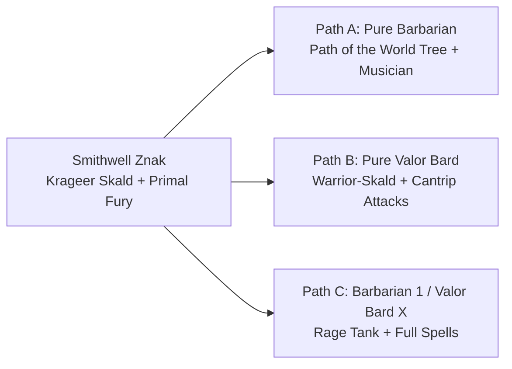

# ⚔️ The Acolytes of Znak — 2024 Character Concepts & Build Workshop

## 📜 Executive Summary & Campaign Context
***The Acolytes of Znak*** follows the second-generation heirs of [[The Order of Znak]] into the mist-shrouded gothic horrors of Barovia (*Curse of Strahd*). Designed for co-op play between Peter and Gary running dual PCs alongside rescued ward [[Yasmina]], the campaign begins at **Level 3** and is projected to conclude around **Level 9 or 10**.

Each character was originally envisioned as a Level 3 heritage multiclass inheriting styles and traditions from their adoptive parents and mentors. However, in the **D&D 2024 / 5.5e ruleset**, starting at Level 3 as a 2/1 multiclass incurs major mechanical bottlenecks:
* **Subclass Postponement:** All 2024 subclasses unlock strictly at **Level 3**. A Level 2/1 multiclass begins Barovia with *zero* subclass features.
* **Delayed Extra Attack & 3rd-Level Spells:** Multiclassing pushes Extra Attack (and game-changing 3rd-level spells like *Revivify*, *Fireball*, or *Spirit Guardians*) from Level 5 to Level 6 or 7—leaving characters significantly underpowered during the brutal mid-game difficulty spikes of Barovia.
* **MAD (Multi-Ability Dependence):** Multiclass requirements force suboptimal stat spreads, particularly for [[Graxxoamo]] (Dex, Wis, Con) and [[Burnice Znak]] (Str, Cha, Con).
* **The 2024 Advantage:** 2024 rules introduce **Origin Feats** (granted at Level 1 via background) and **Weapon Masteries**, allowing characters to inherit mentor mechanics (e.g. *Musician* for skaldic songs, *Magic Initiate* for radiant healing or eldritch blasts, *Nick/Vex* for stealth ambushes) natively **without taking multiclass levels**.

This workshop provides Peter and Gary with three concrete pathways for each character, complete with an intended **Min/Max Level Progression Scheme (Levels 3–10)**:
1. **Path A (Pure Single-Class):** Unlocks subclasses immediately at Level 3, avoids delayed milestones, and uses 2024 origin feats and masteries for mentor flavor.
2. **Path B (Optimized 1-Level Dip):** Takes a surgical 1-level dip for maximum mechanical gain with minimal progression delay.
3. **Path C (Thematic Full Multiclass):** Refines the original 2/1 multiclass vision with an explicit leveling order to minimize dead levels.

---

## 👥 Character Breakdown & Archetype Pathways

### 1. ⚔️ Burnice Znak (Peter's PC)
* **Mentor Heritage:** [[Myagkiy Znak]] (sacrificial healing, radiant protection) + Dark Otherworldly Pact (born from childhood trauma surviving the Leilon kraken cult ritual).
* **Canonical 5e Starting Baseline:**
  * **Level Split:** Paladin 2 (Starting Class) / Warlock 1 (Total Level 3)
  * **Point Buy Stats:** STR 16 (+3) | DEX 8 (-1) | CON 15 (+2) | INT 8 (-1) | WIS 8 (-1) | CHA 16 (+3)
  * **Combat Baseline:** AC 16 (Chain Mail) or AC 18 (Chain Mail + Shield + Spear), HP 27, Speed 30 ft
  * **Feat:** **Polearm Master (PAM)** (Bonus-action 1d4 strike; opportunity attacks on entering reach)
  * **Fighting Style:** **Blind Fighting** (10 ft Blindsight — trained specifically to fight inside [[Graxxoamo]]'s magical darkness!)
  * **Skills & Languages:** Athletics, Religion, Insight, Deception, Intimidation; Common, Giant, Elvish, Draconic
  * **Weapons & Magic:** Glaive, Spear, Longbow; Divine Smite, *Compelled Duel*, *Protection from Good and Evil*, *Thunderous Smite*, *Wrathful Smite*, *Eldritch Blast*, *Green-Flame Blade*, *Armor of Agathys*, *Hex*.

```mermaid
flowchart LR
    BZ[Burnice Znak<br/>STR 16 | CON 15 | CHA 16<br/>Paladin 2 / Warlock 1 (Level 3)<br/>Polearm Master + Blind Fighting] --> PathA[Path A: Pure Paladin<br/>Oath of the Watchers<br/>Lvl 4: Resilient Con -> CON 16<br/>Lvl 5: Extra Attack | Lvl 6: Aura]
    BZ --> PathB[Path B: Paladin X / Warlock 1<br/>Existing 2/1 Hybrid<br/>Pact of the Blade + Short Rest Slots<br/>Lvl 4: Watchers | Lvl 6: Extra Attack]
    BZ --> PathC[Path C: Pure Celestial Warlock<br/>Pact of the Blade + Healing Light<br/>Lvl 5: Thirsting Blade Extra Attack]
```

#### Pathway Comparison

| Feature | Path A: Pure Paladin (Watchers / Vengeance) | Path B: Paladin X / Warlock 1 (Existing 2/1) | Path C: Pure Celestial Blade Warlock |
| :--- | :--- | :--- | :--- |
| **Primary Class** | Paladin (Level 3–10) | Paladin (starts Lvl 2) / Warlock (starts Lvl 1) | Warlock (Level 3–10) |
| **Subclass** | **Oath of the Watchers** or **Vengeance** | Oath of the Watchers / Hexblade or Celestial | **Celestial Patron** |
| **Subclass Online** | **Level 3 (Immediate)** | Level 4 | **Level 3 (Immediate)** |
| **Extra Attack** | **Level 5** | Level 6 | **Level 5 (Thirsting Blade)** |
| **Stat Optimization** | **Str 16, Con 15, Cha 16:** Level 4 Feat (*Resilient: Con*) &rarr; **Con 16 (+3)** (Con save prof for concentration) | Same stat array; delayed ASIs/Feats to Lvl 5 | **SAD:** Cha 16, Con 16 (via feat), Str 15/16 |
| **Weapon Mastery** | 2 Masteries: **Glaive (Graze)** (guaranteed damage on miss) + **Spear (Sap)** (enemy disadvantage) | 2 Masteries (Paladin Lvl 1): Graze + Sap | None (unless taking Weapon Master feat) |
| **Graxxoamo Darkness Synergy** | **10 ft Blind Fighting:** Fights inside Graxx's *Darkness* with permanent Advantage & enemy Disadvantage | **10 ft Blind Fighting:** Fights inside Graxx's *Darkness* with permanent Advantage & enemy Disadvantage | Gains *Devil's Sight* (120 ft darkness vision) |
| **Patron & Spell Core** | Sworn extraplanar hunter (*Watcher's Will* saving throw advantage; extraplanar turning) | *Pact of the Blade* at Warlock 1 (Cha attacks + Force damage) + *Armor of Agathys* | Full Pact Magic + *Healing Light* pool (Myagkiy's healing dice) |

#### Recommended Min/Max Progression Schemes:
* **Path A (Pure Watchers Paladin — Recommended):**
  * *Level 3:* Paladin 3 (Take Oath of the Watchers. Channel Divinity: *Watcher's Will* gives advantage on Int/Wis/Cha saves to self and allies; *Abjure the Extraplanar* turns aberrations, fiends, and elementals).
  * *Level 4:* Paladin 4 (Feat: **Resilient [Constitution]** &rarr; **Con to 16 (+3)**, adds +1 HP/level, and gives proficiency in Constitution saving throws to maintain *Bless*, *Protection from Evil*, or *Hex*).
  * *Level 5:* Paladin 5 (Extra Attack, 2nd-level spells: *Moonbeam*, *Aid*, *Find Steed*).
  * *Level 6:* Paladin 6 (*Aura of Protection* adds +3 to ALL saving throws for party).
  * *Level 7:* Paladin 7 (*Aura of the Sentinel* adds +Proficiency to party initiative).
  * *Level 8:* Paladin 8 (ASI: Charisma or Strength to 18).
  * *Level 9–10:* Paladin 9–10 (3rd-level spells: *Counterspell*, *Revivify*, *Aura of Courage*).
* **Path B (Paladin X / Warlock 1 — Existing 2/1 Hybrid):**
  * *Level 3:* Paladin 2 / Warlock 1 (Heavy armor, Blind Fighting, Divine Smite, *Pact of the Blade* for Charisma weapon attacks, 1 short-rest slot for *Armor of Agathys*).
  * *Level 4:* Paladin 3 / Warlock 1 (Unlock Oath of the Watchers or Vengeance).
  * *Level 5:* Paladin 4 / Warlock 1 (Feat: *Resilient: Con* or Cha to 18).
  * *Level 6:* Paladin 5 / Warlock 1 (Extra Attack unlocks).
  * *Level 7:* Paladin 6 / Warlock 1 (*Aura of Protection*).
  * *Level 8–10:* Paladin 7–9 / Warlock 1 (Paladin aura upgrades and 3rd-level spells).

---

### 2. 🦎 Graxxoamo (Peter's PC)
* **Mentor Heritage:** [[Tvyordiy Znak]] (disciplined agility, unarmed combat, physical resilience) + [[Rhynok]] (ambush predator, wetland stealth, sniper tracking).
* **Canonical 5e Starting Baseline:**
  * **Level Split:** Monk 2 (Starting Class) / Ranger 1 (Total Level 3)
  * **Point Buy Stats:** STR 8 (-1) | DEX 17 (+3) | CON 15 (+2) | INT 8 (-1) | WIS 16 (+3) | CHA 8 (-1)
  * **Combat Baseline:** AC 16 (Natural Armor / Unarmored Defense), HP 25, Speed 30 ft (swimming 30 ft)
  * **Skills (7 Proficiencies):** Acrobatics, Religion, Nature, Athletics, Sleight of Hand, Stealth, Survival
  * **Tools & Languages:** Cooking Utensils, Land Vehicles; Common, Draconic, Giant, Elvish
  * **Key Features:** Favored Enemy (**Undead** — tailor-made for Barovia!), Natural Explorer (**Swamp**), Dedicated Weapon, Hungry Jaws, Bite.
  * **Signature Roleplay Flaw:** An insatiable craving for tribal *"finger sandwiches"* (pickled severed digits).

```mermaid
flowchart LR
    GX[Graxxoamo<br/>DEX 17 | CON 15 | WIS 16<br/>Monk 2 / Ranger 1 (Level 3)] --> PathA[Path A: Pure 2024 Monk<br/>Warrior of Shadow<br/>Lvl 4: Dex 18 / Con 16]
    GX --> PathB[Path B: Monk X / Ranger 1<br/>Hunter's Mark + Weapon Masteries<br/>Lvl 4: Shadow Subclass]
    GX --> PathC[Path C: Monk X / Fighter 1<br/>Blind Fighting + Tactical Mind<br/>10 ft Blindsight in Darkness]
```

#### Pathway Comparison

| Feature | Path A: Pure 2024 Monk (Shadow) | Path B: Monk X / Ranger 1 (Existing 2/1) | Path C: Monk X / Fighter 1 Dip |
| :--- | :--- | :--- | :--- |
| **Primary Class** | Monk (Level 3–10) | Monk (starts Lvl 2) / Ranger (starts Lvl 1) | Monk (starts Lvl 2) / Fighter (starts Lvl 1) |
| **Subclass** | **Warrior of Shadow** | Warrior of Shadow (at Lvl 4) | Warrior of Shadow (at Lvl 4) |
| **Subclass Online** | **Level 3 (Immediate)** | Level 4 | Level 4 |
| **Extra Attack** | **Level 5** | Level 6 | Level 6 |
| **Stat Optimization** | **Dex 17 & Con 15:** Level 4 Dex Half-Feat &rarr; **Dex 18 (AC 17, +7 to-hit)**; Lvl 8 **Chef Feat** &rarr; **Con 16** | Same stat array; delayed ASIs/Feats to Lvl 5 | Same stat array; delayed ASIs/Feats to Lvl 5 |
| **Defensive Core** | Unarmored Defense (AC 16 &rarr; 17), *Deflect Attacks* (reduces melee + ranged damage!) | AC 16, *Deflect Attacks*, 2 Level 1 spell slots | AC 16, *Deflect Attacks*, *Second Wind* |
| **Rhynok Stalker Synergy** | Casts *Darkness* for 1 Focus and **sees through it natively**; at Lvl 6, at-will 60 ft shadow teleport with advantage | 2 free castings of *Hunter's Mark*/day (no slots) + 2 Weapon Masteries (Vex/Nick) | *Blind Fighting* style (10 ft blindsight) + *Tactical Mind* (+1d10 to failed stealth checks) |
| **"Finger Sandwich" Tech** | **Chef Feat (Level 8):** Turns his finger sandwich obsession into temporary HP treats for party | **Chef Feat:** Available at character Level 5 or 9 | **Chef Feat:** Available at character Level 5 or 9 |

#### Recommended Min/Max Progression Schemes:
* **Path A (Pure Warrior of Shadow Monk — Recommended):**
  * *Level 3:* Monk 3 (Warrior of Shadow. 1d6 Martial Arts die, free bonus-action unarmed strike, *Deflect Attacks* reduces damage from ALL attacks by 1d10 + Dex + 3, cast *Darkness* with 1 Focus and see through it natively!).
  * *Level 4:* Monk 4 (Feat: *Athlete*, *Speedy*, or *Weapon Master* &rarr; **Dex to 18 (+4)**. AC becomes 17, attack bonus +7, damage +4).
  * *Level 5:* Monk 5 (Extra Attack, *Stunning Strike*, 1d8 Martial Arts die).
  * *Level 6:* Monk 6 (*Shadow Step* grants at-will 60 ft bonus-action teleport between shadows with Advantage on next attack).
  * *Level 7:* Monk 7 (*Evasion* for zero damage on Dex saves).
  * *Level 8:* Monk 8 (Feat: **Chef Feat** &rarr; **Con to 16 (+3)**, +8 max HP, finger sandwich Temp HP treats).
  * *Level 9–10:* Monk 9–10 (*Acrobatic Movement*, Heightened Focus).
* **Path B (Monk X / Ranger 1 — The Existing 2/1 Hybrid):**
  * *Level 3:* Monk 2 / Ranger 1 (Favored Enemy Undead, 2 free Hunter's Mark/day, Weapon Mastery Nick/Vex, 2 spell slots).
  * *Level 4:* Monk 3 / Ranger 1 (Unlock Warrior of Shadow!).
  * *Level 5:* Monk 4 / Ranger 1 (Dex Half-Feat &rarr; **Dex to 18**).
  * *Level 6:* Monk 5 / Ranger 1 (Extra Attack & Stunning Strike).
  * *Level 7:* Monk 6 / Ranger 1 (Shadow Step).
  * *Level 8–10:* Monk 7–9 / Ranger 1.
* **Path C (Monk X / Fighter 1 Dip — The Blindsight Ambush Master):**
  * *Level 3:* Fighter 1 / Monk 2 (Gain *Blind Fighting* fighting style + Weapon Mastery Nick/Vex + *Second Wind* / *Tactical Mind*).
  * *Level 4:* Fighter 1 / Monk 3 (Warrior of Shadow unlocks).
  * *Level 5:* Fighter 1 / Monk 4 (ASI / Feat &rarr; Dex to 18).
  * *Level 6:* Fighter 1 / Monk 5 (Extra Attack).
  * *Level 7:* Fighter 1 / Monk 6 (Shadow Step).
  * *Level 8–10:* Fighter 1 / Monk 7–9.

---

### 3. 🪓 Smithwell Znak (Gary's PC)
* **Mentor Heritage:** [[Krageer Stoneface Ogolakanu]] (skaldic battle songs, roaring laughter, reckless rage, frontline destruction).
* **Thematic Fantasy:** A charismatic warrior-skald who bolsters allies with songs and battle shouts while cleaving through enemies in a frenzy.



#### Pathway Comparison

| Feature | Path A: Pure Barbarian (World Tree) | Path B: Pure Bard (College of Valor) | Path C: Barbarian 1 / Valor Bard X |
| :--- | :--- | :--- | :--- |
| **Primary Class** | Barbarian (Level 3–10) | Bard (Level 3–10) | Bard (starts Lvl 2) / Barbarian (starts Lvl 1) |
| **Subclass** | **Path of the World Tree** | **College of Valor** | College of Valor (at Lvl 4) |
| **Subclass Online** | **Level 3 (Immediate)** | **Level 3 (Immediate)** | Level 4 |
| **Extra Attack** | **Level 5** | **Level 6 (Cantrip Attack!)** | Level 7 |
| **Rage & Spell Synergy** | **Zero Spell Conflict:** Skald flavor powered by *Musician* Origin Feat | **Zero Rage Lockout:** Full spellcaster weaving songs and battleaxe strikes | Uses Rage as a panic button for boss fights; casts spells outside rage |
| **Frontline Mechanics** | Grants 1d6 Temp HP to allies each turn in rage; Level 6 spectral roots pull foes 30 ft | Medium Armor, Shields, Martial Weapons; Combat Inspiration adds to damage/AC | Con saves proficiency, Unarmored Defense / Medium Armor, Rage resistance |

#### Recommended Min/Max Progression Schemes:
* **Path A (Pure Path of the World Tree Barbarian + Musician Feat — Recommended):**
  * *Level 3:* Barbarian 3 (Path of the World Tree. *Vitality of the Tree* grants Temp HP on rage entry and 1d6 Temp HP to an ally within 10 ft every turn. *Musician* feat grants Heroic Inspiration to allies after every rest. *Primal Knowledge* uses Str for Perception/Survival/Stealth during rage).
  * *Level 4:* Barbarian 4 (Feat: *Great Weapon Master* or Str to 18).
  * *Level 5:* Barbarian 5 (Extra Attack, Fast Movement).
  * *Level 6:* Barbarian 6 (*Branches of the Tree* teleports enemies up to 30 ft into melee as a reaction).
  * *Level 7:* Barbarian 7 (*Feral Instinct* advantage on initiative).
  * *Level 8–10:* Barbarian 8–10 (ASI, Brutal Strike, Spirit of the Tree).
* **Path B (Pure College of Valor Bard):**
  * *Level 3:* Bard 3 (College of Valor. Medium armor, shields, martial weapons, Combat Inspiration).
  * *Level 4:* Bard 4 (Feat: *War Caster* or Cha to 18).
  * *Level 5:* Bard 5 (Font of Inspiration recharges on short rest; 3rd-level spells: *Hypnotic Pattern*).
  * *Level 6:* Bard 6 (Extra Attack allows casting a Cantrip like *Blade Ward* or *True Strike* in place of one attack!).
  * *Level 7–10:* Bard 7–10 (4th & 5th level spells).

---

### 4. 🌿 Shriss (Gary's PC)
* **Mentor Heritage:** [[Myagkiy Znak]] (radiant preservation, life healing) + Mere of Dead Men (swamp nature mystic).
* **Canonical 5e Starting Baseline:**
  * **Level Split:** Druid 2 (Starting Class — Circle of the Land: Swamp) / Cleric 1 (Life Domain) (Total Level 3)
  * **Point Buy Stats:** STR 15 (+2) | DEX 8 (-1) | CON 15 (+2) | INT 10 (+0) | WIS 16 (+3) | CHA 10 (+0)
  * **Combat Baseline:** AC 18 (Chain Mail + Wooden Shield), HP 24, Speed 30 ft (swimming 30 ft)
  * **Background:** Sage (History, Survival; Researcher feature; Languages: Orc, Elvish)
  * **Skills & Languages:** Medicine, Arcana, History, Survival, Nature, Perception; Common, Draconic, Orc, Elvish
  * **Wild Shape Forms:** Spider (stealth scout), Giant Lizard (mount/climber), Giant Poisonous Snake (10 ft reach, venom, blindsight)
  * **Key Features:** Heavy Armor Proficiency (Life Domain), Disciple of Life, Natural Recovery (recharge 1 slot on short rest), Hungry Jaws, Bite.
  * **Full Wisdom Spell Loadout (DC 13, +5 to-hit):** 4 Level 1 slots, 2 Level 2 slots (upcasting!).
    * *Druid Cantrips (3):* *Guidance*, *Shillelagh*, *Thorn Whip* (Bonus cantrip)
    * *Druid Prepared Spells (5):* *Charm Person*, *Faerie Fire*, *Goodberry*, *Ice Knife*, *Thunderwave*
    * *Cleric Cantrips (3 Recommended):* *Sacred Flame*, *Toll the Dead*, *Thaumaturgy*
    * *Cleric Domain Spells (Always Prepared):* *Bless*, *Cure Wounds*
    * *Cleric Prepared Spells (4 Recommended):* *Healing Word*, *Guiding Bolt*, *Sanctuary*, *Detect Magic*

```mermaid
flowchart LR
    SH[Shriss<br/>STR 15 | CON 15 | WIS 16<br/>Druid 2 [Swamp] / Cleric 1 [Life]<br/>AC 18 Heavy Armor | Full Wisdom Caster] --> PathA[Path A: Pure 2024 Druid<br/>Circle of the Stars<br/>Chalice Form Healing Bursts<br/>Lvl 4: Resilient Con -> CON 16]
    SH --> PathB[Path B: Druid 2 / Life Cleric 1<br/>Existing Hybrid (AC 18)<br/>Level 2 Spell Slots at Start<br/>Disciple of Life Healing Engine]
    SH --> PathC[Path C: Pure Life Cleric<br/>Protector Heavy Armor + Channel Divinity<br/>Magic Initiate Druid: Shillelagh & Goodberry]
```

#### Pathway Comparison

| Feature | Path A: Pure Druid (Circle of the Stars) | Path B: Druid 2 / Life Cleric 1 (Existing 2/1) | Path C: Pure Life Domain Cleric |
| :--- | :--- | :--- | :--- |
| **Primary Class** | Druid (Level 3–10) | Druid (starts Lvl 2) / Cleric (starts Lvl 1) | Cleric (Level 3–10) |
| **Subclass** | **Circle of the Stars** | Circle of the Land (Swamp) & Life Domain | **Life Domain** |
| **Subclass Online** | **Level 3 (Immediate)** | Level 3 (Druid Subclass Active!) | **Level 3 (Immediate)** |
| **Spell Slots** | 4 Lvl 1, 2 Lvl 2 | 4 Lvl 1, 2 Lvl 2 (Full Caster Multi!) | 4 Lvl 1, 2 Lvl 2 |
| **Stat Optimization** | **Str 15, Con 15, Wis 16:** Level 4 Feat (*Resilient: Con*) &rarr; **Con 16 (+3)** (Proficiency in Con saves) | Same stat array; delayed ASIs/Feats to Lvl 5 | Same stat array; delayed ASIs/Feats to Lvl 5 |
| **Healing Engine** | *Chalice Form:* Every healing spell heals an **additional 1d8 + Wis HP** to self/ally | *Disciple of Life:* 2 + Spell Level extra HP on all healing spells | *Disciple of Life:* 2 + Spell Level extra HP; *Preserve Life* Channel Divinity |
| **Radiant Offensive** | *Archer Form:* Bonus-action radiant laser (1d8 + Wis radiant damage, 60 ft range) | *Guiding Bolt*, *Sacred Flame*, *Toll the Dead*, *Ice Knife* | *Radiant Strikes*, *Spiritual Weapon*, *Spirit Guardians* |
| **Armor & Defense** | Medium Armor + Shield (AC 16–18) | **Heavy Armor + Shield (AC 18 Chain Mail!)** | **Heavy Armor + Shield (AC 18 Chain Mail!)** |

#### Recommended Min/Max Progression Schemes:
* **Path A (Pure Circle of the Stars Druid — Recommended):**
  * *Level 3:* Druid 3 (Circle of the Stars. Free *Guiding Bolt* casts PB/day without spell slots. Starry Form: Chalice adds massive healing bursts; Archer adds radiant ranged bonus attacks; Dragon ensures concentration never breaks).
  * *Level 4:* Druid 4 (Feat: **Resilient [Constitution]** &rarr; **Con to 16 (+3)**, adds +1 HP/level, and gives Con saving throw proficiency).
  * *Level 5:* Druid 5 (3rd-level spells on time: *Revivify*, *Call Lightning*, *Plant Growth*).
  * *Level 6:* Druid 6 (*Cosmic Omen* adds 1d6 bonus to ally rolls or subtracts 1d6 from enemies).
  * *Level 7–10:* Druid 7–10 (4th & 5th level spells).
* **Path B (Druid X / Life Cleric 1 — The Existing 2/1 Hybrid):**
  * *Level 3:* Druid 2 / Cleric 1 (AC 18 Chain Mail + Shield, Disciple of Life, Natural Recovery, 2nd-level spell slots).
  * *Level 4:* Druid 3 / Cleric 1 (Swamp domain spells: *Darkness*, *Melf's Acid Arrow*).
  * *Level 5:* Druid 4 / Cleric 1 (Feat: *Resilient: Con* &rarr; Con to 16).
  * *Level 6:* Druid 5 / Cleric 1 (3rd-level spells: *Revivify*, *Call Lightning*).
  * *Level 7–10:* Druid 6–9 / Cleric 1 (Land's Stride, Nature's Ward, 4th & 5th level spells).
* **Path C (Pure Life Domain Cleric with Druid Magic Initiate):**
  * *Level 3:* Cleric 3 (Life Domain. *Protector* order for heavy armor. *Magic Initiate: Druid* gives *Shillelagh*, *Guidance*, and *Goodberry*).
  * *Level 4:* Cleric 4 (Feat: *Resilient: Con* &rarr; Con to 16).
  * *Level 5:* Cleric 5 (3rd-level spells on time: *Spirit Guardians*, *Revivify*).
  * *Level 6–10:* Cleric 6–10 (Blessed Healer, Divine Strike).

---

### 5. 🔮 Yasmina (NPC / Party Ward)
* **Origin:** Rescued as a child from a Night Hag in *"Keeping the Faith"*; dark witch/hag lineage.
* **Thematic Fantasy:** An elusive, tricky young witch wielding uncanny hag magic and eldritch manipulation.

#### Pathway Comparison
* **Path A (Pure 2024 Archfey Patron Warlock — The Coven Witch):**
  * *Subclass:* **Archfey Patron** (The definitive hag/witch subclass in 2024!).
  * *Mechanics:* *Steps of the Fey* grants free *Misty Step* casts PB times/day. Each teleport triggers hag riders: *Taunting Step* (disadvantage on attacks against anyone else), *Misty Slam* (2d6 psychic damage + push), or *Refreshing Step* (teleports an ally). At Level 6, *Beguiling Defenses* teleports as a reaction to taking damage.
  * *Pact Boon:* *Pact of the Tome* (Book of Shadows with 3 cantrips and ritual casting) or *Pact of the Chain* (Hag-like familiar: Quasit, Imp, or Sprite).
* **Path B (Pure 2024 Fiend Patron Warlock):**
  * *Subclass:* **Fiend Patron** (*Dark One's Blessing* grants Temp HP on kills; *Dark One's Own Luck* adds 1d10 to ability checks/saves).

---

## 📊 Summary Comparison: Multi-Class vs Single-Class Trade-Offs

| Character | Original 2/1 Multiclass Challenge | 2024 Single-Class Solution | 2024 1-Level Dip Solution |
| :--- | :--- | :--- | :--- |
| **Burnice** | MAD (Str/Cha/Con); delayed Extra Attack | **Oath of the Watchers Paladin** (Magic Initiate Warlock) | **Paladin 2 / Warlock 1** (Pact of the Blade for Cha attacks) |
| **Graxxoamo** | Severe MAD (Dex/Wis/Con); bonus-action clog | **Warrior of Shadow Monk** (native darkness sight + 60 ft teleport) | **Fighter 1 / Monk 2** (Blind Fighting + Weapon Mastery) |
| **Smithwell** | Rage locks out all Bard spellcasting | **Path of the World Tree Barbarian** + *Musician* Feat | **Barbarian 1 / College of Valor Bard X** |
| **Shriss** | "Lifeberry" 2024 rule revision | **Circle of the Stars Druid** (*Chalice* equals Life healing) | **Life Cleric 1 / Swamp Druid X** (Heavy Armor + Disciple of Life) |
| **Yasmina** | Delayed pact magic progression | **Archfey Patron Warlock** (Hag witchcraft & Misty Step riders) | **Cleric 1 / Archfey Warlock X** |

---

## 💡 Workshop Discussion Prompts for Peter & Gary
1. **Graxxoamo's Playstyle:** Do you prefer Graxxoamo as an agile martial artist teleporting through magical darkness with devastating unarmed strikes (Single-Class Shadow Monk), or do you want early weapon masteries and blindsight via a 1-level Fighter dip?
2. **Burnice's Patron Power:** Does Burnice feel more true as a holy inquisitor who turns extraplanar horrors using Oath of the Watchers, or as a SAD Charisma weapon warrior dipping 1 level into Warlock for *Pact of the Blade*?
3. **Smithwell's Skaldic Roar:** For Gary, does Path of the World Tree Barbarian (giving party Temp HP every turn and using the *Musician* feat for inspiration) fulfill Krageer's legacy better than a College of Valor Bard who casts spells instead of raging?
4. **Shriss's Healing Output:** Would Gary prefer the celestial constellation healing of Circle of the Stars Druid (laser blasts + chalice healing bursts), or the armored frontline resilience of a Life Domain Cleric?

---

*Related Notes:*
* [[The Acolytes of Znak Campaign Plan]]
* [[Burnice Znak]] | [[Graxxoamo]] | [[Smithwell Znak]] | [[Shriss]] | [[Yasmina]]
* [[The Order of Znak]] | [[Myagkiy Znak]] | [[Tvyordiy Znak]] | [[Krageer Stoneface Ogolakanu]] | [[Rhynok]]
