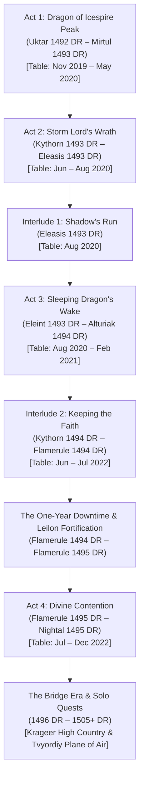

# 📜 Campaign Timeline & The Calendar of Harptos

The complete in-universe chronology of **[[The Order of Znak]]** across the Sword Coast, mapped to the official **Calendar of Harptos** and **Dale Reckoning (DR)** reckoning of the Forgotten Realms.

---

## 📅 The Calendar of Harptos Reference

In the Forgotten Realms, a year consists of 365 days divided into **twelve months of 30 days each** (each month composed of three 10-day weeks called **tendays**), plus **five annual festival days** placed between months that are not part of any month:

| Month # | Month Name | Common Name | Seasonal Marker / Festival Days |
| :---: | :--- | :--- | :--- |
| **1** | **Hammer** | *Deepwinter* | Annual Festival: **Midwinter** (between Hammer and Alturiak) |
| **2** | **Alturiak** | *The Claw of Winter* | The coldest, harshest winter month |
| **3** | **Ches** | *The Sunset* | Spring Equinox (Ches 19) |
| **4** | **Tarsakh** | *The Storms* | Annual Festival: **Greengrass** (between Tarsakh and Mirtul) |
| **5** | **Mirtul** | *The Melting* | Spring thaw and early blossoms |
| **6** | **Kythorn** | *The Time of Flowers* | Summer Solstice (Kythorn 20) |
| **7** | **Flamerule** | *Summertide* | Annual Festival: **Midsummer** (between Flamerule and Eleasis; followed by **Shieldmeet** leap day every 4 years) |
| **8** | **Eleasis** | *Highsun* | The heat of high summer |
| **9** | **Eleint** | *The Fading* | Autumn Equinox (Eleint 21); Annual Festival: **Highharvestide** (between Eleint and Marpenoth) |
| **10** | **Marpenoth** | *Leafall* | Autumn chill and falling leaves |
| **11** | **Uktar** | *The Rotting* | Annual Festival: **The Feast of the Moon** (between Uktar and Nightal) |
| **12** | **Nightal** | *The Drawing Down* | Winter Solstice (Nightal 20) |

---

## 🗺️ Master Campaign Chronology (1492 DR – 1505+ DR)

---

### 🏔️ Act 1: Dragon of Icespire Peak
* **In-Universe Timing:** **Uktar 1492 DR – Mirtul 1493 DR** (*The Year of Three Ships Sailing* to *The Year of the Raised Banner*)
* **Table Play Period:** November 10, 2019 – May 31, 2020 (32 recorded play sessions)
* **Chronicle:** [[01 - Act 1 - Dragon of Icespire Peak]]
* **Timeline Progression:**
  - **Uktar 1492 DR (The Rotting / Late Autumn):** Four sellswords arrive in Phandalin; Townmaster Harbin Wester posts bounties; delving into Gnomengarde to slay the barrel mimic; Dwarven Excavation at the Temple of Abbathor (Abbathor statue trap & Sending Stones claimed).
  - **The Feast of the Moon & Nightal 1492 DR (The Drawing Down / Early Winter):** Manticore siege at Umbrage Hill; Butterskull Ranch outhouse ambush; Cryovain aerial manticore dominance witnessed; first foray into Neverwinter Wood (one-eyed goat ruse and blights retreat at Woodland Manse).
  - **Hammer 1493 DR (Deepwinter):** Rescuing loggers from ankhegs; shelter at Falcon's Hunting Lodge; Tower of Storms lighthouse sea-cliff assault (piercing Moesko's heart, Rhynok awarded +1 Longbow); 2,500 gp gold bell heist at the Shrine of Savras; Mountain's Toe Gold Mine wererat immunity lesson; silvering weapons in Phandalin.
  - **Alturiak 1493 DR (The Claw of Winter):** Rappelling down the chimney to purge Axeholm (Dread Helm claimed); Dragon Barrow expedition (slaying Invisible Stalker, claiming Lady Tanamere's *Dragon Slayer* Longsword, enlisting Xanth the Centaur).
  - **Ches – Tarsakh 1493 DR (Spring Equinox & The Storms):** Ambushing Yargath's patrol; storming the Circle of Thunder (slaying Flenz, Narux, and Gorthok the Thunder Boar); cleansing the Woodland Manse; Rhynok awarded Boots of Elvenkind.
  - **Greengrass & Mirtul 1493 DR (The Melting / Late Spring):** Ascending blizzard-swept Sword Mountains; storming Icespire Hold; Tvyordiy's clutch Stunning Strikes; Krageer slaying **[[Cryovain]]** atop the frozen roof.

---

### ⛈️ Act 2: Storm Lord's Wrath
* **In-Universe Timing:** **Kythorn 1493 DR – Eleasis 1493 DR** (*The Year of the Raised Banner*, Summer)
* **Table Play Period:** June 13, 2020 – August 10, 2020
* **Chronicle:** [[02 - Act 2 - Storm Lord's Wrath]]
* **Timeline Progression:**
  - **Kythorn 1493 DR (The Time of Flowers / Early Summer):** Secret Waterdeep commission from Lars Drumbuckle and Orson Longfellow; breaking the Myrkulite undead siege at The Wayside Inn; Krageer's courtship of Cooragh begins.
  - **Flamerule 1493 DR (Summertide):** Marching north to ruined Leilon; repelling Dark Tide Knights; slaying Nixoxious and water elementals at the quayside; adopting orphaned wards Smithwell and Burnice; founding of Aufox Manor under majordomo Leopold.
  - **Midsummer & Eleasis 1493 DR (Highsun / Late Summer):** Hunting the shapeshifting anchorites; assault on Thunder Cliffs; mutiny on the *Iceflow*; Mere of Dead Men expedition (slaying Matriarch Qolzaz, negotiating lasting alliance with sovereign Grixxugroaz).

---

### 🌑 Interlude 1: "Shadow's Run"
* **In-Universe Timing:** **Late Eleasis 1493 DR** (*The Year of the Raised Banner*, Late Summer)
* **Table Play Period:** August 11, 2020 – August 23, 2020 (DM: Gary)
* **Chronicle:** [[03 - Interlude 1 - Shadow's Run]]
* **Timeline Progression:**
  - **Eleasis 1493 DR:** Commissioned by Daniel Renault's servants Liefold and Joffrey; carriage journey 55 miles north of Neverwinter; owlbear road ambush; 15-mile trek into uncharted forest; infiltrating multi-level cult redoubt; recovering the four ritual stones; unlocking the basalt Dragon Door; slaying the Shadow Dragon and cult vanguard; rescuing young Heracio Renault.

---

### 🐲 Act 3: Sleeping Dragon's Wake
* **In-Universe Timing:** **Eleint 1493 DR – Alturiak 1494 DR** (*The Year of the Raised Banner* to *1494 DR*)
* **Table Play Period:** August 28, 2020 – February 26, 2021
* **Chronicle:** [[04 - Act 3 - Sleeping Dragon's Wake]]
* **Timeline Progression:**
  - **Eleint 1493 DR (The Fading / Highharvestide):** Returning to Aufox Manor; breaking the sahuagin siege at the Salt Caves of Leilon Point (Rhynok's Adamantine Net debut).
  - **Marpenoth 1493 DR (Leafall):** Clearing the stranded Talosite warship *The Relentless* (slaying Gol Badwind, Level 10 milestone); scouring Iniarv's Tower in the Mere of Dead Men (slaying chimera Ashbreath, surviving roof collapse).
  - **Uktar 1493 DR (The Rotting / The Feast of the Moon):** Ambushing orcs at the sea cliffs; parleying with brass dragon Lhammaruntosz at the Bronze Shrine; banishing demonic Alkilith.
  - **Nightal 1493 DR – Hammer 1494 DR (The Drawing Down to Deepwinter):** Overland journey to Kryptgarden Forest; infiltrating Deeping Cave; subterranean boiling acid relay; slaying deathlock warlock Viantha Cruelhex; parley with ancient green wyrm Claugiyliamatar.
  - **Alturiak 1494 DR (The Claw of Winter):** Dracolich Ebondeath possesses Claugiyliamatar; extracting the poisoned hoard via Tvyordiy's monastic poison immunity; bluffing The Gnawbones druids; Level 11 Milestone reached.

---

### 🔥 Interlude 2: "Keeping the Faith"
* **In-Universe Timing:** **Kythorn 1494 DR – Flamerule 1494 DR** (*1494 DR*, Summer)
* **Table Play Period:** June 17, 2022 – July 22, 2022 (DM: Gary)
* **Chronicle:** [[05 - Interlude 2 - Keeping the Faith]]
* **Timeline Progression:**
  - **Kythorn 1494 DR:** Emergency summons to Forge Cleric Flanning Teldorer's mountain forge in the Crags; partnering with prodigy apprentice Dayne Beltran (Level 13); investigating Neverwinter heart-consuming serial murders; slaying Graag the Werebear; Starmetal Hills cavern (Chain Devil confrontation and discovery of Barovian parchment).
  - **Flamerule 1494 DR:** Tracking Balheelsa the Night Hag into Neverwinter Wood; liberating young Yasmina; descending into the molten caldera of Mount Hotenow; Krageer's "Double-Enlarge" titan wrestling match against Fire Giant Queen Kevlaan the Merciless; recovering the Right Hand of Gond.
  - **Midsummer 1494 DR:** Gond's divine blessings bestowed (4 feats: *Crusher*, *Resilient Con*, *Lucky*, *Poisoner*); Dayne's +2 Plate Armor crafted for Myagkiy (24 AC).

---

### ⏳ The One-Year Downtime
* **In-Universe Timing:** **Flamerule 1494 DR – Flamerule 1495 DR**
* **World Events & Party Growth:**
  - Lord Protector Dagult Neverember returns from political hiatus, deploying Neverwinter gold and architects to heavily fortify Leilon.
  - Majordomo Leopold manages Aufox Manor, beginning early martial training for adopted wards Smithwell and Burnice alongside young Yasmina.
  - Rhynok attunes to his newly tailored ***Cloak of Elvenkind***.
  - The Order consolidates their Level 11 martial abilities and regional influence.

---

### ⚡ Act 4: Divine Contention
* **In-Universe Timing:** **Flamerule 1495 DR – Nightal 1495 DR** (*1495 DR*, Summer to Winter Solstice)
* **Table Play Period:** July 24, 2022 – December 18, 2022
* **Chronicle:** [[06 - Act 4 - Divine Contention]]
* **Timeline Progression:**
  - **Flamerule 1495 DR (Summertide):** Recovering Gnomengarde munitions at Dumathoin's Gulch; Tvyordiy infected with wereboar lycanthropy; defending the planar beacon atop the House of Thalivar against Star Spawn Manglers; claiming The Ruinstone and Krageer's *Ultima Exodus* greataxe.
  - **Eleasis 1495 DR (Highsun):** Diplomatic voyage to Castle Never aboard Captain Deloz Montiv's *Twinkle and Icingdeath*; Krageer swaying Dagult Neverember; high seas fleet battle against Galas Windrage's reavers.
  - **Eleint 1495 DR (The Fading / Highharvestide):** The Great Siege of Leilon; dracolich-possessed Claugiyliamatar attacks town center; Boneclaw quayside ambush; Councilor Valdi rescued; Aubrey Silverspun revealed as an immortal ghost guardian.
  - **Marpenoth 1495 DR (Leafall):** Descending into the sunken mausoleum of Ebondeath in the Mere; exorcising Ebondeath from Tvyordiy via Myagkiy's *Guiding Bolt*.
  - **Uktar – Nightal 1495 DR (The Rotting to Winter Solstice):** Sailing *Twinkle* into the heart of a divine hurricane; boarding the Talosite dreadnaught; subduing Fheralai Stormsworn before the colossus of Talos; destroying the Air Elemental Myrmidons and Ub-Vhagga the Nalfeshnee; escaping the sinking wreckage via Myagkiy's *Word of Recall*. Level 13 Milestone reached!

---

### 🌫️ The Bridge Era & Solo Quests (1496 DR – 1505+ DR)
* **Chronicles:** [[07 - Epilogue - Bridge Campaign]], [[07a - Bridge - Krageer - The Stone and the Skillet]], [[07b - Bridge - Tvyordiy - The Breath of the Boundless Sky]]
* **Timeline Progression:**
  - **1496–1500 DR:** A decade of peace in Leilon; Aufox Manor serves as the training hub for the next generation (The Acolytes of Znak: Burnice, Smithwell, Yasmina, Graxxoamo, Shriss).
  - **1500–1504 DR:** Krageer and Cooragh journey north to the Spine of the World; four winters in the high country; uniting the Four Fires (War of Milagove, Fighter 5); slaying Hrimgarra the Pale Widow in the Glass Hall (Fighter 6, Level 15); the Binding of Stones wedding feast.
  - **1500–1505 DR:** Tvyordiy departs Leilon following an Auran dying whisper; pilgrimage to Grandfather Tree; scaling Mount Nimbus with Yeri; entering the Elemental Plane of Air; reuniting with siblings Deekek and Klee'errk; battling the Avatar of Talos; attaining Timeless Body (Level 15); returning to Toril to establish the courtyard dojo.
  - **1505 DR:** Burnice's Sending Stone call summons Krageer and the Order back to The Wayside Inn to inaugurate the Bridge Campaign.
