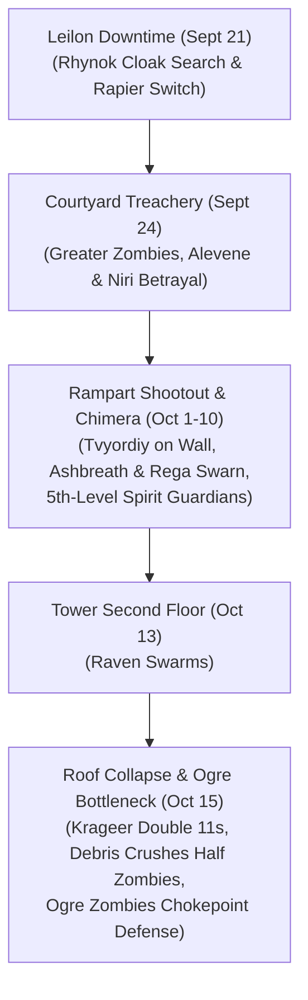

# 🏰 Iniarv's Tower

## 📜 In-Universe Lore & Geography
* **Geographic Position:** Located in the northern reaches of the **[[Mere of Dead Men]]**, approximately twenty-five miles south of [[Leilon]] along the overgrown fringes of the High Road.
* **Historical Lore:** Originally built centuries ago by the archmage **Iniarv**, a legendary wizard of ancient Netheril. During the Goblin Wars, Iniarv invoked catastrophic planar magic to summon the ocean tides inward, drowning the armies of goblinoids and humans alike and transforming the entire region into the cursed swamp known as the Mere of Dead Men.
* **Architectural Layout:** The ruins center around an ancient 80-foot cylindrical stone tower surrounded by crumbling curtain walls, a muddy overgrown courtyard, and ruined battlements. In the late 15th century DR, cultists aligned with **[[Ularan Mortus]]** and the Cult of the Dragon turned the ruins into an operational staging ground.

---

## ⚔️ The Siege of Iniarv's Tower (*Sleeping Dragon's Wake*)
*(September 21 – October 15, 2020 | Level 10)*

Following their victory over the ghost ship *The Relentless*, **[[The Order of Znak]]** accepted a contract from Leilon's town council to purge the ruins of Iniarv's Tower to protect southern trade lines.

---

### 1. Courtyard Skirmish & The Traitorous Chimera Crew
*(September 24, 2020)*
Arriving through the trackless mist of the swamp:
* Entering the muddy courtyard, the Order encountered loose **Greater Zombies** and rushed to the aid of two seemingly distressed women: **[[Alevene Windcoat]]** and **[[Niri Bronzecrown]]**.
* **The Sudden Betrayal:** The instant the Greater Zombie pack was whittled down to a single standing corpse, Alevene and Niri violently turned on the champions, revealing themselves as undercover members of the chimera crew! Caught red-handed, the party executed both traitors alongside the remaining zombie.

---

### 2. The Battlement Shootout & Chimera Ashbreath
*(October 1 – 10, 2020)*
* **Failed Deception:** Calling up to the cult scouts garrisoned on the battlements, Myagkiy, Rhynok, and Krageer attempted to bluff and persuade them they were friendly reinforcements. The deception failed, and archers opened fire with arrow volleys.
* **Assaulting the Walls:** Rhynok took cover to return sniper fire with his +1 Longbow. Tvyordiy and Krageer charged across the courtyard. Using unarmored agility, Tvyordiy scaled the 80-foot tower masonry directly, taking on the archers atop the ramparts in close-quarters melee while Krageer held the courtyard below.
* **Aerial Assault by Ashbreath & Rega Swarn:** Cult leader **[[Rega Swarn]]** and her bonded three-headed Chimera **[[Ashbreath]]** dove into the fight, unleashing a blistering 15-foot cone of *Fire Breath* (Tvyordiy rolling a 23 Dex save, Krageer 7/10).
* **Tvyordiy Down & Divine Restoration:** Tvyordiy was battered down to 0 HP during the clash atop the ramparts, but Myagkiy restored him with divine healing. As additional Greater Zombies flooded the courtyard, Myagkiy upcast a 5th-level ***Spirit Guardians*** (dealing 24, 21, 23 radiant damage), vaporizing the Chimera and disintegrating the undead. The party took a short rest to bandage wounds.

---

### 3. Second Floor & Raven Swarms
*(October 13, 2020)*
Breaching the tower door, the Order ascended to the second floor, fighting off dense swarms of agitated ravens nesting in the shadowed rafters before pushing toward the upper levels.

---

### 4. The Roof Collapse & Krageer's Double 11s
*(October 15, 2020)*
Investigating the crumbling upper floor:
* Krageer stepped onto a decayed, structurally compromised section of the stone roof.
* The ceiling collapsed catastrophically, plunging Krageer directly through the floor into a lower chamber packed with zombies!
* **The DC 12 Debris Saves:** The falling masonry forced a DC 12 Dexterity saving throw on all occupants:
  * Krageer rolled with *Danger Sense* (advantage) but rolled **double 11s** (`11 11`), failing the DC 12 save and taking the full brunt of the crushing rubble and fall.
  * Half of the zombies failed their DC 12 saves and were crushed to death outright under tons of fallen stone!

---

### 5. The Ogre Zombies Doorway Bottleneck
* The surviving undead included colossal **Ogre Zombies**.
* Rather than fighting openly in the crowded chamber, the Order tactically held the narrow doorway of the main tower: the massive bulk of the Ogre Zombies bottlenecked the threshold, physically preventing the rest of the undead from pouring out and surrounding the party.
* Weakened by the ceiling collapse, the Ogre Zombies were methodically cut down and crushed in the doorway one by one.
* With the tower cleansed, the Order returned to Leilon to rest and recuperate.

---

## 👥 Key NPCs & Figures Associated
* **[[Rega Swarn]]:** Cult commander who rode the Chimera Ashbreath.
* **[[Ashbreath]]:** Bonded three-headed Chimera that unleashed *Fire Breath*.
* **[[Alevene Windcoat]] & [[Niri Bronzecrown]]:** Traitorous chimera crew members killed in the courtyard.
* **[[The Order of Znak]]:** Victorious liberators of the ruins.

---

## 📚 Sources & Canon References
* **Official Adventure Module:** *Sleeping Dragon's Wake* (Quest: "Iniarv's Tower")
* **Campaign Session Dates:** September 21, September 24, October 1, 10, 13, and 15, 2020 (Roll20 & Discord Logs)
