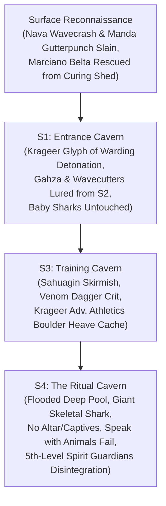

# 🌊 Leilon Point & The Salt Caves

## 📜 In-Universe Lore & Geography
* **Geographic Position:** A rugged, windswept coastal promontory situated approximately ten miles northwest of [[Leilon]], perched along the rocky shoreline overlooking the Sea of Swords.
* **Surface Outpost:** Established as a satellite fishing outpost and lookout encampment supporting the rebuilding of Leilon. Local structures consist of simple timber cabins, a fish-curing storehouse, a general supply hut, and a modest roadside Shrine to Umberlee.
* **Subterranean Salt Caves:** Carved into the cliffs below the promontory lies a network of natural tidal caverns known as the **Salt Caves** (historically used for storing and curing salted cod). During *Sleeping Dragon's Wake*, these caves were infiltrated and occupied by a war band of [[Sahuagin]] serving the shark-god Sekolah.

---

## ⚔️ The Liberation of Leilon Point (*Sleeping Dragon's Wake*)
*(August 28 – September 1, 2020 | Level 9)*

### 1. Surface Reconnaissance & Tragic Discoveries
Arriving at Leilon Point on August 28, 2020, **[[The Order of Znak]]** found the surface village completely deserted and eerie beneath the coastal fog:
* **The Slain Priestess:** At the Shrine of Umberlee, [[Myagkiy Znak]] discovered the bloodied corpse of priest **[[Nava Wavecrash]]** slumped over the desecrated altar (Medicine & Religion checks).
* **The Supply Hut:** Searching the ransacked supply shed, [[Krageer Stoneface Ogolakanu]] found the lifeless body of storekeeper **[[Manda Gutterpunch]]** (Investigation & Medicine checks).
* **The Sole Survivor:** Approaching the fish-curing storehouse, [[Rhynok]] and Myagkiy rolled high Persuasion checks to coax out a terrified survivor hiding among the curing racks: local fisher **[[Marciano Belta]]**. Marciano explained that the sahuagin had overwhelmed the settlement without warning, slaughtered everyone in sight, and dragged all loot into the **Salt Caves** below the cliffs.
* **Zero Exterior Fighting:** The Order encountered zero resistance on the cliffs, open beaches, or surf. All combat occurred strictly inside the subterranean **Salt Caves (S1–S4)**.

---

### 2. S1: Entrance Cavern & The Glyph Detonation
*(August 28, 2020)*
Descending into the sea spray of the entrance cavern (S1):
* Krageer moved forward to examine bodies strewn across the stone floor, accidentally triggering a hidden **Glyph of Warding**.
* The magical ward detonated with a concussive blast (`5d8` explosive damage; party rolling Dexterity saves).
* The thunderous explosion alerted the adjacent barracks cavern (S2), immediately drawing out High Priestess **[[Gahza]]** and a strike force of four-armed Sahuagin Blademasters wielding jagged *Wavecutter Blades*.
* Combat erupted across the cavern: Rhynok snared charging warriors with his newly forged **Adamantine Net** (`27 to-hit`), Krageer cleaving with his Adamantine Greataxe, Myagkiy casting *Spirit Guardians*, and Tvyordiy battering foes with his *Vicious Quarterstaff*.
* In the cave pool, a thrashing swarm of **baby sharks** (mechanically using the swarm of quippers statblock) thrashed in the water; the party recognized them and left them completely untouched.

---

### 3. S3: The Training Cavern & The Boulder Cache
*(August 31, 2020)*
Pushing through the rocky tunnels into the sahuagin training area (S3):
* The Order ambushed a squad of regular sahuagin warriors and an elite blademaster.
* Rhynok struck from the dark with Gloom Stalker invisibility, driving his ***Dagger of Venom*** into the blademaster with a natural 20 critical hit (`29 to-hit`, 10 piercing + 16 poison damage), dropping the sea devil instantly.
* Krageer and Tvyordiy mopped up the remaining warriors.
* Following the clash, Krageer rolled a **22 Investigation check**, discovering a hidden cache concealed behind a massive boulder.
* Rolling an **Athletics check with Advantage**, Krageer heaved the heavy boulder aside, uncovering the sahuagin treasure before the party took a short rest to bandage wounds.

---

### 4. S4: The Ritual Cavern & The Giant Skeletal Shark
*(September 1, 2020)*
Breaching the lowest grotto (S4), the champions entered a vast cavern dominated by a deep, flooded subterranean pool. In accordance with table events, **there was no altar and there were no captives** down here—only a dark summoning pool attended by priestesses and an enormous, animated **Giant Skeletal Shark**:
* **Krageer's Interspecies Dialogue:** Spotting the undead monster circling in the deep pool, Krageer cast ***Speak with Animals*** attempting to reason with or interrogate the skeletal beast—only to discover that a mindless undead shark composed purely of animated bones has absolutely nothing to say.
* **Closing the Distance:** Resigning to brute violence, Krageer rolled a **28 Athletics check** to close the gap and carve into the skeletal shark with his Adamantine Greataxe (`15 + 8 slashing`).
* **The Priestess's Spells:** An attending priestess attempted to turn the tide, casting ***Hold Person*** on Tvyordiy (which the monk shook off with a **20 Constitution save**) and casting ***Mass Healing Word***.
* **Radiant Disintegration:** Stepping to the edge of the pool, Myagkiy upcast ***Spirit Guardians*** to **5th level**, flooding the flooded grotto with searing divine light that disintegrated the skeletal shark into waterlogged bone fragments. Rhynok drove a critical sniper arrow from his +1 Longbow (`31 to-hit`, 13 piercing + 4 sneak attack) into the priestess, ending the battle.

---

### 5. Aftermath & Return to Leilon
With the Salt Caves purged and sole survivor **[[Marciano Belta]]** in tow, the Order secured Leilon Point and returned to [[Leilon]]. Stopping into **[[The Umber Hulk's Shell Inn]]** to celebrate, innkeeper **[[Alion Malwyn]]** relayed the rumor of the bronze dragon flying north with a dolphin, pointing toward their future adventures.

---

## 👥 Key NPCs & Figures Associated
* **[[Marciano Belta]]:** Sole surviving fisher found hiding in the curing shed.
* **[[Nava Wavecrash]]:** Priest of Umberlee slain at the roadside shrine.
* **[[Manda Gutterpunch]]:** Storekeeper found slain in the supply hut.
* **[[Gahza]]:** Sahuagin High Priestess of Sekolah who commanded the raid.
* **[[The Order of Znak]]:** Liberators of Leilon Point and the Salt Caves.

---

## 📚 Sources & Canon References
* **Official Adventure Module:** *Sleeping Dragon's Wake* (Quest: "Leilon Point")
* **Campaign Session Dates:** August 28, August 31, and September 1, 2020 (Roll20 & Discord Logs)
