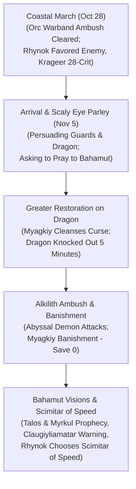

# ⚡ The Bronze Shrine

## 📜 In-Universe Lore & Geography
* **Geographic Position:** Perched atop sheer coastal cliffs approximately thirty miles north of [[Leilon]], overlooking the turbulent waters of the Sea of Swords.
* **Architectural Wonder:** Carved directly into the sea cliffs by ancient artisans, the entrance of the sanctuary is sculpted into the colossal likeness of an ancient bronze dragon with jaws open toward the ocean. Within lies a vast cavern temple dedicated to **Bahamut**, the Platinum Dragon.
* **Sanctuary & Denizens:** The shrine serves as both a holy pilgrimage site for draconic worshipers and the coastal lair of **[[Lhammaruntosz]]** ("The Claws of the Coast"), a venerable and benevolent bronze dragon matriarch. The perimeter is guarded by the **Scaly Eye**, a dedicated company of human and dragonborn guards sworn to protect the dragon and her shrine.

---

## ⚔️ The Pilgrimage to the Bronze Shrine (*Sleeping Dragon's Wake*)
*(October 28 – November 5, 2020 | Level 10)*

Following rumors shared by tavernkeeper [[Alion Malwyn]] at [[The Umber Hulk's Shell Inn]], **[[The Order of Znak]]** journeyed north to seek an audience with the legendary dragon.

---

### 1. Coastal Trek & The Orc Warband Ambush
*(October 28, 2020)*
Journeying north along the high cliff paths:
* An **Orc warband** armed with heavy greataxes attempted an ambush on the narrow trail.
* [[Rhynok]] unleashed hell on his *Favored Enemy (Orcs)* with his +1 Longbow (`31 to-hit`, 16 damage sneak attack).
* [[Tvyordiy Znak]] executed lightning quarterstaff combos (`24`, `25`, `22`), [[Krageer Stoneface Ogolakanu]] cleaved with an Adamantine Greataxe critical hit (`28 to-hit`, 24 damage), and [[Myagkiy Znak]] channeled *Inflict Wounds* (21 necrotic). The orc raiders were completely routed.

---

### 2. Arrival & Parley with the Scaly Eye
*(November 5, 2020)*
* Reaching the monumental dragon facade, the Order was met by the **Scaly Eye** guards.
* The party negotiated peaceful passage (Myagkiy 21 Persuasion, Rhynok 18, Krageer 12), gaining entry to the sacred cavern.
* Inside, the champions found **[[Lhammaruntosz]]** thrashing in agony, her mind twisted by supernatural paranoia and creeping madness.
* Rhynok (18 Persuasion) and Myagkiy (21 Persuasion) calmed the thrashing wyrm, respectfully convincing her they were not intruders and asking permission to pray before the sacred Altar of Bahamut.

---

### 3. Divine Cleansing & The Alkilith Ambush
* Observing her symptoms, Myagkiy rolled a **17 Religion check**, discerning the abyssal parasite corrupting the dragon's spirit.
* Myagkiy stepped forward and cast ***Greater Restoration*** (consuming 100 gp of diamond dust). The divine energy purged the demonic infection; the sudden shock of purification knocked the ancient dragon unconscious for 5 minutes.
* **The Alkilith Strike:** Deprived of its host, a hideous abyssal **Alkilith** demon emerged from the stone ceiling, attacking the party while the dragon slept.
* **The Banishment:** As initiative was rolled, Myagkiy cast ***Banishment***. The Alkilith rolled a catastrophic `0` on its Charisma saving throw and was violently hurled back into the Abyss.

---

### 4. Visions of Bahamut & The Scimitar of Speed
* Lhammaruntosz awakened with a restored mind, deeply grateful to the champions.
* Kneeling before the sacred Altar of Bahamut, the Order received divine visions revealing the apocalyptic alliance closing in on Leilon: the storm cultists of Talos and the dracolich necromancers of Myrkul.
* Lhammaruntosz warned the Order of her ancient green rival, **[[Claugiyliamatar]]** ("Old Gnawbone" / "Clemid"), whose lair lay deep within **Deeping Cave** beneath Kryptgarden Forest.
* **The Sacred Boon:** Opening her hoard, the dragon offered a choice of magical items. Rhynok selected the ***Scimitar of Speed*** over the *Cloak of the Manta Ray*, immediately attuning to the enchanted blade.
* The party collected their 1,000 gp council bounty and returned to Leilon.

---

## 👥 Key NPCs & Figures Associated
* **[[Lhammaruntosz]]:** Ancient bronze dragon ("The Claws of the Coast").
* **The Scaly Eye:** Dedicated guard force sworn to protect the shrine.
* **[[The Order of Znak]]:** Healers of the dragon and recipients of Bahamut's visions.

---

## 📚 Sources & Canon References
* **Official Adventure Module:** *Sleeping Dragon's Wake* (Quest: "The Bronze Shrine")
* **Campaign Session Dates:** October 28 and November 5, 2020 (Roll20 & Discord Logs)
