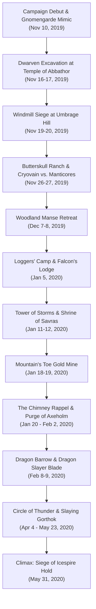

# 🏔️ Act 1: Dragon of Icespire Peak

> **Chronicle Navigation:** 🏠 [[The Order of Znak Complete Campaign Chronicle|Campaign Chronicle Hub]] | ➡️ **Next:** [[02 - Act 2 - Storm Lord's Wrath|Act 2: Storm Lord's Wrath]]

---

## 📜 Overview of the First Act
When the young white dragon **[[Cryovain]]** descended upon the jagged, snow-capped spurs of **[[Icespire Hold]]**, his icy arrival sent shockwaves of terror across the Sword Mountains and Neverwinter Wood. Monstrous predators fled the freezing peaks, displacing ferocious mountain orc tribes who formed a desperate, dark pact with the half-orc **[[Anchorites of Talos]]**. 

Answering the desperate call for sellswords in the frontier boomtown of **[[Phandalin]]**, four disparate travelers—**[[Krageer Stoneface Ogolakanu]]**, **[[Rhynok]]**, **[[Myagkiy Znak]]**, and **[[Tvyordiy Znak]]**—forged the unbreakable fellowship that would canonically become **[[The Order of Znak]]**.

Across thirty-two recorded sessions from November 2019 to May 1920, the companions forged their martial legends: delving into cursed dwarven ruins, braving vine-choked forests, outsmarting wererats, claiming ancient blades, and ultimately scaling the highest frozen peak of the Sword Mountains to slay the white dragon upon his rooftop throne.

---

## ⚔️ The Frontier Chronicles

### 🍺 Chapter 1: Arrival in Phandalin & The White Wyrm's Shadow
*(November 10, 2019)*

#### Welcome to Phandalin
In the gray chill of late autumn in 1492 DR, four untested sellswords marched westward along the rutted Triboar Trail into the rough-and-tumble frontier mining town of **[[Phandalin]]**:

> *Nestled in the rocky foothills of the snow-capped Sword Mountains is the mining town of Phandalin, which consists of forty or fifty simple log buildings. Crumbling stone ruins surround the newer houses and shops, showing how this must have been a much larger town in centuries past.*
> *More recently, settlers from the cities of Neverwinter and Waterdeep have begun to resettle the ruins, working the local mines and farmlands. But the recent arrival of a white dragon threatens to ruin everything.*

Each traveler bore the humble starter equipment of their distant homelands:
* **[[Krageer Stoneface Ogolakanu]]** hefted a heavy iron battleaxe and a quiver of javelins, his weathered Goliath features stoic and unreadable beneath mountain dust.
* **[[Rhynok]]** moved with the silent, watchful grace of the southern swamps, carrying a seasoned longbow, leather armor, and a balanced warhammer.
* **[[Myagkiy Znak]]** bore a sturdy oak shield and a silver-headed mace, carrying cooking utensils (`rolling a 19 and 20 check`) and radiating the compassionate serenity of the Life Domain.
* **[[Tvyordiy Znak]]** glided lightly on feathered talons (`16, 24 talon strikes`), testing his reach with a slender Eastern-style *Qiang* (Two-Handed) wushu spear (`18, 24 attack rolls`).

---

#### The White Dragon's Terror & The Barred Townmaster's Hall
Fear hung like frost over the muddy streets. Over tankards of bitter stout at the **[[Stonehill Inn]]**, friendly innkeeper **[[Toblen Stonehill]]** introduced the newcomers to the grim reality of the frontier. A young, predatory white dragon known as **[[Cryovain]]** had descended from the northern glaciers of Mount Icespire, claiming the Sword Mountains as his hunting domain. The beast had swept low over Phandalin's rooftops in sudden blinding blizzards, snatching sheep, cattle, and horses from the outlying fields and freezing innocent prospectors solid. Only recently, the dragon had butchered miner **[[Turkos Doomheart]]** in the high crags, leaving the town in a state of sheer panic.

Seeking legitimate mercenary contracts, the four companions marched to the Townmaster's Hall:

> *The townmaster's hall has sturdy stone walls, a pitched wooden roof, and a bell tower at the back. Posted on a bulletin board near the door is a notice written in Common:*

Terrified for his own skin, Townmaster **[[Harbin Wester]]**—a pompous, cowardly bureaucrat—had bolted himself inside his office, refusing all face-to-face visitors. Whenever the companions knocked, Harbin's muffled, squeaking voice wailed through the heavy iron keyhole:
> *"Go away! There's a dragon about! If you're looking for work, read the notices on the job board outside! Slide proof under the door and I'll slide out your gold!"*

---

#### The Three Starting Job Board Notices
Tacked to the bulletin board beside the heavy oak door were three handwritten parchment notices sealed with the seal of Phandalin:

> 📜 **Dwarven Excavation Quest:**
> *"Dwarf prospectors found ancient ruins in the hills southwest of town. Go see if they're all right and warn them about the white dragon. 50 gp reward upon your return."*

> 📜 **Gnomengarde Quest:**
> *"A clan of reclusive rock gnomes lives in a settlement called Gnomengarde, located in the mountains south of town. The gnomes might have magic items or mechanical contraptions that could help us fight the white dragon. Go negotiate with their kings. 50 gp reward upon your return."*

> 📜 **Umbrage Hill Quest:**
> *"The midwife of Phandalin, Adabra Gwynn, lives alone in a stone windmill on Umbrage Hill, a few miles south of town. She might not know about the white dragon. Go tell her to pack her things and come to Phandalin for her own safety. 50 gp reward upon your return."*

Conferring over their tactical options, the four sellswords recognized that facing a dragon required arcane power and specialized gear. They chose to march south into the Sword Mountain foothills toward the eccentric inventors of **[[Gnomengarde]]**!

---

### ⚙️ Chapter 2: Gnomengarde & The Wine Cellar Mimic
*(November 13, 2019)*

#### The Misty Falls of Gnomengarde
Following the winding banks of a cascading stream into a secluded valley of the Sword Mountains, the party navigated dense pine ridges (`Rhynok rolling a 20 Navigation check with his tools`):

> *You follow a stream into the Sword Mountains until you reach a misty, waterfall-filled canyon echoing with strange mechanical grinding and the clatter of gears. Caved into the cliffs are the workshop-homes of Gnomengarde.*
> *A narrow ledge hugs the cliffside, crossing rope bridges over the rushing stream. Steam and smoke billow from pipes in the rock, and the smell of ozone and sulfur hangs in the air.*

#### The Spinning Crossbow Apparatus & Facktoré
Their arrival was greeted by immediate, manic mechanical violence! Guarding the northern ledge was eccentric gnome inventor **[[Facktoré]]**, strapped into a bizarre, steam-driven wheeled contraption:

> *A gnome with wild black hair and soot-stained goggles sits strapped into a wheeled contraption mounting a heavy crossbow with a drum magazine. As you approach, she screams and cranks a lever:*
> *“Intruders! Stay back, or I'll perforate you!”*

Before negotiations could even begin, Facktoré opened fire, the mechanized ballista whirring as it hurled heavy bolts along the ledge! A bolt struck Rhynok before **[[Krageer Stoneface Ogolakanu]]** let out a battle roar, bodily charging across the catwalk. With overwhelming Goliath muscle, Krageer grabbed the spinning gears (`Athletics check`) and wrestled the apparatus to a dead halt, disarming the hysterical inventor without taking her life.

---

#### The Mad King & The Missing Gnomes
Venturing deeper into the damp, fungus-lit workshops, the companions met chief inventors **[[Fibblestib Pinebark]]** and **[[Dabbledob Plasterpatch]]** (affectionately dubbed *Dabbledop*). The distraught artificers revealed that a horrific crisis had gripped the colony:
- An unseen shapeshifter had slipped into the caves, mysteriously devouring two gnomes—Orryn and Warryn—whole!
- Terror had unhinged **[[Korboz|King Korboz]]**, who had convinced himself that his husband, **[[Gnerkli|King Gnerkli]]**, was either possessed or about to be eaten. Korboz had bound Gnerkli to a chair inside the royal bedchamber, locking the heavy iron doors from within and threatening anyone who approached.
- Calming the hysterical king required careful diplomacy, but the true threat remained loose in the complex.

#### The Barrel Mimic in the Wine Cellar
Enlisting Dabbledob to guide them, the party systematically swept the workshops and storage caverns. Gary employed his famous tactical innovation: utilizing a **10-foot collapsible pole** to prod barrels, crates, and suspicious furniture from safe reach!

When the pole struck a dusty wine cask in the royal cellar, the wooden barrel suddenly sprouted glistening, multi-eyed pseudopods, gaping maw, and adhesive flesh: **a predatory Mimic disguised as a wine cask!**

Rolling fast into initiative (`Tvyordiy 20.1, Goblins/Allies 11.1`):
- **Adhesive Flesh & Slime:** The mimic lunged forward with a sticky pseudopod (`grappled DC 13`), attempting to drag Krageer into its toothy maw and coat weapons in adhesive glue.
- **Stoneface's Berserk Cleave:** Refusing to yield, Krageer flew into a berserk frenzy, slamming his heavy iron axe into the rubbery hide for massive damage (*"Yo, Stoneface is a straight up killa!"*).
- **Arcane Barrage:** Myagkiy and Dabbledob leveled their staves, hurling glowing darts of *Magic Missile* into the monster's pulsating core.
- **Flurry of Talons:** Tvyordiy vaulted off the cellar walls, landing concussive unarmed strikes that battered the shapeshifter's flanks.
- **Victory & XP:** Splitting the creature's core in twain, the companions slew the horror on the stone floor, earning a shared triumph (**102 XP each**).

#### Royal Sanity & The Gnomish Curios
Witnessing the dead monster, King Korboz wept with relief, unbolted the bedchamber, and released King Gnerkli. In eternal gratitude for saving their colony, the twin monarchs rewarded the Order with four ingenious magical inventions:
1. ***[[Hat of Wizardry]]*** (worn by the party's arcanists to channel minor cantrips).
2. ***[[Clockwork Amulet]]*** (a brass pocket-watch gear that guarantees a roll of 10 on an attack roll 1/day).
3. ***[[Pole of Angling]]*** (a collapsible 10-foot fishing rod that transforms on command).
4. ***[[Wand of Pyrotechnics]]*** (bursting with blinding flashes and smoke).

Triumphant, the Order marched back to Phandalin, sliding word of the mimic's demise under Harbin Wester's door to collect their first **50 gp** bounty!

---

### ⛏️ Chapter 3: The Dwarven Excavation & The Gem of Greed
*(November 13 – November 17, 2019)*

#### The Canyon of the Temple
With Gnomengarde secure, the companions accepted Harbin's second contract, trekking southwest into a jagged limestone canyon of the Sword Mountains to check on dwarven prospectors:

> *The canyon narrows until you reach a dead end dominated by a sheer cliff face. Carved into the stone at its base is a grand facade flanked by crumbling, square pillars. Flanking the entrance are the partially excavated remains of two massive dwarven statues whose heads have toppled into the dirt.*
> *Two dwarf prospectors are camped in the canyon outside the entrance, their pickaxes leaning against a pair of battered canvas tents.*

Camped by the ruins were veteran shield dwarves **[[Dazlyn Grayshard]]** and **[[Norbus Ironrune]]**. The prospectors explained they had spent months unearthing what they believed to be an ancient, long-forgotten dwarven stronghold. However, strange, acidic oozes had recently bubbled up from the subterranean corridors, halting work. While grateful for the party's warning about Cryovain, Dazlyn and Norbus adamantly refused to abandon their excavation until the horrors within were eradicated—offering a handsome reward if the Order cleared the complex.

---

#### The Oozes of Abbathor & The Splitting Horror
Igniting torches, the companions crossed the threshold into the subterranean darkness:

> *Rubble and crushed stone choke the stone halls. Thick, translucent slime glistens across the floor and walls, smelling of vinegar and decay.*

As they advanced down the dusty stone corridors, predatory **Ochre Jellies** crept along the ceiling and oozed through ceiling cracks:
- **Acidic Pseudopods:** The jellies dropped with acidic pseudopods (`2d6+2 bludgeoning + 1d6 acid`), sizzling against Krageer's scale mail and Myagkiy's shield.
- **The Slashing Split Surprise:** Krageer swung his heavy battleaxe in a thunderous horizontal arc, cleaving an ooze in half—only to watch in horror as the severed halves immediately reformed into **two fully functional, smaller Ochre Jellies!**
- **Tactical Realignment:** Realizing slashing blades only multiplied their foes, the Order adjusted on the fly:
  - Myagkiy stepped forward, invoking holy radiance to scour the acidic blobs with searing beams of ***Sacred Flame***.
  - Tvyordiy drove the blunt shaft of his *Qiang* and delivered concussive bludgeoning kicks to crush the jelly cores.
  - Rhynok held the rearguard, picking off oozes at distance with targeted piercing arrows from his longbow.

---

#### The Altar of Greed & Krageer's Blunder
Clearing the eastern crypts, the companions discovered a concealed stone archway leading into the heart of the complex: the defiled **[[Temple of Abbathor]]**, the dwarven deity of greed:

> *At the rear of the excavation is a secret chamber dominated by a stone altar carved with the likeness of a dwarven god whose eyes are hollowed into deep, greedy sockets. Resting on the altar is a fist-sized ruby, pulsing with an alluring crimson glow.*

Gazing upon the magnificent gem, Goliath mercenary Krageer Stoneface Ogolakanu was overcome by mercenary temptation. Reaching out with his gauntlet, Krageer pried the glittering ruby from the stone plinth.

Instantly, ancient dwarven magic flared! A catastrophic collapsing trap detonated, bringing stone slabs and concussive shockwaves crashing down upon the chamber (`DC 15 Dexterity save for half 4d10 damage`). Despite his innate Goliath ***Danger Sense*** granting advantage on Dexterity saves, Krageer rolled two consecutive failures under 15! Smashed by falling masonry and engulfed in flame, the sooty, bruised Goliath tumbled backward out of the chamber, clutching the stone and sheepishly learning a painful lifelong lesson about dwarven greed.

---

#### Mountain Orc Ambush & The Sending Stones Reward
Battered but victorious, the party emerged from the ruins into the blinding afternoon sun—only to hear guttural war cries echoing down the canyon. A raiding warband of five mountain orcs (`Orc Initiative: 7.12`) had tracked the prospectors' smoke and was charging the defile with greataxes raised!

Fatigued from the dungeon, the Order snapped into formation:
- Rhynok's hatred of orcs fueled his aim, his longbow burying shafts into charging raiders before they could close distance.
- Tvyordiy vaulted off boulders, executing aerial talon sweeps and staff sweeps that tripped the vanguard.
- Krageer channeled his lingering embarrassment from the Abbathor trap into savage barbarian rage, cleaving the orc leader with a brutal blow.

With the orcs routed, Dazlyn and Norbus cheered the Order's heroics. True to their word, the grateful prospectors reached into their chest and gifted the companions their most prized possession: **a pair of attuned [[Sending Stones]]**. This unassuming pair of carved river stones would serve as the Order of Znak's vital communication lifeline across every major campaign milestone and siege over the next four years.

Returning to Phandalin, the Order slid proof of the cleared temple under Harbin's door, collecting their second **50 gp** bounty and advancing to **Level 3**!

---

### 🌾 Chapter 4: The Windmill Siege at Umbrage Hill
*(November 19 – November 20, 2019)*

#### The Windmill on the Knoll
Taking up the final contract from Harbin Wester's board, the Order rode south along the rolling foothills toward the agrarian landmark of **[[Umbrage Hill]]**:

> *Standing atop a grassy knoll is a crumbling stone windmill with its vanes slowly turning in the wind. A small cottage is attached to the tower. Crouched against the heavy door of the windmill, clawing and hissing, is a monstrous creature with the body of a lion, bat wings, and a humanlike face ringed with spikes.*

The beast was a ferocious, starving **Manticore**, driven down from its high mountain lair by the freezing frost and territorial dominance of Cryovain. Desperate for warm meat, the predator was battering against the stout oak doors of the windmill, where midwife and herbalist **[[Adabra Gwynn]]** was barricaded inside, screaming for help!

---

#### The Standoff & The Aerial Duel
Approaching through the tall prairie grass, the Order moved with disciplined stealth (`Rhynok: 24, 26 Stealth; Myagkiy: 19; Tvyordiy: 23; Krageer: 20`).

Spotting the armed party, the manticore hissed, whipping its spined tail and rolling high into combat (`Manticore Initiative: 9.16`):
- **Rhynok's Dread Ambush:** Striking first from concealment, Rhynok cast ***Hunter's Mark*** and channeled ***Hail of Thorns***, firing a devastating opening salvo (`23, 25 to hit`) that showered the beast in sharp thorns and pierced its leather wings.
- **Tail Spike Barrage:** Snarling in agony, the manticore whipped its tail, launching three iron-hard spikes toward the party (`17, 18, 16 to hit; 7, 5, 6 piercing damage`).
- **Deflect Missiles Mastery:** As a deadly spike whistled toward Tvyordiy's throat, the Aarakocra monk demonstrated his newly acquired Level 3 monastic feature: snapping his wrist to activate ***Deflect Missiles*** (`reducing damage by 1d10 + DEX + Monk level`), swatting the missile harmlessly out of mid-air!
- **Krageer's Javelins & Tvyordiy's Qiang:** Krageer surged forward, planting his boots and hurling heavy iron javelins into the beast's chest (`17, 23 to hit`). Tvyordiy vaulted up the windmill stonework, thrusting his *Qiang* spear (`20, 15 to hit`) into the beast's haunches.

Bleeding profusely from punctured wings and realizing these sellswords were far deadlier than farm cattle, the wounded manticore shrieked in defeat, leaping into the air and limping away into the southern crags.

---

#### The Stubborn Herbalist & Potions of Healing
With the predator driven off, the companions knocked on the windmill door. Adabra Gwynn cracked the latch, eyes wide with relief. 

Though deeply grateful for her rescue, the eccentric midwife stubbornly refused Harbin Wester's orders to abandon her home:
> *"Leave my windmill? Go cower in Phandalin with that sniveling coward Harbin? Never! My garden is here, my herbs are here, and the people of this valley need my medicines far more than I need stone walls!"*

Recognizing that no amount of persuasion would budge the determined herbalist, the Order respected her courage. In exchange for saving her life and driving off the manticore, Adabra gifted the party several precious **Potions of Healing**—vital draughts that would restore fallen companions in the desperate battles ahead.

Marching back to Phandalin, the Order reported to Harbin Wester. With all three starting quests fulfilled, the name of **The Order of Znak** began to spread across the Sword Coast frontier as true protectors of the realm!

---

### 🐄 Chapter 5: Butterskull Ranch & Cryovain vs. Manticores
*(November 26 – November 27, 2019)*

#### The Plundered Ranch on the Triboar Trail
Trekking eastward across the rolling hills of the Triboar Trail where columns of greasy black smoke stained the horizon, the Order arrived at **[[Butterskull Ranch]]**:

> *Butterskull Ranch occupies a swath of cleared land in the eastern foothills of the Sword Mountains. The ranch consists of a two-story farmhouse, a barn, a horse pig, a smithy, and a pigsty, all surrounded by a wooden fence.*
> *As you near the farmhouse, you smell woodsmoke and hear guttural voices speaking the Orc tongue.*

Driven down from the high mountain crags by Cryovain's territorial chill, a brutal raiding party of mountain orcs had ransacked the homestead, slaughtering the livestock, barricading the doors, and taking the ranch owner—retired Phandalin sheriff **[[Alfonse Kalazorn|"Big Al" Kalazorn]]**—hostage in his own cellar.

---

#### The Outhouse Ambush & Room-to-Room Assault
Approaching under the cover of twilight, Rhynok crept through the tall rye grass (`Stealth check`). Spotting an inattentive orc sentry lingering outside the wooden **outhouse**, the Order executed a silent, synchronized takedown—dropping the guard before he could sound an alarm.

Peering through the grease-smeared kitchen window, Rhynok counted over a dozen heavily armed orcs feasting and smashing furniture inside. Kicking the heavy farmhouse doors off their hinges, the Order launched a furious room-to-room breach (`Orc Initiatives: 2.12, 16.12, 21.12`):
- **Close-Quarters Carnage:** Orc raiders hefted heavy greataxes, lunging with feral fury (`Greataxe Orc Attacks: 21, 24, 17, 21, 23 to hit; dealing 10, 7, 12, 14 slashing damage`).
- **Stoneface's Cleave:** Krageer flew into a raging frenzy, charging through the kitchen and splintering oak dining tables as his battleaxe cleaved through orc armor.
- **Monastic Redirection:** Tvyordiy danced between charging warriors, redirecting clumsy greataxe swings into doorframes and battering orc ribs with spinning *Qiang* strikes.
- **Ranged Crossfire & Holy Light:** Rhynok picked off raiders attempting to mount the cellar stairs with point-blank longbow shots, while Myagkiy held the threshold with radiant holy bursts of *Sacred Flame*.

#### Unchaining Big Al & Rescuing Petunia
Clearing the blood-spattered farmhouse, the companions unbolted the trapdoor and descended into the damp root cellar. Bound to a support post among shattered pickled egg jars was Big Al Kalazorn himself—bruised and furious, but alive.

In tears of gratitude, the burly retired sheriff thanked the heroes. However, before he would celebrate, Big Al made a heartfelt plea: his beloved prize dairy cow, **[[Petunia (cow)|Petunia]]**, had bolted into the nearby foothills during the initial raid. Refusing to leave an innocent beast behind, the Order combed the scrubland until they found the frightened cow huddled in a box canyon, gently coaxing Petunia back to the ranch. Delighted, Big Al rewarded the party with his ancestral suit of **Mithral Chain Mail** and a hefty purse of gold!

---

#### The Apex Dominance Encounter (November 27, 2019)
On the return journey across the foothills toward Phandalin, the temperature suddenly plummeted thirty degrees. Freezing blizzard winds whipped across the grasses as a monstrous shadow swept over the ground.

Circling high in the gray overcast, two hungry **Manticores** were hunting the lowlands. Suddenly, a deafening, bone-chilling roar tore through the clouds:
- **Cryovain's Aerial Ambush:** Swooping from the upper stratosphere with terrifying velocity, the young white dragon **[[Cryovain]]** descended upon the flyers!
- **Savage Butchery:** Breathing a blinding cone of freezing frost that crystallized the air itself, the dragon caught the lead manticore in mid-flight. Sinking six-inch icy talons into its spine and clamping massive jaws around its neck, Cryovain tore the monstrous beast in half in mid-air!
- **The Terrifying Lesson:** The second manticore shrieked in absolute terror, diving into the tree canopy to flee. Tucking his massive pale wings, Cryovain carried his frozen, mangled prey back toward the snowy heights of Mount Icespire.

Watching from the tree line in stunned silence, the Order witnessed firsthand the catastrophic, raw power of the apex predator they were destined to face. The dragon was not merely a beast—it was a force of nature.

---

### 🌲 Chapter 6: Neverwinter Wood & The Woodland Manse Retreat
*(December 7 – December 8, 2019)*

#### The Overgrown Manse of the Woods
Acting on intelligence gathered from travelers, the Order marched north into the primeval depths of **Neverwinter Wood** to investigate rumors of cultist activity at the **[[Woodland Manse]]**:

> *A dilapidated two-story manse sits surrounded by ancient trees and overgrown brambles. Strange, stick-like figures cling to the outside walls, while boars root through the overgrown vegetable gardens.*

The ancient estate, once a peaceful sanctuary, had been conquered by wild **Anchorites of Talos**—fanatical storm-worshiping half-orc shapechangers who had allied with dark forest spirits to spawn hordes of animated twig, needle, and vine blights.

---

#### The Battle of the Courtyard & The Swarming Horde
As the Order approached the weed-choked courtyard, the silence was shattered by feral squeals:
- **Anchorite Ambush:** The anchorites charged forth, their hands wreathed in crackling electricity and tipped with jagged iron claw gauntlets (`Clawed Gauntlet Attacks: 19, 20 to hit; 7, 5 slashing damage`).
- **Thunderwave Detonation:** Chanting to the storm god Talos, an anchorite unleashed a concussive 15-foot blast of thunder (`Thunderwave: DC 14 Constitution save, dealing 11 thunder damage`), blasting the companions back into the mud!
- **The Blight Swarm:** From every bramble hedge and rooftop eave, dozens upon dozens of razor-sharp Twig Blights and Needle Blights detached from the timbers, raining barrages of wooden thorns and clawing at the party's boots in overwhelming numbers.

#### The Desperate Tactical Retreat & Level 5 Milestone
Though Krageer and Tvyordiy fought valiantly shoulder-to-shoulder, the sheer volume of animated flora and lightning-slinging anchorites threatened to encircle and drown the party in thorns. Recognizing that stubborn pride would lead to a total party wipe, Gary and Peter executed a disciplined, tactical fighting retreat—burning away the vanguard with torches and retreating into the deep shadows of Neverwinter Wood.

Licking their wounds at a concealed woodland bivouac, the companions reflected on their narrow survival. The brutal crucible tested their limits, advancing the Order to the pivotal power threshold of **Level 5**:
- **[[Krageer Stoneface Ogolakanu]]:** Gained ***Extra Attack*** (2 attacks per Action) and ***Fast Movement*** (+10 ft speed).
- **[[Rhynok]]:** Mastered ***Extra Attack*** and gained 2nd-level Ranger spells, adding the game-changing ***Rope Trick*** and *Pass without Trace*.
- **[[Myagkiy Znak]]:** Unlocked legendary 3rd-level Cleric miracles, gaining the devastating crowd-shredder ***Spirit Guardians***, ***Mass Healing Word***, and ***Revivify***.
- **[[Tvyordiy Znak]]:** Gained ***Extra Attack*** and his signature battlefield boss-killer: the nerve-shattering ***Stunning Strike***!

Armed with Level 5 power, the Order was no longer a band of green sellswords—they were hardened veterans ready to purge the forest.

---

### 🪓 Chapter 7: Ankhegs at Loggers' Camp & Falcon's Hunting Lodge
*(January 5, 2020)*

#### The Desolate River Clearing
Marching along the southern banks of the River Below deep within Neverwinter Wood, the Order reached the remote timber outpost of **[[Loggers' Camp]]**:

> *Loggers' Camp is situated along the south bank of the river. A dozen tents and cabins stand in a clearing surrounded by felled trees and dense forest. Several flat-bottomed barges are moored along the riverbank, but no workers are in sight.*

The clearing was eerie and deserted. Massive timber logs lay half-lashed on river skiffs, half-eaten bowls of porridge sat rotting on workbenches, and gaping, acid-pitted holes pitted the muddy earth.

---

#### Burrowing Terrors: The Ankheg Ambush
As the party moved toward the central office cabin, the ground buckled beneath their feet (`Ankheg Initiative: 9.11`):
- **Chitinous Mandibles:** Chittering violently, giant subterranean monstrosities known as **Ankhegs** erupted from the soil! A massive insectoid beast clamped its barbed mandibles around Krageer's waist (`Bite Attack: 16 to hit, grappled DC 13; dealing 10 slashing + 6 acid damage`), sizzling through armor with corrosive digestive acid.
- **Sacred Flame & Stunning Strikes:** Reacting with flawless teamwork, Myagkiy invoked divine vengeance, calling down a searing column of radiance (`Sacred Flame: DC 15 Dexterity save; 11 radiant damage`). Tvyordiy bounded across the churned mud, landing a precise ki strike that jarred the beast's nervous system.
- **Cleaving the Shell:** Krageer flexed his massive Goliath brawn, ripping himself free from the mandibles and delivering two punishing battleaxe chops with his new *Extra Attack*, shattering the ankheg's chitinous carapace.

#### Rescuing Tibor Wester & The River Barge Flight
Battering down the barricaded door of the camp's main supply cabin, the party discovered Harbin Wester's estranged, pompous brother, **[[Tibor Wester]]**, cowering beneath a stack of heavy woolen blankets. Blubbering with gratitude, Tibor explained that the burrowing monstrosities had devoured several woodcutters before the rest fled into the wilderness.

Escorting the nervous bureaucrat to the riverbank, the companions commandeered a flat-bottomed river barge, navigating downstream through the misty bends of Neverwinter Wood.

#### Sanctuary at Falcon's Hunting Lodge
Reaching safety, the Order arrived at the fortified wilderness bastion of **[[Falcon's Hunting Lodge]]**:

> *Nestled in a clearing deep within Neverwinter Wood is a sturdy, two-story stone lodge with high timber-reinforced walls and a wooden palisade. A watchtower overlooks the surrounding forest, and a stable stands near the gate.*

Guarding the compound was the grizzled veteran ranger **[[Falcon the Hunter]]**. Welcoming the weary adventurers, Falcon offered warm beds, steaming bowls of savory venison stew, and cold ale. Recognizing the Order's formidable martial spirit, Falcon pledged his lodge as their permanent forward operating base in Neverwinter Wood, providing vital tactical intelligence on the Cult of Talos.

---

### ⚡ Chapter 8: The Sea Cliffs & The Tower of Storms
*(January 11 – January 12, 2020)*

#### The Bleak Headland on the Sea of Swords
Following rumors of unnatural blue-white lightning lashing the coastline, the Order journeyed west to the wind-scoured sea cliffs overlooking the Sea of Swords:

> *A lighthouse stands atop a jagged bluff overlooking the crashing waves of the Sea of Swords. A narrow, windswept stone bridge connects the cliff to a sea stack crowned by the stone tower. At the top of the tower, a magical beacon pulses with erratic, blue-white lightning.*

The lighthouse—known as the **[[Tower of Storms]]**—had been seized by a renegade anchorite of Talos named **[[Moesko]]**, whose dark necromantic rituals were deliberately luring merchant caravels to shipwreck along the rocky reef.

---

#### The Harpy Nest on the Windswept Bridge
Crossing the narrow, crumbling stone bridge sixty feet above the surging ocean foam, the party was ambushed by shrieking coastal predators (`Harpy Initiatives: 16.13, 14.13, 4.13`):
- **Luring Song & Claws:** Three hideous **Harpies** swooped down from the crags, their discordant, bewitching songs echoing across the chasm. The creatures raked with filthy talons (`Claw Attacks: 21, 21 to hit; 5, 4 slashing damage`).
- **Monastic Precision:** Unshaken by their screeches, Tvyordiy planted his *Qiang* and swept a harpy out of mid-air with an aerial kick.
- **Gloom Stalker Barrage:** Rhynok notched two arrows in rapid succession, burying black fletchings through the lead harpy's throat and sending the monster plummeting into the churning breakers below.

#### The Lighthouse Spire & Moesko's Excised Heart
Fighting through the ground floor, the party scaled the spiraling iron staircase into the lighthouse's crowning lantern room. There, surrounded by crackling electrical arcs, stood Moesko—his chest carved open in a gruesome ritual, his bare ribs exposing a hollow, blood-caked cavity!

Pulsating inside the magical lightning lens of the beacon was **Moesko's living, beating heart**, glowing with unholy necromantic power:
- **Lightning Arc & Claw Strike:** Moesko called down arcing lightning, slashing with his clawed gauntlets.
- **Shattering the Conduit:** While Krageer and Tvyordiy tackled the undead anchorite, Myagkiy drove his silvered mace straight into the glass lens, smashing the pulsing, excised heart into bloody ash!
- **The Quenched Beacon:** With his heart destroyed, Moesko dissolved into a pile of lifeless dust with a dying shriek, and the blinding storm beacon was extinguished.

#### The Ghost of Miraes & Sacred Relics
In the peaceful silence that followed, the sorrowful spectral ghost of a drowned sea elf named **[[Miraes]]** manifested in the lantern room. Weeping with gratitude for the extinguishing of the shipwreck light, Miraes revealed the location of her lost family heirlooms hidden beneath the lighthouse floorboards:
1. ***[[Staff of Birdcalls]]*** (a wooden quarterstaff capable of producing bird songs).
2. ***[[Boots of the Winterlands]]*** (enchanted fur boots granting resistance to cold damage and effortless movement across ice and snow—an essential relic for their impending ascent of Mount Icespire!).

---

### 🔔 Chapter 9: The 2,500 Gold Piece Bell at the Shrine of Savras
*(January 16, 2020)*

#### The Ruined Monastery in the Foothills
Seeking to clear out an entrenched mountain orc encampment reported southeast of Conyberry, the Order advanced upon the **[[Shrine of Savras]]**:

> *Resting atop a rocky knoll in the foothills are the sprawling stone ruins of a monastery, surrounded by a crumbling stone wall. A bell tower rises above the ruins, its copper-domed roof gleaming in the sunlight. Heavily armed orcs and hulking ogres patrol the courtyard and walls.*

The ancient sanctuary—once dedicated to Savras, the All-Seeing God of Divination—had been desecrated and turned into a heavily fortified staging camp for dozens of mountain orcs and hulking, club-wielding **Ogres**.

---

#### The Courtyard Purge
Utilizing the crumbling courtyard walls for cover, the companions launched a coordinated assault:
- Rhynok ascended an ancient ruined archway, dropping orc sentries with poison-tipped sneak attack arrows.
- Krageer charged into the central courtyard, his battleaxe cleaving through an ogre's wooden club and bringing the massive brute down in a spray of blood.
- Myagkiy summoned swirling radiant guardians with ***Spirit Guardians***, turning the courtyard doorway into a meatgrinder that annihilated rushing orc reinforcements.
- Tvyordiy swept the flanks, stunning brutes and dodging lumbering counterattacks.

#### The Thousand-Pound Golden Fortune
With the garrison slaughtered, the party explored the ruined monastery. Climbing the rickety timber ladders of the belfry, Gary noticed that beneath centuries of verdigris and grime, the towering church bell was not brass or bronze—**it was cast from solid, unblemished gold!**

Appraising the prize revealed its jaw-dropping worth: an astounding **2,500 gold pieces**!

However, claiming the fortune posed an infamous, hilarious logistical nightmare:
- The bell weighed well over **one thousand pounds**, dangling forty feet above a crumbling stone floor.
- Employing ropes, pitons, pulleys, and Krageer's immense Goliath *Powerful Build*, Gary and Peter engineered an elaborate block-and-tackle rigging system.
- With monster Athletics checks and Myagkiy's *Guidance*, the Order carefully lowered the gargantuan golden artifact without cracking it.
- Lashed to a makeshift wooden timber travois, the four adventurers triumphantly hauled the thousand-pound bell all the way back to Phandalin, stunning Townmaster Harbin Wester and establishing the Order as legendary problem-solvers across the frontier!

---

### 🐀 Chapter 10: The Wererat Lesson at Mountain's Toe Gold Mine
*(January 18 – January 20, 2020)*

#### Escorting Don-Jon Raskin
Following their golden triumph, the Order received a high-priority contract from Townmaster Harbin Wester: escorting newly arrived mining supervisor **[[Don-Jon Raskin]]** to take charge of **[[Mountain's Toe Gold Mine]]**:

> *The trail leads to a rocky canyon in the foothills, where a wooden guard shack and a row of tool sheds stand outside the dark entrance to a mine. Wooden trestles and iron tracks emerge from the tunnel, carrying empty ore carts.*

Don-Jon Raskin—a boisterous, cigar-smoking man of action (`Don-Jon Initiative: 15.1`)—confidently strode into the canyon. But as the party approached the main tunnel, they discovered the miners had fled: the gold mine had been conquered and occupied by a cunning gang of **Wererats** known as the Whiskers clan!

---

#### The Immunity Shock: Non-Magical Blades Bounce!
As negotiations with wererat leader Eleanor Schmidt broke down, combat erupted across the torchlit mine shafts (`Wererat Initiatives: 9.15, 10.15, 14.15`):
- **The Horrifying Discovery:** Krageer swung his heavy battleaxe with reckless might, landing a crushing hit directly on a wererat's neck—only for the steel blade to **bounce harmlessly off the creature's fur without leaving a single scratch!**
- **Immunity Shock:** The entire party realized with shock that lycanthropes possessed **complete immunity to bludgeoning, piercing, and slashing damage from nonmagical, nonsilvered weapons!** Neither Krageer's iron axe nor Rhynok's standard hunting arrows could inflict a single point of physical harm!
- **Holding the Line with Divine Magic & Ki:**
  - With Krageer and Don-Jon temporarily helpless with mundane weapons, Myagkiy became the party's primary offensive anchor, incinerating the rat-men with beams of radiant ***Sacred Flame*** (`DC 15 Dexterity save, 5 radiant damage`).
  - Tvyordiy utilized his monk strikes to push, trip, and grapple the wererats, keeping their infectious bites (`DC 11 Constitution save vs. wererat lycanthropy`) away from his companions.
- **Tunnel Horrors:** Creeping up from the abandoned lower shafts, giant rats and a multi-legged **Carrion Crawler** joined the fray, snapping with paralyzing tentacles (`Tentacles: DC 13 Constitution save vs. paralysis`).

#### The Diplomatic Settlement & Krageer's Vow
Recognizing an unwinnable war of attrition in the cramped tunnels, the Order leveraged their tactical positioning. Don-Jon and the party negotiated a peaceful resolution with Eleanor Schmidt: the wererats agreed to vacate the gold mine and relocate to the ruins of the recently cleared Shrine of Savras in exchange for peace.

Emerging into the daylight, Krageer Stoneface Ogolakanu looked down at his soot-stained iron battleaxe in grim realization. The mighty Goliath had stood helpless against a pack of giant rats. 

Vowing never again to be powerless against supernatural foes, Krageer marched straight into the Phandalin smithy upon his return, **emptying his coin pouch to permanently plate his battleaxe in gleaming alchemical silver!**

Armed with silvered steel and tested by fire, the Order of Znak set their sights on the legendary dwarven fortress of **[[Axeholm]]**!

---

### 🏰 Chapter 11: The Chimney Rappel & Purge of Axeholm
*(January 20 – February 2, 2020)*

With the Phandalin Town Council desperate for a fortified evacuation refuge against Cryovain, the Order was tasked with securing the ancient dwarven fortress of **[[Axeholm]]**. Finding the fortress portcullis barred from within, the party scaled the mountain crags on January 20 to a sheer natural ventilation chimney high above the ramparts.

Under Myagkiy’s prayerful guidance, all four companions rappelled down the soot-blackened flue, dropping into the dark interior in a devastating surprise attack on a nest of seven giant spiders. From there, the Order conducted a methodical, room-by-room purge of the haunted halls across February 1–2: cleansing the West Hall and Smithy of flesh-eating dwarven **Ghouls** and swarms of **Stirges**.

In the upper Haunted Hall, they faced the sorrowful moon elf banshee **[[Vyldara]]**. When the spirit unleashed her soul-chilling *Wail*, the four champions stood like bedrock—not a single member faltering before her shriek—before striking her down with silvered strikes and radiant bursts. Behind a false hearth in the castellan's bedchamber, Myagkiy uncovered and attuned the ***Gauntlets of Ogre Power***, while Krageer donned the menacing ***Dread Helm***, his eyes glowing like crimson embers beneath the steel visor.

---

### 🗡️ Chapter 12: Dragon Barrow & The Dragon Slayer Blade
*(February 8 – February 9, 2020)*

Guided by ancient frontier lore, the Order journeyed past ruined Conyberry to the grassy mounds of **[[Dragon Barrow]]**, tomb of the noble knight Lady Tanamere Alagondar. 

Navigating the submerged sarcophagus catacombs, the champions extinguished a predatory Will-o'-Wisp and confronted an unseen **Invisible Stalker** guarding the crypt of the dragon Azdraka. Anticipating the stalker's strikes, Tvyordiy landed stunning spear blows into the rippling air while Krageer cleaved the unseen entity in twain.

In the innermost vault, Krageer lifted the legendary ***Dragon Slayer* Longsword** from Lady Alagondar's sarcophagus—its ancient runes glowing with radiant vengeance against draconic scale. Exiting the mound, the Order forged an alliance with noble centaur **[[Xanth]]**, who pledged his hooves and spear to help them crush the storm cultists of Neverwinter Wood.

---

### ⚡ Chapter 13: Thunder on the Hill: Slaying Gorthok at Circle of Thunder
*(April 4 – May 23, 2020)*

With the dragon-slaying blade in hand, the Order returned to Neverwinter Wood alongside **[[Xanth]] the Centaur** to settle their blood feud with the storm cultists who had sacked Falcon's Hunting Lodge.

Intercepting anchorite warlord **[[Yargath]]** and her patrol of ten Talosian orcs on a custom wilderness battlefield, the Order annihilated the vanguard without suffering a single casualty. Ascending the standing stones atop the **[[Circle of Thunder]]**, the party breached the storm cult's grand ritual amid deafening thunderclaps and driving rain:
* Cult leaders **[[Flenz]]** and **[[Narux]]** were struck down as they hurled *Lightning Bolts*.
* Slaying the summoners triggered the arrival of **[[Gorthok]] the Thunder Boar**, a colossal primordial beast with crackling lightning tusks.
* Krageer met the Thunder Boar's charge head-on, shrugging off lightning jolts in a Bear Totem fury; Tvyordiy battered its knees with concussive strikes; Myagkiy shredded the swarming blights with *Spirit Guardians*; and Rhynok poured deadeye arrows into its flanks.

When Gorthok collapsed into the muddy stones, the storm cult of Talos was broken forever across the Sword Coast. In the caves beneath the altar, Myagkiy claimed an enchanted ***+1 Shield***, and Falcon proudly awarded Rhynok his long-awaited ***Boots of Elvenkind***.

---

### 🐉 Chapter 14: The Climax: The Rooftop Siege of Icespire Hold
*(May 31, 2020)*

On the final day of May 1920, [[The Order of Znak]] made their ascent into the blizzard-swept heights of the Sword Mountains, climbing the frozen stairs toward **[[Icespire Hold]]**.

Cutting down a hobgoblin warband along the icy spurs, the companions breached the keep, swept past the treacherous **[[Stone-Cold Reavers]]**, and ascended the frost-crusted stairs to the open fortress roof. Stepping out into the howling gale, the heroes came face-to-face with **[[Cryovain]]**, perched atop the battlement crags surrounded by a swarm of **four cackling Ice Mephits**:
* Myagkiy called down a blessing of divine fortune upon his brothers and directed his floating *Spiritual Weapon* to swat the ice mephits out of the air.
* Cryovain opened his maw and unleashed a devastating torrent of glacial *Cold Breath* across the icy rooftop. Weathering the blast, Krageer and Tvyordiy charged across the slippery stone.
* **Tvyordiy Znak landed a series of clutch *Stunning Strikes***, driving his silvered *Qiang* into the dragon's pressure points and locking the young white dragon in frozen paralysis!
* Seizing the opening, **Krageer Stoneface Ogolakanu** roared in a furious Bear Totem rage and brought the ***Dragon Slayer* Longsword** down with crushing, two-handed power strikes—its ancient runes blazing with fury as it bit deep through white scales and cracked bone.
* Rhynok loosed a final pair of black-shafted arrows from his +1 longbow straight through the dragon's throat.

With a final, earth-shaking shudder, **Cryovain** collapsed lifeless across the frozen battlements of Icespire Hold. Act 1 was won.

Returning down the mountain to Phandalin as celebrated legends of the frontier, the Order of Znak found their fame carried down the High Road to **Lord Protector Dagult Neverember** in Neverwinter and the **Lords of Waterdeep**—setting the stage for their next great destiny in coastal **[[Leilon]]**.

---

## 💡 Behind the Screen: Campaign Genesis, Mechanics & Table Trivia

### 🖥️ VTT Genesis: Theatre of the Mind, D&D Beyond Voice Rolls & The Nov 10–13 Roll20 Test Lab
The technical infrastructure of the campaign evolved in lockstep with the heroes' adventures:
* **The Early Hybrid Setup (Theatre of the Mind):** In the opening sessions around November 10, 2019, Peter and Gary played primarily using **theatre of the mind**, supplemented by screen-sharing maps directly from D&D Beyond and early Roll20 screen captures. Character sheets and dice rolls were managed in D&D Beyond, with players calling out their rolls verbally over Discord voice chat.
* **The November 10–13 Roll20 Test Lab:** As Peter began building out the dedicated Roll20 campaign table (*join/5396573*), he spent several days learning the platform's macro syntax, token mechanics, and character sheet configurations. The sporadic chat log entries between November 10 and November 13—including isolated weapon clicks, test saving throws, and damage rolls for Goblins, Orcs, Manticores, and Ochre Jellies—were Peter's GM test runs to understand Roll20's template behavior before running live encounters.
* **Full Tactical VTT Transition (November 16–17):** By the time the Order marched into the *Dwarven Excavation* at the Temple of Abbathor on November 16, 2019, both players were fully onboarded into Roll20 with custom token art, imported sheets (transposing Elemental Evil races and custom point buys), and full on-grid combat tracking.

### 🎲 VTT Encounter Scaling & Dice Highlights
* **November 10, 2019 Campaign Kickoff & Gnomengarde Mimic:** The campaign launched on the morning of November 10, 2019, with Peter (*Sheer Iron Will*) and Gary (*UnixBomber*) creating their Discord server and Roll20 table. Their very first dungeon dive took them to Gnomengarde, where Gary's Stoneface went wild on the barrel mimic (*"Yo stone face is as straight up killa"*). Slaying the beast alongside Dabbledop (*Dabbledob*) earned the party 102 split XP.
* **The 10-Foot Collapsible Pole & "The Monsters Know What They're Doing":** Gary astutely brought a 10-foot collapsible pole into Gnomengarde to prod suspicious furniture and search for monsters from safe distance. In post-session reflection, Peter consulted Keith Ammann's *The Monsters Know What They're Doing* tactics blog, realizing with amusement that under strict 5e adhesive rules, both Gary's weapons and the collapsible pole should have stuck fast to the mimic's adhesive hide! Peter also realized they had forgotten the Gnomengarde wild magic surge check (a d20 roll whenever casting a spell).
* **Two Distinct Manticore Encounters (Nov 19 vs. Nov 27):**
  - **November 19 (Umbrage Hill):** The party fought the lone manticore besieging Adabra Gwynn's stone windmill, surviving its tail spikes before driving it off over the southern crags with *Hail of Thorns* and *Deflect Missiles*.
  - **November 27 (Cryovain's Mid-Air Dominance):** Returning from Butterskull Ranch, the party looked up to witness Cryovain swooping from the clouds upon a pair of manticores, unleashing his glacial *Cold Breath* (24 bite, 26/18 claws) and tearing them apart in mid-air in front of the party.
* **Krageer's Double-Fail with *Danger Sense* (Temple of Abbathor):** Right after unlocking *Danger Sense* at Level 2 (granting Advantage on Dexterity saves against traps), Krageer pried the cursed gem from Abbathor's statue and rolled **under 15 on both d20s** against the DC 15 save, taking full explosive fire damage!
* **The 2,500 GP Bell Heist:** At the Shrine of Savras, Krageer and Tvyordiy rolled high Athletics checks to dislodge the massive solid gold bell from the ruined belfry tower, loading it into a wagon to cash in for a massive 2,500 gold piece bounty.
* **The Wererat Immunity Panic:** Mountain's Toe Gold Mine served as a brutal tactical wake-up call when the players discovered that non-magical/non-silvered weapons dealt zero damage to wererats, forcing Myagkiy (*Spirit Guardians*) and Rhynok (+1 Longbow) to carry the combat while the party immediately silvered their arsenal in Phandalin.
* **Custom Roll20 Map for Yargath's Patrol:** DM Peter designed a custom woodland battlemap where the Order and centaur ally Xanth ambushed anchorite commander Yargath and her ten orcs before reaching the Circle of Thunder.
* **Rooftop Ice Mephits Reinforcement:** Recognizing that a Level 6 party wielding the *Dragon Slayer Longsword* could burn down Cryovain rapidly, Peter added a flock of **four Ice Mephits** to the rooftop battle to harass the party with frost breath and disrupt concentration.
* **Tvyordiy's Clutch Stunning Strikes:** Tvyordiy successfully landed Stunning Strikes on Cryovain, paralyzing the dragon on the roof and granting Krageer automatic advantage with the *Dragon Slayer* blade.
* **Midjourney 2022 Impressionistic Art:** The iconic art of Tvyordiy (*"Sheer Iron Will"*) fighting Cryovain on the mountain summit was generated in early 2022 via Midjourney as a permanent homage to this epic Act 1 climax.
