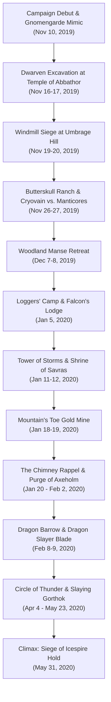

# 🏔️ Act 1: Dragon of Icespire Peak

> **Chronicle Navigation:** 🏠 [[The Order of Znak Complete Campaign Chronicle|Campaign Chronicle Hub]] | ➡️ **Next:** [[02 - Act 2 - Storm Lord's Wrath|Act 2: Storm Lord's Wrath]]

---

## 📜 Overview of the First Act
When the young white dragon **[[Cryovain]]** descended upon the jagged, snow-capped spurs of **[[Icespire Hold]]**, his icy arrival sent shockwaves of terror across the Sword Mountains and Neverwinter Wood. Monstrous predators fled the freezing peaks, displacing ferocious mountain orc tribes who formed a desperate, dark pact with the half-orc **[[Anchorites of Talos]]**. 

Answering the desperate call for sellswords in the frontier boomtown of **[[Phandalin]]**, four disparate travelers—**[[Krageer Stoneface Ogolakanu]]**, **[[Rhynok]]**, **[[Myagkiy Znak]]**, and **[[Tvyordiy Znak]]**—forged the unbreakable fellowship that would canonically become **[[The Order of Znak]]**.

Across thirty-two recorded sessions from November 2019 to May 1920, the companions forged their martial legends: delving into cursed dwarven ruins, braving vine-choked forests, outsmarting wererats, claiming ancient blades, and ultimately scaling the highest frozen peak of the Sword Mountains to slay the white dragon upon his rooftop throne.

---

## ⚔️ The Frontier Chronicles

### 🍺 Chapter 1: Arrival in Phandalin & The White Wyrm's Shadow
*(November 10, 2019)*

#### Welcome to Phandalin
In the gray chill of late autumn in 1492 DR, four untested sellswords marched westward along the rutted Triboar Trail into the rough-and-tumble frontier mining town of **[[Phandalin]]**:

> *Nestled in the rocky foothills of the snow-capped Sword Mountains is the mining town of Phandalin, which consists of forty or fifty simple log buildings. Crumbling stone ruins surround the newer houses and shops, showing how this must have been a much larger town in centuries past.*
> *More recently, settlers from the cities of Neverwinter and Waterdeep have begun to resettle the ruins, working the local mines and farmlands. But the recent arrival of a white dragon threatens to ruin everything.*

Each traveler bore the humble starter equipment of their distant homelands:
* **[[Krageer Stoneface Ogolakanu]]** hefted a heavy iron battleaxe and a quiver of javelins, his weathered Goliath features stoic and unreadable beneath mountain dust.
* **[[Rhynok]]** moved with the silent, watchful grace of the southern swamps, carrying a seasoned longbow, leather armor, and a balanced warhammer.
* **[[Myagkiy Znak]]** bore a sturdy oak shield and a silver-headed mace, carrying cooking utensils (`rolling a 19 and 20 check`) and radiating the compassionate serenity of the Life Domain.
* **[[Tvyordiy Znak]]** glided lightly on feathered talons (`16, 24 talon strikes`), testing his reach with a slender Eastern-style *Qiang* (Two-Handed) wushu spear (`18, 24 attack rolls`).

---

#### The White Dragon's Terror & The Barred Townmaster's Hall
Fear hung like frost over the muddy streets. Over tankards of bitter stout at the **[[Stonehill Inn]]**, friendly innkeeper **[[Toblen Stonehill]]** introduced the newcomers to the grim reality of the frontier. A young, predatory white dragon known as **[[Cryovain]]** had descended from the northern glaciers of Mount Icespire, claiming the Sword Mountains as his hunting domain. The beast had swept low over Phandalin's rooftops in sudden blinding blizzards, snatching sheep, cattle, and horses from the outlying fields and freezing innocent prospectors solid. Only recently, the dragon had butchered miner **[[Turkos Doomheart]]** in the high crags, leaving the town in a state of sheer panic.

Seeking legitimate mercenary contracts, the four companions marched to the Townmaster's Hall:

> *The townmaster's hall has sturdy stone walls, a pitched wooden roof, and a bell tower at the back. Posted on a bulletin board near the door is a notice written in Common:*

Terrified for his own skin, Townmaster **[[Harbin Wester]]**—a pompous, cowardly bureaucrat—had bolted himself inside his office, refusing all face-to-face visitors. Whenever the companions knocked, Harbin's muffled, squeaking voice wailed through the heavy iron keyhole:
> *"Go away! There's a dragon about! If you're looking for work, read the notices on the job board outside! Slide proof under the door and I'll slide out your gold!"*

---

#### The Three Starting Job Board Notices
Tacked to the bulletin board beside the heavy oak door were three handwritten parchment notices sealed with the seal of Phandalin:

> 📜 **Dwarven Excavation Quest:**
> *"Dwarf prospectors found ancient ruins in the hills southwest of town. Go see if they're all right and warn them about the white dragon. 50 gp reward upon your return."*

> 📜 **Gnomengarde Quest:**
> *"A clan of reclusive rock gnomes lives in a settlement called Gnomengarde, located in the mountains south of town. The gnomes might have magic items or mechanical contraptions that could help us fight the white dragon. Go negotiate with their kings. 50 gp reward upon your return."*

> 📜 **Umbrage Hill Quest:**
> *"The midwife of Phandalin, Adabra Gwynn, lives alone in a stone windmill on Umbrage Hill, a few miles south of town. She might not know about the white dragon. Go tell her to pack her things and come to Phandalin for her own safety. 50 gp reward upon your return."*

Conferring over their tactical options, the four sellswords recognized that facing a dragon required arcane power and specialized gear. They chose to march south into the Sword Mountain foothills toward the eccentric inventors of **[[Gnomengarde]]**!

---

### ⚙️ Chapter 2: Gnomengarde & The Wine Cellar Mimic
*(November 13, 2019)*

#### The Misty Falls of Gnomengarde
Following the winding banks of a cascading stream into a secluded valley of the Sword Mountains, the party navigated dense pine ridges (`Rhynok rolling a 20 Navigation check with his tools`):

> *You follow a stream into the Sword Mountains until you reach a misty, waterfall-filled canyon echoing with strange mechanical grinding and the clatter of gears. Caved into the cliffs are the workshop-homes of Gnomengarde.*
> *A narrow ledge hugs the cliffside, crossing rope bridges over the rushing stream. Steam and smoke billow from pipes in the rock, and the smell of ozone and sulfur hangs in the air.*

#### The Spinning Crossbow Apparatus & Facktoré
Their arrival was greeted by immediate, manic mechanical violence! Guarding the northern ledge was eccentric gnome inventor **[[Facktoré]]**, strapped into a bizarre, steam-driven wheeled contraption:

> *A gnome with wild black hair and soot-stained goggles sits strapped into a wheeled contraption mounting a heavy crossbow with a drum magazine. As you approach, she screams and cranks a lever:*
> *“Intruders! Stay back, or I'll perforate you!”*

Before negotiations could even begin, Facktoré opened fire, the mechanized ballista whirring as it hurled heavy bolts along the ledge! A bolt struck Rhynok before **[[Krageer Stoneface Ogolakanu]]** let out a battle roar, bodily charging across the catwalk. With overwhelming Goliath muscle, Krageer grabbed the spinning gears (`Athletics check`) and wrestled the apparatus to a dead halt, disarming the hysterical inventor without taking her life.

---

#### The Mad King & The Missing Gnomes
Venturing deeper into the damp, fungus-lit workshops, the companions met chief inventors **[[Fibblestib Pinebark]]** and **[[Dabbledob Plasterpatch]]** (affectionately dubbed *Dabbledop*). The distraught artificers revealed that a horrific crisis had gripped the colony:
- An unseen shapeshifter had slipped into the caves, mysteriously devouring two gnomes—Orryn and Warryn—whole!
- Terror had unhinged **[[Korboz|King Korboz]]**, who had convinced himself that his husband, **[[Gnerkli|King Gnerkli]]**, was either possessed or about to be eaten. Korboz had bound Gnerkli to a chair inside the royal bedchamber, locking the heavy iron doors from within and threatening anyone who approached.
- Calming the hysterical king required careful diplomacy, but the true threat remained loose in the complex.

#### The Barrel Mimic in the Wine Cellar
Enlisting Dabbledob to guide them, the party systematically swept the workshops and storage caverns. Gary employed his famous tactical innovation: utilizing a **10-foot collapsible pole** to prod barrels, crates, and suspicious furniture from safe reach!

When the pole struck a dusty wine cask in the royal cellar, the wooden barrel suddenly sprouted glistening, multi-eyed pseudopods, gaping maw, and adhesive flesh: **a predatory Mimic disguised as a wine cask!**

Rolling fast into initiative (`Tvyordiy 20.1, Goblins/Allies 11.1`):
- **Adhesive Flesh & Slime:** The mimic lunged forward with a sticky pseudopod (`grappled DC 13`), attempting to drag Krageer into its toothy maw and coat weapons in adhesive glue.
- **Stoneface's Berserk Cleave:** Refusing to yield, Krageer flew into a berserk frenzy, slamming his heavy iron axe into the rubbery hide for massive damage (*"Yo, Stoneface is a straight up killa!"*).
- **Arcane Barrage:** Myagkiy and Dabbledob leveled their staves, hurling glowing darts of *Magic Missile* into the monster's pulsating core.
- **Flurry of Talons:** Tvyordiy vaulted off the cellar walls, landing concussive unarmed strikes that battered the shapeshifter's flanks.
- **Victory & XP:** Splitting the creature's core in twain, the companions slew the horror on the stone floor, earning a shared triumph (**102 XP each**).

#### Royal Sanity & The Gnomish Curios
Witnessing the dead monster, King Korboz wept with relief, unbolted the bedchamber, and released King Gnerkli. In eternal gratitude for saving their colony, the twin monarchs rewarded the Order with four ingenious magical inventions:
1. ***[[Hat of Wizardry]]*** (worn by the party's arcanists to channel minor cantrips).
2. ***[[Clockwork Amulet]]*** (a brass pocket-watch gear that guarantees a roll of 10 on an attack roll 1/day).
3. ***[[Pole of Angling]]*** (a collapsible 10-foot fishing rod that transforms on command).
4. ***[[Wand of Pyrotechnics]]*** (bursting with blinding flashes and smoke).

Triumphant, the Order marched back to Phandalin, sliding word of the mimic's demise under Harbin Wester's door to collect their first **50 gp** bounty!

---

### ⛏️ Chapter 3: The Dwarven Excavation & The Gem of Greed
*(November 13 – November 17, 2019)*

#### The Canyon of the Temple
With Gnomengarde secure, the companions accepted Harbin's second contract, trekking southwest into a jagged limestone canyon of the Sword Mountains to check on dwarven prospectors:

> *The canyon narrows until you reach a dead end dominated by a sheer cliff face. Carved into the stone at its base is a grand facade flanked by crumbling, square pillars. Flanking the entrance are the partially excavated remains of two massive dwarven statues whose heads have toppled into the dirt.*
> *Two dwarf prospectors are camped in the canyon outside the entrance, their pickaxes leaning against a pair of battered canvas tents.*

Camped by the ruins were veteran shield dwarves **[[Dazlyn Grayshard]]** and **[[Norbus Ironrune]]**. The prospectors explained they had spent months unearthing what they believed to be an ancient, long-forgotten dwarven stronghold. However, strange, acidic oozes had recently bubbled up from the subterranean corridors, halting work. While grateful for the party's warning about Cryovain, Dazlyn and Norbus adamantly refused to abandon their excavation until the horrors within were eradicated—offering a handsome reward if the Order cleared the complex.

---

#### The Oozes of Abbathor & The Splitting Horror
Igniting torches, the companions crossed the threshold into the subterranean darkness:

> *Rubble and crushed stone choke the stone halls. Thick, translucent slime glistens across the floor and walls, smelling of vinegar and decay.*

As they advanced down the dusty stone corridors, predatory **Ochre Jellies** crept along the ceiling and oozed through ceiling cracks:
- **Acidic Pseudopods:** The jellies dropped with acidic pseudopods (`2d6+2 bludgeoning + 1d6 acid`), sizzling against Krageer's scale mail and Myagkiy's shield.
- **The Slashing Split Surprise:** Krageer swung his heavy battleaxe in a thunderous horizontal arc, cleaving an ooze in half—only to watch in horror as the severed halves immediately reformed into **two fully functional, smaller Ochre Jellies!**
- **Tactical Realignment:** Realizing slashing blades only multiplied their foes, the Order adjusted on the fly:
  - Myagkiy stepped forward, invoking holy radiance to scour the acidic blobs with searing beams of ***Sacred Flame***.
  - Tvyordiy drove the blunt shaft of his *Qiang* and delivered concussive bludgeoning kicks to crush the jelly cores.
  - Rhynok held the rearguard, picking off oozes at distance with targeted piercing arrows from his longbow.

---

#### The Altar of Greed & Krageer's Blunder
Clearing the eastern crypts, the companions discovered a concealed stone archway leading into the heart of the complex: the defiled **[[Temple of Abbathor]]**, the dwarven deity of greed:

> *At the rear of the excavation is a secret chamber dominated by a stone altar carved with the likeness of a dwarven god whose eyes are hollowed into deep, greedy sockets. Resting on the altar is a fist-sized ruby, pulsing with an alluring crimson glow.*

Gazing upon the magnificent gem, Goliath mercenary Krageer Stoneface Ogolakanu was overcome by mercenary temptation. Reaching out with his gauntlet, Krageer pried the glittering ruby from the stone plinth.

Instantly, ancient dwarven magic flared! A catastrophic collapsing trap detonated, bringing stone slabs and concussive shockwaves crashing down upon the chamber (`DC 15 Dexterity save for half 4d10 damage`). Despite his innate Goliath ***Danger Sense*** granting advantage on Dexterity saves, Krageer rolled two consecutive failures under 15! Smashed by falling masonry and engulfed in flame, the sooty, bruised Goliath tumbled backward out of the chamber, clutching the stone and sheepishly learning a painful lifelong lesson about dwarven greed.

---

#### Mountain Orc Ambush & The Sending Stones Reward
Battered but victorious, the party emerged from the ruins into the blinding afternoon sun—only to hear guttural war cries echoing down the canyon. A raiding warband of five mountain orcs (`Orc Initiative: 7.12`) had tracked the prospectors' smoke and was charging the defile with greataxes raised!

Fatigued from the dungeon, the Order snapped into formation:
- Rhynok's hatred of orcs fueled his aim, his longbow burying shafts into charging raiders before they could close distance.
- Tvyordiy vaulted off boulders, executing aerial talon sweeps and staff sweeps that tripped the vanguard.
- Krageer channeled his lingering embarrassment from the Abbathor trap into savage barbarian rage, cleaving the orc leader with a brutal blow.

With the orcs routed, Dazlyn and Norbus cheered the Order's heroics. True to their word, the grateful prospectors reached into their chest and gifted the companions their most prized possession: **a pair of attuned [[Sending Stones]]**. This unassuming pair of carved river stones would serve as the Order of Znak's vital communication lifeline across every major campaign milestone and siege over the next four years.

Returning to Phandalin, the Order slid proof of the cleared temple under Harbin's door, collecting their second **50 gp** bounty and advancing to **Level 3**!

---

### 🌾 Chapter 4: The Windmill Siege at Umbrage Hill
*(November 19 – November 20, 2019)*

#### The Windmill on the Knoll
Taking up the final contract from Harbin Wester's board, the Order rode south along the rolling foothills toward the agrarian landmark of **[[Umbrage Hill]]**:

> *Standing atop a grassy knoll is a crumbling stone windmill with its vanes slowly turning in the wind. A small cottage is attached to the tower. Crouched against the heavy door of the windmill, clawing and hissing, is a monstrous creature with the body of a lion, bat wings, and a humanlike face ringed with spikes.*

The beast was a ferocious, starving **Manticore**, driven down from its high mountain lair by the freezing frost and territorial dominance of Cryovain. Desperate for warm meat, the predator was battering against the stout oak doors of the windmill, where midwife and herbalist **[[Adabra Gwynn]]** was barricaded inside, screaming for help!

---

#### The Standoff & The Aerial Duel
Approaching through the tall prairie grass, the Order moved with disciplined stealth (`Rhynok: 24, 26 Stealth; Myagkiy: 19; Tvyordiy: 23; Krageer: 20`).

Spotting the armed party, the manticore hissed, whipping its spined tail and rolling high into combat (`Manticore Initiative: 9.16`):
- **Rhynok's Dread Ambush:** Striking first from concealment, Rhynok cast ***Hunter's Mark*** and channeled ***Hail of Thorns***, firing a devastating opening salvo (`23, 25 to hit`) that showered the beast in sharp thorns and pierced its leather wings.
- **Tail Spike Barrage:** Snarling in agony, the manticore whipped its tail, launching three iron-hard spikes toward the party (`17, 18, 16 to hit; 7, 5, 6 piercing damage`).
- **Deflect Missiles Mastery:** As a deadly spike whistled toward Tvyordiy's throat, the Aarakocra monk demonstrated his newly acquired Level 3 monastic feature: snapping his wrist to activate ***Deflect Missiles*** (`reducing damage by 1d10 + DEX + Monk level`), swatting the missile harmlessly out of mid-air!
- **Krageer's Javelins & Tvyordiy's Qiang:** Krageer surged forward, planting his boots and hurling heavy iron javelins into the beast's chest (`17, 23 to hit`). Tvyordiy vaulted up the windmill stonework, thrusting his *Qiang* spear (`20, 15 to hit`) into the beast's haunches.

Bleeding profusely from punctured wings and realizing these sellswords were far deadlier than farm cattle, the wounded manticore shrieked in defeat, leaping into the air and limping away into the southern crags.

---

#### The Stubborn Herbalist & Potions of Healing
With the predator driven off, the companions knocked on the windmill door. Adabra Gwynn cracked the latch, eyes wide with relief. 

Though deeply grateful for her rescue, the eccentric midwife stubbornly refused Harbin Wester's orders to abandon her home:
> *"Leave my windmill? Go cower in Phandalin with that sniveling coward Harbin? Never! My garden is here, my herbs are here, and the people of this valley need my medicines far more than I need stone walls!"*

Recognizing that no amount of persuasion would budge the determined herbalist, the Order respected her courage. In exchange for saving her life and driving off the manticore, Adabra gifted the party several precious **Potions of Healing**—vital draughts that would restore fallen companions in the desperate battles ahead.

Marching back to Phandalin, the Order reported to Harbin Wester. With all three starting quests fulfilled, the name of **The Order of Znak** began to spread across the Sword Coast frontier as true protectors of the realm!

---

### 🐄 Chapter 5: Butterskull Ranch & Cryovain vs. Manticores
*(November 26 – November 27, 2019)*

Reports of black smoke rising along the Triboar Trail drew the Order east to **[[Butterskull Ranch]]**. Mountain orcs displaced from the high peaks had ransacked the homestead, capturing retired sheriff **[[Alfonse Kalazorn|"Big Al" Kalazorn]]**.

Approaching under cover of twilight, Rhynok crept through the tall rye grass. Spotting a solitary orc guard lingering beside the ranch **outhouse**, the Order executed a silent, synchronized ambush—dropping the sentry before an alarm could be raised. Peeking through the farmhouse window, Rhynok counted a dozen heavily armed orcs feasting in the main hall.

Storming the doorway, the Order engaged in a brutal, room-to-room melee. Krageer raged through the kitchen, shattering timber tables and cleaving through orc warriors; Tvyordiy redirected charging brutes with drunken footwork; Myagkiy held the threshold with divine radiance; and Rhynok picked off raiders attempting to flank from the stairwell. Slaying all twelve orcs, the party descended into the cellar to unchain Big Al Kalazorn. In gratitude, Big Al gave the companions his blessing and begged them to recover his prized runaway prize dairy cow, **[[Petunia (cow)|Petunia]]**, who was coaxed safely back to Phandalin.

**The Apex Dominance Encounter (November 27, 2019):**  
On the return journey across the foothills, the skies suddenly darkened as a freezing blizzard wind swept down from the mountains. Looking up, the companions witnessed an awe-inspiring, brutal spectacle of draconic apex dominance: **[[Cryovain]] swooped down from the storm clouds upon a pair of hunting Manticores**. In a flurry of glacial frost breath, razor-sharp claws, and snapping jaws, the young white dragon tore into the manticores mid-air—effortlessly ripping the rival predators to shreds before carrying their frozen carcasses back to the high peaks. The chilling display cemented the true scale of the terror haunting the Sword Coast.

---

### 🌲 Chapter 6: Neverwinter Wood & The Woodland Manse Retreat
*(December 7 – December 8, 2019 & March 7, 2020)*

Commissioned to deliver provisions to the **[[Loggers' Camp]]**, the Order rode deep into the primeval shadows of Neverwinter Wood. Guided by Rhynok’s unerring woodcraft, the companions noticed an unnatural boar tracking them from the briars—recognizing the beast as a shapeshifted priest of the **[[Anchorites of Talos]]**.

Determined to strike at the heart of the storm cult, the party advanced toward the vine-choked **[[Woodland Manse]]**. In an inspired stroke of psychological warfare, **Krageer tattooed a sacred warning in Orcish directly onto the hide of a shaved, one-eyed goat:**
> *"Take this goat as an offering of sustenance. For if you do not take it and flee from this mansion and cease your worship of false and weak gods then my wrath will come upon thee. My blood spear is unforgiving and though I only have one eye... it sees all. — Gruumsh"*

Releasing the goat toward the mansion gates, the omen terrified superstitious orc sentries into breaking ranks! Yet when the Order charged into the central courtyard around the rotting **Gulthias Tree**, they were ensnared in a lethal trap. Half-orc ritualist **[[Grannoc]]** and swarms of needle, twig, and vine blights surrounded the party, while anchorites hurled crackling *Lightning Bolts*.

In the desperate fighting withdrawal, Krageer fell unconscious twice under a punishing storm of spines and dark magic. As the Goliath collapsed at the edge of the clearing, winged monk **Tvyordiy Znak** swooped back through the canopy, hoisted the bleeding Goliath into his talons, and carried him through the treetops to safety—a harrowing escape that cemented their unbreakable bond.

---

### 🪓 Chapter 7: Ankhegs at Loggers' Camp & Falcon's Hunting Lodge
*(January 5, 2020)*

Rebounding from the Manse, the companions hauled their supply wagon—pulled by the stalwart draft ox **[[Vincent (ox)|Vincent]]**—to the **[[Loggers' Camp]]** on the Neverwinter River. They found the logging camp devastated: desecrated totem poles had lured monstrous, acid-spitting **Ankhegs** from the earth.

When an enormous ankheg burst through the floorboards of camp manager **[[Tibor Wester]]**'s cabin, the Order charged into the breach. Krageer grappled its mandibles while Myagkiy blinded it with sacred flame and Tvyordiy crushed its chitin with flying kicks. Liberating Tibor, the party guided the survivors to safety.

Seeking shelter deeper in the woods, the Order brought a fine bottle of wine to **[[Falcon's Hunting Lodge]]**, arriving just as Cryovain swooped down in a strafing frost attack. Fighting shoulder-to-shoulder with master huntsman **[[Gustaf Stellern|Falcon the Hunter]]**, the party drove the dragon off. Impressed by their martial prowess, Falcon promised Rhynok a pair of legendary ***Boots of Elvenkind*** if the Order could cleanse the Woodland Manse once and for all.

---

### ⚡ Chapter 8: The Sea Cliffs & The Tower of Storms
*(January 11, 2020)*

Turning west to the jagged sea cliffs of the Sword Coast, the companions investigated the unnatural green light pulsing from the **[[Tower of Storms]]**. On the rocky shore, they encountered an **awakened giant crab**, who warned them of the sea elf banshee **[[Miraal]]** haunting the tidal caves below the lighthouse.

Entering the cavern, the party spoke with the weeping spirit, learning that half-orc anchorite **[[Moesko]]** had murdered her and stolen her prized conch shell. Scaling the sheer cliffs, several companions momentarily succumbed to the mesmerizing siren song of hunting **Harpies**, nearly stumbling into the ocean surge before breaking the charm and striking the winged predators down.

Storming the lighthouse keep, the Order confronted Moesko at the desecrated altar of Talos. Slaying the cultist, they climbed to the storm-lashed pinnacle to **pierce and destroy Moesko's beating, disembodied heart**, lifting the lighthouse curse forever. Returning the conch to Miraal laid her soul to rest, and true to its word, the awakened giant crab scuttled from the surf bearing an enchanted **+1 Longbow**—which passed straight to **Rhynok**.

---

### 🔔 Chapter 9: The 2,500 Gold Piece Bell at the Shrine of Savras
*(January 12, 2020)*

Escorting frontier patron **[[DonJon Raskin]]** south of ruined Conyberry, the Order reached the ancient stone courtyard of the **[[Shrine of Savras]]**. The holy site had been overrun by a powerful warband of mountain orcs and towering **Ogres**.

With DonJon cheering them on in his colorful frontier drawl, the Order unleashed their full power. Rhynok's newly acquired +1 longbow picked off orc skirmishers with deadly precision; Krageer went toe-to-toe with the ogres, trading crushing club blows for savage greataxe chops; Myagkiy anchored the center with healing wards; and Tvyordiy swept the courtyard with dazzling martial arts.

Inside the ruined sanctuary, Rhynok and Krageer touched the uncovered stone altar of Savras, receiving a shared prophetic vision: soaring through freezing cloud banks to gaze upon **Cryovain** slumbering atop the battlements of **Icespire Hold**. Before riding out, Krageer and Tvyordiy scaled the crumbling belfry, pried loose the solid gold temple bell, and hauled the massive treasure back to Phandalin to **sell for an astounding 2,500 gold pieces**!

---

### 🐀 Chapter 10: The Wererat Lesson at Mountain's Toe Gold Mine
*(January 18 – January 19, 2020)*

Escorting DonJon Raskin to oversee **[[Mountain's Toe Gold Mine]]**, the Order discovered the mining complex occupied by the Whiskered Gang, led by wererat boss **[[Zeleen Varnaster]]**. When negotiations broke down and steel was drawn, a shocking revelation struck the frontline:

Krageer's heavy iron greataxe and Tvyordiy's wooden *Qiang* glanced harmlessly off the lycanthropes' cursed flesh! Immune to non-magical and non-silvered weapons, the wererat pack swarmed the frontline with venomous bites.

The battle turned into an urgent carrying operation:
* **Rhynok's +1 Longbow** punched clean through the supernatural immunity, pinning wererats to the mine timbers.
* **Myagkiy Znak** became the decisive frontline engine: summoning swirling radiant hosts of ***Spirit Guardians***, directing his floating ***Spiritual Weapon***, and blasting wererats with *Sacred Flame*.

Routing the pack, the party drove Zeleen Varnaster from the mine, restored the claim to DonJon, and marched straight back to Phandalin with an urgent mandate: every weapon in their arsenal had to be coated in **alchemical silver**.

---

### 🏰 Chapter 11: The Chimney Rappel & Purge of Axeholm
*(January 20 – February 2, 2020)*

With the Phandalin Town Council desperate for a fortified evacuation refuge against Cryovain, the Order was tasked with securing the ancient dwarven fortress of **[[Axeholm]]**. Finding the fortress portcullis barred from within, the party scaled the mountain crags on January 20 to a sheer natural ventilation chimney high above the ramparts.

Under Myagkiy’s prayerful guidance, all four companions rappelled down the soot-blackened flue, dropping into the dark interior in a devastating surprise attack on a nest of seven giant spiders. From there, the Order conducted a methodical, room-by-room purge of the haunted halls across February 1–2: cleansing the West Hall and Smithy of flesh-eating dwarven **Ghouls** and swarms of **Stirges**.

In the upper Haunted Hall, they faced the sorrowful moon elf banshee **[[Vyldara]]**. When the spirit unleashed her soul-chilling *Wail*, the four champions stood like bedrock—not a single member faltering before her shriek—before striking her down with silvered strikes and radiant bursts. Behind a false hearth in the castellan's bedchamber, Myagkiy uncovered and attuned the ***Gauntlets of Ogre Power***, while Krageer donned the menacing ***Dread Helm***, his eyes glowing like crimson embers beneath the steel visor.

---

### 🗡️ Chapter 12: Dragon Barrow & The Dragon Slayer Blade
*(February 8 – February 9, 2020)*

Guided by ancient frontier lore, the Order journeyed past ruined Conyberry to the grassy mounds of **[[Dragon Barrow]]**, tomb of the noble knight Lady Tanamere Alagondar. 

Navigating the submerged sarcophagus catacombs, the champions extinguished a predatory Will-o'-Wisp and confronted an unseen **Invisible Stalker** guarding the crypt of the dragon Azdraka. Anticipating the stalker's strikes, Tvyordiy landed stunning spear blows into the rippling air while Krageer cleaved the unseen entity in twain.

In the innermost vault, Krageer lifted the legendary ***Dragon Slayer* Longsword** from Lady Alagondar's sarcophagus—its ancient runes glowing with radiant vengeance against draconic scale. Exiting the mound, the Order forged an alliance with noble centaur **[[Xanth]]**, who pledged his hooves and spear to help them crush the storm cultists of Neverwinter Wood.

---

### ⚡ Chapter 13: Thunder on the Hill: Slaying Gorthok at Circle of Thunder
*(April 4 – May 23, 2020)*

With the dragon-slaying blade in hand, the Order returned to Neverwinter Wood alongside **[[Xanth]] the Centaur** to settle their blood feud with the storm cultists who had sacked Falcon's Hunting Lodge.

Intercepting anchorite warlord **[[Yargath]]** and her patrol of ten Talosian orcs on a custom wilderness battlefield, the Order annihilated the vanguard without suffering a single casualty. Ascending the standing stones atop the **[[Circle of Thunder]]**, the party breached the storm cult's grand ritual amid deafening thunderclaps and driving rain:
* Cult leaders **[[Flenz]]** and **[[Narux]]** were struck down as they hurled *Lightning Bolts*.
* Slaying the summoners triggered the arrival of **[[Gorthok]] the Thunder Boar**, a colossal primordial beast with crackling lightning tusks.
* Krageer met the Thunder Boar's charge head-on, shrugging off lightning jolts in a Bear Totem fury; Tvyordiy battered its knees with concussive strikes; Myagkiy shredded the swarming blights with *Spirit Guardians*; and Rhynok poured deadeye arrows into its flanks.

When Gorthok collapsed into the muddy stones, the storm cult of Talos was broken forever across the Sword Coast. In the caves beneath the altar, Myagkiy claimed an enchanted ***+1 Shield***, and Falcon proudly awarded Rhynok his long-awaited ***Boots of Elvenkind***.

---

### 🐉 Chapter 14: The Climax: The Rooftop Siege of Icespire Hold
*(May 31, 2020)*

On the final day of May 1920, [[The Order of Znak]] made their ascent into the blizzard-swept heights of the Sword Mountains, climbing the frozen stairs toward **[[Icespire Hold]]**.

Cutting down a hobgoblin warband along the icy spurs, the companions breached the keep, swept past the treacherous **[[Stone-Cold Reavers]]**, and ascended the frost-crusted stairs to the open fortress roof. Stepping out into the howling gale, the heroes came face-to-face with **[[Cryovain]]**, perched atop the battlement crags surrounded by a swarm of **four cackling Ice Mephits**:
* Myagkiy called down a blessing of divine fortune upon his brothers and directed his floating *Spiritual Weapon* to swat the ice mephits out of the air.
* Cryovain opened his maw and unleashed a devastating torrent of glacial *Cold Breath* across the icy rooftop. Weathering the blast, Krageer and Tvyordiy charged across the slippery stone.
* **Tvyordiy Znak landed a series of clutch *Stunning Strikes***, driving his silvered *Qiang* into the dragon's pressure points and locking the young white dragon in frozen paralysis!
* Seizing the opening, **Krageer Stoneface Ogolakanu** roared in a furious Bear Totem rage and brought the ***Dragon Slayer* Longsword** down with crushing, two-handed power strikes—its ancient runes blazing with fury as it bit deep through white scales and cracked bone.
* Rhynok loosed a final pair of black-shafted arrows from his +1 longbow straight through the dragon's throat.

With a final, earth-shaking shudder, **Cryovain** collapsed lifeless across the frozen battlements of Icespire Hold. Act 1 was won.

Returning down the mountain to Phandalin as celebrated legends of the frontier, the Order of Znak found their fame carried down the High Road to **Lord Protector Dagult Neverember** in Neverwinter and the **Lords of Waterdeep**—setting the stage for their next great destiny in coastal **[[Leilon]]**.

---

## 💡 Behind the Screen: Campaign Genesis, Mechanics & Table Trivia

### 🖥️ VTT Genesis: Theatre of the Mind, D&D Beyond Voice Rolls & The Nov 10–13 Roll20 Test Lab
The technical infrastructure of the campaign evolved in lockstep with the heroes' adventures:
* **The Early Hybrid Setup (Theatre of the Mind):** In the opening sessions around November 10, 2019, Peter and Gary played primarily using **theatre of the mind**, supplemented by screen-sharing maps directly from D&D Beyond and early Roll20 screen captures. Character sheets and dice rolls were managed in D&D Beyond, with players calling out their rolls verbally over Discord voice chat.
* **The November 10–13 Roll20 Test Lab:** As Peter began building out the dedicated Roll20 campaign table (*join/5396573*), he spent several days learning the platform's macro syntax, token mechanics, and character sheet configurations. The sporadic chat log entries between November 10 and November 13—including isolated weapon clicks, test saving throws, and damage rolls for Goblins, Orcs, Manticores, and Ochre Jellies—were Peter's GM test runs to understand Roll20's template behavior before running live encounters.
* **Full Tactical VTT Transition (November 16–17):** By the time the Order marched into the *Dwarven Excavation* at the Temple of Abbathor on November 16, 2019, both players were fully onboarded into Roll20 with custom token art, imported sheets (transposing Elemental Evil races and custom point buys), and full on-grid combat tracking.

### 🎲 VTT Encounter Scaling & Dice Highlights
* **November 10, 2019 Campaign Kickoff & Gnomengarde Mimic:** The campaign launched on the morning of November 10, 2019, with Peter (*Sheer Iron Will*) and Gary (*UnixBomber*) creating their Discord server and Roll20 table. Their very first dungeon dive took them to Gnomengarde, where Gary's Stoneface went wild on the barrel mimic (*"Yo stone face is as straight up killa"*). Slaying the beast alongside Dabbledop (*Dabbledob*) earned the party 102 split XP.
* **The 10-Foot Collapsible Pole & "The Monsters Know What They're Doing":** Gary astutely brought a 10-foot collapsible pole into Gnomengarde to prod suspicious furniture and search for monsters from safe distance. In post-session reflection, Peter consulted Keith Ammann's *The Monsters Know What They're Doing* tactics blog, realizing with amusement that under strict 5e adhesive rules, both Gary's weapons and the collapsible pole should have stuck fast to the mimic's adhesive hide! Peter also realized they had forgotten the Gnomengarde wild magic surge check (a d20 roll whenever casting a spell).
* **Two Distinct Manticore Encounters (Nov 19 vs. Nov 27):**
  - **November 19 (Umbrage Hill):** The party fought the lone manticore besieging Adabra Gwynn's stone windmill, surviving its tail spikes before driving it off over the southern crags with *Hail of Thorns* and *Deflect Missiles*.
  - **November 27 (Cryovain's Mid-Air Dominance):** Returning from Butterskull Ranch, the party looked up to witness Cryovain swooping from the clouds upon a pair of manticores, unleashing his glacial *Cold Breath* (24 bite, 26/18 claws) and tearing them apart in mid-air in front of the party.
* **Krageer's Double-Fail with *Danger Sense* (Temple of Abbathor):** Right after unlocking *Danger Sense* at Level 2 (granting Advantage on Dexterity saves against traps), Krageer pried the cursed gem from Abbathor's statue and rolled **under 15 on both d20s** against the DC 15 save, taking full explosive fire damage!
* **The 2,500 GP Bell Heist:** At the Shrine of Savras, Krageer and Tvyordiy rolled high Athletics checks to dislodge the massive solid gold bell from the ruined belfry tower, loading it into a wagon to cash in for a massive 2,500 gold piece bounty.
* **The Wererat Immunity Panic:** Mountain's Toe Gold Mine served as a brutal tactical wake-up call when the players discovered that non-magical/non-silvered weapons dealt zero damage to wererats, forcing Myagkiy (*Spirit Guardians*) and Rhynok (+1 Longbow) to carry the combat while the party immediately silvered their arsenal in Phandalin.
* **Custom Roll20 Map for Yargath's Patrol:** DM Peter designed a custom woodland battlemap where the Order and centaur ally Xanth ambushed anchorite commander Yargath and her ten orcs before reaching the Circle of Thunder.
* **Rooftop Ice Mephits Reinforcement:** Recognizing that a Level 6 party wielding the *Dragon Slayer Longsword* could burn down Cryovain rapidly, Peter added a flock of **four Ice Mephits** to the rooftop battle to harass the party with frost breath and disrupt concentration.
* **Tvyordiy's Clutch Stunning Strikes:** Tvyordiy successfully landed Stunning Strikes on Cryovain, paralyzing the dragon on the roof and granting Krageer automatic advantage with the *Dragon Slayer* blade.
* **Midjourney 2022 Impressionistic Art:** The iconic art of Tvyordiy (*"Sheer Iron Will"*) fighting Cryovain on the mountain summit was generated in early 2022 via Midjourney as a permanent homage to this epic Act 1 climax.
