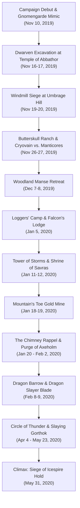

# 🏔️ Act 1: Dragon of Icespire Peak

> **Chronicle Navigation:** 🏠 [[The Order of Znak Complete Campaign Chronicle|Campaign Chronicle Hub]] | ➡️ **Next:** [[02 - Act 2 - Storm Lord's Wrath|Act 2: Storm Lord's Wrath]]

---

## 📜 Overview of the First Act
When the young white dragon **[[Cryovain]]** descended upon the jagged, snow-capped spurs of **[[Icespire Hold]]**, his icy arrival sent shockwaves of terror across the Sword Mountains and Neverwinter Wood. Monstrous predators fled the freezing peaks, displacing ferocious mountain orc tribes who formed a desperate, dark pact with the half-orc **[[Anchorites of Talos]]**. 

Answering the desperate call for sellswords in the frontier boomtown of **[[Phandalin]]**, four disparate travelers—**[[Krageer Stoneface Ogolakanu]]**, **[[Rhynok]]**, **[[Myagkiy Znak]]**, and **[[Tvyordiy Znak]]**—forged the unbreakable fellowship that would canonically become **[[The Order of Znak]]**.

Across thirty-two recorded sessions from November 2019 to May 1920, the companions forged their martial legends: delving into cursed dwarven ruins, braving vine-choked forests, outsmarting wererats, claiming ancient blades, and ultimately scaling the highest frozen peak of the Sword Mountains to slay the white dragon upon his rooftop throne.

---

## ⚔️ The Frontier Chronicles

### 🍺 Chapter 1: Arrival in Phandalin & The White Wyrm's Shadow
*(November 10, 2019)*

In the gray chill of late autumn, four untested sellswords marched along the Triboar Trail into the rough-and-tumble mining boomtown of **[[Phandalin]]**. Each carried the humble equipment of their origins:
* **[[Krageer Stoneface Ogolakanu]]** hefted a heavy iron battleaxe and a quiver of javelins, his weathered Goliath features unreadable.
* **[[Rhynok]]** moved with the silent, watchful grace of the swamps, carrying a weathered longbow and a balanced warhammer.
* **[[Myagkiy Znak]]** bore a sturdy oak shield and a silver-headed mace, radiating the compassionate serenity of the Life Domain.
* **[[Tvyordiy Znak]]** glided lightly on feathered talons, twirling a slender Eastern-style *Qiang* spear.

Over tankards of bitter ale at the **[[Stonehill Inn]]**, innkeeper **[[Toblen Stonehill]]** introduced the newcomers to frontier life. Fear hung heavy over the settlement: the young white dragon **[[Cryovain]]** had descended upon the peaks, sweeping low over the rooftops in sudden hunting raids that seized livestock and claimed the life of miner **[[Turkos Doomheart]]**. Terrified for the town's survival, Townmaster **[[Harbin Wester]]** barred his manor doors, refusing visitors and sliding frantic, ink-stained bounty notices beneath the threshold. 

Among the initial notices was an urgent plea to seek out the eccentric rock gnome inventors of **[[Gnomengarde]]** to negotiate for magical or mechanical contraptions capable of repelling the dragon. Accepting the contract, the four sellswords set out southeast along the stream into the Sword Mountain foothills.

---

### ⚙️ Chapter 2: Gnomengarde & The Wine Cellar Mimic
*(November 10, 2019)*

Following a cascading mountain stream into the misty gorge of **[[Gnomengarde]]**, the Order sought audience with the reclusive rock gnome kingdom. Their arrival was met with instantaneous, frantic chaos: manic inventor **[[Facktoré]]** opened fire from behind a barricade with her steam-driven autoloading heavy crossbow contraption, shooting Rhynok before Krageer bodily rushed the apparatus and restrained the spinning ballista!

Roughing up jittery gnome sentries along the corridors, the party was introduced to chief artificers **[[Fibblestib Pinebark]]** and **[[Dabbledob Plasterpatch]]** (affectionately called *Dabbledop*). The artificers revealed that an insidious shapeshifting predator had crept into the caverns and begun devouring gnomes whole. The killings had driven **[[Korboz|King Korboz]]** mad with terror, prompting the monarch to lock himself and husband **[[Gnerkli|King Gnerkli]]** inside the royal bedchamber.

Enlisting the aid of Dabbledob, the party systematically swept the workshop halls. Utilizing Gary's tactical **10-foot collapsible pole** to poke barrels and suspicious furniture from safe distance, the Order cornered the monster in the royal wine cellar: **a predatory Mimic disguised as a wine barrel**. 

The battle was swift, brutal, and decisive:
* Krageer Stoneface Ogolakanu went into a berserk frenzy, driving his heavy iron battleaxe into the creature's rubbery mass (*"Yo, Stoneface is a straight up killa"*).
* Myagkiy and Dabbledob unleashed a lethal barrage of glowing *Magic Missiles* into its core, tearing the monstrosity to shreds before its adhesive flesh could permanently trap their weapons.
* Slaying the beast alongside Dabbledob earned the companions a shared triumph (splitting 102 XP each).

With royal sanity restored and King Korboz convinced the danger had passed, the grateful gnomish court rewarded the heroes with several ingenious magical curios—including the ***Clockwork Amulet*** and ***Hat of Wizardry***—before the Order marched back to Phandalin.

---

### ⛏️ Chapter 3: The Dwarven Excavation & The Gem of Greed
*(November 16 – November 17, 2019)*

With Gnomengarde secured, the companions turned southwest into a rugged canyon of the Sword Mountains to fulfill Townmaster Harbin’s second contract: warning dwarven prospectors **[[Dazlyn Grayshard]]** and **[[Norbus Ironrune]]** about Cryovain’s encroaching presence. Upon arriving at the newly unearthed **[[Temple of Abbathor]]**, the dwarves welcomed the armed party but adamantly refused to abandon their claim until the subterranean ruin was cleared of lurking horrors.

Entering the ancient stone halls, the Order encountered undulating **Ochre Jellies** oozing from the crumbling stonework. In a grueling subterranean duel:
* Myagkiy invoked divine guidance and seared the acidic horrors with beams of *Sacred Flame*.
* Tvyordiy vaulted forward, driving his *Qiang* into the oozes and following with rapid unarmed strikes.
* Krageer hewed the beasts with his axe, discovering with alarm that slashing weapons divided the jellies into smaller, swarming horrors!
* Rhynok methodically picked off the splitting oozes from a safe distance with his longbow.

Clearing the inner sanctuary, the party unearthed a hidden altar room housing a stone statue of Abbathor, the dwarven god of greed, with a glowing jewel set into its breast. Tempted by its luster, Krageer pried at the stone. The Goliath’s danger instincts flared an instant before the trap detonated, but he double-failed his DC 15 Dexterity save (rolling under 15 on both d20s despite *Danger Sense*!) and took the full brunt of the explosive fireblast. Soot-stained and humbled, Krageer emerged into the canyon where Dazlyn and Norbus rewarded the party with a pair of attuned ***Sending Stones***—a magical lifeline that would keep the Order linked across their entire legendary saga.

As they exited the canyon, a raiding party of five mountain orcs charged the defile. Against Rhynok’s sworn hatred of orc-kind and the party's disciplined frontline, the raiders were annihilated before they could breach the canyon mouth.

---

### 🌾 Chapter 4: The Windmill Siege at Umbrage Hill
*(November 19 – November 20, 2019)*

Riding south toward the rolling agrarian meadows of **[[Umbrage Hill]]**, the Order sought out the stubborn midwife and herbalist **[[Adabra Gwynn]]**. Upon approaching the stone windmill, they found the compound under active siege: a ravenous, leathery-winged **Manticore** was clawing at the timber doors, roaring for flesh.

Rolling initiative against the monstrosity, the Order executed a synchronized ranged and aerial assault:
* Krageer hurled heavy iron javelins into the beast's flanks, trading blows as the manticore whipped its barbed tail.
* Tvyordiy bounded up the windmill masonry, using his monk discipline to *Deflect Missiles* out of mid-air and strike back with his wushu spear.
* Rhynok unleashed an enchanted volley of *Hail of Thorns* from his longbow, punching shafts through the beast's wings.
* Myagkiy channeled radiant healing energy to keep the frontline pristine.

Badly wounded and unable to pierce the Order's coordinated defense, the manticore broke off the siege and fled into the southern crags. Though Adabra stubbornly refused to evacuate her windmill, she gifted the Order several restorative potions of healing.

---

### 🐄 Chapter 5: Butterskull Ranch & Cryovain vs. Manticores
*(November 26 – November 27, 2019)*

Reports of black smoke rising along the Triboar Trail drew the Order east to **[[Butterskull Ranch]]**. Mountain orcs displaced from the high peaks had ransacked the homestead, capturing retired sheriff **[[Alfonse Kalazorn|"Big Al" Kalazorn]]**.

Approaching under cover of twilight, Rhynok crept through the tall rye grass. Spotting a solitary orc guard lingering beside the ranch **outhouse**, the Order executed a silent, synchronized ambush—dropping the sentry before an alarm could be raised. Peeking through the farmhouse window, Rhynok counted a dozen heavily armed orcs feasting in the main hall.

Storming the doorway, the Order engaged in a brutal, room-to-room melee. Krageer raged through the kitchen, shattering timber tables and cleaving through orc warriors; Tvyordiy redirected charging brutes with drunken footwork; Myagkiy held the threshold with divine radiance; and Rhynok picked off raiders attempting to flank from the stairwell. Slaying all twelve orcs, the party descended into the cellar to unchain Big Al Kalazorn. In gratitude, Big Al gave the companions his blessing and begged them to recover his prized runaway prize dairy cow, **[[Petunia (cow)|Petunia]]**, who was coaxed safely back to Phandalin.

**The Apex Dominance Encounter (November 27, 2019):**  
On the return journey across the foothills, the skies suddenly darkened as a freezing blizzard wind swept down from the mountains. Looking up, the companions witnessed an awe-inspiring, brutal spectacle of draconic apex dominance: **[[Cryovain]] swooped down from the storm clouds upon a pair of hunting Manticores**. In a flurry of glacial frost breath, razor-sharp claws, and snapping jaws, the young white dragon tore into the manticores mid-air—effortlessly ripping the rival predators to shreds before carrying their frozen carcasses back to the high peaks. The chilling display cemented the true scale of the terror haunting the Sword Coast.

---

### 🌲 Chapter 6: Neverwinter Wood & The Woodland Manse Retreat
*(December 7 – December 8, 2019 & March 7, 2020)*

Commissioned to deliver provisions to the **[[Loggers' Camp]]**, the Order rode deep into the primeval shadows of Neverwinter Wood. Guided by Rhynok’s unerring woodcraft, the companions noticed an unnatural boar tracking them from the briars—recognizing the beast as a shapeshifted priest of the **[[Anchorites of Talos]]**.

Determined to strike at the heart of the storm cult, the party advanced toward the vine-choked **[[Woodland Manse]]**. In an inspired stroke of psychological warfare, **Krageer tattooed a sacred warning in Orcish directly onto the hide of a shaved, one-eyed goat:**
> *"Take this goat as an offering of sustenance. For if you do not take it and flee from this mansion and cease your worship of false and weak gods then my wrath will come upon thee. My blood spear is unforgiving and though I only have one eye... it sees all. — Gruumsh"*

Releasing the goat toward the mansion gates, the omen terrified superstitious orc sentries into breaking ranks! Yet when the Order charged into the central courtyard around the rotting **Gulthias Tree**, they were ensnared in a lethal trap. Half-orc ritualist **[[Grannoc]]** and swarms of needle, twig, and vine blights surrounded the party, while anchorites hurled crackling *Lightning Bolts*.

In the desperate fighting withdrawal, Krageer fell unconscious twice under a punishing storm of spines and dark magic. As the Goliath collapsed at the edge of the clearing, winged monk **Tvyordiy Znak** swooped back through the canopy, hoisted the bleeding Goliath into his talons, and carried him through the treetops to safety—a harrowing escape that cemented their unbreakable bond.

---

### 🪓 Chapter 7: Ankhegs at Loggers' Camp & Falcon's Hunting Lodge
*(January 5, 2020)*

Rebounding from the Manse, the companions hauled their supply wagon—pulled by the stalwart draft ox **[[Vincent (ox)|Vincent]]**—to the **[[Loggers' Camp]]** on the Neverwinter River. They found the logging camp devastated: desecrated totem poles had lured monstrous, acid-spitting **Ankhegs** from the earth.

When an enormous ankheg burst through the floorboards of camp manager **[[Tibor Wester]]**'s cabin, the Order charged into the breach. Krageer grappled its mandibles while Myagkiy blinded it with sacred flame and Tvyordiy crushed its chitin with flying kicks. Liberating Tibor, the party guided the survivors to safety.

Seeking shelter deeper in the woods, the Order brought a fine bottle of wine to **[[Falcon's Hunting Lodge]]**, arriving just as Cryovain swooped down in a strafing frost attack. Fighting shoulder-to-shoulder with master huntsman **[[Gustaf Stellern|Falcon the Hunter]]**, the party drove the dragon off. Impressed by their martial prowess, Falcon promised Rhynok a pair of legendary ***Boots of Elvenkind*** if the Order could cleanse the Woodland Manse once and for all.

---

### ⚡ Chapter 8: The Sea Cliffs & The Tower of Storms
*(January 11, 2020)*

Turning west to the jagged sea cliffs of the Sword Coast, the companions investigated the unnatural green light pulsing from the **[[Tower of Storms]]**. On the rocky shore, they encountered an **awakened giant crab**, who warned them of the sea elf banshee **[[Miraal]]** haunting the tidal caves below the lighthouse.

Entering the cavern, the party spoke with the weeping spirit, learning that half-orc anchorite **[[Moesko]]** had murdered her and stolen her prized conch shell. Scaling the sheer cliffs, several companions momentarily succumbed to the mesmerizing siren song of hunting **Harpies**, nearly stumbling into the ocean surge before breaking the charm and striking the winged predators down.

Storming the lighthouse keep, the Order confronted Moesko at the desecrated altar of Talos. Slaying the cultist, they climbed to the storm-lashed pinnacle to **pierce and destroy Moesko's beating, disembodied heart**, lifting the lighthouse curse forever. Returning the conch to Miraal laid her soul to rest, and true to its word, the awakened giant crab scuttled from the surf bearing an enchanted **+1 Longbow**—which passed straight to **Rhynok**.

---

### 🔔 Chapter 9: The 2,500 Gold Piece Bell at the Shrine of Savras
*(January 12, 2020)*

Escorting frontier patron **[[DonJon Raskin]]** south of ruined Conyberry, the Order reached the ancient stone courtyard of the **[[Shrine of Savras]]**. The holy site had been overrun by a powerful warband of mountain orcs and towering **Ogres**.

With DonJon cheering them on in his colorful frontier drawl, the Order unleashed their full power. Rhynok's newly acquired +1 longbow picked off orc skirmishers with deadly precision; Krageer went toe-to-toe with the ogres, trading crushing club blows for savage greataxe chops; Myagkiy anchored the center with healing wards; and Tvyordiy swept the courtyard with dazzling martial arts.

Inside the ruined sanctuary, Rhynok and Krageer touched the uncovered stone altar of Savras, receiving a shared prophetic vision: soaring through freezing cloud banks to gaze upon **Cryovain** slumbering atop the battlements of **Icespire Hold**. Before riding out, Krageer and Tvyordiy scaled the crumbling belfry, pried loose the solid gold temple bell, and hauled the massive treasure back to Phandalin to **sell for an astounding 2,500 gold pieces**!

---

### 🐀 Chapter 10: The Wererat Lesson at Mountain's Toe Gold Mine
*(January 18 – January 19, 2020)*

Escorting DonJon Raskin to oversee **[[Mountain's Toe Gold Mine]]**, the Order discovered the mining complex occupied by the Whiskered Gang, led by wererat boss **[[Zeleen Varnaster]]**. When negotiations broke down and steel was drawn, a shocking revelation struck the frontline:

Krageer's heavy iron greataxe and Tvyordiy's wooden *Qiang* glanced harmlessly off the lycanthropes' cursed flesh! Immune to non-magical and non-silvered weapons, the wererat pack swarmed the frontline with venomous bites.

The battle turned into an urgent carrying operation:
* **Rhynok's +1 Longbow** punched clean through the supernatural immunity, pinning wererats to the mine timbers.
* **Myagkiy Znak** became the decisive frontline engine: summoning swirling radiant hosts of ***Spirit Guardians***, directing his floating ***Spiritual Weapon***, and blasting wererats with *Sacred Flame*.

Routing the pack, the party drove Zeleen Varnaster from the mine, restored the claim to DonJon, and marched straight back to Phandalin with an urgent mandate: every weapon in their arsenal had to be coated in **alchemical silver**.

---

### 🏰 Chapter 11: The Chimney Rappel & Purge of Axeholm
*(January 20 – February 2, 2020)*

With the Phandalin Town Council desperate for a fortified evacuation refuge against Cryovain, the Order was tasked with securing the ancient dwarven fortress of **[[Axeholm]]**. Finding the fortress portcullis barred from within, the party scaled the mountain crags on January 20 to a sheer natural ventilation chimney high above the ramparts.

Under Myagkiy’s prayerful guidance, all four companions rappelled down the soot-blackened flue, dropping into the dark interior in a devastating surprise attack on a nest of seven giant spiders. From there, the Order conducted a methodical, room-by-room purge of the haunted halls across February 1–2: cleansing the West Hall and Smithy of flesh-eating dwarven **Ghouls** and swarms of **Stirges**.

In the upper Haunted Hall, they faced the sorrowful moon elf banshee **[[Vyldara]]**. When the spirit unleashed her soul-chilling *Wail*, the four champions stood like bedrock—not a single member faltering before her shriek—before striking her down with silvered strikes and radiant bursts. Behind a false hearth in the castellan's bedchamber, Myagkiy uncovered and attuned the ***Gauntlets of Ogre Power***, while Krageer donned the menacing ***Dread Helm***, his eyes glowing like crimson embers beneath the steel visor.

---

### 🗡️ Chapter 12: Dragon Barrow & The Dragon Slayer Blade
*(February 8 – February 9, 2020)*

Guided by ancient frontier lore, the Order journeyed past ruined Conyberry to the grassy mounds of **[[Dragon Barrow]]**, tomb of the noble knight Lady Tanamere Alagondar. 

Navigating the submerged sarcophagus catacombs, the champions extinguished a predatory Will-o'-Wisp and confronted an unseen **Invisible Stalker** guarding the crypt of the dragon Azdraka. Anticipating the stalker's strikes, Tvyordiy landed stunning spear blows into the rippling air while Krageer cleaved the unseen entity in twain.

In the innermost vault, Krageer lifted the legendary ***Dragon Slayer* Longsword** from Lady Alagondar's sarcophagus—its ancient runes glowing with radiant vengeance against draconic scale. Exiting the mound, the Order forged an alliance with noble centaur **[[Xanth]]**, who pledged his hooves and spear to help them crush the storm cultists of Neverwinter Wood.

---

### ⚡ Chapter 13: Thunder on the Hill: Slaying Gorthok at Circle of Thunder
*(April 4 – May 23, 2020)*

With the dragon-slaying blade in hand, the Order returned to Neverwinter Wood alongside **[[Xanth]] the Centaur** to settle their blood feud with the storm cultists who had sacked Falcon's Hunting Lodge.

Intercepting anchorite warlord **[[Yargath]]** and her patrol of ten Talosian orcs on a custom wilderness battlefield, the Order annihilated the vanguard without suffering a single casualty. Ascending the standing stones atop the **[[Circle of Thunder]]**, the party breached the storm cult's grand ritual amid deafening thunderclaps and driving rain:
* Cult leaders **[[Flenz]]** and **[[Narux]]** were struck down as they hurled *Lightning Bolts*.
* Slaying the summoners triggered the arrival of **[[Gorthok]] the Thunder Boar**, a colossal primordial beast with crackling lightning tusks.
* Krageer met the Thunder Boar's charge head-on, shrugging off lightning jolts in a Bear Totem fury; Tvyordiy battered its knees with concussive strikes; Myagkiy shredded the swarming blights with *Spirit Guardians*; and Rhynok poured deadeye arrows into its flanks.

When Gorthok collapsed into the muddy stones, the storm cult of Talos was broken forever across the Sword Coast. In the caves beneath the altar, Myagkiy claimed an enchanted ***+1 Shield***, and Falcon proudly awarded Rhynok his long-awaited ***Boots of Elvenkind***.

---

### 🐉 Chapter 14: The Climax: The Rooftop Siege of Icespire Hold
*(May 31, 2020)*

On the final day of May 1920, [[The Order of Znak]] made their ascent into the blizzard-swept heights of the Sword Mountains, climbing the frozen stairs toward **[[Icespire Hold]]**.

Cutting down a hobgoblin warband along the icy spurs, the companions breached the keep, swept past the treacherous **[[Stone-Cold Reavers]]**, and ascended the frost-crusted stairs to the open fortress roof. Stepping out into the howling gale, the heroes came face-to-face with **[[Cryovain]]**, perched atop the battlement crags surrounded by a swarm of **four cackling Ice Mephits**:
* Myagkiy called down a blessing of divine fortune upon his brothers and directed his floating *Spiritual Weapon* to swat the ice mephits out of the air.
* Cryovain opened his maw and unleashed a devastating torrent of glacial *Cold Breath* across the icy rooftop. Weathering the blast, Krageer and Tvyordiy charged across the slippery stone.
* **Tvyordiy Znak landed a series of clutch *Stunning Strikes***, driving his silvered *Qiang* into the dragon's pressure points and locking the young white dragon in frozen paralysis!
* Seizing the opening, **Krageer Stoneface Ogolakanu** roared in a furious Bear Totem rage and brought the ***Dragon Slayer* Longsword** down with crushing, two-handed power strikes—its ancient runes blazing with fury as it bit deep through white scales and cracked bone.
* Rhynok loosed a final pair of black-shafted arrows from his +1 longbow straight through the dragon's throat.

With a final, earth-shaking shudder, **Cryovain** collapsed lifeless across the frozen battlements of Icespire Hold. Act 1 was won.

Returning down the mountain to Phandalin as celebrated legends of the frontier, the Order of Znak found their fame carried down the High Road to **Lord Protector Dagult Neverember** in Neverwinter and the **Lords of Waterdeep**—setting the stage for their next great destiny in coastal **[[Leilon]]**.

---

## 💡 Behind the Screen: Campaign Genesis, Mechanics & Table Trivia

### 🎲 VTT Encounter Scaling & Dice Highlights
* **November 10, 2019 Campaign Kickoff & Gnomengarde Mimic:** The campaign launched on the morning of November 10, 2019, with Peter (*Sheer Iron Will*) and Gary (*UnixBomber*) creating their Discord server and Roll20 table. Their very first dungeon dive took them to Gnomengarde, where Gary's Stoneface went wild on the barrel mimic (*"Yo stone face is as straight up killa"*). Slaying the beast alongside Dabbledop (*Dabbledob*) earned the party 102 split XP.
* **The 10-Foot Collapsible Pole & "The Monsters Know What They're Doing":** Gary astutely brought a 10-foot collapsible pole into Gnomengarde to prod suspicious furniture and search for monsters from safe distance. In post-session reflection, Peter consulted Keith Ammann's *The Monsters Know What They're Doing* tactics blog, realizing with amusement that under strict 5e adhesive rules, both Gary's weapons and the collapsible pole should have stuck fast to the mimic's adhesive hide! Peter also realized they had forgotten the Gnomengarde wild magic surge check (a d20 roll whenever casting a spell).
* **Two Distinct Manticore Encounters (Nov 19 vs. Nov 27):**
  - **November 19 (Umbrage Hill):** The party fought the lone manticore besieging Adabra Gwynn's stone windmill, surviving its tail spikes before driving it off over the southern crags with *Hail of Thorns* and *Deflect Missiles*.
  - **November 27 (Cryovain's Mid-Air Dominance):** Returning from Butterskull Ranch, the party looked up to witness Cryovain swooping from the clouds upon a pair of manticores, unleashing his glacial *Cold Breath* (24 bite, 26/18 claws) and tearing them apart in mid-air in front of the party.
* **Krageer's Double-Fail with *Danger Sense* (Temple of Abbathor):** Right after unlocking *Danger Sense* at Level 2 (granting Advantage on Dexterity saves against traps), Krageer pried the cursed gem from Abbathor's statue and rolled **under 15 on both d20s** against the DC 15 save, taking full explosive fire damage!
* **The 2,500 GP Bell Heist:** At the Shrine of Savras, Krageer and Tvyordiy rolled high Athletics checks to dislodge the massive solid gold bell from the ruined belfry tower, loading it into a wagon to cash in for a massive 2,500 gold piece bounty.
* **The Wererat Immunity Panic:** Mountain's Toe Gold Mine served as a brutal tactical wake-up call when the players discovered that non-magical/non-silvered weapons dealt zero damage to wererats, forcing Myagkiy (*Spirit Guardians*) and Rhynok (+1 Longbow) to carry the combat while the party immediately silvered their arsenal in Phandalin.
* **Custom Roll20 Map for Yargath's Patrol:** DM Peter designed a custom woodland battlemap where the Order and centaur ally Xanth ambushed anchorite commander Yargath and her ten orcs before reaching the Circle of Thunder.
* **Rooftop Ice Mephits Reinforcement:** Recognizing that a Level 6 party wielding the *Dragon Slayer Longsword* could burn down Cryovain rapidly, Peter added a flock of **four Ice Mephits** to the rooftop battle to harass the party with frost breath and disrupt concentration.
* **Tvyordiy's Clutch Stunning Strikes:** Tvyordiy successfully landed Stunning Strikes on Cryovain, paralyzing the dragon on the roof and granting Krageer automatic advantage with the *Dragon Slayer* blade.
* **Midjourney 2022 Impressionistic Art:** The iconic art of Tvyordiy (*"Sheer Iron Will"*) fighting Cryovain on the mountain summit was generated in early 2022 via Midjourney as a permanent homage to this epic Act 1 climax.
