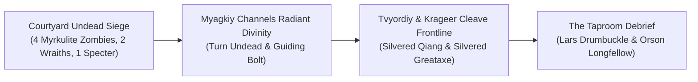
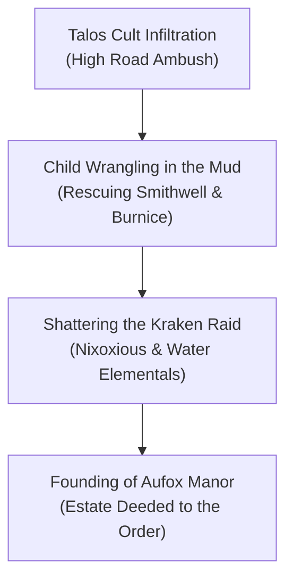
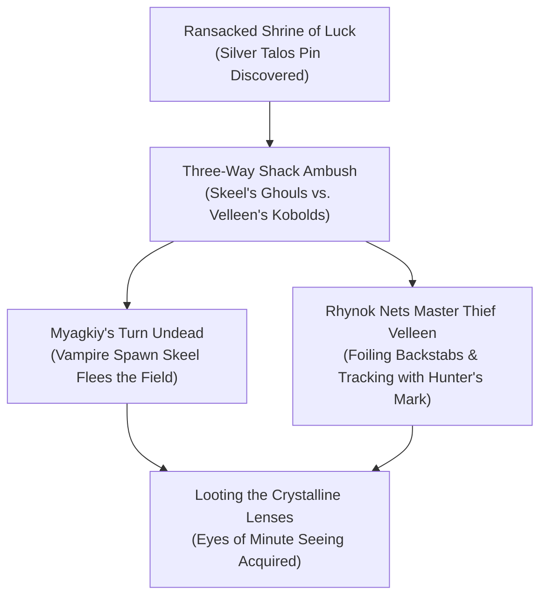
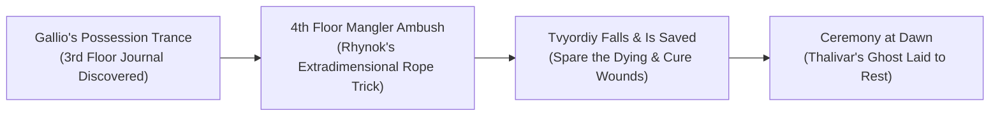
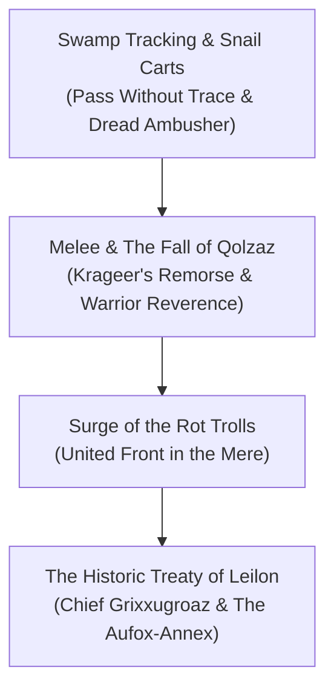
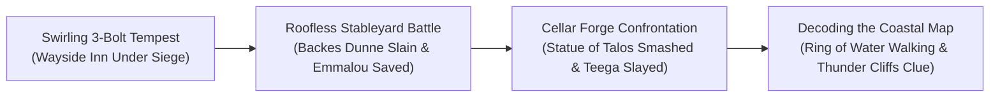
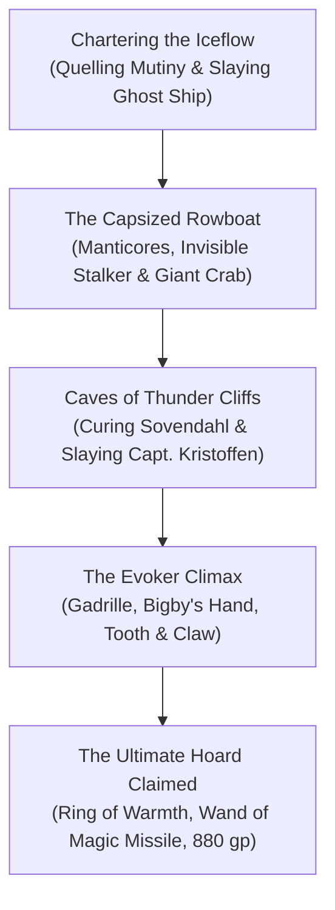

# ⛈️ Act 2: Storm Lord's Wrath (The Order of Znak)

## 📖 Historical Context & The Road to Leilon
With the white dragon [[Cryovain]] slain upon the frozen peak of Icespire Hold, peace returned to the mining settlement of Phandalin. Yet far to the south along the High Road, ancient rivalries stirred. The Lords of Waterdeep grew wary of Neverwinter’s southern expansion, specifically Lord Protector Dagult Neverember’s ambitious military and mercantile efforts to rebuild the ruined coastal town of **[[Leilon]]** and control the southern mining trade. 

Seeking trusted operatives who held no official allegiance to Neverwinter’s throne, confidential agents of Waterdeep turned their eyes to the four champions known across the Sword Coast as **[[The Order of Znak]]**.

---

## 🍷 Chapter 1: The Gathering Tempest at the Wayside Inn
*(June 13 – June 21, 2020)*

Commissioned under sealed orders from Waterdeep, the Order traveled south down the High Road toward **[[The Wayside Inn]]**, a fortified coaching hospice standing sentinel between the Mere of Dead Men and the coastal wilderness. They arrived under a heavy, sunless sky only to find the inn encircled by the walking dead.

Four zombies—their rotting foreheads carved with the macabre skull insignia of Myrkul, Lord of Bones—shambled through the courtyard alongside two chilling wraiths. As the wraiths reached forward with life-draining talons, spectral wails tore through the rain. A fallen traveler violently coalesced into a shrieking specter, threatening to overrun the gates.

Stepping to the broken threshold, **[[Myagkiy Znak]]** raised his holy symbol, invoking the censuring light of the Life Domain. The divine flare shattered the zombies' unholy resolve and seared the incorporeal shadows. Bounding across the mud, **[[Tvyordiy Znak]]** drove his silvered *Qiang* spear into the wraiths, dodging cold spectral claws with agile, drunken sways. Beside him, **[[Krageer Stoneface Ogolakanu]]** roared into a battle fury, his silvered greataxe hewing decayed limbs in sweeping arcs, while **[[Rhynok]]** unleashed precision cover archery from the roadside thickets.

With the undead purged, the champions were ushered into the warm, fortified taproom. There they were embraced by proprietor **[[Martisha Vinetalker]]**, who pledged mutual protection and promised to endorse a future mercantile pact once the Order established themselves in Leilon. Over hearty, steam-laden bowls of fiery pepper stew and savory pork pies, Krageer found himself hopelessly smitten with half-orc head cook **[[Cooragh|Cooragh Struckt]]**, whose spirited temperament and tongue-searing spices marked the beginning of a legendary courtship.

At a secluded corner table, the party met their confidential contacts: **[[Orson Longfellow]]** and **[[Lars Drumbuckle]]**. After testing the adventurers' resolve and discretion, Lars laid bare their true mandate for the **Lords of Waterdeep**: Neverwinter was moving aggressively to fortify Leilon as a regional trade monopoly. The Order was tasked with traveling to Leilon, embedding themselves as the town’s indispensable champions, surveying Neverwinter’s true motives, and paving the way for Waterdhavian commercial influence.

---

## 🌊 Chapter 2: The High Road Ambush & A Normal Day in Leilon
*(July 3 – July 9, 2020)*

Departing at first light, the Order marched north toward Leilon. Along the muddy highway, the weather shifted with unnatural violence. Emerging through the roadside drizzle came a chilling vanguard: armored knights mounted upon supernatural steeds sculpted from living, undulating water, bearing shields emblazoned with three parallel lightning bolts striking downward—the dread sigil of the storm god, Talos. Behind them rumbled a heavy wagon hauled by another water-steed, filled with cultist archers.

Krageer met the charging aquatic steeds head-on, testing his massive Goliath frame against their supernatural momentum, splintering their lances, and hacking down the Dark Tide Knights with his silvered axe. Tvyordiy vaulted cleanly into the wagon bed, his *Qiang* thrusts and spinning kicks scattering the archers, while Myagkiy summoned radiant guardian spirits and locked the enemy vanguard with paralyzing divine magic. Rhynok silenced the remaining archers from the treeline. Searching the dissolved watery remains, Krageer uncovered proof of Talosite incursions encroaching on the High Road.

Upon reaching the outskirts of ruined Leilon, the party found the nascent town leadership assembled in disarray along the road. Cultist infiltrators had slipped into the settlement, panicking the populace and scattering frightened children toward the treacherous marshes. Fanning out through the rubble, the Order moved with swift precision—relying on silent stalks and gentle coaxing to herd two terrified ten-year-old orphans, **[[Smithwell and Burnice]]**, out of harm’s way.

Moments later, the marsh canals erupted. Mutated tiefling Kraken Priest **[[Nixoxious]]** strode forth from the waters, bellowing with the thunderous *Voice of the Kraken* while calling lightning bolts down from the darkening heavens. Raging berserkers surged behind him, butchering townsfolk to empower their dark rituals as towering water elementals and water weirds constricted survivors in suffocating vortexes.

Krageer’s primal danger sense guided him through crackling lightning strikes as he intercepted the berserkers in brutal close combat. Myagkiy anchored the center of town, his radiant aura providing a safe haven for fleeing commoners while his spells stitched grievous wounds. Tvyordiy dove into the swirling vortexes, landing concussive strikes that shattered the elementals' cohesion, while Rhynok singled out Nixoxious with a hunter's curse, driving arrow after arrow into the cult leader until he collapsed into the marsh.

Hailed as the saviors of Leilon, the Order was formally awarded a fortified stone manor by the grateful Town Council. In honor of their esteemed associate, the champions canonically christened their new headquarters **Aufox Manor**, taking young Smithwell and Burnice under their permanent wing.

---

## 🐐 Chapter 3: Aid from Phandalin & The Triple-Sided Shadow
*(July 10 – July 17, 2020)*

With Leilon’s immediate defenses stabilized, the Town Council requested the Order escort eccentric gnome goatherd **[[Pinchwit Wigglehoof]]** and her valuable herd of **Giant Goats** east to Phandalin.

During the trek across the foothills, the towering shadow of a hunting wyvern cast dread over the herd, triggering a frantic stampede. Drawing on his swamp upbringing, **Rhynok** seized the initiative with an innovative tactical maneuver: hurling weighted hunting nets to ensnare the bolting goats and drag them back into formation. This spontaneous triumph ignited Rhynok's enduring tactical fascination with combat netting, a discipline he would hone into an art form.

At nightfall, the perimeter watch was tested when **seven Ogres** lumbered into the firelight, intent on slaughtering the herd. Krageer planted himself before the giants, shrugging off crushing blows with his Goliath endurance while locking an ogre in a dirt-churning grapple. Tvyordiy struck like a whirlwind, delivering stunning thrusts with his *Qiang* and cracking ribs with unarmed kicks. Myagkiy raised a beacon of divine hope, while Rhynok picked off the towering brutes from the shadows. All seven ogres were felled without the loss of a single goat.

Arriving in Phandalin, the Order was welcomed with triumphant cheers. Yet beneath the town's cheer, darkness festered. Investigating the ransacked Shrine of Luck, the party uncovered a discarded silver pin bearing the three lightning bolts of Talos. Clues pointed toward shady prospector **[[Argus Skeel]]**, who had vanished into an abandoned shack on the edge of town.

Breaching the shack, the Order walked into a chaotic three-way confrontation between two rival factions: Argus Skeel, unmasked as a terrifying **Vampire Spawn** commanding six skull-marked ghouls of Myrkul, and **[[Velleen Firecrow]]**, an agile **Master Thief** leading an elite cohort of kobold dragonshields in service to Talos.

As the undead lunged, Myagkiy presented his holy symbol and unleashed *Turn Undead*. Overwhelmed by raw divine majesty, the vampire spawn broke in sheer terror, **fleeing completely into the night**. Simultaneously, Master Thief Velleen prepared to weave through the shadows to backstab the party, only for **Rhynok to fling a heavy net directly over her**, entangling her weapons and utterly shutting down her mobility on round one. When Velleen desperately tore free and bolted into the dark, Rhynok placed an upcast hunter's mark upon her, tracking her through the wilderness until she was brought down. 

Searching Velleen's remains, Rhynok claimed a pair of exquisite crystalline lenses—the ***Eyes of Minute Seeing***—along with an encrypted note: *"They will show you the secrets of the map."*

---

## 👻 Chapter 4: The House of Thalivar & Laying the Ghost to Rest
*(July 17 – July 22, 2020)*

Returning along the Triboar Trail, the champions swatted aside an ambush of blood-drinking stirges before marching back into Leilon. There, council members alerted the party to a chilling crisis: wizard **[[Gallio Elibro]]** was suffering from violent fugue states, trances, and supernatural sleepwalking, drawn repeatedly toward the crumbling ruins of the **House of Thalivar**.

Ascending the haunted spire, the party reached the third floor and discovered the ancient handwritten journal of archmage **[[Thalivar]]**. The yellowed pages spoke of a mind trapped in a perpetual dream, yearning for his lost servant and compelled toward the dimensional rubble of the upper floor.

Mounting the stone stairs to the fourth-floor ruins, the air grew freezing and distorted. From the shadowy debris lunged **two six-armed Star-Spawn Manglers**, aberrant horrors born of the Far Realm. The creatures struck with blinding savagery, unleashing flurries of six razor claws that inflicted unbearable psychic "brain pain" whenever striking from darkness.

Rhynok reacted instantly, casting ***Rope Trick*** and ascending into an invisible extradimensional pocket above the rubble, raining deadeye arrows down from total safety. Tvyordiy sustained the brunt of a six-claw flurry, his unarmored frame shredded as he dropped unconscious to the stone. With Tvyordiy hovering on the threshold of death, Myagkiy dashed through the fray, touching the fallen monk with ***Spare the Dying*** before pouring curative divine magic into his wounds. Krageer and Myagkiy's swirling radiant guardians pulverized the remaining mangler into dust.

Recognizing that Thalivar's tortured soul anchored the rift, Myagkiy took a long rest to commune with his deity. At sunrise, Myagkiy scattered 25 gold pieces worth of powdered silver across the ruins, performing a solemn ***Ceremony*** ritual that permanently laid Thalivar’s ghost to rest, severing the possession and restoring Gallio to sanity.

---

## 🐊 Chapter 5: The Snail Carts of the Mere & The Ballad of Qolzaz
*(July 22 – July 26, 2020)*

Shortly after sanctifying the tower, Town Marshal **[[Breltora]]** delivered urgent word: a Neverwintan soldier patrol led by **Private Vesper** had disappeared into the trackless bogs of the **Mere of Dead Men**.

Raised in the great swamps of Faerûn by his Uncle Christos, Rhynok took the lead through his favored terrain. Reading stagnant ripples and decaying marsh vegetation, Rhynok guided the Order through quicksand and venomous mires without a single misstep, bypassing wandering swamp monstrosities and tracking the soldiers to an isolated island camp.

There, sheltered among stagnant reeds, stood a fortified encampment centered around rustic carts hitched to **gargantuan draft snails**. The missing patrol was imprisoned in wooden cages, surrounded by hostile lizardfolk warriors, their brutal champion **Slosh the Render**, subchief **Hissain**, and elderly tribal matriarch **[[Matriarch Qolzaz]]**.

Rhynok shrouded the Order in a veil of silence and camouflage, slipping to the camp's edge before dropping a sentry with a devastating opening bowshot. The battle erupted into a frantic melee in the mud. Slosh and Hissain were cut down by Tvyordiy's spear and Krageer's greataxe. In the blind frenzy of his barbarian rage, Krageer charged elderly Matriarch Qolzaz, striking her down in the heat of combat.

The death of Qolzaz struck deep into Krageer’s warrior conscience—a heavy burden of shame at cutting down an elderly tribal elder. Yet to the surviving lizardfolk, who lived by the harsh, unsentimental laws of martial strength, Krageer’s ferocity commanded profound reverence. 

Before tensions could resolve, the true curse of the swamp descended: ravenous, undead **Rot Trolls** emitting waves of rancid necrotic degeneration. Uniting against the common foe, the Order and the surviving lizardfolk fought back-to-back. Krageer smashed troll skulls with silvered steel, Tvyordiy battered them with relentless unarmed combinations, and Myagkiy channeled radiant sunlight to halt their regeneration.

With the trolls destroyed, the Order liberated Private Vesper and his soldiers. Myagkiy cast ***Tongues***, enabling a direct council with the new lizardfolk sovereign, **[[Grixxugroaz]]**. Acknowledging the Order’s honor and martial superiority, Grixxugroaz ratified a historic peace treaty with Leilon. To seal the pact, **three lizardfolk ambassadors** were assigned to live at **Aufox Manor**, housed in the newly established **Aufox-Annex** alongside an honored, hand-painted portrait of young Qolzaz in battle regalia—her memory forever immortalized in Krageer’s ribcage tattoo and the ***[[Ballad of Qolzaz]]***.

---

## ⚡ Chapter 6: Foul Weather at Wayside & The Doom of Teega
*(July 26 – August 4, 2020)*

Returning to Aufox Manor, the champions enjoyed only brief respite before the heavens darkened once more. Gazing south from the parapets, they observed unnatural, tempestuous thunderheads swirling in the unmistakable shape of **three parallel lightning bolts** directly above [[The Wayside Inn]].

Marching into the gale, the Order arrived at the Wayside Inn to find it engulfed in an apocalyptic siege. Cultist zombies clawed at the walls while three roaring **Air Elemental Myrmidons** tore across the grounds. At the gates, Neverwintan soldier **[[Emmalou]]** lay bleeding out on the brink of death; Myagkiy rushed forward through the gale, stabilizing her life force while severing the ropes holding surviving commoners who had been brutally staked to the palisade with tridents.

Breaching the rain-drenched, roofless stableyard, the party collided with traitorous former gladiator **Backes Dunne** and his cultist guards. Fighting in blinding, knee-deep sheets of mud and water, Krageer and Rhynok cut down Backes Dunne within moments, propping his body by the exterior gates as a terrifying warning to approaching reinforcements. Moving with blistering urgency, the Order cleared the courtyard in under ten minutes, breaking the initial ritual circle and preserving the weather of the Sword Coast.

Breaching the front doors of the inn, an abjuration rune exploded across the foyer; Myagkiy absorbed the brunt of the warding trap, shielding his companions. Upstairs, they discovered terrified tavern worker **[[Cray Onderquill]]**, who revealed that bard **[[Tarbin Tul]]** had been abducted by cultist riders, and proprietor **[[Martisha Vinetalker]]** had been dragged into the flooded cellar forge to be sacrificed.

Kicking open the cellar doors, the champions plunged into the submerged forge. Blacksmith **[[Teega]]** stood chanting before a monstrous, animated **Statue of Talos** that brandished lightning-bolt blades. Severing Martisha's chains, the fierce ex-bandit drew steel and fought alongside the Order. Krageer hammered the animated idol into gravel with devastating two-handed power cleaves. 

As the statue shattered, **Myagkiy Znak** stepped through the radiant light of his guardian spirits, laid a glowing hand upon Teega, and unleashed an upcast, fifth-tier ***Inflict Wounds***. A devastating surge of forty points of pure necrotic wrath tore through the traitor priestess, extinguishing her life in an instant.

Searching the chamber, Rhynok claimed the ***Ring of Water Walking***. Examining Teega’s altar, they discovered an encoded coastal map. Rhynok placed Velleen’s crystalline lenses over his eyes, revealing the hidden ink that pinpointed the cult’s primary coastal redoubt: the **Thunder Cliffs**.

---

## 🌊 Chapter 7: The Thunder Cliffs Finale
*(August 5 – August 11, 2020)*

Determined to decapitate the Cult of Talos, the Order chartered the coastal galley *Iceflow* and sailed north from Leilon into heavy coastal fog.

Midway through the passage, panic overtook the crew, and first mate **Castisha** drew her cutlass, attempting to incite an armed mutiny to turn the vessel back. Before blood could be shed, Myagkiy stepped into the hold and cast ***Calm Emotions***, soothing the crew's terror. Krageer and Rhynok backed the spell with cold, imposing stances of martial dominance, while Tvyordiy captivated the wavering swashbucklers with an acrobatic martial display. Castisha surrendered her blade, and the crew rallied under the Order's banner.

Navigating through the mist, the *Iceflow* crossed paths with Captain Winchet of the caravel *Uneasy Alliance*, who shouted a dire warning of haunted reefs. Moments later, an ancient ghost ship loomed out of the fog, disgorging a maddening **Allip** and life-draining **Specters**. Back-to-back upon the swaying decks, the Order weathered horrific life-draining chills, their silvered weapons and radiant divine flares laying the spectral crew to rest.

Anchoring half a mile offshore from the jagged spires of the Thunder Cliffs, the party pushed off in a heavy rowboat. Midway across the churning surf, **two Manticores** and an **Invisible Stalker** swept down from the cloud banks. Trading volleys across the swells, the party slew the manticores and dispelled the stalker. Yet before they could catch their breath, a gargantuan **Giant Crab** breached the waves, violently upending their rowboat into the breakers!

Rhynok activated his *Ring of Water Walking*, instantly popping to the surface. He cast ***Rope Trick*** into the ocean spray, scrambling into an extradimensional pocket above the waves to rain arrows down upon the submerged titan. Tvyordiy bounded across floating flotsam and surging waves, driving his fists into the creature’s armored shell until the crab sank into the deep.

Reaching the cliffs, the Order scaled the sheer rock face and infiltrated the sea caves without tripping the cultists' alarm wires. Within an interior cavern, they located captive merchant **[[Sovendahl Erkinze]]**. Myagkiy laid hands upon the prisoner, lifting his dark curse; in overwhelming gratitude, Sovendahl aided the party, gifting Rhynok his coveted ***Dagger of Venom***.

Advancing into the central grotto, the champions confronted the garrison commander: dragonborn veteran **Captain [[Kristoffen]]**, flanked by two roaring Air Elementals. Raising his holy symbol, Myagkiy cast ***Banishment*** upon both elementals simultaneously. Holding his concentration with unbreakable resolve, Myagkiy maintained the dimensional lock until both extraplanar horrors were permanently cast back to the Elemental Plane of Air. Deprived of his elemental vanguard, Captain Kristoffen was overwhelmed by Krageer's greataxe, Tvyordiy’s flurry of blows, and Rhynok’s venomous blades.

Pressing into the final sanctuary, the Order confronted arch-evoker **[[Gadrille]] the Reef-Reaver** and his twin hell hounds: **Tooth and Claw**. Gadrille unleashed a terrifying barrage of archmage magic: conjuring a crushing ***Bigby’s Hand***, roaring *Fireballs*, freezing *Cones of Cold*, and crackling forks of *Chain Lightning*. Refusing to yield, Krageer and Tvyordiy weathered the arcane storm, cutting down Tooth and Claw before cornering Gadrille and shattering his arcane ward.

Surfronting the surviving cult spies and scouts, Krageer and Myagkiy delivered an ultimatum of surrender. Realizing their leaders were dead and their elemental masters banished, the spies laid down their arms and fled into the crags.

Gathering within the innermost treasury on **August 11, 2020**, the Order of Znak claimed their hard-won spoils:
- **880 gold pieces** in mint coinage.
- A **pulsing crimson draught** (*Potion of Superior Healing*).
- A **spiraled wand with a bright blue tip** (the ***Wand of Magic Missile***, claimed by **[[Tvyordiy Znak]]**, who famously tested its force salvos).
- A **smooth gold band that remained perpetually warm to the touch** (the ***[[Ring of Warmth]]***, claimed and attuned by **[[Myagkiy Znak]]**).

Boarding the *Iceflow*, the triumphant Order of Znak sailed south toward Leilon—their names etched into Sword Coast legend as the breakers of the Storm Lord’s wrath.

---

## 💡 Behind the Screen & Table Trivia
* **The workplace Kollektiv & Aufox Manor:** Aufox Manor was named in honor of **David**, Peter and Gary's coworker at workplace (whom Gary also knew prior to workplace)—joining Grigory as the second workplace colleague immortalized in campaign lore.
* **The July 13, 2020 HeroForge Milestone:** On July 13, 2020, Peter shared the custom 3D HeroForge digital miniatures created for the four champions in Discord, met with Gary's enthusiastic *"Yesss!"*
* **The Stableyard Rain Debate:** During the August 3 assault on the Wayside Inn, the players realized the tactical grid featured a stableyard with no ceiling, sparking the hilarious exchange: *"It's raining inside?" / "We are in a stableyard!" / "With no roof?!" / "There was no roof, we could have climbed it!"*
* **Myagkiy's 10-Minute Banishment Lock:** In the battle against Captain Kristoffen on August 10, Myagkiy's double-*Banishment* of the Air Elementals was held unbroken for the full spell duration, turning a temporary exile into permanent planar banishment.
* **The Joke-Jab of Qolzaz:** Peter's July 23, 2020 Discord tease (*"Krageer murdered an elderly lizardwoman ... to keep his rage"*) started as table ribbing over barbarian rage timers before the pair transformed it into Krageer's defining lore anchor, his chest tattoo, and the *Ballad of Qolzaz*.
* **Rhynok's Net Obsession:** Rhynok's successful netting of Pinchwit's giant goats and his first-round netting of Master Thief Velleen Firecrow in Phandalin (completely foiling Peter's planned sneak-attack backstabs) turned nets into Gary's signature crowd-control weapon, culminating in a future adamantine-threaded net.
* **The Chronological Boundary:** Act 2 concludes definitively on **August 11, 2020** with the discovery of the *Ring of Warmth*. The very next day (**August 12, 2020**), the party begins **Interlude 1: *"Shadow's Run"***.
