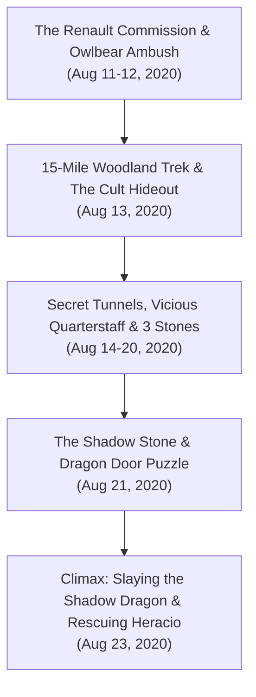

# 🌑 Interlude 1: "Shadow's Run"

> **Chronicle Navigation:** ⬅️ **Previous:** [[02 - Act 2 - Storm Lord's Wrath|Act 2: Storm Lord's Wrath]] | 🏠 [[The Order of Znak Complete Campaign Chronicle|Campaign Chronicle Hub]] | ➡️ **Next:** [[04 - Act 3 - Sleeping Dragon's Wake|Act 3: Sleeping Dragon's Wake]]

---

## 📜 Overview of the First Interlude
In late **Eleasis 1493 DR** (Highsun; *Table Play: August 2020*), following the defense of [[Leilon]] and the elimination of the kraken priest [[Nixoxious]] in *[[02 - Act 2 - Storm Lord's Wrath|Storm Lord's Wrath]]*, **[[The Order of Znak]]** took a brief hiatus from regional rebuilding to answer an urgent, high-stakes personal commission from the southern metropolis of Waterdeep.

Stepping behind the Dungeon Master's screen for the very first time in the campaign, **Gary** crafted and ran a lethal, subterranean homebrew mystery: **"Shadow's Run"**. When noble patron **Daniel Renault** suffered the brutal murder of his wife and the abduction of his young child **Heracio**, his loyal household servants sought out the celebrated champions of the Sword Coast. 

What began as an investigation into a kidnapping evolved into an expedition 55 miles north of Neverwinter, an overland trek into primeval woodlands, an infiltration of a multi-tiered cult redoubt, and an epic descent into a subterranean abyss to unseal an ancient dragon door and slay a terrifying **Shadow Dragon**.

---

## ⚔️ The Shadow's Run Chronicles

### 🐎 Chapter 1: The Waterdeep Carriage, Owlbear Ambush & The Renault Mission
*Eleasis 1493 DR | Table Sessions: August 11 – August 12, 2020*

In the late summer haze, an ornate private carriage bearing the livery of **Daniel Renault**, an influential aristocrat of Waterdeep, arrived in Neverwinter bearing two trusted household servants: **Liefold** and **Joffrey**. Desperate and exhausted, the retainers sought out [[The Order of Znak]] with a tragic plea for aid.

A secretive, shadow-worshipping cult had struck the Renault household—brutally murdering Daniel’s wife and abducting his young son, **Heracio**. While city watch investigations stalled in bureaucratic red tape, Daniel dispatched his most loyal retainers northward to hire the four heroes whose martial renown had spread from Phandalin to the Lords of Waterdeep.

Accepting the urgent contract, the Order boarded Renault’s private carriage. To coordinate extraction upon completion, Liefold presented **[[Tvyordiy Znak]]** with an attuned magical ***Messenger Stone***, allowing the monk to telepathically signal the coachman when young Heracio was secured.

The carriage sped north along the High Road, carrying the company fifty-five miles north of Neverwinter into rugged wilderness. En route, the journey was violently interrupted: smelling the horses, a pair of territorial, bloodthirsty **Owlbears** burst from the tree line in a ferocious ambush! 
* Reacting with trained reflexes, Tvyordiy leaped from the coach steps, driving his Eastern *Qiang* into the lead beast's shoulder and battering its beak with concussive unarmed strikes.
* [[Myagkiy Znak]] stepped into the road, invoking radiant authority to manifest a glowing *Spiritual Weapon* that pummeled the charging predators.
* [[Krageer Stoneface Ogolakanu]] and [[Rhynok]] bounded into the flanking brush, their coordinated martial fury making short work of the monstrosities. 

Securing the carriage and binding minor wounds, the companions stood at the edge of the deep forest, ready to pursue the cult on foot.

---

### 🌲 Chapter 2: The 15-Mile Woodland Trek & Infiltrating the First Layer
*Eleasis 1493 DR | Table Session: August 13, 2020*

Leaving Liefold and Joffrey stationed with the carriage in a concealed woodland clearing, the Order set off on foot—navigating fifteen grueling miles into dense, uncharted old-growth forest. Guided by Rhynok’s unerring Gloom Stalker tracking instincts, the companions skirted natural deadfalls and thorn thickets before coming upon the cult's hidden stronghold: a weathered stone estate nestled deep within the tree-choked valley.

Approaching the threshold, Tvyordiy humorously flared his enchanted ***Cloak of Billowing***, letting the silk ripple dramatically on a phantom breeze to steady his companions' nerves. Breaching the upper entryway, the party engaged the cult's outer perimeter guards. Moving from chamber to chamber across the first floor:
* Rhynok sniped cult sentries from the shadows with his *+1 Longbow*, keeping his movements completely silent.
* Krageer shattered timber barricades, cornering panicked guards before alarms could spread through the compound.
* Sifting through the dust of the upper floor, the companions uncovered a well-concealed stone trapdoor concealing a steep, worn stairway descending deep into the cold earth below.

---

### 🗝️ Chapter 3: The Secret Tunnels, The Vicious Quarterstaff & The Three Stones
*Eleasis 1493 DR | Table Sessions: August 14 – August 20, 2020*

Descending into the lightless subterranean depths beneath the estate, the Order discovered a sprawling complex of damp flagstones, secret doors, and ancient ceremonial chambers where the veil between the Material Plane and the Shadowfell had worn perilously thin.

Clearing Room 1, Rhynok and Tvyordiy detected a hidden compartment behind a masonry bookcase. Forcing open a locked iron chest, Tvyordiy reached inside to discover an exquisitely balanced, rune-carved weapon: the ***Vicious Quarterstaff***. Testing its weight, the winged monk spun the staff in a fluid Drunken Master flourish, feeling the wood thrum with lethal impact on critical strikes. Setting aside his starting spear, the *Vicious Quarterstaff* became Tvyordiy’s signature melee weapon.

Traversing the secret tunnels connecting Room 1 and Room 2 over the following days, the dungeon tested the companions' stamina:
* Wandering shadowy horrors and cultist skirmishers harried the party through narrow corridors, forcing Krageer and Rhynok to burn through four hit dice each to staunch their bleeding.
* Investigating trapped pedestals and secret alcoves, the Order recovered the first three ancient ritual stones required to bypass the inner sanctum:
  1. The glowing **Blood Stone** (a flawless star ruby valued at 1,000 gp).
  2. The dark, light-absorbing **Nightshade Stone**.
  3. The radiant **Moon Stone** (a luminous diamond valued at 5,000 gp).

With three of the four keys in their possession, the Order pressed deeper into the subterranean dark toward the final sealed threshold.

---

### 🐉 Chapter 4: The Dragon Door Puzzle & The Fanatic Vanguard
*Eleasis 1493 DR | Table Session: August 21, 2020*

Deep in the subterranean lower complex, the tunnel terminated at a massive, circular archway carved from polished black basalt: **The Dragon Door**. Dominating the barrier was an imposing relief of an ancient dragon with hollow recesses carved into its anatomy.

Searching a neighboring ritual vault, the Order struck down the remaining cult sentries and claimed the final key: the shadowy, umbral **Shadow Stone**.

Examining the cryptic draconic engravings, the companions deduced the proper ritual sockets to activate the ancient ward:
* **The Blood Stone** was slotted into the **Left Wing**.
* **The Nightshade Stone** was slotted into the **Right Wing**.
* **The Shadow Stone** was fitted into the **Left Eye**.
* **The Moon Stone** was set into the **Right Eye**.

As the fourth stone locked into place, the heavy basalt doors groaned, grinding inward amidst a swirl of freezing mist. Standing across the threshold in the grand vaulted sanctum was the cult's fanatical inner vanguard, spearheaded by the dark ritualist **Fanatic F**.

Initiative flared in an instant. Krageer surged into the room with a roar, Rhynok drove venom-tipped arrows into the cultists' ranks, and Tvyordiy vaulted across the flagstones, his *Vicious Quarterstaff* whistling through the air as the Order pulverized the vanguard and stepped into the abyssal chamber beyond.

---

### 💀 Chapter 5: Boss Battle: Slaying the Shadow Dragon & Rescuing Heracio
*Eleasis 1493 DR | Table Session: August 23, 2020*

Stepping beyond the shattered vanguard, the air temperature plummeted below freezing. Emerging into a colossal subterranean cavern bathed in dim, ethereal gloom, the Order beheld the true master of the cult: a colossal, terrifying **Shadow Dragon**, its translucent ebony scales absorbing the very torchlight and its eyes burning with malevolent hunger. 

Curled beside the draconic altar, bound in chains but alive, was young **Heracio Renault**.

The battle was frantic, merciless, and fought at the edge of life and death:
* The Shadow Dragon took flight, banking along the cavern ceiling before unleashing a horrific torrent of **Necrotic Shadow Breath**—a blast of pure darkness that drained the life and stamina of anyone caught in its path.
* **[[Myagkiy Znak]]** anchored the battlefield with supreme divine devotion: upcasting a 4th-level ***Spirit Guardians*** that swirled in a blazing cyclone of radiant angels, burning away the gloom and searing the dragon whenever it swooped low. When the wyrm landed, Myagkiy closed the distance, driving a devastating 3rd-level ***Inflict Wounds*** into its chest for massive necrotic shock!
* **[[Tvyordiy Znak]]** proved the power of his newly claimed ***Vicious Quarterstaff***: darting beneath the dragon's tail swipes to score multiple critical strikes against its wing joints, following up with concussive unarmed strikes.
* **[[Rhynok]]** struck from concealment along the stalactites, unleashing deadly sneak attacks from his *+1 Longbow* and driving his ***Dagger of Venom*** deep between the dragon’s scales, delivering 16 poison damage past its defenses.
* **[[Krageer Stoneface Ogolakanu]]** went into a full Bear Totem rage, drawing the legendary ***Dragon Slayer* Longsword** claimed from Lady Alagondar's tomb in Dragon Barrow. Bounding onto the wyrm's back, Krageer brought the blade down in two-handed overhead chops, its radiant runes blazing brightly against the darkness until the beast shuddered, collapsed, and dissolved into dissipating black ash.

**The Aftermath & Rescue:**  
With the dragon slain and the cult eradicated, the companions rushed to the altar to shatter young **Heracio**'s bonds. In the desperate melee, a member or innocent victim had fallen; invoking the high rites of Life Domain necromancy, Myagkiy channeled a sacred diamond to cast ***Raise Dead***, restoring life and mending mortal wounds.

Searching the dragon's inner hoard, the heroes claimed their well-earned spoils:
* The valuable ritual gems: the **1,000 gp Star Ruby** (Blood Stone) and the **5,000 gp Diamond** (Moon Stone).
* An enchanted ***+1 Light Hammer***, which passed to Myagkiy Znak.
* The wondrous ***Cape of the Mountebank***, claimed by **[[Myagkiy Znak]]**—granting the heavily armored Life Cleric the invaluable ability to cast ***Dimension Door*** once per day, vanishing and reappearing enveloped in a billowing cloud of harmless brimstone smoke.
* The enchanted ***Sash of the Patient Master***, a masterwork martial art sash claimed by **[[Tvyordiy Znak]]**—attuning to his spiritual discipline to allow the Drunken Master monk to regenerate **1d4 + 1 expended Ki points** once per day.
* An intact shirt of **Adamantine Chain Mail**, which Rhynok claimed to bring back to Phandalin's smithy to be reforged into his dream crowd-control weapon: the **Adamantine Net**.

Emerging from the lightless depths into the morning sun, Tvyordiy activated the ***Messenger Stone***. Within hours, Liefold and Joffrey arrived with the carriage, weeping with gratitude upon seeing young Heracio safe and sound. Escorting the child back to Waterdeep to reunite with Daniel Renault, [[The Order of Znak]] stood as celebrated champions across the Sword Coast—ready to face whatever darker storm awaited them next in [[04 - Act 3 - Sleeping Dragon's Wake|Act 3]].

---

## 💡 Behind the Screen: Gary's DM Screen & Table Trivia

### 🎲 Gary's DM Debut & Roll20 Table Setup
* **Gary Behind the Screen:** Interlude 1 (*"Shadow's Run"*) marked the very first time in the campaign that Gary stepped behind the DM screen, giving Peter a break after running the 14-quest arc of *Dragon of Icespire Peak* and *Storm Lord's Wrath*.
* **Player-Only Chat Logs:** Because Gary owned the Roll20 campaign table and operated as GM, Roll20's default export only preserved player messages for Peter (`Peter M.` and `System/GM`). Gary's monster rolls, NPC whispers, and dynamic lighting triggers were hidden on the GM layer, requiring Peter and Gary's concurrent Discord notes to reconstruct the exact narrative timeline.
* **The Liefold / Leopold Butler Lineage:** The carriage driver and loyal servant who recruited the Order and gave Tvyordiy the *Messenger Stone* was named **Liefold**. This bears an uncanny, affectionate resemblance to **[[Leopold]]**, the Order's dignified human majordomo and butler who manages Aufox Manor and guards adopted wards [[Smithwell and Burnice]] and [[Yasmina]] in Leilon. Whether Liefold subsequently left Renault's service to become the Order's permanent butler Leopold remains a beloved table theory awaiting final confirmation from Gary!
* **The Adamantine Net Lineage:** During the August 12 prep, Gary noted that Rhynok was -100 gp for a smith's deposit to craft an adamantine net. Slaying the cultists yielded the raw adamantine chain shirt on August 23 that was subsequently reforged into Rhynok's signature crowd-control net.
* **The Vicious Quarterstaff Origin:** While Tvyordiy started the campaign wielding a wooden/silvered *Qiang* spear as an homage to *Oriental Adventures*, discovering the *Vicious Quarterstaff* in the first-floor chest of the cult lair on August 14 established the staff as Peter's primary monk weapon throughout the remainder of the trilogy.
* **The 55-Mile Coach / 15-Mile Foot Route:** Gary specifically established the operational geography: taking the carriage 55 miles north of Neverwinter along the High Road, followed by a 15-mile trek on foot into uncharted Neverwinter Wood/Sword Mountain foothills to keep the cult hideout completely isolated from civilization.