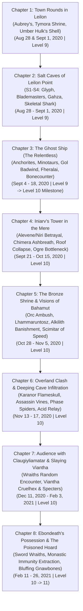
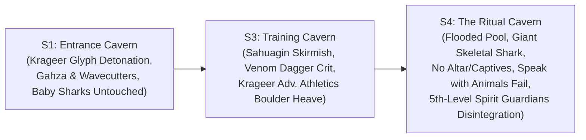

# 🐲 Act 3: Sleeping Dragon's Wake

> **Chronicle Navigation:** ⬅️ **Previous:** [[03 - Interlude 1 - Shadow's Run|Interlude 1: Shadow's Run]] | 🏠 [[The Order of Znak Complete Campaign Chronicle|Campaign Chronicle Hub]] | ➡️ **Next:** [[05 - Interlude 2 - Keeping the Faith|Interlude 2: Keeping the Faith]]

---

## 📜 Overview of the Third Act
Following their return to [[Leilon]] from the lightless depths of *[[03 - Interlude 1 - Shadow's Run|Shadow's Run]]*, **[[The Order of Znak]]** entered the third great chapter of the Sword Coast saga: ***Sleeping Dragon's Wake*** (spanning from **Eleint 1493 DR** to **Alturiak 1494 DR**; *Table Play: August 28, 2020 – February 26, 2021*). 

As the storm worshipers of **[[Talos]]** regrouped along the waves, an ancient, shadowy second threat rose from the mire: **[[Ularan Mortus]]**, High Priest of **Myrkul**, and his necromantic allies sought an ancient dragon vessel to house the malevolent dracolich spirit of **[[Chardansearavitriol]]** ("Ebondeath"). Caught between competing apocalyptic cults, the four champions defended Leilon and its outlying settlements place-by-place:
* Breaking an amphibious sahuagin siege within the **Salt Caves** of **[[Leilon Point]]**
* Purging the stranded Talosite warship *The Relentless* (**The Ghost Ship**)
* Scouring the haunted ruins of **[[Iniarv's Tower]]** in the Mere of Dead Men
* Cleansing demonic madness and receiving Bahamut visions at **[[The Bronze Shrine]]**
* Infiltrating **Deeping Cave** beneath **Kryptgarden Forest** to parley with ancient green wyrm **[[Claugiyliamatar]]** ("Old Gnawbone") and extracting her poisoned hoard following Ebondeath's possession.

---

## ⚔️ The Chronicles of Sleeping Dragon's Wake

### 🏘️ Chapter 1: The Return to Leilon & Town Rounds
*Eleasis – Eleint 1493 DR | Table Sessions: August 28 & September 1, 2020 | Level 9*

Returning from Waterdeep and the northern woodlands after rescuing young Heracio Renault and slaying the Shadow Dragon in *Shadow's Run*, the Order returned to their home at **[[Leilon|Aufox Manor]]**. The settlement was bustling with Grizzelda's stonecutters, but uneasy rumors drifted through the seaside air.

Taking time to resupply and inspect the town:
* **The Adamantine Net Delivery:** [[Rhynok]] retrieved his newly forged **Adamantine Net** from the town smithy—custom-crafted from the adamantine chain shirt won from the Shadow Dragon's hoard (fulfilling his long-standing 100 gp deposit). Rhynok took practice throws in the courtyard, confirming the net's heavy, unbreakable weave (+10 attack).
* **Aubrey's Peculiarities Shoppe:** The party stopped by the storefront of **[[Aubrey Silverspun]]**, browsing Table C magical oddities, examining a *Potion of Superior Healing* (500 gp), and purchasing custom tool kits.
* **Shrine of Tymora:** Visiting the nervous elven acolyte **[[Puck Caribdas]]**, the party noted his fresh batch of alchemical stock, including rare ***potions of growth***.
* **The Umber Hulk's Shell Inn & The Bronze Dragon Rumor:** Gathering at **[[The Umber Hulk's Shell Inn]]** on the morning of September 1, 2020, friendly innkeeper **[[Alion Malwyn]]** served the champions mugs of local ale beneath the massive hanging umber hulk carapace. Leaning over the counter, Alion shared the defining rumor of the frontier:
  > *“Did you hear about the bronze dragon? Apparently, a few travelers from Neverwinter saw one fly north along the coast with a dolphin in its claws. They say those metallic dragons are good. I hope they’re right.”*
* **The Call to Arms:** Before the party could investigate the bronze wyrm, an urgent message arrived from the town council: the outlying fishing settlement at **[[Leilon Point]]** had gone silent following a coordinated amphibious assault by sea devils. Girding their weapons, the Order departed immediately for the rocky northwest coast.

---

### 🌊 Chapter 2: The Salt Caves of Leilon Point
*Eleasis – Eleint 1493 DR | Table Sessions: August 28 – September 1, 2020 | Level 9*

Ten miles northwest of Leilon, the rugged coastal promontory of **[[Leilon Point]]** stood eerily silent beneath heavy ocean fog. Arriving at the village, the Order began a methodical tactical reconnaissance of the surface:
* **Surface Reconnaissance:**
  * Searching the village perimeter, [[Myagkiy Znak]] discovered the battered corpse of priest **[[Nava Wavecrash]]** slumped across the vandalized Shrine of Umberlee (Medicine & Religion checks).
  * In the ransacked supply hut, [[Krageer Stoneface Ogolakanu]] discovered the body of storekeeper **[[Manda Gutterpunch]]** (Investigation & Medicine checks).
  * Approaching the fish-curing storehouse, Rhynok and Myagkiy rolled high Persuasion checks to coax out a terrified survivor: fisher **[[Marciano Belta]]**. Trembling in the shadows, Marciano revealed that the sea devils had slaughtered the villagers and dragged everything down into the subterranean **Salt Caves** below the cliffs.
* **Zero Exterior Warfare:** The party engaged in zero fighting on the open bluffs, surf, or cliffs; all combat occurred strictly subterranean within the four chambers of the **Salt Caves (S1–S4)**.

#### S1: The Entrance Cavern & The Glyph Detonation (*Table Session: August 28, 2020*)
Descending into the dripping limestone entrance of the Salt Caves (S1):
* Krageer moved forward to examine dead sahuagin and human bodies strewn across the cave floor, accidentally triggering a hidden **Glyph of Warding**.
* The magical glyph detonated with a thunderous roar (`5d8` explosive blast; party rolling Dexterity saves).
* The concussive blast alerted the adjacent barracks chamber (S2), immediately drawing out High Priestess **[[Gahza]]** and a strike team of four-armed Sahuagin Blademasters wielding jagged *Wavecutter Blades*.
* Combat exploded in S1: Rhynok deployed his newly forged **Adamantine Net** (`27 to-hit`) to restrain charging warriors; Krageer carved into the blademasters with his Adamantine Greataxe; Myagkiy anchored the center with *Spirit Guardians*; and Tvyordiy shattered enemy bones with his *Vicious Quarterstaff*.
* In the tidal cave pool, a swarm of **baby sharks** (mechanically using the swarm of quippers stat block) thrashed in the blood-tinted water; the party wisely left the young sharks completely untouched.

#### S3: The Training Cavern & The Boulder Cache (*Table Session: August 31, 2020*)
Pushing deeper through the rocky tunnels into the sahuagin training cavern:
* The Order ambushed a squad of regular sahuagin warriors and an elite blademaster.
* Striking from the shadows with Gloom Stalker invisibility, Rhynok drove his ***Dagger of Venom*** into the blademaster with a devastating natural 20 critical hit (`29 to-hit`, 10 piercing + 16 poison damage), dropping the sea devil instantly.
* Krageer and Tvyordiy swept the remaining warriors. Following combat, Krageer rolled a **22 Investigation check**, spotting a concealed hollow behind a massive subterranean rock.
* Rolling an **Athletics check with Advantage**, Krageer roared and heaved the heavy boulder aside, uncovering the sahuagin's hidden treasure cache before the party took a short rest to bandage wounds.

#### S4: The Ritual Cavern & The Giant Skeletal Shark (*Table Session: September 1, 2020*)
Breaching the lowest chamber (S4), the champions entered a vast, flooded subterranean cavern with deep ocean water surging beneath stone ledges. In accordance with table events: **there was no altar and there were no captives**—only a dark ritual pool attended by fanatical priestesses and an enormous, animated **Giant Skeletal Shark** thrashing beneath the water.
* **Krageer's Interspecies Dialogue:** Spotting the undead monster circling in the pool, Krageer cast ***Speak with Animals*** attempting to reason with, intimidate, or interrogate the colossal creature—only to discover that a mindless undead shark composed purely of animated necromantic bones has absolutely nothing to say.
* **Brute Force Assault:** Resigning to violence, Krageer rolled a **28 Athletics check** to close the distance, bounding into the shallows to carve into the ribcage of the skeletal leviathan with devastating Adamantine Greataxe crits (`15 + 8 slashing`).
* **The Priestess's Magic:** An attending priestess cast ***Hold Person*** on Tvyordiy (which the monk resisted with a **20 Constitution save**) and attempted to stabilize the battle with ***Mass Healing Word***.
* **Divine Disintegration:** Stepping to the edge of the pool, Myagkiy upcast ***Spirit Guardians*** to **5th level**, flooding the subterranean grotto with blinding radiant power that shattered the skeletal shark into waterlogged bone fragments. Rhynok finished the remaining priestess with a pinpoint sniper crit from his +1 Longbow (`31 to-hit`, 13 piercing + 4 sneak attack).
* **Return to Leilon:** Escorting sole survivor Marciano Belta safely out of the caves, the Order secured Leilon Point and returned to Leilon.

---

### ⛵ Chapter 3: The Ghost Ship / Talosite Dreadnaught (*The Relentless*)
*Eleint 1493 DR | Table Sessions: September 4 – September 18, 2020 | Level 9 &rarr; Level 10 Milestone*

Returning to Leilon, the council alerted the Order to a mysterious, storm-damaged warship grounded upon the rocky reefs near the Tower of Storms: *The Relentless*, a vessel commanded by storm cultists of Talos.

#### Covert Approach & Undetected Boarding (*Table Session: September 4, 2020*)
* Approaching the mist-shrouded reefs, the party coordinated a group stealth check (Tvyordiy 18, Rhynok 31 & 27, Krageer 18 & 17).
* Rhynok cast ***Pass without Trace***, cloaking the entire party in unnatural shadows and silence.
* Krageer cast *Speak with Animals* (Animal Handling 19) to observe local coastal sea gulls.
* Slipping up the ship's beached hull completely undetected, the Order boarded the main deck without raising an alarm.

#### Upper Deck Storm Battle (*Table Session: September 13, 2020*)
* Emerging onto the weather deck, the party engaged the Anchorites of Talos guarding the twin mangonels, boulder loading chains, and the round iron shield steering wheel.
* The cultists unleashed devastating bursts of ***Lightning Bolt*** and ***Thunderwave*** across the deck, forcing rapid Dexterity saves (Myagkiy 13/17, Krageer 9/13, Rhynok 12, Tvyordiy 26/24).
* Rhynok took the full brunt of a lightning strike and dropped to 0 HP, rolling a **12 on his Death Saving Throw** before Tvyordiy rushed across the planks and administered a *Potion of Greater Healing* (restoring 15 HP).
* Myagkiy cast ***Mass Cure Wounds*** (restoring 21 HP via Disciple of Life), stabilizing the frontline.
* Krageer carved down the remaining cultists with his Adamantine Greataxe. After securing the upper deck, the party barricaded the hold hatch and took **Short Rest #1** to spend hit dice.

#### Lower Decks: Skeletal Minotaurs & Gol Badwind (*Table Session: September 15, 2020*)
* Descending through the 20-foot vertical cargo shaft into the 3rd lower deck, the Order was ambushed by four colossal **Minotaur Skeletons** wielding massive greataxes (`26` and `25` slashing damage) and gore attacks.
* Mid-battle, First Mate **[[Gol Badwind]]** entered the initiative order (12), sniping from the gloom with his shortbow.
* Myagkiy cast ***Mass Healing Word*** to sustain the battered party while they licked their wounds.
* Tvyordiy engaged Gol Badwind with his *Vicious Quarterstaff*, triggering **Stunning Strike** and forcing Gol to roll Constitution saves (`7` fail, `22` pass), locking the warlord in place.
* Myagkiy followed with a 2nd-level *Guiding Bolt* (`19 to-hit`, 12 radiant), setting up Krageer for brutal Adamantine Greataxe crits (`27 to-hit`, 26 damage; `27 to-hit`, 14 damage) and Tvyordiy's natural 20 critical quarterstaff strike (`29 to-hit`, 18 damage), slaying Gol Badwind.
* **Gol's Quarters Loot:** Searching Gol's private cabin, Krageer discovered and claimed the ***Alchemy Jug***.

#### Crew's Quarters & Animated Hammocks (*Table Session: September 17, 2020*)
* Pushing into the crew's quarters, the party was attacked by animated hammocks (mechanically using the *Rug of Smothering* statblock).
* While lacking high durability, one hammock wrapped around Myagkiy, smothering the cleric (failing a DC Strength save with a 9).
* Krageer shredded the animated canvas with back-to-back Greataxe crits (`27`, `27`) while Myagkiy rolled a **20 Strength save** to rip himself free.
* Taking **Short Rest #2** in the cleared quarters, the champions drank potions of greater healing and spent hit dice.

#### Captain's Cabin: Showdown with Fheralai Stormsworn (*Table Session: September 18, 2020*)
* Breaching the final sanctum, the Order confronted High Priestess **[[Fheralai Stormsworn]]**.
* Tvyordiy lunged across the cabin with his *Vicious Quarterstaff*, striking twice (`25` and `22`) before landing a natural 20 critical unarmed strike (`29 to-hit`), successfully **stunning** Fheralai on the second strike.
* Myagkiy capitalized instantly with an upcast 3rd-level ***Guiding Bolt*** (`22 to-hit`, 21 radiant damage).
* Rhynok unloaded a deadly sniper volley with his +1 Longbow and Sneak Attack (`25`, `27`, `27`), battering Fheralai down to **34 HP**—shattering her defenses and sealing her fate.

#### The Armory, Flesh Golems, & Severing the Spectral Anchor
* **The Armory:** Searching the weapon racks, Myagkiy discovered ***Bonecounter***, a magical +1 mace specialized against skeletal undead.
* **Bypassed Hold:** The sealed lower compartment containing two hulking **Flesh Golems** was left undisturbed and unopened.
* **Rescue of Tarbin Tul:** The party discovered and liberated the captive traveling bard **[[Tarbin Tul]]**, unbinding his chains.
* **The Ship's Death Knight Soul:** The champions communed with the lingering spectral presence / Death Knight soul bound to *The Relentless*. Extracting Tarbin Tul severed the dark curse anchoring the ship to the mortal shoals; the ghostly warship glided silently off the rocks and sailed out into the mists of the Sea of Swords.

#### 🌟 The Level 10 Milestone Advancement (*Table Session: September 18, 2020*)
Completing Leilon Point and the Ghost Ship fulfilled the official module 2-quest milestone requirement, advancing the Order of Znak to **Level 10**:
* **[[Tvyordiy Znak]]:** Reached **Monk 10**, unlocking ***Purity of Body***—granting complete immunity to disease, poison damage, and the poisoned condition (a feature destined to prove vital in Deeping Cave).
* **[[Rhynok]]:** Advanced to **Ranger 8 / Rogue 2**, gaining ***Cunning Action*** (Dash, Disengage, or Hide as a Bonus Action on each turn).
* **[[Krageer Stoneface Ogolakanu]]:** Having capped Barbarian at Level 9 (*Brutal Critical*), multiclassed into **Barbarian 9 / Fighter 1**. *Narrative Evolution:* Fighting alongside his disciplined companions began to temper Krageer's wild tribal rage into true martial technique, granting him **Fighting Style: Great Weapon Fighting** (rerolling 1s and 2s on Greataxe damage dice) and ***Second Wind*** (regaining 1d10+1 HP as a bonus action).
* **[[Myagkiy Znak]]:** Advanced to **Cleric 10**, unlocking ***Divine Intervention*** and advancing *Preserve Life* healing pool to 50 HP.

---

### 🏰 Chapter 4: Iniarv's Tower in the Mere of Dead Men
*Eleint – Marpenoth 1493 DR | Table Sessions: September 21 – October 15, 2020 | Level 10*

#### Downtime & The Cloak of Elvenkind Commission (*Table Session: September 21, 2020*)
Back in Leilon, Rhynok leveraged the *Xanathar's Guide to Everything* magic item search rules, paying **1,500 gp** to commission wilderness contacts and scouts to hunt down a ***Cloak of Elvenkind*** (establishing a 3-week scouting timeframe). Rhynok also officially integrated a **Rapier** into his frontline loadout for reliable melee finesse Sneak Attacks. Meanwhile, Puck restocked potions of growth, and two new urgent assignments appeared on the board: Iniarv's Tower and the Bronze Shrine.

#### Courtyard Skirmish & The Traitorous Chimera Crew (*Table Session: September 24, 2020*)
Marching south into the sodden marshes of the Mere of Dead Men to secure supply roads against bandits and undead nesting in the ruins of Iniarv's Tower:
* Entering the muddy outer courtyard, the Order encountered loose **Greater Zombies** and rushed to the defense of two seemingly helpless women trapped against the masonry: **[[Alevene Windcoat]]** and **[[Niri Bronzecrown]]**.
* **The Sudden Betrayal:** The instant the zombie pack was whittled down to a single standing corpse, Alevene and Niri violently drew weapons and turned on the party! Caught in their treachery, the champions swiftly executed both cultists alongside the final zombie.

#### Battlement Shootout & Chimera Ashbreath (*Table Sessions: October 1–10, 2020*)
* **Failed Wall Deception:** Myagkiy, Rhynok, and Krageer shouted up to the cult scouts garrisoned on the battlements, attempting to bluff and convince them they were friendly reinforcements. The deception failed, and archers opened fire with heavy arrow volleys.
* **Assaulting the Heights:** Rhynok took cover to return deadly sniper fire with his +1 Longbow. Tvyordiy and Krageer charged across the open yard. Using his unarmored speed, Tvyordiy scaled the 80-foot tower masonry directly, taking on the scouts atop the ramparts in close-quarters melee while Krageer held the courtyard below.
* **Aerial Assault by Ashbreath & Rega Swarn:** Cult commander **[[Rega Swarn]]** and her fearsome three-headed Chimera **[[Ashbreath]]** dove into the fight! Ashbreath unleashed a blistering 15-foot cone of *Fire Breath* across the stone (Tvyordiy rolling a 23 Dex save, Krageer 7/10).
* **Tvyordiy Down & Divine Restoration:** Tvyordiy was battered down to 0 HP during the clash on the walls, but Myagkiy restored him with divine healing magic. As additional Greater Zombies flooded the courtyard, Myagkiy upcast a 5th-level ***Spirit Guardians*** (dealing 24, 21, 23 radiant damage), vaporizing the Chimera and disintegrating the undead. The party took **Short Rest #1** in the courtyard.

#### Second Floor Raven Swarms (*Table Session: October 13, 2020*)
Breaching the main tower entrance and ascending to the second floor, the champions were attacked by swarms of ravens roosting in the dark vaulted shadows. The party swept through them with flurry strikes and hammer blows.

#### Roof Collapse & Krageer's Double 11s (*Table Session: October 15, 2020*)
Investigating the crumbling upper floor of the tower:
* Krageer stepped onto a structurally compromised, decayed section of the stone roof.
* The ceiling gave way with a catastrophic roar, plunging Krageer through the floor into a lower chamber packed with zombies!
* **The DC 12 Debris Saves:** The falling masonry forced a DC 12 Dexterity saving throw on all occupants:
  * Krageer rolled with *Danger Sense* (advantage) but rolled **double 11s** (`11 11`), failing the DC 12 save and taking crushing stone damage alongside the fall.
  * Half of the zombies failed their saves and were crushed to death outright beneath tons of fallen stone!
* **Ogre Zombies Doorway Bottleneck:** The surviving undead included colossal **Ogre Zombies**. Rather than engaging openly in the crowded chamber, the party tactically held the narrow doorway of the main tower: the massive bulk of the Ogre Zombies bottlenecked the entrance, physically blocking the rest of the horde from pouring out. Weakened by the ceiling collapse, the ogres were battered down one by one.
* Having cleansed Iniarv's Tower of cultists and undead, the Order returned to Leilon to rest.

---

### ⚡ Chapter 5: The Bronze Shrine & Visions of Bahamut
*Marpenoth – Uktar 1493 DR | Table Sessions: October 28 – November 5, 2020 | Level 10*

#### Coastal Trek & The Orc Warband Ambush (*Table Session: October 28, 2020*)
Marching north along the high sea cliffs toward the cliffside sanctuary:
* An **Orc warband** armed with greataxes attempted an ambush on the narrow trail.
* Rhynok capitalized on his *Favored Enemy (Orcs)*, raining deadly sniper fire with his +1 Longbow (`31 to-hit`, 16 damage sneak attack).
* Tvyordiy executed rapid quarterstaff combos (`24`, `25`, `22`), Krageer cleaved with an Adamantine Greataxe crit (`28 to-hit`, 24 damage), and Myagkiy channeled *Inflict Wounds* (21 necrotic). The orc ambushers were utterly wiped out.

#### The Bronze Shrine & Scaly Eye Parley (*Table Session: November 5, 2020*)
* Reaching the dramatic cliff-carved temple sculpted in the likeness of a colossal bronze dragon overlooking the Sea of Swords, the party was met by the dragon's faithful **Scaly Eye** guards.
* The Order negotiated peaceful entrance (Myagkiy 21 Persuasion, Rhynok 18, Krageer 12).
* Inside the sanctuary, they encountered the bronze matriarch **[[Lhammaruntosz]]** ("The Claws of the Coast"), who was thrashing in creeping madness and hostility.
* **Persuading the Dragon:** Rhynok (18 Persuasion) and Myagkiy (21 Persuasion) calmed the dragon, convincing her they were not intruders and asking to pray before the sacred Altar of Bahamut.

#### Greater Restoration & The Alkilith Banishment
* Observing her torment, Myagkiy rolled a **17 Religion check**, diagnosing the demonic parasite warping her mind.
* Myagkiy cast ***Greater Restoration*** (consuming 100 gp diamond dust) on Lhammaruntosz, severing the curse. The shock of the purge knocked the ancient dragon unconscious for 5 minutes.
* **The Alkilith Ambush:** Deprived of its host, a hideous abyssal **Alkilith** demon of Juiblex emerged from the stone rafters to ambush the party while the dragon slept.
* **The Banishment:** Myagkiy cast ***Banishment***; the Alkilith critically failed its Charisma save with a `0`, hurling it back into the Abyss.

#### Visions of Bahamut & The Scimitar of Speed
* Lhammaruntosz awakened with a restored mind, expressing immense gratitude to the Order.
* Praying before the sacred Altar of Bahamut, the champions received divine prophetic visions confirming the twin cataclysms marching toward Leilon: the storm horde of Talos and the undead legions of Myrkul.
* Lhammaruntosz warned them of her ancient green rival, **[[Claugiyliamatar]]** ("Old Gnawbone" / "Clemid"), whose lair lay deep within **Deeping Cave** beneath Kryptgarden Forest.
* **Dragon's Gift:** Offering a choice of magical items from her hoard, Rhynok chose the ***Scimitar of Speed*** over the *Cloak of the Manta Ray*.
* The party collected their 1,000 gp bounty from the council and prepared to march into Kryptgarden Forest.

---

### 🌲 Chapter 6: Overland Clash & Deeping Cave Infiltration
*Uktar 1493 DR | Table Sessions: November 13 – November 17, 2020 | Level 10*

#### Overland Battle vs Karanor the Flameskull (*Table Session: November 13, 2020*)
Approaching the borders of Kryptgarden Forest on the overland world map:
* The Order was ambushed by an undead vanguard dispatched by **[[Ularan Mortus]]** to breach the green dragon's lair.
* The champions confronted **[[Karanor]]**, an undead Flameskull wreathed in emerald fire leading a pack of ravenous Ghouls.
* The party made short work of the ghouls and blasted Karanor's floating skull to cinders (with Karanor destined to rejuvenate an hour later without holy water or dispel magic).

#### Northern Cavern Infiltration & Phase Spiders (*Table Sessions: November 13–17, 2020*)
* Delving beneath Kryptgarden Forest through the northern entrance of Deeping Cave, the Order hacked through grasping **Assassin Vines** and fended off shifting **Phase Spiders** (Myagkiy crushing arachnids with ***Bonecounter***).
* Deep within the cavern, the party discovered ancient statues, including an effigy of **Laeral Silverhand**.

#### The Caustic Acid Pool Relay
* A boiling subterranean pool of caustic green acid blocked the primary passage.
* Rhynok loaned his *Ring of Water Walking* while Myagkiy cast ***Water Walk*** (3rd-level ritual transmutation) to ferry the party safely across.
* Krageer grew impatient, entered a Bear Totem rage, and charged straight through the boiling caustic bath on foot, shrugging off the sizzling acid through sheer goliath endurance.

---

### 💀 Chapter 7: Audience with Claugiyliamatar & Slaying Viantha
*Nightal – Alturiak 1494 DR | Table Sessions: December 11, 2020 – February 3, 2021 | Level 10*

#### Audience with Old Gnawbone
The champions stood in the presence of the colossal ancient green dragon **[[Claugiyliamatar]]** within her grand cavern lair. Old Gnawbone demanded the destruction of **[[Viantha Cruelhex]]**, an undead Deathlock Mastermind under Ularan Mortus who was defiling her forest with necromancy.

#### The Wraiths Random Encounter (*Table Session: December 11, 2020*)
* Combing the fog of Kryptgarden Forest for the warlock's lair, initial tracking checks failed, triggering a deadly random encounter from the Undead Encounters table.
* A pack of life-draining **Wraiths** (Initiative 23.16) ambushed the party in the woods, attacking with *Life Drain* before being purged by radiant power and *Bonecounter*.

#### Slaying Viantha Cruelhex & Specters (*Table Session: February 3, 2021*)
* Tracking Viantha Cruelhex to a secluded forest clearing, the Order interrupted her dark chanting.
* Waving her bone wand, Viantha summoned shrieking **Specters**. Rhynok’s archery and Krageer’s greataxe shredded the minions and cut down the Deathlock Mastermind.
* The champions harvested Viantha's skull and bones as proof of the kill for the green dragon.

---

### 👑 Chapter 8: Ebondeath's Possession & The Poisoned Hoard
*Alturiak 1494 DR | Table Sessions: February 11 – February 26, 2021 | Level 10 &rarr; Level 11*

#### Ebondeath's Possession & The Sword Wraiths (*Table Session: February 11, 2021*)
* Returning to Deeping Cave to deliver Viantha's bones, a planar vortex erupted across the cavern!
* The incorporeal dracolich spirit of **[[Chardansearavitriol]]** ("Ebondeath") lunged from the gloom and possessed Claugiyliamatar's colossal physical body!
* Ancient **Sword Wraiths** led by a **Sword Wraith Commander** materialized with two-handed longswords. Myagkiy battered spectral warriors with *Bonecounter* while Tvyordiy and Krageer shattered the commander's vanguard.

#### The Poisoned Hoard & Purity of Body (*Table Session: February 19, 2021*)
* Locating the dragon's secret hoard behind an invisible *Wall of Force* flooded with lethal green poison gas (*"When the seven are united, the wall falls and the gold flows"*):
* Krageer acted as the "sacrificial lamb," plunging in to trigger the initial trap burst before scrambling back out to be healed.
* Having attained **Level 10**, **[[Tvyordiy Znak]]** centered his ki: his Monk 10 feature ***Purity of Body*** granted complete immunity to poison damage and the poisoned condition!
* Tvyordiy casually strolled through the billowing clouds of lethal green gas without taking a single point of damage, methodically looting and extracting the entire dragon's hoard.

#### Bluffing The Gnawbones (*Table Session: February 26, 2021*)
* Emerging from Deeping Cave laden with treasure, the Order was confronted by the fanatical druid circle **[[Gnawbones|The Gnawbones]]** (Argina Therrow, Delis Venomcauldron, Saija Hurwi, Zuri Kimyak).
* Keeping their nerve, the Order coolly bluffed the druids into believing they were acting as Claugiyliamatar's chosen mortal envoys. Intimidated and deceived, the druids permitted them to leave Kryptgarden Forest unhindered.

#### Return to Leilon & Act 3 Climax
* Returning triumphantly to Leilon, the Order reported the terrifying revelation to the town council: ancient green dragon Claugiyliamatar was now possessed by the dracolich Ebondeath!
* **Milestone Level 11 Advancement:** With the regional threat escalating to full-scale war, the Order of Znak concluded Act 3 as celebrated frontier champions, officially advancing to **Level 11** (Krageer: Barbarian 10 / Fighter 1; Rhynok: Ranger 8 / Rogue 3; Tvyordiy: Monk 11; Myagkiy: Cleric 11).
* **Rhynok's Cloak of Elvenkind Commission:** Flushed with dragon gold from Deeping Cave, Rhynok spent downtime and invested 1,500 gold pieces under *Xanathar's Guide to Everything* rules to put out word and hire scouts along the Sword Coast to procure a coveted ***Cloak of Elvenkind***—a search that bore fruit during the downtime leading into *Divine Contention*.

---

## 🎒 Key Magic Items & Relics Acquired in Act 3

| Relic / Item | Recipient | Origin & Acquisition Context |
| :--- | :--- | :--- |
| **Adamantine Net** | [[Rhynok]] | Forged by Leilon smithy from the Shadow Dragon's adamantine chain shirt (100 gp deposit). |
| **Alchemy Jug** | [[Krageer Stoneface Ogolakanu]] | Discovered in First Mate Gol Badwind's private cabin aboard *The Relentless*. |
| **Bonecounter** (+1 Mace) | [[Myagkiy Znak]] | Found in the armory of *The Relentless*; deals bonus bludgeoning vs skeletons. |
| **Scimitar of Speed** | [[Rhynok]] | Chosen over the *Cloak of the Manta Ray* from Lhammaruntosz's hoard at the Bronze Shrine. |
| **Claugiyliamatar's Hoard** | The Order | Extracted from the poison gas vault in Deeping Cave via Tvyordiy's *Purity of Body*. |