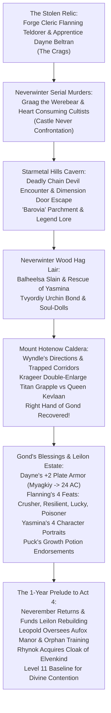

# 🔥 Interlude 2: "Keeping the Faith"

> **Chronicle Navigation:** ⬅️ **Previous:** [[04 - Act 3 - Sleeping Dragon's Wake|Act 3: Sleeping Dragon's Wake]] | 🏠 [[The Order of Znak Complete Campaign Chronicle|Campaign Chronicle Hub]] | ➡️ **Next:** [[06 - Act 4 - Divine Contention|Act 4: Divine Contention]]

---

## 📜 Overview of the Second Interlude
In the early summer of 2022, following the harrowing revelation of [[Chardansearavitriol|Ebondeath]]'s possession of [[Claugiyliamatar]] in Deeping Cave at the climax of *[[04 - Act 3 - Sleeping Dragon's Wake|Sleeping Dragon's Wake]]*, **[[The Order of Znak]]** answered an urgent, desperate plea from the mountains northeast of Neverwinter.

Stepping behind the Dungeon Master screen for the second time, **Gary** ran a lethal, high-stakes homebrew bridge adventure: **"Keeping the Faith"** (June 17 – July 22, 2022). Stationed at **Level 11** alongside a powerful Level 13 allied forge apprentice, the four champions were summoned to recover the stolen sacred relic of Gond—the legendary **Right Hand of Gond**—thrusting them into a sprawling investigation of savage serial murders in Neverwinter, a fiendish cavern in the Starmetal Hills harboring ominous breadcrumbs from the dread demiplane of **Barovia**, the rescue of a young girl from the clutches of a child-stealing Night Hag in Neverwinter Wood, and an epic "Double-Enlarge" titan wrestling match inside the molten caldera of Mount Hotenow against Fire Giant Queen **[[Kevlaan the Merciless]]**.

---

## ⚔️ The Keeping the Faith Chronicles

### 🔨 Prologue: The Cry from the Crags
*(June 17 – June 18, 2022 | Level 11)*

While the town council of [[Leilon]] grappled with reports of draconic possession and rising cult movements along the High Road, an urgent missive reached the Order from the craggy, jagged peaks northeast of Neverwinter. 

**[[Flanning Teldorer]]**, a devout Forge Domain cleric dedicated to Gond (the Wonderbringer, Lord of All Smiths), requested an immediate emergency council at his mountain forge in the Crags. His most revered sanctified implement—the legendary **Right Hand of Gond**, an ancient masterwork smithing hammer imbued with divine craft—had been audaciously stolen from his forge. Accompanying the plea was Flanning's talented young forge apprentice, **[[Dayne Beltran]]**, a gifted youth whose blacksmith parents had recognized his innate prodigy at the anvil and sent him at an early age to apprentice under Flanning. Dayne operated as a potent **Level 13** cleric of the Forge Domain.

With the crisis demanding immediate eyes on the ground, **[[Tvyordiy Znak]]** took to the skies on his Aarakocra wings, flying north alone into the Crags to consult directly with Flanning. Meeting the troubled forge master, Tvyordiy learned that the thieving trail led directly toward Neverwinter. The next morning, Tvyordiy and Dayne Beltran set out south to rendezvous with [[Myagkiy Znak]], [[Krageer Stoneface Ogolakanu]], and [[Rhynok]] at the gates of the City of Skilled Hands.

---

### 🩸 Chapter 1: The Blood of Neverwinter & Graag the Werebear
*(June 18 – June 23, 2022 | Level 11)*

Entering Neverwinter, the Order discovered the jewel of the North paralyzed by horror. Over recent nights, a gruesome series of synchronized murders had left mutilated corpses strewn across the city:
* **Sleeping Dragon Bridge:** A solitary noblewoman slain.
* **The House of Knowledge:** Nine Oghmanyte scholar-monks slaughtered inside the great temple of knowledge, with only **[[Brother Christoph]]** surviving the massacre as a shell-shocked witness.
* **South East Gate:** Four city watch guards butchered at their posts.
* **Dannar's Mechanical Marvels:** Two master shopkeepers and tinkerers executed in cold blood.
* **The Grey Cloaks:** Six elite members of Neverwinter's Grey Cloak patrol sent out into the streets to investigate vanished without a trace, later found dead in the shadows.

Examining the gruesome crime scenes, [[Rhynok]] knelt by the muddy flagstones and rolled a sharp Investigation check, deducing that the heavy, clawed tracks did not belong to any native Sword Coast carnivore, but rather an **unnatural, massive mountainous bear**. 

Interrogating the surviving [[Brother Christoph]] and casting divine rites to *Speak with Dead* over the fallen sentries, the Order extracted chilling testimonies:
> *"What attacked you?"* — *"A large man... and a beast."*  
> *"Did they come upon you in a surprise attack?"* — *"Yes... out of the shadows. At first, they looked normal."*  
> *"Did one transform into a beast?"* — *"Yes... half-beast, attacking with claws and biting!"*

Most horrifying of all: every single victim had their chest cavity torn open, their **hearts ritually ripped out and consumed**.

Tracking the trail of dark occult energy through Neverwinter's alleys toward Castle Never, the Order intercepted a towering, muscular barbarian flanked by two cultist henchmen. As weapons cleared their scabbards, the brute sneered, swelling into a monstrous lycanthrope: **[[Graag]] the Werebear**.
> *"Your world is ours! We were summoned here as a gift from our gods!"* — **Graag the Werebear**

Initiative erupted in the courtyards. Graag lashed out with savage claws and crushing jaws, but the combined martial fury of four Level 11 champions and Level 13 Dayne proved insurmountable. Krageer raged and traded thunderous blows with the beast, Rhynok drove venomous arrows through the cultists, Tvyordiy swept the henchmen's legs, and Myagkiy battered the lycanthrope with radiant power until Graag fell lifeless to the cobbles. Searching the bodies and the nearby hideout, the champions confirmed that no trace of the stolen hearts remained—corroborating the grisly truth that the hearts had been consumed in dark planar rites.

---

### ⛓️ Chapter 2: The Starmetal Hills Cavern & The Chain Devils
*(June 24 – July 1, 2022 | Level 11)*

Following the defeat of Graag, [[Dayne Beltran]] channeled divine guidance and revealed that the stolen **Heartstone** linked to the cult's planar activity had been transported eastward into the jagged crags of the **Starmetal Hills**.

Departing Neverwinter, the companions skirted the eastern borders of Neverwinter Wood, camping under the stars before tracking the fiendish aura into a subterranean cavern complex carved into the hills. Deep within the cavern, the Order stepped straight into a lethal ambush orchestrated by extraplanar fiends and dark cultists.

Rattling from the darkness came the terrifying clatter of iron links: the party was confronted by deadly **Chain Devils** (Kytons) and fiendish cultists. The battle was brutally punishing:
* A Chain Devil turned its horrific, shifting gaze upon [[Krageer Stoneface Ogolakanu]], attempting to paralyze the Goliath with its *Unnerving Mask*. Gritting his teeth in Bear Totem fury, Krageer shook off the illusion and carved into the fiend with his adamantine greataxe.
* Animated, razor-sharp spiked chains whipped through the gloom, striking at [[Tvyordiy Znak]]—who dodged and redirected the blows with *Tipsy Sway*—before coiling around heavy Life Cleric **[[Myagkiy Znak]]**, threatening to crush his ribs in a lethal spiked grapple.
* **The Cape of the Mountebank Tactical Masterstroke:** Reacting in an instant, Myagkiy grasped the clasp of his ***[[Cape of the Mountebank]]*** (looted from the Shadow Dragon's hoard in *[[03 - Interlude 1 - Shadow's Run|Shadow's Run]]*). Instantly activating ***Dimension Door***, Myagkiy dissolved into a thick, harmless puff of brimstone smoke—slipping completely free of the constricting iron coils and rematerializing sixty feet away on a high stone ledge! From his new elevated vantage, Myagkiy upcast a blazing 5th-level ***Spirit Guardians***, raining divine restoration and radiant fury upon the devils while Dayne cast *Zone of Truth* to interrogate the cult survivors.

**The Cryptic Parchment & Legend Lore:**  
Purging the cavern of fiends, the Order recovered the stolen Heartstone alongside a bizarre collection of ritual components: an intact snake skeleton, two heavy boar tusks, and a tightly folded slip of parchment.

Unfolding the paper, Myagkiy read the chilling, handwritten incantation aloud:
> *"Barovia, Barovia, Barovia... I call upon the fiends of Barovia..."*

Unfamiliar with any realm by that name along the Sword Coast or the Great Wheel, Myagkiy sat in deep meditation on July 1 and cast the high 5th-level divination ritual ***Legend Lore***. Through his divine trance, the sacred truth was revealed:
> *The valley of **Barovia** is the oldest and best known of the Domains of Dread—an isolated demiplane shrouded in perpetual mists, ruled and corrupted by an ancient, omnipresent dark evil.*

Though how and why fiends from this distant dread domain were being summoned into Faerûn remained an unresolved mystery, Gary's deliberate breadcrumbs seeded the cosmological foundation that would one day pull their successors into ***[[The Acolytes of Znak]]***!

---

### 👵 Chapter 3: The Night Hag Balheelsa & Rescuing Yasmina
*(July 4 – July 5, 2022 | Level 11)*

Following the trail of the Heartstone and interrogating the broken cultist survivors, Dayne learned that the mastermind coordinating the lower planar trades was a sinister Night Hag named **[[Balheelsa]]** (Balheeza / Balhelsa), who operated from a wretched, moss-draped hovel secluded in the deep shadows of **Neverwinter Wood**. Furthermore, Dayne recalled that the stolen hammer itself had already been traded upward to **[[Kevlaan the Merciless]]**, Queen of the Fire Giants.

Hiking out of the Starmetal Hills on July 4, the Order penetrated the ancient woods and stormed Balheelsa's hut before the fiendish crone could slip into the Ethereal Plane. In a short, ferocious melee, the Order broke through her illusory wards, intercepted her fiendish claws, and struck Balheelsa down on her hearth!

**The Rescue of Young Yasmina & Tvyordiy's Urchin Empathy:**  
Searching the rear chambers of the hovel, the Order discovered a terrified young girl named **[[Yasmina]]**, trembling in confinement. Investigating her past, they learned that Yasmina was the fatherless daughter and prisoner of Balheelsa. 

The discovery struck a deep, tender chord in **[[Tvyordiy Znak]]**. Looking upon the frightened, soot-stained orphan, the stoic Aarakocra monk saw his own impoverished, street-urchin childhood reflected in her wide eyes. Stepping forward with gentle dignity, Tvyordiy shielded Yasmina, offering her bread, soothing her terror, and swearing that the Order would protect her.

When questioned about her captor's dark dealings, young Yasmina revealed shocking planar horrors:
* Balheelsa had been actively trafficking and selling stolen mortal souls into the Lower Planes to fuel the cosmic war between fiends and devils (the Blood War).
* Whenever Balheelsa harvested souls from her victims, she would either ferry them to the Abyss/Nine Hells or **trap their screaming spirits inside the hollow heads of her porcelain dolls**!

**The Hag's Spoils:**  
Ransacking the hut, the Order liberated Yasmina and claimed Balheelsa's sinister hoard:
* A locked tin coffer containing **2,500 gold pieces** and **5,000 silver pieces**.
* High-value ritual components: 500 gp worth of powdered ruby dust, 100 gp of raw ivory, an exotic squid/octopus tentacle, a writing quill plucked from a sleeping bird, and an unholy sacrificial offering (25 gp).

Escorting Yasmina safely out of Neverwinter Wood, the Order delivered her to the safety of the [[Iron Flagon Inn]] on the road toward Leilon, where she would be formally welcomed as an adopted ward of Aufox Manor alongside [[Smithwell and Burnice]].

---

### 🌋 Chapter 4: Mount Hotenow & The Double-Enlarge Titan Clash
*(July 5 – July 8, 2022 | Level 11)*

At the **Iron Flagon Inn**, the companions questioned regular patrons regarding the whereabouts of Fire Giant Queen **[[Kevlaan the Merciless]]**. [[Wyndle]], a beloved local tavern patron, provided crucial topographical intelligence, pointing them toward the steaming subterranean caldera of the volcanic peak **Mount Hotenow**. Dayne added vital lore: **Surtur**, the legendary fire giant patron god of smithing, stood as an ancient divine rival to **Gond**, explaining why Queen Kevlaan sought the sacred *Right Hand of Gond* to forge catastrophic weapons of war.

Departing for Mount Hotenow, the Order descended into the volcanic fissure:
* **The Trapped Corridors:** Navigating the winding tunnels leading toward the magma belly, Tvyordiy and Krageer—guided by Myagkiy's divine *Guidance*—skirted lethal engineering traps, tripwires, and molten vents. In an extraordinary display of patience and dexterity, the two frontline martials successfully disarmed a deadly trapped chest, extracting **4,000 gp** and **four Potions of Greater Healing**.
* **Krageer's Discovery:** Sifting through the volcanic antechamber, Krageer claimed a magical ***Ring of Animal Influence*** bearing an ancient secondary enchantment.
* The companions took a brief Short Rest to bind their burns and steel their resolve before descending the obsidian stairs into the central magma chamber.

**The Climax: The Legendary "Double-Enlarge" in the Magma:**  
Emerging into the colossal caldera, the Order stood amidst churning rivers of glowing molten lava. Dominating the central stone dais was **[[Kevlaan the Merciless]]**, Queen of the Fire Giants, wielding a colossal iron greatsword with the glowing *Right Hand of Gond* mounted beside her forge anvil.

Recognizing that a Huge-sized Fire Giant Queen would easily swat aside any normal combatant, the party executed one of the most celebrated, legendary tactical combos in campaign history—the **"Double-Enlarge"**:
1. **Puck's Potion:** [[Krageer Stoneface Ogolakanu]] pulled the cork from the ***Potion of Growth*** he had bought in Leilon from nervous elven merchant **[[Puck Caribdas]]**, gulping down the brew to swell from `Medium` to **Large**.
2. **Myagkiy's Divine Enlarge:** Simultaneous with the potion taking effect, **[[Myagkiy Znak]]** invoked divine transmutation, casting ***Enlarge*** directly upon Krageer (`Large` &rarr; **Huge**)!

Swelling two full size categories to **Huge titan proportions**—standing over 20 feet tall with biceps like granite boulders—Krageer roared, surged across the basalt bridge, and locked arms with Queen Kevlaan in a titanic wrestling grapple right at the lip of the bubbling lava flow!

The battle was frantic, brutal, and back-and-forth:
* With Krageer pinning the fire giant monarch by her throat and shoulders in an unbreakable grapple check, **[[Tvyordiy Znak]]** vaulted off Krageer's massive stone shoulder, driving his *Vicious Quarterstaff* and flurry strikes directly into Kevlaan's temple to land a clutch **Stunning Strike**!
* Stunned and unable to swing her greatsword, Kevlaan was helpless as **[[Rhynok]]** unleashed a devastating storm of poisoned sniper arrows from the high ledges.
* Krageer entered a reckless frenzy, delivering crushing unarmed slams and greataxe hews until the Fire Giant Queen collapsed into the cooled slag!

**Loot Recovered from Kevlaan:**  
* The sacred **Right Hand of Gond** (The Hammer of Gond) was safely reclaimed!
* An unknown enchanted ring and an unknown amulet.
* Kevlaan's reign over Mount Hotenow's giants was completely shattered.

---

### 🎁 Chapter 5: Gond's Consecration, The Divine Feats, Puck's Endorsements & Yasmina's Art
*(July 8 – July 22, 2022 | Level 11)*

Returning triumphantly to the Crags, the Order delivered the sacred *Right Hand of Gond* back into the hands of the overjoyed Forge Cleric **[[Flanning Teldorer]]**. 

In divine gratitude for saving his faith's greatest relic and liberating his apprentice Dayne, Flanning invoked the highest blessings of Gond:
1. **Gear Consecration & Identification:** Flanning identified the recovered rings and amulet, fully repaired and honed all party armaments, and upgraded their masterwork implements.
2. **Dayne's Plate Armor to Myagkiy:** Dayne Beltran ceremonially gifted his masterwork, consecrated **+2 Plate Armor** to Life Cleric **[[Myagkiy Znak]]**. Combined with Myagkiy's +2 shield and *Gauntlets of Ogre Power*, the Life Cleric's armor class surged to an impenetrable **24 AC**!
3. **Flanning's Four Divine Feats:** Through Gond's divine favor, Flanning conferred an extraordinary spiritual boon—granting each member of the Order a permanent **Bonus Feat**:
   * **[[Tvyordiy Znak]]:** Took ***Crusher***, allowing his bludgeoning quarterstaff strikes and unarmed martial arts to push foes 5 feet and grant whole-party advantage on critical hits.
   * **[[Myagkiy Znak]]:** Took ***Resilient (Constitution)***, mastering concentration saves to ensure his *Spirit Guardians* and *Banishment* spells would never break under frontline assault.
   * **[[Krageer Stoneface Ogolakanu]]:** Took ***Lucky***, representing his uncanny Goliath instinct to twist fatal missteps into triumphant survival.
   * **[[Rhynok]]:** Took ***Poisoner***, allowing the Gloom Stalker ranger to brew and apply lethal toxins as a bonus action, ignoring poison resistance (incorporating DM Gary's curated 5e poison rules from *aidedd.org*).

> [!TIP] 🧪 **Krageer's Official Label Endorsements for [[Puck Caribdas|Puck's]] *Potion of Growth***
> Following his volcano triumph, Krageer (inspired by Peter's table suggestion of punny dad-jokes right up Krageer's alley) offered **[[Puck Caribdas]]** two official endorsement quotes to print on his potion bottle labels in [[Leilon]]:
> * *"I am a huge fan of Puck's Potion of Growth."* — **Krageer**
> * *"I didn't care for the taste at first, but I grew to like it."* — **Also Krageer**

![[krageer-firegiant.png]]
*Krageer Double-Enlarged to Huge Size (via Puck Caribdas's Potion of Growth + Myagkiy Znak's Enlarge) Wrestling Fire Giant Queen Kevlaan the Merciless in the Volcano*

![[firegiant.jpg]]
*The Volcano Boss Battle — Confrontation with Queen Kevlaan in Mount Hotenow*

**Young Yasmina's Canonical Portraits of The Order of Znak:**  
Following her safe arrival in Leilon and installation at Aufox Manor, young **[[Yasmina]]** expressed her deep child-like devotion and gratitude by drawing and painting expressive character portraits of her four saviors—immortalizing **[[Krageer Stoneface Ogolakanu]]**, **[[Rhynok]]**, **[[Tvyordiy Znak]]**, and **[[Myagkiy Znak]]** through her eyes:

| ![[Krageer_Portrait.png]] | ![[Rhynock_Portrait.png]] |
| :---: | :---: |
| *Krageer Stoneface Ogolakanu — Drawn by Young Yasmina* | *Rhynok — Drawn by Young Yasmina* |
| ![[TZnak_Portrait.png]] | ![[MZnak_Portrait.png]] |
| *Tvyordiy Znak (Ъ) — Drawn by Young Yasmina* | *Myagkiy Znak (Ь) — Drawn by Young Yasmina* |

---

### ⏳ Chapter 6: The One-Year Prelude to Act 4 (*Divine Contention*)
*(July 22, 2022 | Downtime Interim)*

At the conclusion of *Keeping the Faith*, DM Gary formally established the chronological bridge to the final published adventure: **Act 4 (*Divine Contention*) begins exactly one full year after the events of *Keeping the Faith*.**

During this year of transition, several monumental developments reshaped the Sword Coast:

1. **The Rout at Neverwinter's Doorstep:** Shortly after Kevlaan's fall, a massive horde of orcs, fire giants, and goblinkin marched toward Neverwinter's gates. However, leaderless and deprived of the mighty masterwork weapons of war that the *Right Hand of Gond* was meant to forge, the monstrous assault crumbled against Neverwinter's defenses, routed with minimal defender casualties.
2. **The Return of Lord Dagult Neverember:** These events precipitated the dramatic return of **[[Dagult Neverember|Lord Protector Dagult Neverember]]** from his prolonged political hiatus away from Neverwinter. Focusing his immense wealth on rebuilding Castle Never and heavily garrisoning the city streets against werebears and aberrations, Lord Neverember also personally financed the extensive reconstruction and fortification of **[[Leilon]]**.
3. **Leopold's Estate Stewardship & Orphan Cross-Training:** The Order formally retained **[[Leopold]]** as the permanent majordomo and steward of Aufox Manor in Leilon. Beyond managing household affairs, Leopold oversaw the blooming talents of the adopted wards (**[[Smithwell and Burnice]]** and **[[Yasmina]]**). All the young wards began daily cross-training in combat and survival under the Order, joined by allied marshland lizardfolk from the Mere of Dead Men who taught them the flora, fauna, and wilderness lore of the wetlands.
4. **The Gathering Cult Storms:** While the Sword Coast enjoyed temporary peace, the two defeated cults quietly regrouped in the shadows. High priestess **[[Fheralai Stormsworn]]** rebuilt the Cult of Talos following her dreadnaught defeat, while death-priest **[[Ularan Mortus]]** received a massive undead army from Myrkul—setting the stage for a catastrophic clash to seize control of Leilon and the High Road.
5. **Rhynok's Cloak of Elvenkind Delivered:** Over the course of this full year of downtime, the 1,500 gold pieces Rhynok had paid to Sword Coast scouts during *Sleeping Dragon's Wake* finally paid off. Word arrived in Leilon, and Rhynok officially took possession of his coveted ***Cloak of Elvenkind***, wrapping the shadowy mantle over his shoulders just as the war drums began to beat.
6. **Level 11 Baseline:** Having rested, trained, and prepared through the 1-year interim, **[[The Order of Znak]]** stood fortified at **Level 11**, ready to march into **[[06 - Act 4 - Divine Contention|Act 4: Divine Contention]]**!

---

## 🎒 Key Magic Items & Relics in Interlude 2

| Relic / Item | Recipient | Origin & Acquisition Context |
| :--- | :--- | :--- |
| **Dayne's +2 Plate Armor** | [[Myagkiy Znak]] | Bestowed by [[Dayne Beltran]] & Flanning; boosts Myagkiy to **24 AC**. |
| **Ring of Animal Influence** | [[Krageer Stoneface Ogolakanu]] | Discovered in Mount Hotenow caldera corridors. |
| **Right Hand of Gond** | [[Flanning Teldorer]] | Reclaimed from Fire Giant Queen Kevlaan; restored to Gond's altar in the Crags. |
| **Bonus Feats (Crusher, Resilient, Lucky, Poisoner)** | The Order of Znak | Divine gift of Gond conferred by Flanning Teldorer. |
| **Cloak of Elvenkind** | [[Rhynok]] | Delivered during the 1-year downtime interim from his 1,500 gp SDW commission. |
| **Trapped Chest Spoils** | The Order of Znak | 4,000 gp and 4 Potions of Greater Healing disarmed in Mount Hotenow. |
| **Hag Tin Coffer** | The Order of Znak | 2,500 gp, 5,000 sp, and ruby dust recovered from Balheelsa's hut. |

---

## 💡 Behind the Screen: Gary's DM Screen & Table Trivia

* **Gary's Second DM Arc:** *Keeping the Faith* was the second homebrew adventure Gary wrote and ran for the table, acting as an essential narrative hinge connecting the draconic terror of *Sleeping Dragon's Wake* with the final siege of *Divine Contention*.
* **The "Double-Enlarge" Rule of Cool:** In official 5e rules, magical effects with the same name do not stack, and *Potion of Growth* explicitly references the *Enlarge* spell. However, Gary and Peter enthusiastically invoked the **Rule of Cool**: because one effect was an alchemical consumable and the other was a divine concentration spell, stacking `Medium` &rarr; `Large` &rarr; `Huge` created an unforgettable, cinematic Goliath-vs-Giant showdown that became one of the campaign's greatest table memories.
* **Barovia Breadcrumbs for *The Acolytes of Znak*:** The cultist parchment summoning "the fiends of Barovia" and Myagkiy's *Legend Lore* check were intentionally seeded by Gary to establish early continuity with the Ravenloft domain, laying the narrative groundwork for their upcoming campaign *The Acolytes of Znak*.
* **Level Progression Consensus:** While Gary briefly considered awarding additional levels for *Keeping the Faith*, the table agreed to maintain **Level 11** throughout the interlude and the 1-year interim, ensuring the party did not out-level the challenging encounters of *Divine Contention*.
* **Rhynok's Poisoncraft System:** Gary linked Peter to the comprehensive *aidedd.org* 5e poison database, allowing Rhynok's *Poisoner* feat to harvest, brew, and apply exotic toxins to his arrows—a mechanic later expanded via GM Binder custom brewing rules during Act 4.

---

> **Chronicle Navigation:** ⬅️ **Previous:** [[04 - Act 3 - Sleeping Dragon's Wake|Act 3: Sleeping Dragon's Wake]] | 🏠 [[The Order of Znak Complete Campaign Chronicle|Campaign Chronicle Hub]] | ➡️ **Next:** [[06 - Act 4 - Divine Contention|Act 4: Divine Contention]]
