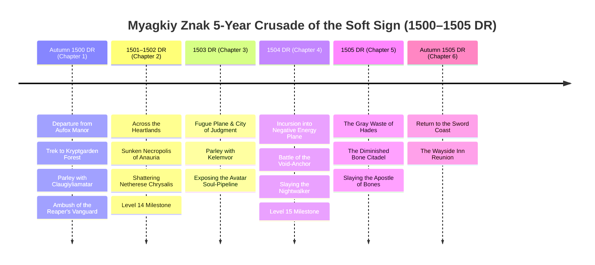

# 🕊️ The Shepherd of the Quiet Grave: The Saga of Myagkiy Znak

> **Chronicle Navigation:** ⬅️ **Previous:** [[07b - Bridge - Tvyordiy - The Breath of the Boundless Sky|07b: The Breath of the Boundless Sky]] | 🏠 [[The Order of Znak Complete Campaign Chronicle|Campaign Chronicle Hub]] | ⬆️ [[07 - Epilogue - Bridge Campaign|Epilogue Overview]] | ➡️ **Next Generation:** [[The Acolytes of Znak Campaign Plan|The Acolytes of Znak]]

---

*What [[Myagkiy Znak]] did across five years of solitary crusade (1500–1505 DR), hunting down the surviving cabals of Myrkul, terminating attempts to cultivate a new Chosen or Avatar of Death, and walking the planes until the gathering at the [[Wayside Inn]].*

When [[The Order of Znak]] scattered following five peaceful winters in [[Leilon]], they did not march under banners or sound trumpets. They dispersed like seeds caught in an autumn gale. [[Tvyordiy Znak]] had turned east toward the High Forest and the Star Mounts to seek his ancestral bloodline in the open skies. [[Krageer Stoneface Ogolakanu]] had turned north into the frozen crags with [[Cooragh]], carrying his seasoned iron skillet and a heart at peace. 

For [[Myagkiy Znak]], the road led southward down the High Road—clad in the polished, consecrated plate armor of fallen hero [[Dayne Preadhun]], his dark hair neatly tied back with strands of iron-grey touching his temples, and the flanged steel head of ***Bonecounter*** resting quiet at his belt. 

He was twelve years older than the solitary hermit who had once wandered the Dessarin Valley tending flocks of sheep. Yet beneath the tempered steel of his breastplate, the pulse of the Soft Sign—$\mathbf{Ь}$—beat with unyielding clarity: that which preserves life must also stand sentinel against the rot that would mock it.

---

## 🗺️ Campaign Pacing & Five-Year Chronicle Map (1500–1505 DR)

---

## Chapter 1: The Dragon's Debt & The Reaper of the Triad

*Table Session: Live Interactive Session (Peter as Myagkiy Znak, Antigravity as DM)*  
*In-Game Setting: Autumn, 1500 DR (The Year of the Sea's Secrets Revealed)*  
*Location: Aufox Manor (Leilon) ➔ The High Road ➔ Deeping Cave (Kryptgarden Forest)*

*(Session currently in progress at the table...)*

---

## 📊 End-of-Chapter Resource & Progress Ledger

### 🧙‍♂️ Character Starting Baseline (Autumn 1500 DR)
* **Class & Level:** Level 13 Life Domain Cleric (D&D 5.0 Ruleset)
* **Hit Points:** 107 / 107 HP (Hit Dice: 13d8 + 26)
* **Armor Class:** 24 (Dayne's Consecrated +2 Plate Armor, +2 Shield)
* **Ability Scores:** STR 19 (+4, *Gauntlets of Ogre Power*), DEX 10 (+0), CON 14 (+2), INT 10 (+0), WIS 18 (+4), CHA 12 (+1)
* **Attuned Magic Items (3/3):**
  1. *Dayne's Plate Armor (+2)* (Attuned to cleric/paladin of Gond/Life)
  2. *Gauntlets of Ogre Power* (Sets STR to 19)
  3. *Cape of the Mountebank* (1×/day *Dimension Door*)
* **Other Carried Magic Items:**
  - *+2 Shield*
  - ***Bonecounter*** (Flanged Steel Mace)
  - *Ring of Warmth* (Cold resistance, comfortable down to -50°F)
* **Spell Slots Available:**
  - 1st Level: `4 / 4`
  - 2nd Level: `3 / 3`
  - 3rd Level: `3 / 3`
  - 4th Level: `3 / 3`
  - 5th Level: `2 / 2`
  - 6th Level: `1 / 1`
  - 7th Level: `1 / 1`
* **Divination & Diamond Focus Cache:**
  - 4 reusable ivory strips (200 gp total focus for *Legend Lore*)
  - 3× 250 gp blocks of rare frankincense & myrrh (750 gp total)
  - 2× 300 gp diamonds (for *Revivify*)
  - 1× 500 gp diamond (for *Raise Dead*)
* **Road Treasury Cache:** 700 pp (7,000 gp) in travel pouches, 54 gp in silver/copper for day-to-day provisions.
* **Secured in Subterranean Bedrock Vault:** 243 pp, 15,150 gp, 40 ep, 1,500 sp, dragon spoils, and Order trade bars.
