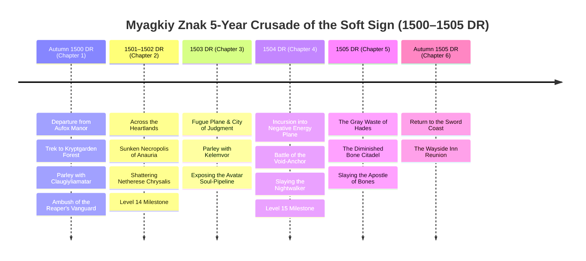

# 🕊️ The Shepherd of the Quiet Grave: The Saga of Myagkiy Znak

> **Chronicle Navigation:** ⬅️ **Previous:** [[07b - Bridge - Tvyordiy - The Breath of the Boundless Sky|07b: The Breath of the Boundless Sky]] | 🏠 [[The Order of Znak Complete Campaign Chronicle|Campaign Chronicle Hub]] | ⬆️ [[07 - Epilogue - Bridge Campaign|Epilogue Overview]] | ➡️ **Next Generation:** [[The Acolytes of Znak Campaign Plan|The Acolytes of Znak]]

---

*What [[Myagkiy Znak]] did across five years of solitary crusade (1500–1505 DR), hunting down the surviving cabals of Myrkul, terminating attempts to cultivate a new Chosen or Avatar of Death, and walking the planes until the gathering at the [[Wayside Inn]].*

When [[The Order of Znak]] scattered following five peaceful winters in [[Leilon]], they did not march under banners or sound trumpets. They dispersed like seeds caught in an autumn gale. [[Tvyordiy Znak]] had turned east toward the High Forest and the Star Mounts to seek his ancestral bloodline in the open skies. [[Krageer Stoneface Ogolakanu]] had turned north into the frozen crags with [[Cooragh]], carrying his seasoned iron skillet and a heart at peace. 

For [[Myagkiy Znak]], the road led southward down the High Road—clad in the polished, consecrated plate armor of fallen hero [[Dayne Preadhun]], his dark hair neatly tied back with strands of iron-grey touching his temples, his heavy mace ***Bonecounter*** stowed quiet at his pack, and his hands open to the road.

He was twelve years older than the solitary hermit who had once wandered the Dessarin Valley tending flocks of sheep. Yet beneath the tempered steel of his breastplate, the pulse of the Soft Sign—$\mathbf{Ь}$—beat with unyielding clarity: that which preserves life must also stand sentinel against the rot that would mock it.

---

## 🗺️ Campaign Pacing & Five-Year Chronicle Map (1500–1505 DR)



---

## Chapter 1: The Dragon's Debt & The Reaper of the Triad

*Table Session: November 16, 2026*  
*In-Game Setting: Autumn, 1500 DR (The Year of the Sea's Secrets Revealed)*  
*Location: Leilon Crossroads ➔ The High Road ➔ Deeping Cave (Kryptgarden Forest)*

---

### 🌅 Scene 1: The Parting of the Signs at the Crossroads

The morning air bit with the clean, sharp chill of early northern frost. A low white ground-mist drifted across the salt meadows, curling around the weathered timbers of the roadside ditches outside [[Leilon]].

Behind them, the palisade gates stood open. High upon the timber walkway, four familiar silhouettes watched in silence: [[Leopold]], his spectacles catching the first pale glint of dawn; broad-shouldered [[Smithwell Znak]] with his arms resting against the logs; [[Burnice Znak]], standing tall in her cuirass; and young [[Yasmina]], her dark hair and traveling cloak whipping in the coastal wind. Just beyond the rooftops, the unmortared white marble spire of the newly raised **[[The Temple of the Twin Signs|Temple of the Gods]]** caught the dawn light like a tranquil beacon above the town.

[[Myagkiy Znak]] and [[Tvyordiy Znak]] had walked down the cart-track together, their boots crunching side by side in the gravel. 

At the fork outside the ditch, where the High Road divided—the northern trail running toward the [[Wayside Inn]], and the southern branch winding down along the coast toward the gloom of Kryptgarden Forest—Tvyordiy came to a halt.

The veteran Aarakocra adjusted the coarse friar's cowl of his *Hat of Disguise*, settling the heavy hempen coils of rope and the traveling pack upon his shoulders. At sixteen summers, the silver frost touching his crest feathers marked him as an elder among his short-lived kin. 

He turned to face Myagkiy. His golden raptor eyes were deep, unblinking, and serene, carrying the quiet gravity of sixteen years of shared blood, bread, and brotherhood since that freezing alleyway in Waterdeep. 

He raised a scarred, feathered forearm in the traditional warrior's clasp, waiting for Myagkiy’s grip:

> *"The road forks here, brother,"* Tvyordiy rumbled softly in his deep, resonant baritone, his voice carrying clear above the keening autumn wind.  
> 
> *"I turn my face to the high country of the east; you turn yours to the quiet graves of the south. We do not know where these trails will take us, or when the wind will bring us back through these gates. But the Sign holds. When iron meets stone, it remembers. Watch your back in the wild places, Myagkiy. Walk with the light."*

Myagkiy clasped his brother's forearm, the steel of Dayne’s gauntlet locking firm against Tvyordiy's feathers:

> *"Brother, we both go to fight some unseen demons that have haunted us since our epic victory five years ago. That we should all four of us be beckoned away, each in our own turn, must be kismet."*

Tvyordiy nodded solemnly, his golden eyes unblinking in the wind. Myagkiy continued:

> *"We have put, each in our own way, a mark or sign on Leilon which will protect it. If not for that, mayhap we would not be able to even make this journey. Keep and watch for the Znak, Tvyordiy. It will protect and guide you."*

As he turned to walk away, a faint, wry smile touched Myagkiy's dark beard:

> *"I promise not to preach to every brigand on the path. And for you, do not get turned around whilst turning over every stone searching for the path. As you would say: 'If you are facing the right direction, all you need to do is keep on walking'."*

Tvyordiy’s beak curved in an amused, knowing smirk. With a final nod that spoke louder than oaths, the Aarakocra turned north, his long strides carrying him up the rise. 

Myagkiy watched until his brother’s grey friar's robe was swallowed by the northern mist. Then, turning his back to the town he had helped rebuild, he faced south down the High Road.

---

### 🚶 Scene 2: The Pastoral Road & The Scrying Veil

For eight days, Myagkiy walked south at an unhurried, pastoral pace. 

He covered fifteen or sixteen miles between sunrise and dusk, letting the steady crunch of gravel set the rhythm of his prayers. He traveled in Dayne’s polished +2 plate armor—its silvered steel catching the pale autumn sun—but his weapons remained stowed. The heavy flanged head of ***Bonecounter*** was strapped securely behind his pack, and his +2 shield hung dormant across his shoulders. He walked with his hands open, looking not like a conqueror seeking battle, but like a shepherd walking the boundaries of a vast, quiet pasture.

Where he met carters hauling salt-fish or tenant farmers gathering late cabbage, he stopped to share cold cheese and hear the news of the road. The countryside was peaceful. The dragon terrors of Icespire and the storm-raids of Talos had faded into tavern songs. Yet beneath that pastoral tranquility, Myagkiy’s spirit was troubled by what had transpired in the quiet months before his departure.

Within the sanctum of the **[[The Temple of the Twin Signs|Temple of the Gods]]**, in the weeks leading up to the autumn equinox, Myagkiy had sought to pierce the veil. He had burned rare incense over his ivory strips, casting ***Legend Lore*** to gather the ancient names and deeds of Myrkul—learning of the Lord of Bones’ fall at Boareskyr Bridge, the lingering curse of the *Crown of Horns*, and the desperate hunger of his diminished spirit in the wastes of the Outer Planes.

Yet when Myagkiy had knelt before the consecrated altar of the Twin Signs, focusing his divine focus to cast ***Scrying*** upon the surviving Myrkulite cells, his magic had struck an impenetrable wall.

A being of light and radiant vitality, guided by the benevolent mandates of Gond and Lathander, could not pierce the necrotic shroud. The very nature of Myagkiy’s divine power acted as a beacon of metaphysical opposition: the evil will and dense spiritual rot surrounding Myrkul’s surviving faithful repelled holy divination like oil rejecting holy water. The shroud of death would not open to a righteous man.

It was that theological failure that had led Myagkiy to his deduction. 

If a creature of radiant good could not pierce the necrotic veil, he needed an instrument already steeped in that darkness. And along the Sword Coast, only one creature possessed both the means and the metaphysical attunement: **[[Claugiyliamatar]]**, the ancient green wyrm known as **Old Gnawbones**.

Deep within her cavern in **Kryptgarden Forest**, she kept dozens of floating crystal scrying spheres and her massive, living topographic map of the Sword Coast. More critically, Claugiyliamatar possessed an involuntary, terrifying connection to the Lord of Bones: during the siege of Leilon, she had been possessed, hollowed out, and inhabited by **[[Ebondeath]]**, the ancient dragon-wraith of Myrkul. Though the ghost had been exorcised, that harrowing violation had left its stain in her marrow—a lingering resonance tuned precisely to Myrkul’s frequency. Her own predatory, wicked nature would offer no moral resistance against scrying the cult.

And above all, Old Gnawbones was bound by an absolute debt of blood. 

When Ebondeath was driven from her flesh in the climax of *Divine Contention*, the green wyrm had crashed into the shattered timber and masonry of **Aubrey’s Peculiarities**, broken, bleeding, and trembling at death’s door. It was Myagkiy who had stepped forward through the smoke. Channeling the boundless vitality of the Life Domain, Myagkiy had laid his gauntlets upon her torn emerald scales, pouring high-circle healing magic into her shattered breast until her lungs filled with air and her wings found the strength to launch into the sky and limp back to her forest redoubt.

She owed him her life.

On the eighth afternoon of his trek, the rolling scrubland fell away. To the east, the towering, moss-draped canopy of **Kryptgarden Forest** rose like an ancient green wall against the slate-grey sky.

---

### 🐉 Scene 3: The Audience in Deeping Cave

*(Live Tabletop Session — Peter as Myagkiy Znak, Antigravity as DM)*  
*Location: Area D8 - Claugiyliamatar's Sanctum, Deeping Cave, Kryptgarden Forest*  
*Canonical Environment: Sleeping Dragon's Wake (Area D8)*

To reach the dragon's private sanctum, Myagkiy chose the high, cautious ingress. Climbing the damp limestone crags on the eastern cliff face, he entered through the elevated **lookout post**, bypassing the treacherous lower ravines. Moving with calm, measured footsteps, he passed through the shadowy **druid cavern**—where Claugiyliamatar's ragged, wild-eyed wood-cultists crouched among the dripping stalagmites in eerie silence, watching the holy battle-priest pass without daring to raise a blade. 

From there, he crossed the narrow, natural **stone bridge** arching sixty feet above the cavern floor. Below the wet bridge, bubbling and hissing in the dark, lay the **dark green acidic slime pools**—their corrosive vapors stinging the nostrils. With *Water Walk* prepared in his mind as a contingency, Myagkiy's boots never slipped on the slick stone, bringing him safely across into the vast sanctum of **Area D8**.

The sanctum opened into an immense, cavernous dome draped in heavy emerald shadows. 

Scattered across the damp flagstone floor stood a **dozen 10-foot-high brass pedestals**, each tarnished with green verdigris and bearing a heavy, flawless **crystal ball** used for the wyrm's far-reaching scrying network. 

Dominating the walls were two breathtaking displays of draconic lair magic. Massive, tangled vines clung to the north and south walls, each forming an almost perfect circle enclosing a **twenty-foot-diameter patch of strangely glowing green moss**:
* **The North Wall:** The luminous moss was shaped into an exquisite, living street-by-street map of the great city of **Waterdeep**, where Claugiyliamatar conducted the majority of her intricate humanoid manipulations and criminal investments.
* **The South Wall:** The moss formed a grand, sprawling regional relief map of the **Sword Coast**, stretching from the Spine of the World down to the Cloud Peaks. 

Both living moss maps were dotted with glowing **Draconic runes** marking the active positions of her humanoid spies and charmed informants—glimmering in the ports of Luskan, the taverns of Neverwinter, the upper terraces of Waterdeep, and the lower gates of Baldur's Gate and Elturel. 

Yet as Myagkiy’s keen eyes swept the south wall, one profound detail stood out immediately: **there were no runes near Leilon**. Not a single glowing mark touched the coastal hills between the Mere of Dead Men and the Sword Mountains. In the five years since *Divine Contention*, Old Gnawbones had kept her spies far clear of the Order’s sanctum, treating Leilon as an untouchable domain of holy iron and living fire.

High above the brass pedestals, emerald scales scraped across stone with the sound of grinding millstones.

Down from the high vaulted shadows slithered **[[Claugiyliamatar]]**.

Her eighty-foot bulk glided down a massive central stalactite, her talons gouging deep trenches into the stone ledge twelve paces before him. Dried swamp muck and calcified moss crusted her spine-ridges, and the electrum chains around her thick neck jingled as she landed heavily between two of the brass pedestals.

She lowered her horned, crocodilian head until her snout was level with his chest. Her vertical yellow slit-pupils locked onto him, and her nostrils flared wide, drawing in a deep draft of cavern air.

Suddenly, her yellow eyes dilated with incandescent, murderous fury.

A low, guttural hiss rattled the loose gravel on the ledges. Her slit pupils fixed with venomous sharpness on his hip:

> *"The wand..."* she snarled, a violent cloud of pale chlorine gas jetting from her nostrils and sizzling against the rock. *"The Wand of Magic Detection from my private coffer... and the scent of my own bed-gold upon your pouch! Coins that lay in my gravel for three centuries!*
> 
> *When the Order drove the shadow-worm from my skull, I returned to my deep home to find my vaults cracked! My coffers plundered! My gold scattered into the pockets of little mortal thieves! I swore by Tiamat’s five heads that I would hunt down whoever despoiled my sleep and melt their marrow to soup!"*

She took two heavy, thundering steps forward. Her dagger-length teeth were bared, her jaws dripping acrid, sizzling saliva just five feet from Dayne's breastplate. The heat of her throat rolled over him like a furnace.

Yet even in her towering, draconic fury, she halted. Her claws trembled against the rock, fighting her own primal instincts. Her wicked eyes narrowed, shifting from the wand at his belt to the silver Life medallion resting against his chest:

> *"And now... the very cleric who laid his holy hands upon my crushed breast in the rubble of Leilon walks into my parlor, flaunting my stolen wand in my face. You saved my life, Myagkiy Znak. You gave me back my wings when Ebondeath crushed me like an insect. But you push a dragon's pride to the razor's edge. Give me one reason why I should not bite that wand from your waist, tear that purse from your belt, and spit your bones into the slime pool before I hear another word!"*

Myagkiy did not flinch. His boots remained anchored to the limestone flagstones, his gauntlets resting steady at his sides, his dark eyes meeting her blazing yellow slit-pupils without a tremor:

> *"I mean no disrespect here. We took what remained under reason of presumed abandonment. We knew not you would return clear of your bewitchment alive. And if not for me and the order, this would not be the case. Make no mistake though, this was ill-begotten wealth and my moral framework bucks against any remorse I would normally have. I've only just set out Claugiyliamatar, but trust I can be gone in a moment and come back hosting more than a large enough legion to best even one as ancient as you."*

The silence that followed was suffocating.

Claugiyliamatar’s slit eyes locked onto the crimson velvet of the *Cape of the Mountebank* draped across his shoulders, then to the silver holy medallion resting over Dayne's breastplate. An ancient wyrm of three centuries does not survive by failing to understand high-circle divine spellcraft. 

She possessed no arcane *Counterspell*. A single spoken syllable of ***Word of Recall*** would dissolve the cleric into a flash of radiant starlight, landing him instantly within the fortified sanctuary of the *Temple of the Gods* behind Leilon’s permanent *Forbiddance* grid—beyond her reach, immune to her breath weapon, and in position to sound the muster horns across the Sword Coast to finish what Ebondeath began.

For five long heartbeats, the dragon held his gaze. She bottled her towering rage, her draconic cunning quietly weighing whether to plot revenge in secret or leave well enough alone for now.

Then, slowly, her frills settled against her thick neck. She pulled her snout back two paces, her jaws clicking shut. A low, dry rattle of laughter rumbled from her chest—grating, cold, and amused by his posturing:

> *"Bold words for a mortal in an unlit cave,"* she purred, her claws curling against the stone. *"You speak of legions and flight, shepherd of Leilon. But you have walked very far from your little temple—that stone coop where you and your brothers vanish completely from my crystal orbs, cloaked behind your stubborn wards.*
> 
> *You did not venture across my bridges, brave my slime pools, and step outside your little sanctuary merely to boast of your escape spells or defend your theft. Old Gnawbones sees much, but she does not see into a blind priest's skull.*
> 
> *Tell me, Myagkiy Znak: what shadow could possibly drag you out of your protected nest and drive you south into my woods?"*

Myagkiy reached up with his right gauntlet, lightly touching the silver sunburst of the Soft Sign embossed upon Dayne's breastplate. Beneath his breath, he whispered a tranquil syllable of prayer, invoking ***Guidance*** to steady his mortal mind before delivering his solemn truth.

Looking straight into her vast, slit-pupiled eyes, Myagkiy answered:

> *"Znak's will will be fulfilled. I have felt it send to me a sense of urgency to seek out the remnants of Myrkul and its deathly presence upon the Sword Coast and probably Faerûn, Toril, and worlds beyond I cannot fathom. Yet, my attempts at communing and divining are met with death's own shroud and knell forcing me out of my reverie.*
> 
> *You though, its shade inhabited your mind for a time and perhaps that with your proclivities might make you a better viewer into just where he has made his own quiet and shallow grave whilst waiting for his next opportunity to unmake life in our plane."*

> **Mechanical Resolution: Charisma Check (Theological Parley & Life Debt)**
> * **Check:** Charisma (Untrained, `+1` CHA)
> * **Situational Advantage (2d20):** Granted due to Claugiyliamatar's acknowledged blood debt to Myagkiy from Leilon, combined with her burning hatred of Myrkul and Ebondeath.
>   * *Die 1:* **Natural 20** (`20 + 1 = 21`)
>   * *Die 2:* `7` (`7 + 1 = 8`)
>   * *Selected Die:* **Natural 20**
> * **Cantrip (*Guidance*):** `+4` (Maximum 1d4 roll)
> * **Total Check Result:** **`25`** vs. **DC 15** — **CRITICAL SUCCESS**!

Claugiyliamatar’s yellow eyes dilated. For several seconds, the ancient wyrm stared at him in stunned, disbelieving silence. She listened to the slow, steady beat of his heart—free of deceit, free of trembling. 

A holy battle-priest of the Soft Sign, standing in her parlor and demanding that an ancient green dragon harness the traumatic necrosis of her own defilement to serve as his occult lens against the god who enslaved her!

Then, deep in her belly, a sound began to build.

It started as a wet, guttural rumble, vibrating through the 10-foot brass pillars, before bursting forth into a deafening, cavern-splitting roar of draconic laughter. Chlorine fumes puffed from her nostrils in choking rings as she shook her horned head, her electrum chains thrashing:

> *"Hahahahaha! By Tiamat's five weeping heads! The soft-handed shepherd of Leilon has black poison in his well after all!*
> 
> *You would turn the rotting corpse-worm that nested in my skull into your hound to hunt his own master? You stand in my parlor and command Old Gnawbones to dredge up the stench of her own shame to clear your blind eyes?*
> 
> *Magnificent. Utterly wicked. If you had an ounce of greed in your heart, cleric, you would make a splendid blackguard.*
> 
> *Very well. A life debt is a galling collar, Myagkiy Znak, and I will not wear it around my neck for another hour. Step to the pedestals. Let us burn this ledger once and for all."*

The dragon stalked across the flagstones, her heavy talons clicking against the stone floor. She approached one of the central **10-foot-high brass pedestals** that aligned directly with the south wall. 

Lowering her horned chin until her nostrils were level with the crystal sphere, Claugiyliamatar closed her yellow slit eyes. 

A deep, sickening shudder rippled down her eighty-foot emerald spine. From deep within her chest—where Ebondeath's spectral claws had once bound themselves to her draconic heart—she summoned the dormant, foul residue of that dark possession. The air in the cavern plunged twenty degrees. An icy, necrotic rime frosted the brass pedestal and coated the edges of her snout. 

She exhaled a long, chilling breath across the glass of the crystal ball.

Inside the sphere, pale green arcane static curdled instantly into a thick, swirling vortex of necrotic violet and bone-black mist.

Simultaneously, Claugiyliamatar’s lair magic surged through the bedrock.

On the **south wall**, within the twenty-foot circle framed by thick vines, the **living green moss began to writhe and crawl across the stone face** in real time!

With wet, rustling whispers, the bioluminescent growth animated under her mental command. The familiar contours of the Sword Coast remained anchored in deep green, but along the eastern border, tendrils of living moss began to scale the stone crags of the Greypeak Mountains. 

Like creeping tendrils of ivy, the moss spilled over the mountain passes and crawled outward across the unmapped expanse to the east, charting the great arid wasteland: **Anauroch**.

Where the sands began, the nature of the moss twisted. Starved of moisture, the growth transformed into a pale, desiccated ochre and ash-grey moss, creeping south into the dried bed of the ancient inland sea: **Anauria**.

There, amidst the shifting dunes of the animated moss, miniature formations erupted from the rock face: tiny, sharp geometric shapes made of blackened, withered lichen depicting **sunken basalt pyramids** and half-buried Netherese obelisks.

At the center of Anauria, a pulsating, unholy crimson-and-black rune blossomed in the moss like an open wound.

Claugiyliamatar’s eyes rolled back into her head, turning milky white as she leaned into the crystal ball, her voice resonating in an eerie, double-toned rasp that sounded like two voices speaking from a single throat:

> *"I smell him..."* she hissed, the brass pedestal vibrating beneath her claws. *"The rot of Boareskyr Bridge... the dry bone-dust of Netheril...*
> 
> *They do not hide in the coastal cities. They have fled east, across the desert dunes where the skin shrivels from the meat...*
> 
> *In the sunken ruins of **Anauria**... beneath the glassed sands of southern **Anauroch**... the tombs of ancient Netherese liches have broken open. Servants who bowed to the Lord of Bones before the Fall walk the sands once more. They have chosen their champion.*
> 
> *A fallen crusader... **Vaelen the Grave-Sworn**... the 'Reaper of the Triad.' He is binding undead nomads, butchering desert caravans, and gathering surviving cultists to fuel a colossal **blood chrysalis**. They intend to pour ten thousand slaughtered souls into his vessel to birth a living mortal Avatar of Myrkul upon Toril!"*

Suddenly, the dragon turned her horned head toward the western fringe of the moss map, her left foreclaw stabbing toward the stone wall. Her obsidian talon tapped sharply against the living moss just outside the borders of Kryptgarden Forest:

> *"And look closer to home, holy man!"* she growled, her talon gouging a speck of glowing crimson moss at the forest's eastern verge.
> 
> *"An advance scouting cell... a vanguard of bone-carvers, wights, and death-priests... they lie in wait not ten miles from where you stand! At the **Weeping Stone Crossing**, where the forest stream cuts the cart road toward the Dessarin Valley. They were dispatched by Vaelen to watch the eastern highways from Leilon—ordered to butcher any solitary scouts, paladins, or couriers before word of the Reaper's rising could reach the Lords' Alliance!*
> 
> *They wait for sheep at the river crossing. They do not know a wolf in shining plate is marching down my mountain."*

With a violent convulsion, Claugiyliamatar severed the link. 

The crystal ball atop the brass pedestal went abruptly opaque and dark. The dragon collapsed her heavy snout onto the limestone floor, coughing and retching violently, spitting a pool of sizzling black bile between the brass pillars as she fought off the sickening, lingering nausea of Ebondeath's taint.

Myagkiy looked at the shuddering wyrm with calm, measured priestly poise. His voice remained steady, offering mercy without servility:

> *"I could give you some restoration, Gnawbone, if the fell humors still plague your breath. But tell me, you have lived longer than the lives of mortal men. What know you of Anauria? I presume you hold no love for the sands, but have you seen it?"*

Claugiyliamatar raised her snout from the flagstones, baring her needle-sharp teeth in a rasping hiss:

> *"Keep your holy hands off my scales, cleric!"* she spat, wiping black slime against the verdigris brass of the pedestal. *"Though the rot tastes like boiled gall, Old Gnawbones has endured worse than a foul gullet. I need no soft shepherd to pat my head and cleanse my breath.*
> 
> *As for the sands..."* 

She turned her yellow slit-pupils up toward the twenty-foot circle on the south wall, where the withered ochre moss outlined the Great Sand Sea.

> *"I flew high above the Greypeaks in my youth, centuries before your petty wooden hamlets were pegged to the mud. A green dragon belongs in the canopy, where the rot is lush, wet, and fertile. The desert is a cursed kiln, desiccated by those alien leech-monsters they call the Phaerimm, who drained the inland sea until the rivers withered to dust.*
> 
> *Anauria was the proudest of Netheril's daughter-states. When the flying enclaves plummeted from the heavens, the lords of Anauria thought their sword-magic and silver pegasi would preserve them forever. But the sand swallowed them all the same. Their towers drowned in dunes; their glass spires shattered under the wind.*
> 
> *And underneath those sands, holy man... the arch-wizards who knelt to the Lord of Bones refused to die. They bound their souls into sunken basalt pyramids and black obsidian sarcophagi. They have slept under the burning dunes for a thousand winters, waiting for a champion ruthless enough to break the seals.*
> 
> *Vaelen is that champion. If you march into Anauroch, the sun will boil the grease beneath your plate by noon, and the black winds of Hades will freeze your marrow by midnight. But if you want to crush the skull of Myrkul's new avatar, Anauria is where you will find his cradle."*

Myagkiy listened intently, committing every geographic contour of the withered moss to memory. He knew Claugiyliamatar's nature well—her insatiable appetite for rumors, court intrigue, and the whisperings of humanoid powers across the Sword Coast. 

As a gesture of good faith, and to leave the ancient wyrm in a posture of mutual respect, Myagkiy inclined his head slightly and offered a choice parting secret:

> *"I know you have an ear for the whisperings of men, wyrm. Take this for your trouble: I have heard the Thay wizards are stirring again, showing up further and further west from far away Thay."*

The effect was instantaneous.

Claugiyliamatar’s scalloped neck-frills flared wide, trembling with intense, predatory curiosity. Her yellow eyes glittered with wicked amusement, and a low, rattling purr echoed in her throat:

> *"The Red Wizards..."* she hissed, licking her lips with a long, forked black tongue. *"Szass Tam’s bald carrion-crows... creeping west past the Sea of Fallen Stars? Hiss... delicious. Truly delicious.*
> 
> *If the Thayan vultures are flying toward the Sword Coast, the Merchant Lords of Waterdeep will soil their velvet robes in terror. And terrified men make foolish trades, open their vaults, and beg for secret alliances.*
> 
> *You pay in good coin after all, Myagkiy Znak—not in gold, but in the sweetest currency of all: whispers.*
> 
> *Our ledger is burned. The life debt is closed. Now take your stolen wand, take your bed-gold, and go spill the black blood of the Myrkulites at the Weeping Stone Crossing before they realize their dragon has sold them out."*

Myagkiy met her gaze for a final, solemn breath. He made no bow, but he gave a firm, respectful nod of his head:

> *"May your wings remain your own, Claugiyliamatar."*

Turning upon his heel, the crimson velvet of his *Cape of the Mountebank* swirling behind him, Myagkiy marched back across the stone bridge, past the silent wood-druids, and out of Deeping Cave into the crisp autumn wind of Kryptgarden Forest.

---

### ⚔️ Scene 4: The Ambush at Weeping Stone Crossing

*(Tactical Combat & Interrogation — Myagkiy Znak Level 13 Life Cleric)*  
*Location: The Weeping Stone Crossing, Eastern Verge of Kryptgarden Forest*  
*Conditions: Overcast dusk, damp moss-slicked terrain, rushing stream, ancient weeping stone monument*

#### 🗺️ Tactical Setup & Battlefield Layout
Two hours before sunset, Myagkiy reached the eastern verge of the forest. 

The **Weeping Stone Crossing** was an ancient, melancholic landmark—a massive, moss-covered menhir carved with weeping human faces that continually wept trickles of condensation into a shallow, rushing stream (15 feet wide, 2 feet deep, difficult terrain). The ancient cart path crossed the stream over a slick, partially collapsed cobblestone ford.

Dense pine trees and tangled briars flanked the eastern and western banks, providing heavy obscurement and elevated vantage points 10 feet above the road.

#### 💀 Enemy Roster & Vanguard Positions
Forewarned by Claugiyliamatar’s scrying, Myagkiy's keen eyes spotted the ambushers before they could spring their trap:

1. **Malakor the Bone-Carver (Cult Leader / War Priest of Myrkul):** Stationed 50 feet away behind the weeping menhir on the eastern bank. He wears dull iron mail and an iron skull mask, clutching a flail of blackened bone and an unholy symbol of Myrkul.
2. **2x Myrkulite Death-Snipers (Cult Wight Marksmen):** Perched 10 feet up in the pine boughs flanking the eastern bank (55 feet away, half cover `+2 AC`). Their longbows are nocked with arrows dripping black grave-poison.
3. **4x Crypt Ghouls:** Submerged beneath the black, rushing water of the stream bed directly at the cobblestone ford (35 feet away), waiting to erupt and drag crossing travelers down into the muck.


#### 🛡️ Tactical Preparation & Pre-Cast Battery
Knowing an ambush waited ahead, Myagkiy took a quiet hour of resting prayer in a sheltered pine hollow half a mile west of the river. Unfurling his prayer beads, he communed with the divine presence of the Soft Sign, tailoring his spell preparations specifically for undead annihilation, severe injury, and aquatic battlefield control:

* **Life Domain Spells (Always Prepared):** *Bless*, *Cure Wounds*, *Lesser Restoration*, *Spiritual Weapon*, *Beacon of Hope*, *Revivify*, *Death Ward*, *Guardian of Faith*, *Mass Cure Wounds*, *Raise Dead*.
* **Prepared Spells (18 Spells total, WIS 20 (+5) + Lvl 13):**
  * 1st Level: *Healing Word*, *Guiding Bolt*, *Sanctuary*
  * 2nd Level: *Aid*, *Blindness/Deafness*, *Calm Emotions*
  * 3rd Level: *Spirit Guardians*, *Dispel Magic*, *Water Walk*
  * 4th Level: *Control Water*, *Banishment*
  * 5th Level: *Summon Celestial*, *Holy Weapon*, *Flame Strike*
  * 6th Level: *Heal*, *Heroes' Feast*, *Word of Recall*
  * 7th Level: *Regenerate*, *Divine Word*

Before stepping into the open cart lane within sight of the weeping menhir, Myagkiy deployed a layered divine fortress of pre-cast magic:

1. ***Regenerate*** *(7th-Level Slot — 1 Hour, No Concentration):* Touching his own chest, Myagkiy stimulated his life-essence to supreme vitality. For the next hour, he regains 1 HP at the start of every turn, granting continuous automatic resuscitation if ever knocked unconscious.
2. ***Death Ward*** *(4th-Level Slot — 8 Hours, No Concentration):* Warded his life force against instant death or dropping to 0 HP (drops to 1 HP instead).
3. ***Guardian of Faith*** *(4th-Level Slot — 8 Hours, No Concentration):* Channeled thirty feet down the road, manifesting a Large, spectral warrior clad in glowing golden plate hovering directly above the cobblestone ford, commanding the water where the ghouls were submerged (10-ft aura: DC 18 DEX save, 20 radiant damage).
4. ***Summon Celestial*** *(5th-Level Slot — 1 Hour, Concentration):* Invoked a 5th-level golden-winged **Celestial Avenger** (AC 16, 50 HP, 40 ft fly speed, wielding a radiant golden longbow).
5. ***Spiritual Weapon*** *(2nd-Level Slot — 1 Minute, No Concentration):* Called forth a floating warhammer of luminous holy force hovering at his shoulder, ready to deploy.

*Spell Slots Expended:* 2nd: `1/3`, 4th: `2/3`, 5th: `1/2`, 7th: `1/1`.

---

#### ⚔️ Round 1: The Ambush Reversed (Surprise Round)

* **Initiative:**
  * Death-Snipers (Wights 1 & 2): `16` *(Surprised)*
  * Crypt Ghouls (1–4): `13` *(Surprised)*
  * **Myagkiy Znak & Celestial Avenger:** **`9`**
  * Malakor the Bone-Carver: `2` *(Surprised)*

Because Myagkiy possessed precise coordinates from Claugiyliamatar and approached with a radiant angelic host, the Myrkulite ambushers were caught entirely unprepared. All enemies suffered the **Surprised** condition during Round 1.

* **Wights (Init 16):** Surprised. Froze in the pine branches as the golden angel took flight.
* **Ghouls (Init 13):** Surprised. Remained submerged in the cold muck beneath the ford.

* **Myagkiy Znak (Init 9):**
  * *Regenerate:* 1 HP healed (at full 115/115 HP).
  * *Movement:* Advances 15 feet down the cart track. Clad in Dayne's +2 Plate and +2 Shield (**24 AC**), he halts 20 feet from the stream ford.
  * *Bonus Action:* Directs his ***Spiritual Weapon*** to advance ahead of him, stationing the glowing warhammer **5 feet directly in front of him** (15 feet from the water ford) as a forward intercepting screen.
  * *Action:* Extends his gauntlet toward Malakor behind the weeping menhir and casts ***Sacred Flame***. Seared columns of holy fire descend from the overcast sky, bypassing the menhir's cover:
    * *Malakor DEX Save (DC 18):* Rolled `4 + 0 = 4` (Failure!).
    * *Damage:* **22 radiant damage** (`3d8` base 14 + `1d8` *Blessed Strikes* max 8), scorching his iron skull mask, shattering his bone amulets, and setting his robes ablaze (Malakor down to 62/84 HP)!

* **Celestial Avenger (Init 9, immediately after Myagkiy):**
  * The Large winged angel beats its golden wings, ascending 40 feet into the mist above the stream, drawing its *Radiant Bow*:
  * *Attack 1 (Wight 1 in pine boughs, AC 16 with half-cover):* Rolled `18 + 10 = 28` (Hit!).
    * *Damage:* **20 radiant damage**! A shaft of blinding starlight pierces the wight's chest, pinning it to the pine trunk and burning away half its withered ribcage (Wight 1 reduced to 25/45 HP)!
  * *Attack 2 (Wight 1):* Rolled `2 + 10 = 12` (Miss, shattering a pine limb).

* **Malakor (Init 2):** Surprised. Coughs ash through his smoking iron mask, clutching his bone flail in horror.

---

#### ⚔️ Round 2: The Eruption & The Radiant Barrier

* **Death-Snipers (Init 16):**
  * *Wight 1 (Pine Bough Left, 25 HP):* Shakes off the radiant burn and looses two black-fletched poison arrows at the hovering Celestial Avenger (AC 16):
    * *Arrow 1:* Rolled `8 + 4 = 12` (Miss!).
    * *Arrow 2:* Rolled `6 + 4 = 10` (Miss!). Both arrows shatter uselessly against the angel's golden wing feathers.
  * *Wight 2 (Pine Bough Right, 45 HP):* Takes aim at Myagkiy advancing down the road (AC 24):
    * *Arrow 1:* Rolled **Natural 20** (`20 + 4 = 24`) — Critical Hit! The poisoned shaft finds a narrow chink in Dayne's gorget:
      * *Critical Damage:* **13 piercing damage** (Myagkiy reduced to 102/115 HP).
      * *Concentration Check (Summon Celestial):* DC 10 (half of 13). With **Resilient (Constitution)** (`CON 19 (+4)` + `PB (+5)` = **`+9` to CON Saves**), Myagkiy rolls `2 + 9 = 11` vs DC 10 (**SUCCESS**)! Concentration is unbroken, and the Celestial Avenger remains in flight.
    * *Arrow 2:* Rolled `10 + 4 = 14` (Miss, ricocheting loudly off his +2 Shield).

* **Crypt Ghouls (Init 13):**
  * Spurred by Malakor's hissed commands, all four ghouls erupt violently from the black water of the stream bed, lunging toward the western bank to swarm the cleric!
  * As they surge through the water, they move directly into the 10-foot radius of the ***Guardian of Faith*** hovering above the ford! The spectral warrior slashes with its blinding greatsword of light:
    * *Ghoul 1 DEX Save (DC 18):* Rolled `11 + 2 = 13` (Fail!). Takes **20 radiant damage** (reduced to 2/22 HP). *Guardian Pool: 20/60*.
    * *Ghoul 2 DEX Save (DC 18):* Rolled `9 + 2 = 11` (Fail!). Takes **20 radiant damage** (reduced to 2/22 HP). *Guardian Pool: 40/60*.
    * *Ghoul 3 DEX Save (DC 18):* Rolled `1 + 2 = 3` (Fail!). Takes **20 radiant damage** (reduced to 2/22 HP). *Guardian Pool: 60/60*. The Guardian of Faith dissipates in a blinding flare of solar light, having exhausted its full damage pool!
    * *Ghoul 4 DEX Save (DC 18):* Rolled `8 + 2 = 10` (Unharmed, moving through the dissipating wake).
  * Staggering through the difficult terrain of the rocky stream bed, the four waterlogged undead scramble onto the western bank, hissing and clawing the mud **15 feet away from Myagkiy**—halted directly before the glowing, hovering ***Spiritual Weapon***!

* **Myagkiy Znak & Celestial Avenger (Init 9):**
  * *Regenerate:* At the start of Myagkiy's turn, the 7th-level healing surges through his veins, closing the arrow wound for **+1 HP** (Myagkiy rises to **103/115 HP**).
  * *Spiritual Weapon (Bonus Action):* Myagkiy points his gauntlet forward, commanding the glowing warhammer to lunge 10 feet into the nearest wounded monstrosity, **Ghoul 1**:
    * *Attack Roll:* Rolled `14 + 10 = 24` vs AC 12 (Hit!).
    * *Damage:* **8 force damage**! The hammer slams into its skull like a siege ram, pulverizing the ghoul into rotten mud (**Ghoul 1 Obliterated**!).
  * *Movement & Action (Myagkiy):* Striding 10 feet forward through the mud, Myagkiy closes into melee with **Ghoul 2**, swinging his consecrated mace ***Bonecounter*** in a crushing two-handed arc:
    * *Attack Roll:* Rolled `18 + 10 = 28` vs AC 12 (Hit!).
    * *Damage:* **18 total damage** (`1d6+5` base 10 magical bludgeoning + `1d8` ***Blessed Strikes*** max 8 radiant)! Searing solar energy erupts from the mace's flanged head, disintegrating the ghoul's ribcage (**Ghoul 2 Obliterated**!).
  * *Celestial Avenger (Turn):* Hovering 40 feet above the tree line, the golden-winged celestial looses two blinding shafts of starlight:
    * *Attack 1 (Wight 1 in pine boughs, AC 16 with half-cover):* Rolled `19 + 10 = 29` (Hit!).
      * *Damage:* **24 radiant damage** (`2d6+7 + 1d10`)! Searing celestial fire strips its rotten flesh from bone. Wight 1 drops to **1 / 45 HP**, clinging by a single burning claw to the pine trunk!
    * *Attack 2 (Ghoul 3 crawling on the bank, AC 12):* Rolled `14 + 10 = 24` (Hit!).
      * *Damage:* **19 radiant damage**! The shaft impales the ghoul through the spine, incinerating it into falling cinders (**Ghoul 3 Obliterated**!).

* **Malakor the Bone-Carver (Init 2):**
  * Stunned by the utter annihilation of three ghouls in three seconds, Malakor backs behind the weeping menhir:
  * *Bonus Action:* Casts ***Spiritual Weapon*** of Myrkul, manifesting a floating, jagged scythe of rusted iron hovering over the stream ford.
  * *Action:* Channels a 3rd-level ***Guiding Bolt*** of sickly green necrotic fire at the hovering **Celestial Avenger** (AC 16) to knock out the cleric's air support:
    * *Attack Roll:* Rolled `10 + 7 = 17` vs AC 16 (Hit!).
    * *Damage:* **23 necrotic damage**! Corrosive shadows lash the angel's breastplate, reducing the Celestial Avenger to **27 / 50 HP** and bathing it in a dim green glow.

---

#### ⚔️ Round 3: The Climax of the Crossing

* **Death-Snipers (Init 16):**
  * *Wight 1 (1 HP, Left Pine Bough):* Clinging with blackened bone claws to the pine branch, it draws its longbow with trembling hands, firing at the glowing Celestial Avenger (Advantage from *Guiding Bolt*):
    * *Attack Roll:* Rolled `9 + 4 = 13` with Advantage vs AC 16 (**Miss!**). The arrow goes wide, vanishing into the dark canopy.
  * *Wight 2 (45 HP, Right Pine Bough):* Looses two rapid poison arrows at the Celestial Avenger:
    * *Arrow 1:* Rolled `5 + 4 = 9` vs AC 16 (**Miss!**).
    * *Arrow 2:* Rolled `10 + 4 = 14` vs AC 16 (**Miss!**). Both shafts ricochet off the angel's celestial armor.

* **Crypt Ghoul 4 (Init 13):**
  * The lone surviving ghoul (22 HP) shrieks in animalistic frenzy, lunging forward with its paralyzed claws to slash at Myagkiy in melee (AC 24):
    * *Attack Roll:* Rolled `19 + 4 = 23` vs AC 24 (**Miss!**). Its jagged talons scrape across Dayne's +2 plate with a screech of sparks, completely deflected!

* **Myagkiy Znak & Celestial Avenger (Init 9):**
  * *Regenerate:* Holy restorative light pulses through Myagkiy at the start of his turn, granting **+1 HP** (Myagkiy rises to **104 / 115 HP**).
  * *Myagkiy (Action — Bonecounter + Blessed Strikes):* Stepping firmly into the mud, Myagkiy brings ***Bonecounter*** down upon **Ghoul 4** in a sweeping, two-handed strike:
    * *Attack Roll:* Rolled `13 + 10 = 23` vs AC 12 (Hit!).
    * *Damage:* **16 total damage** (`1d6+5` base 9 magical bludgeoning + `1d8` ***Blessed Strikes*** 7 radiant)! The blow shatters the ghoul's jaw and collarbone, knocking it flat into the muck (reduced to 6 HP).
  * *Spiritual Weapon (Bonus Action):* The hovering warhammer of force plunges downward to finish the creature:
    * *Attack Roll:* Rolled `19 + 10 = 29` vs AC 12 (Hit!).
    * *Damage:* **10 force damage** (`1d8 + 5`)! The hammer pulverizes the creature's chest into black mire (**Ghoul 4 Obliterated — All 4 Crypt Ghouls are Destroyed!**).
  * *Celestial Avenger (Turn):* Hovering 40 feet above the stream, the golden angel splits its bowfire across the eastern pine trees:
    * *Attack 1 (Wight 1 in left boughs):* From its high vertical angle negating low branch cover, looses a shaft of pure starlight (`15` vs base AC 14):
      * *Damage:* **18 radiant damage**! Searing celestial fire engulfs the creature, burning it to white ash that drifts down into the water (**Wight 1 Destroyed!**).
    * *Attack 2 (Wight 2 in right boughs, AC 16 with cover):* Rolled `18 + 10 = 28` (Hit!).
      * *Damage:* **20 radiant damage** (`2d6+7 + 1d10`)! The radiant arrow pins Wight 2 through the shoulder, scorching its dead flesh (Wight 2 reduced to **25 / 45 HP**).

* **Malakor the Bone-Carver (Init 2):**
  * Trapped alone on the eastern bank, Malakor unleashes a desperate, screaming curse to Myrkul:
  * *Spiritual Weapon (Rusted Scythe of Myrkul — Bonus Action):* Directs the scythe to slash at Myagkiy across the water:
    * *Attack Roll:* Rolled `6 + 7 = 13` vs **AC 24** (**Miss!**). Deflected effortlessly by Dayne's +2 shield.
  * *Action (Blight — 4th-Level Spell):* Thrusts his bone flail forward, unleashing a wave of withering necrotic decay:
    * *Myagkiy Constitution Save (DC 15):* With **Resilient (Constitution)** (`CON 19 (+4)` + `PB (+5)` = **`+9` to CON Saves**), Myagkiy rolls `17 + 9 = 26` vs DC 15 — **CRITICAL SUCCESS!**
    * *Damage:* Takes half damage = **15 necrotic damage** (Myagkiy reduced from 104 to **89 / 115 HP**).
    * *Concentration Check (Summon Celestial):* DC 10 (half of 15). With `+9` modifier, Myagkiy rolls `16 + 9 = 25` vs DC 10 — **CRITICAL SUCCESS!** Concentration on the Celestial Avenger is completely unbroken!

---

#### ⚔️ Round 4: The Cleansing Pillar & Malakor's Surrender

* **Wight 2 (Init 16):**
  * Smoking and scorched (25 HP), Wight 2 draws its longbow, preparing to fire from the pine bough.

* **Myagkiy Znak & Celestial Avenger (Init 9):**
  * *Regenerate & Disciple of Life:* At the start of his turn, holy healing surges through Myagkiy's body:
    * *Healing Audit (Jeremy Crawford Sage Advice):* Under *Disciple of Life*, each instance of healing from a 1st+ level spell adds `2 + spell level`. *Regenerate* triggers a new instance of healing each turn, restoring `1 HP + (2 + 7) =` **10 HP per 6-second round**!
    * *Round 4 Tick:* Myagkiy heals **+10 HP** (rising from 89 to **99 / 115 HP**).
  * *Action (Myagkiy — Flame Strike, 5th-Level Spell):*
    * Raising his gauntlet toward the eastern bank, Myagkiy calls down divine retribution. Centering the spell precisely between the base of the pine tree and the weeping menhir, he manifests a roaring, 10-foot-radius, 40-foot-high vertical cylinder of solar fire:
    * *Damage:* `4d6` fire + `4d6` radiant = **27 total damage** (8 fire + 19 radiant; Half: 13).
    * *Wight 2 DEX Save (DC 18):* Rolled `10 + 2 = 12` vs DC 18 (Failure!). Takes the full **27 damage** &rarr; **Wight 2 is instantly incinerated to ash in the burning pine branches!**
    * *Malakor DEX Save (DC 18):* Rolled `18 + 0 = 18` vs DC 18 (Exact Success!). Takes half damage = **13 damage** (Malakor reduced from 62 to **49 / 84 HP**).
  * *Celestial Avenger (Turn):*
    * Seeing Wight 2 reduced to falling cinders, the golden angel redirects its *Radiant Bow* entirely onto Malakor:
    * *Arrow 1:* Rolled `18 + 10 = 28` vs AC 16 (Hit!). Deals **18 radiant damage** (Malakor reduced to **31 / 84 HP**).
    * *Arrow 2:* Rolled `20 + 10 = 30` vs AC 16 (Hit!). Deals **20 radiant damage** (Malakor reduced to **11 / 84 HP**).
  * *Spiritual Weapon (Bonus Action):*
    * The glowing warhammer flies across the stream ford and slams into Malakor's chest:
    * *Attack Roll:* Rolled `9 + 10 = 19` vs AC 16 (Hit!). Deals **9 force damage**!
    * **Malakor drops to 2 / 84 HP!**

* **Combat Concludes:**
  * Every ghoul and wight in the ambush has been eradicated.
  * Malakor's bone flail and iron skull symbol drop from his blistered hands, clattering against the wet cobblestones. The cult war priest collapses to his knees in the mud beside the scorched weeping menhir, raising his trembling, burned hands in utter terror:
  * > *"Mercy... servant of the sun... spare me! Do not burn what little marrow remains in my bones!"*

---

### 🕊️ Scene 5: The Interrogation of Malakor at Weeping Stone Crossing

*(Interactive Roleplay & Interrogation — Myagkiy Znak Level 13 Life Cleric)*  
*Location: Eastern Bank of Weeping Stone Crossing | Overcast dusk, smell of ozone and burning pine*

In the eighteen seconds following Malakor's surrender, the full miraculous power of the Life Domain manifested upon the battlefield.

Under the continuous restorative pulse of ***Regenerate*** amplified by ***Disciple of Life*** (+10 HP per 6-second round):
* *Round 5 (6 seconds):* Restores +10 HP &rarr; **109 / 115 HP**. The black withering on Myagkiy's arm from the *Blight* recedes into smooth, unblemished skin.
* *Round 6 (12 seconds):* Restores +6 HP &rarr; **115 / 115 HP (Full Maximum Health Restored!)**. The puncture wound in his shoulder from Wight 2's arrow closes completely, leaving not even a scar.

Myagkiy stepped across the shallow, blood-tinged water of the cobblestone ford. His boots landed heavily upon the eastern bank, Dayne's +2 plate gleaming untarnished in the twilight, his consecrated mace ***Bonecounter*** resting loosely in his right gauntlet. 

High above, the golden-winged **Celestial Avenger** circled at forty feet, scanning the eastern tree-line on vigilant overwatch, its *Radiant Bow* nocked and ready to loose against any unseen reinforcement.

Two inches before Malakor’s face, Myagkiy’s ***Spiritual Weapon*** hovered motionless—the glowing warhammer of divine force humming with crackling solar energy, poised to crush the cultist’s skull instantly at the slightest hostile twitch.

Kneeling in the muck beneath the weeping menhir, his iron skull mask split in two and revealing a terrified, ash-smeared face, Malakor shivered violently:

> *"I yield... by the Lord of Bones, I yield! You are no mere hedge-priest... you are an inquisitor of the Dawn!*
> 
> *Ask what you will! Take the bone-case from my belt... take the route-map! Only spare my soul from the pyre!"*


Calm and measured, Myagkiy looked down at the shivering cultist. He rested the heavy head of *Bonecounter* against the damp earth, his dark eyes steady and unblinking:

> *"Bone-carver... this is Bone-counter. It takes a tithing, a silver coin for every denizen of undeath it smites which I donate every piece to charitable causes. I took it from Emberlost's treasure hold. Tarbin Tul told me upon his rescue that he would sing and perform the tales of Anauria for the homesick deathknight."*

> **Mechanical Resolution: Wisdom (Insight) Check**
> * **Check:** Wisdom (Insight) — Trained (`+5` WIS + `+5` PB = **`+10` Modifier**)
> * **Concentration Discipline:** Myagkiy strictly refrains from casting *Guidance* to preserve his concentration on the hovering ***Summon Celestial***.
> * **Dice Roll:** Natural `1` on the d20 (`1 + 10 =` **`11 Total`**).
> * **Adjudication:**
>   * *The Surface Truth:* Malakor’s eyes bulge in stark, superstitious terror. His jaw slackens, and he gasps out loud at the names *Emberlost*, *Bonecounter*, and *Anauria*. The cult revered the death knight of Emberlost as an ancient Netherese crusader of their lineage; hearing that Myagkiy stormed Emberlost and holds the very mace from its crypts convinces Malakor that the cleric is an inevitable scourge of Myrkul.
>   * *The Blindspot:* Because of his chaotic, stammering terror, Myagkiy cannot read the cultist's deeper intentions. He cannot discern whether the parchment map contains deliberate desert hazards or if Malakor hopes the blazing sands and Netherese liches will finish what the ambush failed to do.

Fumbling at his rusted belt with blistered, shaking fingers, Malakor unhitched a heavy, lead-lined bone cylinder and thrust it forward into the mud:

> *"The Sorrowful Knight... he was the first of Vaelen's line! A fallen captain of Netheril who swore his soul to the Lord of Bones when the floating cities crashed into the sand!*
> 
> *Here! In this bone-case... it is the skull-route! The secret tracks across the Greypeaks into southern Anauroch... marked by ancient dry cisterns and the dead subterranean rivers!*
> 
> *Vaelen has unsealed the black glass pyramid of **Aul-Khem** in the sunken basin of Anauria. He feeds the blood of stolen merchant caravans into the **Blood Chrysalis** to birth an Avatar! The liches guide him... they awaken the dead of the old empire!*
> 
> *I was only ordered to guard the crossing... to slaughter any who rode from Leilon! That is all I know... I swear it upon the hollow skull of Myrkul!"*

Myagkiy reached down with his left gauntlet, picking up the lead-lined bone cylinder. Wary of the treacherous arts of the Lord of Bones, he drew the ***Wand of Magic Detection*** from his belt, pointing its polished tip across the bone casing and the rolled vellum scroll within:

> **Mechanical Resolution: Magical & Trap Scrutiny of the Bone Cylinder**
> * ***Wand of Magic Detection* (Expending 1 Charge):** The lead lining had blocked passive divination while sealed, but once unhitched, the wand's aura sweep revealed:
>   * *No Active Explosive Glyphs:* Zero abjuration or evocation traps, confirming no *Glyphs of Warding* or death-curses were primed to detonate upon opening.
>   * *Faint Transmutation & Divination Inks:* The ink used by the Netherese cartographers was ground from ancient lapis lazuli and silver dust, retaining a faint, centuries-old preservation enchantment that prevented fading under the desert sun.
>   * *Faint Necromancy:* The cylinder itself was carved from a human femur consecrated to Myrkul, bearing a dull necrotic chill.
> * ***Find Traps* (2nd-Level Spell — Prepared at First Long Rest):** At his very next long rest before setting out on the road, Myagkiy memorized and cast ***Find Traps***, focusing the divine sensor directly upon the bone tube, its cap mechanism, and the rolled parchment. The spell searched specifically for concealed mechanical traps (spring-loaded poisoned needles, razor locks, contact toxins, or sudden deadfalls).
>   * *Divine Result:* **No traps detected.** The spell confirmed with absolute divine certainty that the cylinder was an authentic, mundane courier dispatch case crafted for mortal cult messengers, completely safe to handle and carry.

Satisfied that the artifact was free of treachery, Myagkiy confirmed the angular Netherese runes, the trail markers of the Greypeak passes, and the coordinates across the southern dunes of Anauroch.

Looking back to the trembling war priest, Myagkiy spoke with serene, unshakeable authority:

> *"So you know it. I thought as much. You picked the wrong ford, and not 10 miles from Old Gnawbone's lair where Ularan sent hosts of his minions to harry her. Ularan is no more, and my order was the catalyst to his demise. Do you seek the ancient green again, for I just came from her abode to help reckon with Myrkul myself once and for all. She is ever more on her guard and has no lost love for you or your kin, if such a creature could ever know love.*
> 
> *Worry not, for I shan't end your existence here. No, I say go back east. Tell your master one bathed in life comes to seek one to answer for the crimes upon the Sword Coast."*

Myagkiy asked for nothing more.

With a single gesture of his gauntlet, the hovering *Spiritual Weapon* dissolved into motes of golden dust. The Celestial Avenger wheeled high in the autumn sky, banking on silent wings.

Malakor stared up at the unyielding battle-priest in utter disbelief. Scrambling to his feet in the mud, clutching his cracked iron skull mask to his chest, the cult leader turned and fled eastward into the darkening woods, stumbling through the briars as an involuntary, terrified herald of the Dawn.

The Weeping Stone Crossing fell silent once more, save for the rush of the stream and the gentle condensation dripping from the ancient stone faces.

---

### ❄️ Epilogue: The Long Road East & The Wintering in the Greypeaks

*(Interstitial Chronicle — Winter 1500 DR to Spring 1501 DR)*  
*Route: The Delimbiyr Vale Corridor (The River Shining Route) — 750 Miles Eastward*

```
[Weeping Stone Crossing]
       │
       ▼ (South down Dessarin Valley)
[Womford / Ironford Crossing]
       │
       ▼ (East through Corridor between High Forest & High Moor)
[Delimbiyr River (River Shining) via Secomber & Loudwater]
       │
       ▼ (Upstream into Granite Foothills & River Canyons)
[The Greypeak Mountains & Parnast Threshold]
```

#### 🧭 The Cartographic Itinerary: Route B (The Delimbiyr Vale)
Following the battle at the crossing, Myagkiy turned his boots south and east, deliberately choosing **The Delimbiyr Vale Corridor**. 

This path diverged completely from his brother [[Tvyordiy Znak]]'s solitary northern march along the Spine of the World, keeping their sacred trials geographically distinct across the continent.

1. **The Pastoral South:** Myagkiy marched south down the agrarian tracks of the Dessarin Valley, crossing the wide, tranquil waters of the **Dessarin River** near Womford. Walking through these familiar riverlands brought a profound sense of spiritual grounding, echoing his three hermit years in the hollow willow tree before his destiny called him to Waterdeep.
2. **The River Shining:** Entering the broad, fertile valley nestled between the ancient, looming canopy of the **High Forest** to the north and the mist-wrapped plateau of the **High Moor** to the south, Myagkiy picked up the banks of the **Delimbiyr River (The River Shining)**.
3. **The River Settlements:** Following the sparkling waters upstream, Myagkiy passed through the frontier trading hubs of **Secomber**, **Zelbross**, and **Loudwater**, where the river cut through limestone cliffs before ascending toward the Greypeak foothills.

#### 🛡️ The Daily Travel & Masonry Loadout
Throughout the 750-mile journey, Myagkiy attuned his spellcraft to travel, sustenance, environmental mastery, and pastoral construction:
* **Subsistence, Vigilance & Health:** ***Create or Destroy Water***, ***Purify Food and Drink***, and ***Create Food and Water*** ensured he never competed with local wildlife or drained frontier larders. ***Aid***, ***Lesser Restoration***, and ***Find Traps*** (2nd level) were kept ready to detect hidden ambuscades or trapped ruins. ***Motivational Speech*** (3rd level) was prepared daily to steel the hearts of traveling companions and frontier folk.
* **Pastoral Masonry (*Stone Shape*):** Channeling the sacred craft of Gond and the architectural memory of Aufox Manor, Myagkiy used *Stone Shape* to repair cracked stone cottages, carve sturdy stone storm-shelters for sheep herders along the windy riverbanks, and reshape washed-out stone bridge piers for isolated hamlets.
* **Alpine Repose (*Meld into Stone*):** While traversing predator-haunted river canyons, Myagkiy stepped directly into solid granite bedrock to take short rests and meditate in total, undetectable safety, completely imperceptible to passing brigands or beasts.
* **Environmental Immunity:** Wielding his attuned ***Ring of Warmth***, Myagkiy was physiologically immune to extreme sub-zero cold. When early blizzards began howling down from the mountains, he cast ***Freedom of Movement***, striding across knee-deep snowdrifts and frozen bogs without suffering the slightest reduction in his steady pastoral pace.

#### 🕊️ The Two-Way *Sending* Network
Across the vast distances of Faerûn, the lifeline between Myagkiy and his home remained unbreakable:
* **Myagkiy's Outbound Relay:** Utilizing a 3rd-level slot for ***Sending***, Myagkiy spoke across the planar winds to majordomo [[Leopold]] at Aufox Manor:
  > *"Ambush at Weeping Stone Crossing broken. Advance cell scattered. Claugiyliamatar's debt settled; she remains wary. I march east along Delimbiyr toward Greypeaks. Guard the hearth."*
* **Inbound Relays from Leilon:** Senior 5th-level clerics trained at the **Temple of the Twin Signs** and halfling high-priestess [[Merrygold Brightshine]] cast *Sending* in return, relaying council reports from [[Grizzelda Copperwraught]], the good health of young [[Burnice Znak]], [[Smithwell Znak]], and [[Yasmina]], and confirming that Leilon's *Forbiddance* grid and bedrock vault remained undisturbed.

#### 🏛️ The Wintering Miracle: Daily *Temple of the Gods* (Greypeak Passes)
By the **Feast of the Moon** (late autumn 1500 DR), the towering granite wall of the **Greypeak Mountains** was swallowed by howling alpine blizzards. Mountain passes leading toward the desert of Anauroch were blocked by twenty-foot drifts of ice and avalanches.

In the high mountain foothills near the frontier outpost of **Parnast**, Myagkiy spent the four long months of winter performing a daily miracle of the Life Domain:
* Each morning at dawn, Myagkiy channeled his single 7th-level spell slot to cast ***Temple of the Gods***.
* Outside the snowbound timber settlements, an immense, magnificent sanctuary of gleaming white marble and polished cedar materialized from the earth (120 feet on each side).
* The temple was naturally heated to spring-like warmth, illuminated by radiant solar lanterns, immune to scrying, and shielded by divine wards that blocked fiends and undead from crossing the threshold.
* Here, Myagkiy harbored stranded trappers, local mountain families, and wood-cutters. He fed the community with *Create Food and Water* and healed frostbite and winter lung-rot.
* **The Pastoral Voice (*Motivational Speech*):** Each evening beneath the soaring marble dome, Myagkiy channeled ***Motivational Speech*** (3rd-level spell, 1 hour duration) to deliver impassioned, comforting sermons. Touching the silver Soft Sign upon his chest, his voice resonated with tranquil power, granting up to five chosen community leaders at a time **5 temporary hit points**, **Advantage on Wisdom saving throws** against winter despair and cabin madness, and a divine ward ensuring that if reduced to 0 HP by cold or beast, they would drop to **1 HP instead**. He taught that winter is creation's necessary Hard Sign (Ъ), and the coming spring its enduring Soft Sign (Ь).

#### 🪙 The Economy of the Soft Sign
* **Crafting Holy Symbols:** Using his smithing tools in the warmth of the temple, Myagkiy carved and cast **5 gp holy symbols of the Twin Signs**—silver sunbursts embossed with the Cyrillic Soft Sign (**Ь**)—gifting them to village elders and faithful travelers.
* **Charity:** Grateful caravan merchants and fur trappers donated coin and provisions for his hospitality. Combining these gifts with the silver coins collected by ***Bonecounter***, Myagkiy maintained a modest, healthy traveling purse, donating every surplus coin to frontier poorboxes before the mountain snows began to melt.

As the vernal equinox of **Spring 1501 DR** arrived, the mountain ice cracked under the warm southern winds. 

The eastern canyon pass unsealed. 

Girding Dayne's +2 plate, checking the bone cylinder at his belt, and grasping *Bonecounter*, Myagkiy stepped out of the melting snows of the Greypeaks and marched toward the blazing, ochre dunes of **Anauroch** to begin **Chapter 2**.
