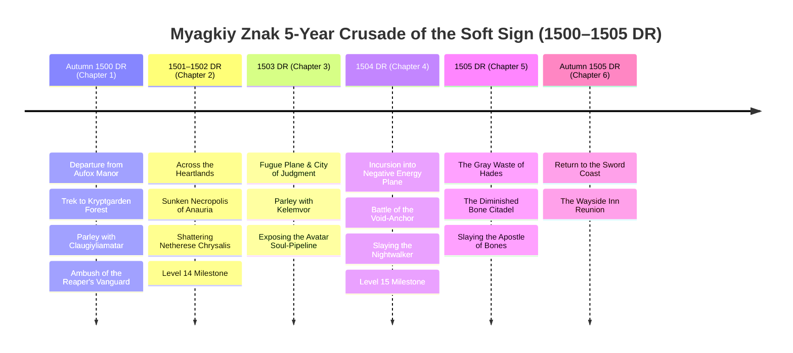

# 🕊️ The Shepherd of the Quiet Grave: The Saga of Myagkiy Znak

> **Chronicle Navigation:** ⬅️ **Previous:** [[07b - Bridge - Tvyordiy - The Breath of the Boundless Sky|07b: The Breath of the Boundless Sky]] | 🏠 [[The Order of Znak Complete Campaign Chronicle|Campaign Chronicle Hub]] | ⬆️ [[07 - Epilogue - Bridge Campaign|Epilogue Overview]] | ➡️ **Next Generation:** [[The Acolytes of Znak Campaign Plan|The Acolytes of Znak]]

---

*What [[Myagkiy Znak]] did across five years of solitary crusade (1500–1505 DR), hunting down the surviving cabals of Myrkul, terminating attempts to cultivate a new Chosen or Avatar of Death, and walking the planes until the gathering at the [[Wayside Inn]].*

When [[The Order of Znak]] scattered following five peaceful winters in [[Leilon]], they did not march under banners or sound trumpets. They dispersed like seeds caught in an autumn gale. [[Tvyordiy Znak]] had turned east toward the High Forest and the Star Mounts to seek his ancestral bloodline in the open skies. [[Krageer Stoneface Ogolakanu]] had turned north into the frozen crags with [[Cooragh]], carrying his seasoned iron skillet and a heart at peace. 

For [[Myagkiy Znak]], the road led southward down the High Road—clad in the polished, consecrated plate armor of fallen hero [[Dayne Preadhun]], his dark hair neatly tied back with strands of iron-grey touching his temples, his heavy mace ***Bonecounter*** stowed quiet at his pack, and his hands open to the road.

He was twelve years older than the solitary hermit who had once wandered the Dessarin Valley tending flocks of sheep. Yet beneath the tempered steel of his breastplate, the pulse of the Soft Sign—$\mathbf{Ь}$—beat with unyielding clarity: that which preserves life must also stand sentinel against the rot that would mock it.

---

## 🗺️ Campaign Pacing & Five-Year Chronicle Map (1500–1505 DR)

---

## Chapter 1: The Dragon's Debt & The Reaper of the Triad

*Table Session: November 16, 2026*  
*In-Game Setting: Autumn, 1500 DR (The Year of the Sea's Secrets Revealed)*  
*Location: Leilon Crossroads ➔ The High Road ➔ Deeping Cave (Kryptgarden Forest)*

---

### 🌅 Scene 1: The Parting of the Signs at the Crossroads

The morning air bit with the clean, sharp chill of early northern frost. A low white ground-mist drifted across the salt meadows, curling around the weathered timbers of the roadside ditches outside [[Leilon]].

Behind them, the palisade gates stood open. High upon the timber walkway, four familiar silhouettes watched in silence: [[Leopold]], his spectacles catching the first pale glint of dawn; broad-shouldered [[Smithwell Znak]] with his arms resting against the logs; [[Burnice Znak]], standing tall in her cuirass; and young [[Yasmina]], her dark hair and traveling cloak whipping in the coastal wind. Just beyond the rooftops, the unmortared white marble spire of the newly raised **[[The Temple of the Twin Signs|Temple of the Gods]]** caught the dawn light like a tranquil beacon above the town.

[[Myagkiy Znak]] and [[Tvyordiy Znak]] had walked down the cart-track together, their boots crunching side by side in the gravel. 

At the fork outside the ditch, where the High Road divided—the northern trail running toward the [[Wayside Inn]], and the southern branch winding down along the coast toward the gloom of Kryptgarden Forest—Tvyordiy came to a halt.

The veteran Aarakocra adjusted the coarse friar's cowl of his *Hat of Disguise*, settling the heavy hempen coils of rope and the traveling pack upon his shoulders. At sixteen summers, the silver frost touching his crest feathers marked him as an elder among his short-lived kin. 

He turned to face Myagkiy. His golden raptor eyes were deep, unblinking, and serene, carrying the quiet gravity of sixteen years of shared blood, bread, and brotherhood since that freezing alleyway in Waterdeep. 

He raised a scarred, feathered forearm in the traditional warrior's clasp, waiting for Myagkiy’s grip:

> *"The road forks here, brother,"* Tvyordiy rumbled softly in his deep, resonant baritone, his voice carrying clear above the keening autumn wind.  
> 
> *"I turn my face to the high country of the east; you turn yours to the quiet graves of the south. We do not know where these trails will take us, or when the wind will bring us back through these gates. But the Sign holds. When iron meets stone, it remembers. Watch your back in the wild places, Myagkiy. Walk with the light."*

Myagkiy clasped his brother's forearm, the steel of Dayne’s gauntlet locking firm against Tvyordiy's feathers:

> *"Brother, we both go to fight some unseen demons that have haunted us since our epic victory five years ago. That we should all four of us be beckoned away, each in our own turn, must be kismet."*

Tvyordiy nodded solemnly, his golden eyes unblinking in the wind. Myagkiy continued:

> *"We have put, each in our own way, a mark or sign on Leilon which will protect it. If not for that, mayhap we would not be able to even make this journey. Keep and watch for the Znak, Tvyordiy. It will protect and guide you."*

As he turned to walk away, a faint, wry smile touched Myagkiy's dark beard:

> *"I promise not to preach to every brigand on the path. And for you, do not get turned around whilst turning over every stone searching for the path. As you would say: 'If you are facing the right direction, all you need to do is keep on walking'."*

Tvyordiy’s beak curved in an amused, knowing smirk. With a final nod that spoke louder than oaths, the Aarakocra turned north, his long strides carrying him up the rise. 

Myagkiy watched until his brother’s grey friar's robe was swallowed by the northern mist. Then, turning his back to the town he had helped rebuild, he faced south down the High Road.

---

### 🚶 Scene 2: The Pastoral Road & The Scrying Veil

For eight days, Myagkiy walked south at an unhurried, pastoral pace. 

He covered fifteen or sixteen miles between sunrise and dusk, letting the steady crunch of gravel set the rhythm of his prayers. He traveled in Dayne’s polished +2 plate armor—its silvered steel catching the pale autumn sun—but his weapons remained stowed. The heavy flanged head of ***Bonecounter*** was strapped securely behind his pack, and his +2 shield hung dormant across his shoulders. He walked with his hands open, looking not like a conqueror seeking battle, but like a shepherd walking the boundaries of a vast, quiet pasture.

Where he met carters hauling salt-fish or tenant farmers gathering late cabbage, he stopped to share cold cheese and hear the news of the road. The countryside was peaceful. The dragon terrors of Icespire and the storm-raids of Talos had faded into tavern songs. Yet beneath that pastoral tranquility, Myagkiy’s spirit was troubled by what had transpired in the quiet months before his departure.

Within the sanctum of the **[[The Temple of the Twin Signs|Temple of the Gods]]**, in the weeks leading up to the autumn equinox, Myagkiy had sought to pierce the veil. He had burned rare incense over his ivory strips, casting ***Legend Lore*** to gather the ancient names and deeds of Myrkul—learning of the Lord of Bones’ fall at Boareskyr Bridge, the lingering curse of the *Crown of Horns*, and the desperate hunger of his diminished spirit in the wastes of the Outer Planes.

Yet when Myagkiy had knelt before the consecrated altar of the Twin Signs, focusing his divine focus to cast ***Scrying*** upon the surviving Myrkulite cells, his magic had struck an impenetrable wall.

A being of light and radiant vitality, guided by the benevolent mandates of Gond and Lathander, could not pierce the necrotic shroud. The very nature of Myagkiy’s divine power acted as a beacon of metaphysical opposition: the evil will and dense spiritual rot surrounding Myrkul’s surviving faithful repelled holy divination like oil rejecting holy water. The shroud of death would not open to a righteous man.

It was that theological failure that had led Myagkiy to his deduction. 

If a creature of radiant good could not pierce the necrotic veil, he needed an instrument already steeped in that darkness. And along the Sword Coast, only one creature possessed both the means and the metaphysical attunement: **[[Claugiyliamatar]]**, the ancient green wyrm known as **Old Gnawbones**.

Deep within her cavern in **Kryptgarden Forest**, she kept dozens of floating crystal scrying spheres and her massive, living topographic map of the Sword Coast. More critically, Claugiyliamatar possessed an involuntary, terrifying connection to the Lord of Bones: during the siege of Leilon, she had been possessed, hollowed out, and inhabited by **[[Ebondeath]]**, the ancient dragon-wraith of Myrkul. Though the ghost had been exorcised, that harrowing violation had left its stain in her marrow—a lingering resonance tuned precisely to Myrkul’s frequency. Her own predatory, wicked nature would offer no moral resistance against scrying the cult.

And above all, Old Gnawbones was bound by an absolute debt of blood. 

When Ebondeath was driven from her flesh in the climax of *Divine Contention*, the green wyrm had crashed into the shattered timber and masonry of **Aubrey’s Peculiarities**, broken, bleeding, and trembling at death’s door. It was Myagkiy who had stepped forward through the smoke. Channeling the boundless vitality of the Life Domain, Myagkiy had laid his gauntlets upon her torn emerald scales, pouring high-circle healing magic into her shattered breast until her lungs filled with air and her wings found the strength to launch into the sky and limp back to her forest redoubt.

She owed him her life.

On the eighth afternoon of his trek, the rolling scrubland fell away. To the east, the towering, moss-draped canopy of **Kryptgarden Forest** rose like an ancient green wall against the slate-grey sky.

---

### 🐉 Scene 3: The Audience in Deeping Cave

*(Live Tabletop Session — Peter as Myagkiy Znak, Antigravity as DM)*  
*Location: Inner Sanctum of Deeping Cave, Kryptgarden Forest*

To reach the inner sanctum, Myagkiy chose the high, cautious path. Climbing the limestone crags on the eastern cliff face, he entered through the elevated **lookout post**, bypassing the treacherous lower ravines. Moving with calm, measured footsteps, he passed through the shadowy **druid cavern**—where Claugiyliamatar's ragged, wild-eyed wood-cultists watched him from the stalagmites in eerie silence, sensing the holy radiance of his armor. 

From there, he crossed the narrow, natural **stone bridge** that arched sixty feet above the cavern floor. Below the bridge, bubbling and hissing in the dark, lay the **dark green acidic slime pools**—their foul, corrosive vapors stinging the air. With *Water Walk* held ready in his mind as an emergency contingency, Myagkiy's boots never faltered on the wet stone, bringing him safely across to the great inner chamber.

The inner sanctum was immense. Suspended throughout the vast vaulted gloom, dozens of translucent **crystal spheres** drifted like pale, glowing moons, humming with arcane static. Carved directly into the damp stone floor was the wyrm's massive, living **topographic relief map of the Sword Coast**, its painted valleys and miniature rivers glittering with mineral pigments.

High above, emerald scales scraped across stone with the sound of grinding millstones. 

Down from the high shadows slithered **[[Claugiyliamatar]]**. 

Her eighty-foot bulk glided down a massive central stalactite, her talons gouging deep trenches into the stone ledge twelve paces before him. Dried swamp muck and calcified moss crusted her spine-ridges, and the electrum chains around her thick neck jingled as her floating scrying baubles shifted.

She lowered her horned, crocodilian head until her snout was level with his chest. Her vertical yellow slit-pupils locked onto him, and her nostrils flared wide, drawing in a deep draft of cavern air.

Suddenly, her yellow eyes dilated with incandescent, murderous fury.

A low, guttural hiss rattled the loose gravel on the ledges. Her slit pupils fixed with venomous sharpness on his hip:

> *"The wand..."* she snarled, a violent cloud of pale chlorine gas jetting from her nostrils and sizzling against the rock. *"The Wand of Magic Detection from my private coffer... and the scent of my own bed-gold upon your pouch! Coins that lay in my gravel for three centuries!*
> 
> *When the Order drove the shadow-worm from my skull, I returned to my deep home to find my vaults cracked! My coffers plundered! My gold scattered into the pockets of little mortal thieves! I swore by Tiamat’s five heads that I would hunt down whoever despoiled my sleep and melt their marrow to soup!"*

She took two heavy, thundering steps forward. Her dagger-length teeth were bared, her jaws dripping acrid, sizzling saliva just five feet from Dayne's breastplate. The heat of her throat rolled over him like a furnace.

Yet even in her towering, draconic fury, she halted. Her claws trembled against the rock, fighting her own primal instincts. Her wicked eyes narrowed, shifting from the wand at his belt to the silver Life medallion resting against his chest:

> *"And now... the very cleric who laid his holy hands upon my crushed breast in the rubble of Leilon walks into my parlor, flaunting my stolen wand in my face. You saved my life, Myagkiy Znak. You gave me back my wings when Ebondeath crushed me like an insect. But you push a dragon's pride to the razor's edge. Give me one reason why I should not bite that wand from your waist, tear that purse from your belt, and spit your bones into the slime pool before I hear another word!"*

Myagkiy did not flinch. His boots remained anchored to the limestone flagstones, his gauntlets resting steady at his sides, his dark eyes meeting her blazing yellow slit-pupils without a tremor:

> *"I mean no disrespect here. We took what remained under reason of presumed abandonment. We knew not you would return clear of your bewitchment alive. And if not for me and the order, this would not be the case. Make no mistake though, this was ill-begotten wealth and my moral framework bucks against any remorse I would normally have. I've only just set out Claugiyliamatar, but trust I can be gone in a moment and come back hosting more than a large enough legion to best even one as ancient as you."*

The silence that followed was suffocating.

Claugiyliamatar’s slit eyes locked onto the crimson velvet of the *Cape of the Mountebank* draped across his shoulders, then to the silver holy medallion resting over Dayne's breastplate. An ancient wyrm of three centuries does not survive by failing to understand high-circle divine spellcraft. 

She possessed no arcane *Counterspell*. A single spoken syllable of ***Word of Recall*** would dissolve the cleric into a flash of radiant starlight, landing him instantly within the fortified sanctuary of the *Temple of the Gods* behind Leilon’s permanent *Forbiddance* grid—beyond her reach, immune to her breath weapon, and in position to sound the muster horns across the Sword Coast to finish what Ebondeath began.

For five long heartbeats, the dragon held his gaze. The sulfur in her throat rumbled like dying thunder.

Then, slowly, her frills settled against her thick neck. She pulled her snout back two paces, her jaws clicking shut. A low, dry rattle of laughter rumbled from her chest—grating, cold, and begrudgingly impressed:

> *"Bold words for a mortal in an unlit cave,"* she purred, her claws curling against the stone. *"You speak like a conqueror, Myagkiy Znak, but you did not walk across my bridges and brave my slime pools merely to boast of your legions or defend your theft.*
> 
> *The soft priest has iron in his marrow, as Tvyordiy has stone. Let us set aside the wand and the coins for now. A life debt is a heavy chain, and Old Gnawbones does not like carrying debts.*
> 
> *Tell me why you have come, cleric. What shadow drives you south into my woods?"*

Myagkiy reached up with his right gauntlet, lightly resting his fingertips upon the silver sunburst of the Soft Sign embossed against Dayne's breastplate. Beneath his breath, he whispered a tranquil, quiet syllable of prayer, invoking ***Guidance*** to steady his mortal mind before the ancient wyrm.

> **Mechanical Resolution: Charisma Check (Theological Parley & Life Debt)**
> * **Check:** Charisma (Untrained, `+1` CHA)
> * **Situational Advantage (2d20):** Granted due to Claugiyliamatar's acknowledged blood debt to Myagkiy from Leilon, combined with her burning hatred of Myrkul and Ebondeath.
>   * *Die 1:* **Natural 20** (`20 + 1 = 21`)
>   * *Die 2:* `7` (`7 + 1 = 8`)
>   * *Selected Die:* **Natural 20**
> * **Cantrip (*Guidance*):** `+4` (Maximum 1d4 roll)
> * **Total Check Result:** **`25`** vs. **DC 15** — **CRITICAL SUCCESS**!

Lowering his hand, Myagkiy looked straight into her vast, slit-pupiled eyes. His voice echoed across the vaulted chamber with calm, unyielding moral authority:

> *"I came not to take, Claugiyliamatar, but because my own light cannot reach where I must go.*
> 
> *In Leilon, in the quiet months before setting out, I prepared for this journey. I burned incense, cast legend lore, and learned the ancient names of Myrkul. I knelt before the consecrated altar of the Twin Signs and cast scrying to pierce the veil and locate where his surviving cults gather. But a priest of the Life Domain cannot pierce the shroud of death.*
> 
> *The radiant vitality of my gods repels necrotic rot like oil rejecting water. Every prayer I cast struck an impenetrable wall of darkness. The shroud of death will not part for a holy man.*
> 
> *You possess what no priest of Lathander or Gond can ever wield. You have your floating crystal spheres. You have your living relief map of the Sword Coast. And most of all, you carry in your very marrow the lingering ghost-scent of Ebondeath.*
> 
> *His possession was your agony and your disgrace, but today it is our key. Your predatory nature offers no holy resistance against death magic, and your soul is attuned to Myrkul's dark frequency. You owe me your life, wyrm. You owe me the breath in your lungs. Open your spheres. Call upon that lingering darkness in your bones, pierce the shroud of death, and tell me where the carrion-mongers of the god who made a beast of you are hiding."*

The silence returned, heavier and colder than before.

Claugiyliamatar’s yellow eyes widened. For a moment, the great wyrm seemed frozen in astonishment—not by a mortal’s arrogance, but by the ruthless, pragmatic intellect behind his words. A holy battle-priest of the Soft Sign, demanding that an ancient green dragon harness the traumatic necrosis of her own defilement to serve as his occult lens!

Then, deep in her belly, a sound began to build.

It started as a wet, guttural rumble, vibrating through the stone ledges, before bursting forth into a deafening, cavern-splitting roar of draconic laughter. Chlorine fumes puffed from her nostrils in choking rings as she shook her horned head, her electrum chains thrashing:

> *"Hahahahaha! By Tiamat's five weeping heads! The soft-handed shepherd of Leilon has black poison in his well after all!*
> 
> *You would turn the rotting corpse-worm that nested in my skull into your hound to hunt his own master? You stand in my parlor and command Old Gnawbones to dredge up the stench of her own shame to clear your blind eyes?*
> 
> *Magnificent. Utterly wicked. If you had an ounce of greed in your heart, cleric, you would make a splendid blackguard.*
> 
> *Very well. A life debt is a galling collar, Myagkiy Znak, and I will not wear it around my neck for another hour. Step forward to the map. Let us burn this ledger once and for all."*

The dragon turned her massive bulk, her barbed tail sweeping across the stone floor with a dry hiss. Slithering into the sunken amphitheater where the great topographic relief map was carved, she reared onto her hind haunches. 

Extending her long, scalloped wings, she hissed a guttural incantation in ancient Draconic. 

Above them, the floating **crystal spheres** began to orbit like spinning moons. Pale green arcane light flared within the glass, rapidly curdling into a sickly, necrotic violet. From the ridges of Claugiyliamatar’s spine, wisps of black, spectral fog began to seep—the dormant, foul residue of Ebondeath’s possession, called forth by her iron will.

Her vertical pupils rolled back into her head, turning milky white. Her talons twitched in mid-air as she tuned her draconic senses through the spheres, casting her mind across the Sword Coast:

> *"I smell him..."* she rasped, her voice shifting into a chilling, double-toned echo that rattled Myagkiy's teeth. *"The rot of Boareskyr Bridge... the dry bone-dust of the Netherese crypts...*
> 
> *They do not gather in the cities. They do not hide in Neverwinter or Waterdeep. They have fled east, far past the mountains, out into the great wastes where the skin shrivels from the meat...*
> 
> *In the sunken ruins of **Anauria**... beneath the scorched sands of southern **Anauroch**... the black glass pyramids of ancient Netheril stir. Ancient liches—servants who bowed to the Lord of Bones before the Fall—have broken their tombs. They have chosen a vessel.*
> 
> *A fallen champion... **Vaelen the Grave-Sworn**... the 'Reaper of the Triad.' He is gathering the remnants of the broken cults, binding undead nomads, and raiding merchant caravans to fuel a colossal **blood chrysalis**. They intend to pour thousands of slaughtered souls into his vessel to birth a living mortal Avatar of Myrkul upon Toril!"*

Suddenly, Claugiyliamatar’s left foreclaw stabbed downward with lightning speed. Her six-inch obsidian talon struck the painted relief map with a sharp *CRACK*, embedding into the eastern tree-line of Kryptgarden Forest:

> *"And they are closer than the desert, cleric!"* she hissed, her snout snapping toward him with venomous intensity.
> 
> *"An advance scouting cell... a vanguard of bone-carvers, wights, and death-priests... they lie in wait not ten miles from this very cave! At the **Weeping Stone Crossing**, where the forest stream cuts the eastern road toward the Dessarin Valley. They were sent to watch the roads from Leilon, to butcher any solitary scouts or holy messengers before word could reach the Lords' Alliance!*
> 
> *They wait for sheep. They do not know a wolf in shining steel walks down the mountain."*

With a violent shudder, the dragon snapped her head forward. The violet mist shattered into pale ash. Claugiyliamatar collapsed onto all fours, coughing and spitting a puddle of acrid black bile onto the stone flagstones, shivering with revulsion at the lingering taste of Ebondeath's necrotic taint.

She glared at Myagkiy with exhausted, burning yellow eyes:

> *"The debt of blood is paid in full, Myagkiy Znak. I gave you the head of the serpent, and I gave you the adder coiled in the grass at your feet.*
> 
> *Go to the Weeping Stone Crossing. Spill their black blood on the moss. Take whatever route-maps and Netherese markers their leader carries, and march your boots into the desert wastes until the sand chokes your lungs.*
> 
> *Now take your wand, take your bed-gold, and get out of my mountain before I remember that you are flesh, and that dragons grow hungry in the autumn chill."*

Myagkiy met her gaze for a single, solemn breath. He made no bow, but he gave a firm, respectful nod of his head:

> *"Our ledger is clear, Claugiyliamatar. May your wings remain your own."*

Turning upon his heel, the crimson velvet of his *Cape of the Mountebank* swirling behind him, Myagkiy marched back across the stone bridge, past the silent wood-druids, and out into the crisp autumn wind of Kryptgarden.

---

### ⚔️ Scene 4: The Ambush at Weeping Stone Crossing

*(Tactical Combat & Interrogation — Myagkiy Znak Level 13 Life Cleric)*  
*Location: The Weeping Stone Crossing, Eastern Verge of Kryptgarden Forest*  
*Conditions: Overcast dusk, damp moss-slicked terrain, rushing stream, ancient weeping stone monument*

#### 🗺️ Tactical Setup & Battlefield Layout
Two hours before sunset, Myagkiy reached the eastern verge of the forest. 

The **Weeping Stone Crossing** was an ancient, melancholic landmark—a massive, moss-covered menhir carved with weeping human faces that continually wept trickles of condensation into a shallow, rushing stream (15 feet wide, 2 feet deep, difficult terrain). The ancient cart path crossed the stream over a slick, partially collapsed cobblestone ford.

Dense pine trees and tangled briars flanked the eastern and western banks, providing heavy obscurement and elevated vantage points 10 feet above the road.

#### 💀 Enemy Roster & Vanguard Positions
Forewarned by Claugiyliamatar’s scrying, Myagkiy's keen eyes spotted the ambushers before they could spring their trap:

1. **Malakor the Bone-Carver (Cult Leader / War Priest of Myrkul):** Clad in dull iron mail and a skull mask, stationed on the eastern bank behind the weeping menhir, clutching a flail of blackened bone and an unholy symbol of Myrkul.
2. **2x Myrkulite Death-Snipers (Cult Wight Marksmen):** Perched in the elevated pine boughs on the eastern bank (10 ft up, half cover, longbows tipped with grave-poison).
3. **4x Crypt Ghouls:** Submerged beneath the dark water of the stream bed, waiting to drag crossing travelers down into the muck.
