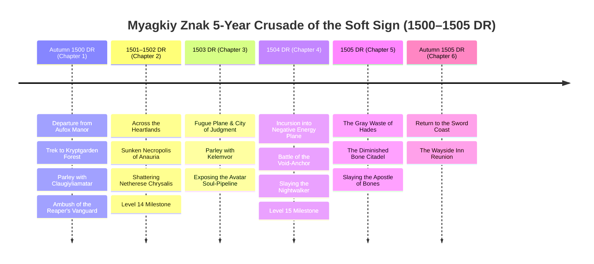

# 🕊️ The Shepherd of the Quiet Grave: The Saga of Myagkiy Znak

> **Chronicle Navigation:** ⬅️ **Previous:** [[07b - Bridge - Tvyordiy - The Breath of the Boundless Sky|07b: The Breath of the Boundless Sky]] | 🏠 [[The Order of Znak Complete Campaign Chronicle|Campaign Chronicle Hub]] | ⬆️ [[07 - Epilogue - Bridge Campaign|Epilogue Overview]] | ➡️ **Next Generation:** [[The Acolytes of Znak Campaign Plan|The Acolytes of Znak]]

---

*What [[Myagkiy Znak]] did across five years of solitary crusade (1500–1505 DR), hunting down the surviving cabals of Myrkul, terminating attempts to cultivate a new Chosen or Avatar of Death, and walking the planes until the gathering at the [[Wayside Inn]].*

When [[The Order of Znak]] scattered following five peaceful winters in [[Leilon]], they did not march under banners or sound trumpets. They dispersed like seeds caught in an autumn gale. [[Tvyordiy Znak]] had turned east toward the High Forest and the Star Mounts to seek his ancestral bloodline in the open skies. [[Krageer Stoneface Ogolakanu]] had turned north into the frozen crags with [[Cooragh]], carrying his seasoned iron skillet and a heart at peace. 

For [[Myagkiy Znak]], the road led southward down the High Road—clad in the polished, consecrated plate armor of fallen hero [[Dayne Preadhun]], his deep brown, dark-skinned face weathered with the serene wisdom of an elder battle-priest in his early fifties, his dark dreadlocks neatly bound back in a warrior-monk's knot with strands of silver and iron-grey prominently framing his temples, his heavy mace ***Bonecounter*** stowed quiet at his pack, and his hands open to the road.

He was twelve years older than the solitary hermit who had once wandered the Dessarin Valley tending flocks of sheep. Yet beneath the tempered steel of his breastplate, the pulse of the Soft Sign—$\mathbf{Ь}$—beat with unyielding clarity: that which preserves life must also stand sentinel against the rot that would mock it.

---

## 🗺️ Campaign Pacing & Five-Year Chronicle Map (1500–1505 DR)



---

## Chapter 1: The Dragon's Debt & The Reaper of the Triad

*Table Session: November 16, 2026*  
*In-Game Setting: Autumn, 1500 DR (The Year of the Sea's Secrets Revealed)*  
*Location: Leilon Crossroads ➔ The High Road ➔ Deeping Cave (Kryptgarden Forest)*

---

### 🌅 Scene 1: The Parting of the Signs at the Crossroads

The morning air bit with the clean, sharp chill of early northern frost. A low white ground-mist drifted across the salt meadows, curling around the weathered timbers of the roadside ditches outside [[Leilon]].

Behind them, the palisade gates stood open. High upon the timber walkway, four familiar silhouettes watched in silence: [[Leopold]], his spectacles catching the first pale glint of dawn; broad-shouldered [[Smithwell Znak]] with his arms resting against the logs; [[Burnice Znak]], standing tall in her cuirass; and young [[Yasmina]], her dark hair and traveling cloak whipping in the coastal wind. Just beyond the rooftops, the unmortared white marble spire of the newly raised **[[The Temple of the Twin Signs|Temple of the Gods]]** caught the dawn light like a tranquil beacon above the town.

[[Myagkiy Znak]] and [[Tvyordiy Znak]] had walked down the cart-track together, their boots crunching side by side in the gravel. 

At the fork outside the ditch, where the High Road divided—the northern trail running toward the [[Wayside Inn]], and the southern branch winding down along the coast toward the gloom of Kryptgarden Forest—Tvyordiy came to a halt.

The veteran Aarakocra adjusted the coarse friar's cowl of his *Hat of Disguise*, settling the heavy hempen coils of rope and the traveling pack upon his shoulders. At sixteen summers, the silver frost touching his crest feathers marked him as an elder among his short-lived kin. 

He turned to face Myagkiy. His golden raptor eyes were deep, unblinking, and serene, carrying the quiet gravity of sixteen years of shared blood, bread, and brotherhood since that freezing alleyway in Waterdeep. 

He raised a scarred, feathered forearm in the traditional warrior's clasp, waiting for Myagkiy’s grip:

> *"The road forks here, brother,"* Tvyordiy rumbled softly in his deep, resonant baritone, his voice carrying clear above the keening autumn wind.  
> 
> *"I turn my face to the high country of the east; you turn yours to the quiet graves of the south. We do not know where these trails will take us, or when the wind will bring us back through these gates. But the Sign holds. When iron meets stone, it remembers. Watch your back in the wild places, Myagkiy. Walk with the light."*

Myagkiy clasped his brother's forearm, the steel of Dayne’s gauntlet locking firm against Tvyordiy's feathers:

> *"Brother, we both go to fight some unseen demons that have haunted us since our epic victory five years ago. That we should all four of us be beckoned away, each in our own turn, must be kismet."*

Tvyordiy nodded solemnly, his golden eyes unblinking in the wind. Myagkiy continued:

> *"We have put, each in our own way, a mark or sign on Leilon which will protect it. If not for that, mayhap we would not be able to even make this journey. Keep and watch for the Znak, Tvyordiy. It will protect and guide you."*

As he turned to walk away, a faint, wry smile touched Myagkiy's dark beard:

> *"I promise not to preach to every brigand on the path. And for you, do not get turned around whilst turning over every stone searching for the path. As you would say: 'If you are facing the right direction, all you need to do is keep on walking'."*

Tvyordiy’s beak curved in an amused, knowing smirk. With a final nod that spoke louder than oaths, the Aarakocra turned north, his long strides carrying him up the rise. 

Myagkiy watched until his brother’s grey friar's robe was swallowed by the northern mist. Then, turning his back to the town he had helped rebuild, he faced south down the High Road.

![[myagkiy_bridge_ch01_leilon_crossroads_parting.jpg]]
*Figure 1.1: The Parting of the Signs (Autumn 1500 DR) — Myagkiy Znak (Ь) and Tvyordiy Znak (Ъ) clasp forearms at the fork of the High Road outside the palisade gates and the newly raised Temple of the Gods in Leilon.*


---

### 🚶 Scene 2: The Pastoral Road & The Scrying Veil

For eight days, Myagkiy walked south at an unhurried, pastoral pace. 

He covered fifteen or sixteen miles between sunrise and dusk, letting the steady crunch of gravel set the rhythm of his prayers. He traveled in Dayne’s polished +2 plate armor—its silvered steel catching the pale autumn sun—but his weapons remained stowed. The heavy flanged head of ***Bonecounter*** was strapped securely behind his pack, and his +2 shield hung dormant across his shoulders. He walked with his hands open, looking not like a conqueror seeking battle, but like a shepherd walking the boundaries of a vast, quiet pasture.

Where he met carters hauling salt-fish or tenant farmers gathering late cabbage, he stopped to share cold cheese and hear the news of the road. The countryside was peaceful. The dragon terrors of Icespire and the storm-raids of Talos had faded into tavern songs. Yet beneath that pastoral tranquility, Myagkiy’s spirit was troubled by what had transpired in the quiet months before his departure.

Within the sanctum of the **[[The Temple of the Twin Signs|Temple of the Gods]]**, in the weeks leading up to the autumn equinox, Myagkiy had sought to pierce the veil. He had burned rare incense over his ivory strips, casting ***Legend Lore*** to gather the ancient names and deeds of Myrkul—learning of the Lord of Bones’ fall at Boareskyr Bridge, the lingering curse of the *Crown of Horns*, and the desperate hunger of his diminished spirit in the wastes of the Outer Planes.

Yet when Myagkiy had knelt before the consecrated altar of the Twin Signs, focusing his divine focus to cast ***Scrying*** upon the surviving Myrkulite cells, his magic had struck an impenetrable wall.

A being of light and radiant vitality, guided by the benevolent mandates of Gond and Lathander, could not pierce the necrotic shroud. The very nature of Myagkiy’s divine power acted as a beacon of metaphysical opposition: the evil will and dense spiritual rot surrounding Myrkul’s surviving faithful repelled holy divination like oil rejecting holy water. The shroud of death would not open to a righteous man.

It was that theological failure that had led Myagkiy to his deduction. 

If a creature of radiant good could not pierce the necrotic veil, he needed an instrument already steeped in that darkness. And along the Sword Coast, only one creature possessed both the means and the metaphysical attunement: **[[Claugiyliamatar]]**, the ancient green wyrm known as **Old Gnawbones**.

Deep within her cavern in **Kryptgarden Forest**, she kept dozens of floating crystal scrying spheres and her massive, living topographic map of the Sword Coast. More critically, Claugiyliamatar possessed an involuntary, terrifying connection to the Lord of Bones: during the siege of Leilon, she had been possessed, hollowed out, and inhabited by **[[Ebondeath]]**, the ancient dragon-wraith of Myrkul. Though the ghost had been exorcised, that harrowing violation had left its stain in her marrow—a lingering resonance tuned precisely to Myrkul’s frequency. Her own predatory, wicked nature would offer no moral resistance against scrying the cult.

And above all, Old Gnawbones was bound by an absolute debt of blood. 

When Ebondeath was driven from her flesh in the climax of *Divine Contention*, the green wyrm had crashed into the shattered timber and masonry of **Aubrey’s Peculiarities**, broken, bleeding, and trembling at death’s door. It was Myagkiy who had stepped forward through the smoke. Channeling the boundless vitality of the Life Domain, Myagkiy had laid his gauntlets upon her torn emerald scales, pouring high-circle healing magic into her shattered breast until her lungs filled with air and her wings found the strength to launch into the sky and limp back to her forest redoubt.

She owed him her life.

On the eighth afternoon of his trek, the rolling scrubland fell away. To the east, the towering, moss-draped canopy of **Kryptgarden Forest** rose like an ancient green wall against the slate-grey sky.

---

### 🐉 Scene 3: The Audience in Deeping Cave

*(Live Tabletop Session — Peter as Myagkiy Znak, Antigravity as DM)*  
*Location: Area D8 - Claugiyliamatar's Sanctum, Deeping Cave, Kryptgarden Forest*  
*Canonical Environment: Sleeping Dragon's Wake (Area D8)*

To reach the dragon's private sanctum, Myagkiy chose the high, cautious ingress. Climbing the damp limestone crags on the eastern cliff face, he entered through the elevated **lookout post**, bypassing the treacherous lower ravines. Moving with calm, measured footsteps, he passed through the shadowy **druid cavern**—where Claugiyliamatar's ragged, wild-eyed wood-cultists crouched among the dripping stalagmites in eerie silence, watching the holy battle-priest pass without daring to raise a blade. 

From there, he crossed the narrow, natural **stone bridge** arching sixty feet above the cavern floor. Below the wet bridge, bubbling and hissing in the dark, lay the **dark green acidic slime pools**—their corrosive vapors stinging the nostrils. With *Water Walk* prepared in his mind as a contingency, Myagkiy's boots never slipped on the slick stone, bringing him safely across into the vast sanctum of **Area D8**.

The sanctum opened into an immense, cavernous dome draped in heavy emerald shadows. 

Scattered across the damp flagstone floor stood a **dozen 10-foot-high brass pedestals**, each tarnished with green verdigris and bearing a heavy, flawless **crystal ball** used for the wyrm's far-reaching scrying network. 

Dominating the walls were two breathtaking displays of draconic lair magic. Massive, tangled vines clung to the north and south walls, each forming an almost perfect circle enclosing a **twenty-foot-diameter patch of strangely glowing green moss**:
* **The North Wall:** The luminous moss was shaped into an exquisite, living street-by-street map of the great city of **Waterdeep**, where Claugiyliamatar conducted the majority of her intricate humanoid manipulations and criminal investments.
* **The South Wall:** The moss formed a grand, sprawling regional relief map of the **Sword Coast**, stretching from the Spine of the World down to the Cloud Peaks. 

Both living moss maps were dotted with glowing **Draconic runes** marking the active positions of her humanoid spies and charmed informants—glimmering in the ports of Luskan, the taverns of Neverwinter, the upper terraces of Waterdeep, and the lower gates of Baldur's Gate and Elturel. 

Yet as Myagkiy’s keen eyes swept the south wall, one profound detail stood out immediately: **there were no runes near Leilon**. Not a single glowing mark touched the coastal hills between the Mere of Dead Men and the Sword Mountains. In the five years since *Divine Contention*, Old Gnawbones had kept her spies far clear of the Order’s sanctum, treating Leilon as an untouchable domain of holy iron and living fire.

High above the brass pedestals, emerald scales scraped across stone with the sound of grinding millstones.

Down from the high vaulted shadows slithered **[[Claugiyliamatar]]**.

Her eighty-foot bulk glided down a massive central stalactite, her talons gouging deep trenches into the stone ledge twelve paces before him. Dried swamp muck and calcified moss crusted her spine-ridges, and the electrum chains around her thick neck jingled as she landed heavily between two of the brass pedestals.

She lowered her horned, crocodilian head until her snout was level with his chest. Her vertical yellow slit-pupils locked onto him, and her nostrils flared wide, drawing in a deep draft of cavern air.

![[myagkiy_bridge_ch01_deeping_cave_claugiyliamatar.jpg]]
*Figure 1.2: The Dragon's Debt — Elder battle priest Myagkiy Znak stands resolute upon a mossy stone ledge in Deeping Cave, claiming the life-debt of the ancient green dragon Claugiyliamatar (Old Gnawbone).*


Suddenly, her yellow eyes dilated with incandescent, murderous fury.

A low, guttural hiss rattled the loose gravel on the ledges. Her slit pupils fixed with venomous sharpness on his hip:

> *"The wand..."* she snarled, a violent cloud of pale chlorine gas jetting from her nostrils and sizzling against the rock. *"The Wand of Magic Detection from my private coffer... and the scent of my own bed-gold upon your pouch! Coins that lay in my gravel for three centuries!*
> 
> *When the Order drove the shadow-worm from my skull, I returned to my deep home to find my vaults cracked! My coffers plundered! My gold scattered into the pockets of little mortal thieves! I swore by Tiamat’s five heads that I would hunt down whoever despoiled my sleep and melt their marrow to soup!"*

She took two heavy, thundering steps forward. Her dagger-length teeth were bared, her jaws dripping acrid, sizzling saliva just five feet from Dayne's breastplate. The heat of her throat rolled over him like a furnace.

Yet even in her towering, draconic fury, she halted. Her claws trembled against the rock, fighting her own primal instincts. Her wicked eyes narrowed, shifting from the wand at his belt to the silver Life medallion resting against his chest:

> *"And now... the very cleric who laid his holy hands upon my crushed breast in the rubble of Leilon walks into my parlor, flaunting my stolen wand in my face. You saved my life, Myagkiy Znak. You gave me back my wings when Ebondeath crushed me like an insect. But you push a dragon's pride to the razor's edge. Give me one reason why I should not bite that wand from your waist, tear that purse from your belt, and spit your bones into the slime pool before I hear another word!"*

Myagkiy did not flinch. His boots remained anchored to the limestone flagstones, his gauntlets resting steady at his sides, his dark eyes meeting her blazing yellow slit-pupils without a tremor:

> *"I mean no disrespect here. We took what remained under reason of presumed abandonment. We knew not you would return clear of your bewitchment alive. And if not for me and the order, this would not be the case. Make no mistake though, this was ill-begotten wealth and my moral framework bucks against any remorse I would normally have. I've only just set out Claugiyliamatar, but trust I can be gone in a moment and come back hosting more than a large enough legion to best even one as ancient as you."*

The silence that followed was suffocating.

Claugiyliamatar’s slit eyes locked onto the crimson velvet of the *Cape of the Mountebank* draped across his shoulders, then to the silver holy medallion resting over Dayne's breastplate. An ancient wyrm of three centuries does not survive by failing to understand high-circle divine spellcraft. 

She possessed no arcane *Counterspell*. A single spoken syllable of ***Word of Recall*** would dissolve the cleric into a flash of radiant starlight, landing him instantly within the fortified sanctuary of the *Temple of the Gods* behind Leilon’s permanent *Forbiddance* grid—beyond her reach, immune to her breath weapon, and in position to sound the muster horns across the Sword Coast to finish what Ebondeath began.

For five long heartbeats, the dragon held his gaze. She bottled her towering rage, her draconic cunning quietly weighing whether to plot revenge in secret or leave well enough alone for now.

Then, slowly, her frills settled against her thick neck. She pulled her snout back two paces, her jaws clicking shut. A low, dry rattle of laughter rumbled from her chest—grating, cold, and amused by his posturing:

> *"Bold words for a mortal in an unlit cave,"* she purred, her claws curling against the stone. *"You speak of legions and flight, shepherd of Leilon. But you have walked very far from your little temple—that stone coop where you and your brothers vanish completely from my crystal orbs, cloaked behind your stubborn wards.*
> 
> *You did not venture across my bridges, brave my slime pools, and step outside your little sanctuary merely to boast of your escape spells or defend your theft. Old Gnawbones sees much, but she does not see into a blind priest's skull.*
> 
> *Tell me, Myagkiy Znak: what shadow could possibly drag you out of your protected nest and drive you south into my woods?"*

Myagkiy reached up with his right gauntlet, lightly touching the silver sunburst of the Soft Sign embossed upon Dayne's breastplate. Beneath his breath, he whispered a tranquil syllable of prayer, invoking ***Guidance*** to steady his mortal mind before delivering his solemn truth.

Looking straight into her vast, slit-pupiled eyes, Myagkiy answered:

> *"Znak's will will be fulfilled. I have felt it send to me a sense of urgency to seek out the remnants of Myrkul and its deathly presence upon the Sword Coast and probably Faerûn, Toril, and worlds beyond I cannot fathom. Yet, my attempts at communing and divining are met with death's own shroud and knell forcing me out of my reverie.*
> 
> *You though, its shade inhabited your mind for a time and perhaps that with your proclivities might make you a better viewer into just where he has made his own quiet and shallow grave whilst waiting for his next opportunity to unmake life in our plane."*

> **Mechanical Resolution: Charisma Check (Theological Parley & Life Debt)**
> * **Check:** Charisma (Untrained, `+1` CHA)
> * **Situational Advantage (2d20):** Granted due to Claugiyliamatar's acknowledged blood debt to Myagkiy from Leilon, combined with her burning hatred of Myrkul and Ebondeath.
>   * *Die 1:* **Natural 20** (`20 + 1 = 21`)
>   * *Die 2:* `7` (`7 + 1 = 8`)
>   * *Selected Die:* **Natural 20**
> * **Cantrip (*Guidance*):** `+4` (Maximum 1d4 roll)
> * **Total Check Result:** **`25`** vs. **DC 15** — **CRITICAL SUCCESS**!

Claugiyliamatar’s yellow eyes dilated. For several seconds, the ancient wyrm stared at him in stunned, disbelieving silence. She listened to the slow, steady beat of his heart—free of deceit, free of trembling. 

A holy battle-priest of the Soft Sign, standing in her parlor and demanding that an ancient green dragon harness the traumatic necrosis of her own defilement to serve as his occult lens against the god who enslaved her!

Then, deep in her belly, a sound began to build.

It started as a wet, guttural rumble, vibrating through the 10-foot brass pillars, before bursting forth into a deafening, cavern-splitting roar of draconic laughter. Chlorine fumes puffed from her nostrils in choking rings as she shook her horned head, her electrum chains thrashing:

> *"Hahahahaha! By Tiamat's five weeping heads! The soft-handed shepherd of Leilon has black poison in his well after all!*
> 
> *You would turn the rotting corpse-worm that nested in my skull into your hound to hunt his own master? You stand in my parlor and command Old Gnawbones to dredge up the stench of her own shame to clear your blind eyes?*
> 
> *Magnificent. Utterly wicked. If you had an ounce of greed in your heart, cleric, you would make a splendid blackguard.*
> 
> *Very well. A life debt is a galling collar, Myagkiy Znak, and I will not wear it around my neck for another hour. Step to the pedestals. Let us burn this ledger once and for all."*

The dragon stalked across the flagstones, her heavy talons clicking against the stone floor. She approached one of the central **10-foot-high brass pedestals** that aligned directly with the south wall. 

Lowering her horned chin until her nostrils were level with the crystal sphere, Claugiyliamatar closed her yellow slit eyes. 

A deep, sickening shudder rippled down her eighty-foot emerald spine. From deep within her chest—where Ebondeath's spectral claws had once bound themselves to her draconic heart—she summoned the dormant, foul residue of that dark possession. The air in the cavern plunged twenty degrees. An icy, necrotic rime frosted the brass pedestal and coated the edges of her snout. 

She exhaled a long, chilling breath across the glass of the crystal ball.

Inside the sphere, pale green arcane static curdled instantly into a thick, swirling vortex of necrotic violet and bone-black mist.

Simultaneously, Claugiyliamatar’s lair magic surged through the bedrock.

On the **south wall**, within the twenty-foot circle framed by thick vines, the **living green moss began to writhe and crawl across the stone face** in real time!

With wet, rustling whispers, the bioluminescent growth animated under her mental command. The familiar contours of the Sword Coast remained anchored in deep green, but along the eastern border, tendrils of living moss began to scale the stone crags of the Greypeak Mountains. 

Like creeping tendrils of ivy, the moss spilled over the mountain passes and crawled outward across the unmapped expanse to the east, charting the great arid wasteland: **Anauroch**.

Where the sands began, the nature of the moss twisted. Starved of moisture, the growth transformed into a pale, desiccated ochre and ash-grey moss, creeping south into the dried bed of the ancient inland sea: **Anauria**.

There, amidst the shifting dunes of the animated moss, miniature formations erupted from the rock face: tiny, sharp geometric shapes made of blackened, withered lichen depicting **sunken basalt pyramids** and half-buried Netherese obelisks.

At the center of Anauria, a pulsating, unholy crimson-and-black rune blossomed in the moss like an open wound.

Claugiyliamatar’s eyes rolled back into her head, turning milky white as she leaned into the crystal ball, her voice resonating in an eerie, double-toned rasp that sounded like two voices speaking from a single throat:

> *"I smell him..."* she hissed, the brass pedestal vibrating beneath her claws. *"The rot of Boareskyr Bridge... the dry bone-dust of Netheril...*
> 
> *They do not hide in the coastal cities. They have fled east, across the desert dunes where the skin shrivels from the meat...*
> 
> *In the sunken ruins of **Anauria**... beneath the glassed sands of southern **Anauroch**... the tombs of ancient Netherese liches have broken open. Servants who bowed to the Lord of Bones before the Fall walk the sands once more. They have chosen their champion.*
> 
> *A fallen crusader... **Vaelen the Grave-Sworn**... the 'Reaper of the Triad.' He is binding undead nomads, butchering desert caravans, and gathering surviving cultists to fuel a colossal **blood chrysalis**. They intend to pour ten thousand slaughtered souls into his vessel to birth a living mortal Avatar of Myrkul upon Toril!"*

Suddenly, the dragon turned her horned head toward the western fringe of the moss map, her left foreclaw stabbing toward the stone wall. Her obsidian talon tapped sharply against the living moss just outside the borders of Kryptgarden Forest:

> *"And look closer to home, holy man!"* she growled, her talon gouging a speck of glowing crimson moss at the forest's eastern verge.
> 
> *"An advance scouting cell... a vanguard of bone-carvers, wights, and death-priests... they lie in wait not ten miles from where you stand! At the **Weeping Stone Crossing**, where the forest stream cuts the cart road toward the Dessarin Valley. They were dispatched by Vaelen to watch the eastern highways from Leilon—ordered to butcher any solitary scouts, paladins, or couriers before word of the Reaper's rising could reach the Lords' Alliance!*
> 
> *They wait for sheep at the river crossing. They do not know a wolf in shining plate is marching down my mountain."*

With a violent convulsion, Claugiyliamatar severed the link. 

The crystal ball atop the brass pedestal went abruptly opaque and dark. The dragon collapsed her heavy snout onto the limestone floor, coughing and retching violently, spitting a pool of sizzling black bile between the brass pillars as she fought off the sickening, lingering nausea of Ebondeath's taint.

Myagkiy looked at the shuddering wyrm with calm, measured priestly poise. His voice remained steady, offering mercy without servility:

> *"I could give you some restoration, Gnawbone, if the fell humors still plague your breath. But tell me, you have lived longer than the lives of mortal men. What know you of Anauria? I presume you hold no love for the sands, but have you seen it?"*

Claugiyliamatar raised her snout from the flagstones, baring her needle-sharp teeth in a rasping hiss:

> *"Keep your holy hands off my scales, cleric!"* she spat, wiping black slime against the verdigris brass of the pedestal. *"Though the rot tastes like boiled gall, Old Gnawbones has endured worse than a foul gullet. I need no soft shepherd to pat my head and cleanse my breath.*
> 
> *As for the sands..."* 

She turned her yellow slit-pupils up toward the twenty-foot circle on the south wall, where the withered ochre moss outlined the Great Sand Sea.

> *"I flew high above the Greypeaks in my youth, centuries before your petty wooden hamlets were pegged to the mud. A green dragon belongs in the canopy, where the rot is lush, wet, and fertile. The desert is a cursed kiln, desiccated by those alien leech-monsters they call the Phaerimm, who drained the inland sea until the rivers withered to dust.*
> 
> *Anauria was the proudest of Netheril's daughter-states. When the flying enclaves plummeted from the heavens, the lords of Anauria thought their sword-magic and silver pegasi would preserve them forever. But the sand swallowed them all the same. Their towers drowned in dunes; their glass spires shattered under the wind.*
> 
> *And underneath those sands, holy man... the arch-wizards who knelt to the Lord of Bones refused to die. They bound their souls into sunken basalt pyramids and black obsidian sarcophagi. They have slept under the burning dunes for a thousand winters, waiting for a champion ruthless enough to break the seals.*
> 
> *Vaelen is that champion. If you march into Anauroch, the sun will boil the grease beneath your plate by noon, and the black winds of Hades will freeze your marrow by midnight. But if you want to crush the skull of Myrkul's new avatar, Anauria is where you will find his cradle."*

Myagkiy listened intently, committing every geographic contour of the withered moss to memory. He knew Claugiyliamatar's nature well—her insatiable appetite for rumors, court intrigue, and the whisperings of humanoid powers across the Sword Coast. 

As a gesture of good faith, and to leave the ancient wyrm in a posture of mutual respect, Myagkiy inclined his head slightly and offered a choice parting secret:

> *"I know you have an ear for the whisperings of men, wyrm. Take this for your trouble: I have heard the Thay wizards are stirring again, showing up further and further west from far away Thay."*

The effect was instantaneous.

Claugiyliamatar’s scalloped neck-frills flared wide, trembling with intense, predatory curiosity. Her yellow eyes glittered with wicked amusement, and a low, rattling purr echoed in her throat:

> *"The Red Wizards..."* she hissed, licking her lips with a long, forked black tongue. *"Szass Tam’s bald carrion-crows... creeping west past the Sea of Fallen Stars? Hiss... delicious. Truly delicious.*
> 
> *If the Thayan vultures are flying toward the Sword Coast, the Merchant Lords of Waterdeep will soil their velvet robes in terror. And terrified men make foolish trades, open their vaults, and beg for secret alliances.*
> 
> *You pay in good coin after all, Myagkiy Znak—not in gold, but in the sweetest currency of all: whispers.*
> 
> *Our ledger is burned. The life debt is closed. Now take your stolen wand, take your bed-gold, and go spill the black blood of the Myrkulites at the Weeping Stone Crossing before they realize their dragon has sold them out."*

Myagkiy met her gaze for a final, solemn breath. He made no bow, but he gave a firm, respectful nod of his head:

> *"May your wings remain your own, Claugiyliamatar."*

Turning upon his heel, the crimson velvet of his *Cape of the Mountebank* swirling behind him, Myagkiy marched back across the stone bridge, past the silent wood-druids, and out of Deeping Cave into the crisp autumn wind of Kryptgarden Forest.

---

### ⚔️ Scene 4: The Ambush at Weeping Stone Crossing

*(Tactical Combat & Interrogation — Myagkiy Znak Level 13 Life Cleric)*  
*Location: The Weeping Stone Crossing, Eastern Verge of Kryptgarden Forest*  
*Conditions: Overcast dusk, damp moss-slicked terrain, rushing stream, ancient weeping stone monument*

#### 🗺️ Tactical Setup & Battlefield Layout
Two hours before sunset, Myagkiy reached the eastern verge of the forest. 

The **Weeping Stone Crossing** was an ancient, melancholic landmark—a massive, moss-covered menhir carved with weeping human faces that continually wept trickles of condensation into a shallow, rushing stream (15 feet wide, 2 feet deep, difficult terrain). The ancient cart path crossed the stream over a slick, partially collapsed cobblestone ford.

Dense pine trees and tangled briars flanked the eastern and western banks, providing heavy obscurement and elevated vantage points 10 feet above the road.

#### 💀 Enemy Roster & Vanguard Positions
Forewarned by Claugiyliamatar’s scrying, Myagkiy's keen eyes spotted the ambushers before they could spring their trap:

1. **Malakor the Bone-Carver (Cult Leader / War Priest of Myrkul):** Stationed 50 feet away behind the weeping menhir on the eastern bank. He wears dull iron mail and an iron skull mask, clutching a flail of blackened bone and an unholy symbol of Myrkul.
2. **2x Myrkulite Death-Snipers (Cult Wight Marksmen):** Perched 10 feet up in the pine boughs flanking the eastern bank (55 feet away, half cover `+2 AC`). Their longbows are nocked with arrows dripping black grave-poison.
3. **4x Crypt Ghouls:** Submerged beneath the black, rushing water of the stream bed directly at the cobblestone ford (35 feet away), waiting to erupt and drag crossing travelers down into the muck.


#### 🛡️ Tactical Preparation & Pre-Cast Battery
Knowing an ambush waited ahead, Myagkiy took a quiet hour of resting prayer in a sheltered pine hollow half a mile west of the river. Unfurling his prayer beads, he communed with the divine presence of the Soft Sign, tailoring his spell preparations specifically for undead annihilation, severe injury, and aquatic battlefield control:

* **Life Domain Spells (Always Prepared):** *Bless*, *Cure Wounds*, *Lesser Restoration*, *Spiritual Weapon*, *Beacon of Hope*, *Revivify*, *Death Ward*, *Guardian of Faith*, *Mass Cure Wounds*, *Raise Dead*.
* **Prepared Spells (18 Spells total, WIS 20 (+5) + Lvl 13):**
  * 1st Level: *Healing Word*, *Guiding Bolt*, *Sanctuary*
  * 2nd Level: *Aid*, *Blindness/Deafness*, *Calm Emotions*
  * 3rd Level: *Spirit Guardians*, *Dispel Magic*, *Water Walk*
  * 4th Level: *Control Water*, *Banishment*
  * 5th Level: *Summon Celestial*, *Holy Weapon*, *Flame Strike*
  * 6th Level: *Heal*, *Heroes' Feast*, *Word of Recall*
  * 7th Level: *Regenerate*, *Divine Word*

Before stepping into the open cart lane within sight of the weeping menhir, Myagkiy deployed a layered divine fortress of pre-cast magic:

1. ***Regenerate*** *(7th-Level Slot — 1 Hour, No Concentration):* Touching his own chest, Myagkiy stimulated his life-essence to supreme vitality. For the next hour, he regains 1 HP at the start of every turn, granting continuous automatic resuscitation if ever knocked unconscious.
2. ***Death Ward*** *(4th-Level Slot — 8 Hours, No Concentration):* Warded his life force against instant death or dropping to 0 HP (drops to 1 HP instead).
3. ***Guardian of Faith*** *(4th-Level Slot — 8 Hours, No Concentration):* Channeled thirty feet down the road, manifesting a Large, spectral warrior clad in glowing golden plate hovering directly above the cobblestone ford, commanding the water where the ghouls were submerged (10-ft aura: DC 18 DEX save, 20 radiant damage).
4. ***Summon Celestial*** *(5th-Level Slot — 1 Hour, Concentration):* Invoked a 5th-level golden-winged **Celestial Avenger** (AC 16, 50 HP, 40 ft fly speed, wielding a radiant golden longbow).
5. ***Spiritual Weapon*** *(2nd-Level Slot — 1 Minute, No Concentration):* Called forth a floating warhammer of luminous holy force hovering at his shoulder, ready to deploy.

*Spell Slots Expended:* 2nd: `1/3`, 4th: `2/3`, 5th: `1/2`, 7th: `1/1`.

---


![[myagkiy_bridge_ch01_weeping_stone_crossing_ambush.jpg]]
*Figure 1.3: The Ambush at Weeping Stone Crossing — Myagkiy Znak wades through the rushing river shallows with warhammer and glowing "Ь" shield, flanked by the soaring Celestial Avenger and Spiritual Weapon as Death Priest Malakor recoils by the weeping menhir.*

#### ⚔️ Round 1: The Ambush Reversed (Surprise Round)

* **Initiative:**
  * Death-Snipers (Wights 1 & 2): `16` *(Surprised)*
  * Crypt Ghouls (1–4): `13` *(Surprised)*
  * **Myagkiy Znak & Celestial Avenger:** **`9`**
  * Malakor the Bone-Carver: `2` *(Surprised)*

Because Myagkiy possessed precise coordinates from Claugiyliamatar and approached with a radiant angelic host, the Myrkulite ambushers were caught entirely unprepared. All enemies suffered the **Surprised** condition during Round 1.

* **Wights (Init 16):** Surprised. Froze in the pine branches as the golden angel took flight.
* **Ghouls (Init 13):** Surprised. Remained submerged in the cold muck beneath the ford.

* **Myagkiy Znak (Init 9):**
  * *Regenerate:* 1 HP healed (at full 115/115 HP).
  * *Movement:* Advances 15 feet down the cart track. Clad in Dayne's +2 Plate and +2 Shield (**24 AC**), he halts 20 feet from the stream ford.
  * *Bonus Action:* Directs his ***Spiritual Weapon*** to advance ahead of him, stationing the glowing warhammer **5 feet directly in front of him** (15 feet from the water ford) as a forward intercepting screen.
  * *Action:* Extends his gauntlet toward Malakor behind the weeping menhir and casts ***Sacred Flame***. Seared columns of holy fire descend from the overcast sky, bypassing the menhir's cover:
    * *Malakor DEX Save (DC 18):* Rolled `4 + 0 = 4` (Failure!).
    * *Damage:* **22 radiant damage** (`3d8` base 14 + `1d8` *Blessed Strikes* max 8), scorching his iron skull mask, shattering his bone amulets, and setting his robes ablaze (Malakor down to 62/84 HP)!

* **Celestial Avenger (Init 9, immediately after Myagkiy):**
  * The Large winged angel beats its golden wings, ascending 40 feet into the mist above the stream, drawing its *Radiant Bow*:
  * *Attack 1 (Wight 1 in pine boughs, AC 16 with half-cover):* Rolled `18 + 10 = 28` (Hit!).
    * *Damage:* **20 radiant damage**! A shaft of blinding starlight pierces the wight's chest, pinning it to the pine trunk and burning away half its withered ribcage (Wight 1 reduced to 25/45 HP)!
  * *Attack 2 (Wight 1):* Rolled `2 + 10 = 12` (Miss, shattering a pine limb).

* **Malakor (Init 2):** Surprised. Coughs ash through his smoking iron mask, clutching his bone flail in horror.

---

#### ⚔️ Round 2: The Eruption & The Radiant Barrier

* **Death-Snipers (Init 16):**
  * *Wight 1 (Pine Bough Left, 25 HP):* Shakes off the radiant burn and looses two black-fletched poison arrows at the hovering Celestial Avenger (AC 16):
    * *Arrow 1:* Rolled `8 + 4 = 12` (Miss!).
    * *Arrow 2:* Rolled `6 + 4 = 10` (Miss!). Both arrows shatter uselessly against the angel's golden wing feathers.
  * *Wight 2 (Pine Bough Right, 45 HP):* Takes aim at Myagkiy advancing down the road (AC 24):
    * *Arrow 1:* Rolled **Natural 20** (`20 + 4 = 24`) — Critical Hit! The poisoned shaft finds a narrow chink in Dayne's gorget:
      * *Critical Damage:* **13 piercing damage** (Myagkiy reduced to 102/115 HP).
      * *Concentration Check (Summon Celestial):* DC 10 (half of 13). With **Resilient (Constitution)** (`CON 19 (+4)` + `PB (+5)` = **`+9` to CON Saves**), Myagkiy rolls `2 + 9 = 11` vs DC 10 (**SUCCESS**)! Concentration is unbroken, and the Celestial Avenger remains in flight.
    * *Arrow 2:* Rolled `10 + 4 = 14` (Miss, ricocheting loudly off his +2 Shield).

* **Crypt Ghouls (Init 13):**
  * Spurred by Malakor's hissed commands, all four ghouls erupt violently from the black water of the stream bed, lunging toward the western bank to swarm the cleric!
  * As they surge through the water, they move directly into the 10-foot radius of the ***Guardian of Faith*** hovering above the ford! The spectral warrior slashes with its blinding greatsword of light:
    * *Ghoul 1 DEX Save (DC 18):* Rolled `11 + 2 = 13` (Fail!). Takes **20 radiant damage** (reduced to 2/22 HP). *Guardian Pool: 20/60*.
    * *Ghoul 2 DEX Save (DC 18):* Rolled `9 + 2 = 11` (Fail!). Takes **20 radiant damage** (reduced to 2/22 HP). *Guardian Pool: 40/60*.
    * *Ghoul 3 DEX Save (DC 18):* Rolled `1 + 2 = 3` (Fail!). Takes **20 radiant damage** (reduced to 2/22 HP). *Guardian Pool: 60/60*. The Guardian of Faith dissipates in a blinding flare of solar light, having exhausted its full damage pool!
    * *Ghoul 4 DEX Save (DC 18):* Rolled `8 + 2 = 10` (Unharmed, moving through the dissipating wake).
  * Staggering through the difficult terrain of the rocky stream bed, the four waterlogged undead scramble onto the western bank, hissing and clawing the mud **15 feet away from Myagkiy**—halted directly before the glowing, hovering ***Spiritual Weapon***!

* **Myagkiy Znak & Celestial Avenger (Init 9):**
  * *Regenerate:* At the start of Myagkiy's turn, the 7th-level healing surges through his veins, closing the arrow wound for **+1 HP** (Myagkiy rises to **103/115 HP**).
  * *Spiritual Weapon (Bonus Action):* Myagkiy points his gauntlet forward, commanding the glowing warhammer to lunge 10 feet into the nearest wounded monstrosity, **Ghoul 1**:
    * *Attack Roll:* Rolled `14 + 10 = 24` vs AC 12 (Hit!).
    * *Damage:* **8 force damage**! The hammer slams into its skull like a siege ram, pulverizing the ghoul into rotten mud (**Ghoul 1 Obliterated**!).
  * *Movement & Action (Myagkiy):* Striding 10 feet forward through the mud, Myagkiy closes into melee with **Ghoul 2**, swinging his consecrated mace ***Bonecounter*** in a crushing two-handed arc:
    * *Attack Roll:* Rolled `18 + 10 = 28` vs AC 12 (Hit!).
    * *Damage:* **18 total damage** (`1d6+5` base 10 magical bludgeoning + `1d8` ***Blessed Strikes*** max 8 radiant)! Searing solar energy erupts from the mace's flanged head, disintegrating the ghoul's ribcage (**Ghoul 2 Obliterated**!).
  * *Celestial Avenger (Turn):* Hovering 40 feet above the tree line, the golden-winged celestial looses two blinding shafts of starlight:
    * *Attack 1 (Wight 1 in pine boughs, AC 16 with half-cover):* Rolled `19 + 10 = 29` (Hit!).
      * *Damage:* **24 radiant damage** (`2d6+7 + 1d10`)! Searing celestial fire strips its rotten flesh from bone. Wight 1 drops to **1 / 45 HP**, clinging by a single burning claw to the pine trunk!
    * *Attack 2 (Ghoul 3 crawling on the bank, AC 12):* Rolled `14 + 10 = 24` (Hit!).
      * *Damage:* **19 radiant damage**! The shaft impales the ghoul through the spine, incinerating it into falling cinders (**Ghoul 3 Obliterated**!).

* **Malakor the Bone-Carver (Init 2):**
  * Stunned by the utter annihilation of three ghouls in three seconds, Malakor backs behind the weeping menhir:
  * *Bonus Action:* Casts ***Spiritual Weapon*** of Myrkul, manifesting a floating, jagged scythe of rusted iron hovering over the stream ford.
  * *Action:* Channels a 3rd-level ***Guiding Bolt*** of sickly green necrotic fire at the hovering **Celestial Avenger** (AC 16) to knock out the cleric's air support:
    * *Attack Roll:* Rolled `10 + 7 = 17` vs AC 16 (Hit!).
    * *Damage:* **23 necrotic damage**! Corrosive shadows lash the angel's breastplate, reducing the Celestial Avenger to **27 / 50 HP** and bathing it in a dim green glow.

---

#### ⚔️ Round 3: The Climax of the Crossing

* **Death-Snipers (Init 16):**
  * *Wight 1 (1 HP, Left Pine Bough):* Clinging with blackened bone claws to the pine branch, it draws its longbow with trembling hands, firing at the glowing Celestial Avenger (Advantage from *Guiding Bolt*):
    * *Attack Roll:* Rolled `9 + 4 = 13` with Advantage vs AC 16 (**Miss!**). The arrow goes wide, vanishing into the dark canopy.
  * *Wight 2 (45 HP, Right Pine Bough):* Looses two rapid poison arrows at the Celestial Avenger:
    * *Arrow 1:* Rolled `5 + 4 = 9` vs AC 16 (**Miss!**).
    * *Arrow 2:* Rolled `10 + 4 = 14` vs AC 16 (**Miss!**). Both shafts ricochet off the angel's celestial armor.

* **Crypt Ghoul 4 (Init 13):**
  * The lone surviving ghoul (22 HP) shrieks in animalistic frenzy, lunging forward with its paralyzed claws to slash at Myagkiy in melee (AC 24):
    * *Attack Roll:* Rolled `19 + 4 = 23` vs AC 24 (**Miss!**). Its jagged talons scrape across Dayne's +2 plate with a screech of sparks, completely deflected!

* **Myagkiy Znak & Celestial Avenger (Init 9):**
  * *Regenerate:* Holy restorative light pulses through Myagkiy at the start of his turn, granting **+1 HP** (Myagkiy rises to **104 / 115 HP**).
  * *Myagkiy (Action — Bonecounter + Blessed Strikes):* Stepping firmly into the mud, Myagkiy brings ***Bonecounter*** down upon **Ghoul 4** in a sweeping, two-handed strike:
    * *Attack Roll:* Rolled `13 + 10 = 23` vs AC 12 (Hit!).
    * *Damage:* **16 total damage** (`1d6+5` base 9 magical bludgeoning + `1d8` ***Blessed Strikes*** 7 radiant)! The blow shatters the ghoul's jaw and collarbone, knocking it flat into the muck (reduced to 6 HP).
  * *Spiritual Weapon (Bonus Action):* The hovering warhammer of force plunges downward to finish the creature:
    * *Attack Roll:* Rolled `19 + 10 = 29` vs AC 12 (Hit!).
    * *Damage:* **10 force damage** (`1d8 + 5`)! The hammer pulverizes the creature's chest into black mire (**Ghoul 4 Obliterated — All 4 Crypt Ghouls are Destroyed!**).
  * *Celestial Avenger (Turn):* Hovering 40 feet above the stream, the golden angel splits its bowfire across the eastern pine trees:
    * *Attack 1 (Wight 1 in left boughs):* From its high vertical angle negating low branch cover, looses a shaft of pure starlight (`15` vs base AC 14):
      * *Damage:* **18 radiant damage**! Searing celestial fire engulfs the creature, burning it to white ash that drifts down into the water (**Wight 1 Destroyed!**).
    * *Attack 2 (Wight 2 in right boughs, AC 16 with cover):* Rolled `18 + 10 = 28` (Hit!).
      * *Damage:* **20 radiant damage** (`2d6+7 + 1d10`)! The radiant arrow pins Wight 2 through the shoulder, scorching its dead flesh (Wight 2 reduced to **25 / 45 HP**).

* **Malakor the Bone-Carver (Init 2):**
  * Trapped alone on the eastern bank, Malakor unleashes a desperate, screaming curse to Myrkul:
  * *Spiritual Weapon (Rusted Scythe of Myrkul — Bonus Action):* Directs the scythe to slash at Myagkiy across the water:
    * *Attack Roll:* Rolled `6 + 7 = 13` vs **AC 24** (**Miss!**). Deflected effortlessly by Dayne's +2 shield.
  * *Action (Blight — 4th-Level Spell):* Thrusts his bone flail forward, unleashing a wave of withering necrotic decay:
    * *Myagkiy Constitution Save (DC 15):* With **Resilient (Constitution)** (`CON 19 (+4)` + `PB (+5)` = **`+9` to CON Saves**), Myagkiy rolls `17 + 9 = 26` vs DC 15 — **CRITICAL SUCCESS!**
    * *Damage:* Takes half damage = **15 necrotic damage** (Myagkiy reduced from 104 to **89 / 115 HP**).
    * *Concentration Check (Summon Celestial):* DC 10 (half of 15). With `+9` modifier, Myagkiy rolls `16 + 9 = 25` vs DC 10 — **CRITICAL SUCCESS!** Concentration on the Celestial Avenger is completely unbroken!

---

#### ⚔️ Round 4: The Cleansing Pillar & Malakor's Surrender

* **Wight 2 (Init 16):**
  * Smoking and scorched (25 HP), Wight 2 draws its longbow, preparing to fire from the pine bough.

* **Myagkiy Znak & Celestial Avenger (Init 9):**
  * *Regenerate & Disciple of Life:* At the start of his turn, holy healing surges through Myagkiy's body:
    * *Healing Audit (Jeremy Crawford Sage Advice):* Under *Disciple of Life*, each instance of healing from a 1st+ level spell adds `2 + spell level`. *Regenerate* triggers a new instance of healing each turn, restoring `1 HP + (2 + 7) =` **10 HP per 6-second round**!
    * *Round 4 Tick:* Myagkiy heals **+10 HP** (rising from 89 to **99 / 115 HP**).
  * *Action (Myagkiy — Flame Strike, 5th-Level Spell):*
    * Raising his gauntlet toward the eastern bank, Myagkiy calls down divine retribution. Centering the spell precisely between the base of the pine tree and the weeping menhir, he manifests a roaring, 10-foot-radius, 40-foot-high vertical cylinder of solar fire:
    * *Damage:* `4d6` fire + `4d6` radiant = **27 total damage** (8 fire + 19 radiant; Half: 13).
    * *Wight 2 DEX Save (DC 18):* Rolled `10 + 2 = 12` vs DC 18 (Failure!). Takes the full **27 damage** &rarr; **Wight 2 is instantly incinerated to ash in the burning pine branches!**
    * *Malakor DEX Save (DC 18):* Rolled `18 + 0 = 18` vs DC 18 (Exact Success!). Takes half damage = **13 damage** (Malakor reduced from 62 to **49 / 84 HP**).
  * *Celestial Avenger (Turn):*
    * Seeing Wight 2 reduced to falling cinders, the golden angel redirects its *Radiant Bow* entirely onto Malakor:
    * *Arrow 1:* Rolled `18 + 10 = 28` vs AC 16 (Hit!). Deals **18 radiant damage** (Malakor reduced to **31 / 84 HP**).
    * *Arrow 2:* Rolled `20 + 10 = 30` vs AC 16 (Hit!). Deals **20 radiant damage** (Malakor reduced to **11 / 84 HP**).
  * *Spiritual Weapon (Bonus Action):*
    * The glowing warhammer flies across the stream ford and slams into Malakor's chest:
    * *Attack Roll:* Rolled `9 + 10 = 19` vs AC 16 (Hit!). Deals **9 force damage**!
    * **Malakor drops to 2 / 84 HP!**

* **Combat Concludes:**
  * Every ghoul and wight in the ambush has been eradicated.
  * Malakor's bone flail and iron skull symbol drop from his blistered hands, clattering against the wet cobblestones. The cult war priest collapses to his knees in the mud beside the scorched weeping menhir, raising his trembling, burned hands in utter terror:
  * > *"Mercy... servant of the sun... spare me! Do not burn what little marrow remains in my bones!"*

---

### 🕊️ Scene 5: The Interrogation of Malakor at Weeping Stone Crossing

*(Interactive Roleplay & Interrogation — Myagkiy Znak Level 13 Life Cleric)*  
*Location: Eastern Bank of Weeping Stone Crossing | Overcast dusk, smell of ozone and burning pine*

In the eighteen seconds following Malakor's surrender, the full miraculous power of the Life Domain manifested upon the battlefield.

Under the continuous restorative pulse of ***Regenerate*** amplified by ***Disciple of Life*** (+10 HP per 6-second round):
* *Round 5 (6 seconds):* Restores +10 HP &rarr; **109 / 115 HP**. The black withering on Myagkiy's arm from the *Blight* recedes into smooth, unblemished skin.
* *Round 6 (12 seconds):* Restores +6 HP &rarr; **115 / 115 HP (Full Maximum Health Restored!)**. The puncture wound in his shoulder from Wight 2's arrow closes completely, leaving not even a scar.

Myagkiy stepped across the shallow, blood-tinged water of the cobblestone ford. His boots landed heavily upon the eastern bank, Dayne's +2 plate gleaming untarnished in the twilight, his consecrated mace ***Bonecounter*** resting loosely in his right gauntlet. 

High above, the golden-winged **Celestial Avenger** circled at forty feet, scanning the eastern tree-line on vigilant overwatch, its *Radiant Bow* nocked and ready to loose against any unseen reinforcement.

Two inches before Malakor’s face, Myagkiy’s ***Spiritual Weapon*** hovered motionless—the glowing warhammer of divine force humming with crackling solar energy, poised to crush the cultist’s skull instantly at the slightest hostile twitch.

Kneeling in the muck beneath the weeping menhir, his iron skull mask split in two and revealing a terrified, ash-smeared face, Malakor shivered violently:

> *"I yield... by the Lord of Bones, I yield! You are no mere hedge-priest... you are an inquisitor of the Dawn!*
> 
> *Ask what you will! Take the bone-case from my belt... take the route-map! Only spare my soul from the pyre!"*


Calm and measured, Myagkiy looked down at the shivering cultist. He rested the heavy head of *Bonecounter* against the damp earth, his dark eyes steady and unblinking:

> *"Bone-carver... this is Bone-counter. It takes a tithing, a silver coin for every denizen of undeath it smites which I donate every piece to charitable causes. I took it from Emberlost's treasure hold. Tarbin Tul told me upon his rescue that he would sing and perform the tales of Anauria for the homesick deathknight."*

> **Mechanical Resolution: Wisdom (Insight) Check**
> * **Check:** Wisdom (Insight) — Trained (`+5` WIS + `+5` PB = **`+10` Modifier**)
> * **Concentration Discipline:** Myagkiy strictly refrains from casting *Guidance* to preserve his concentration on the hovering ***Summon Celestial***.
> * **Dice Roll:** Natural `1` on the d20 (`1 + 10 =` **`11 Total`**).
> * **Adjudication:**
>   * *The Surface Truth:* Malakor’s eyes bulge in stark, superstitious terror. His jaw slackens, and he gasps out loud at the names *Emberlost*, *Bonecounter*, and *Anauria*. The cult revered the death knight of Emberlost as an ancient Netherese crusader of their lineage; hearing that Myagkiy stormed Emberlost and holds the very mace from its crypts convinces Malakor that the cleric is an inevitable scourge of Myrkul.
>   * *The Blindspot:* Because of his chaotic, stammering terror, Myagkiy cannot read the cultist's deeper intentions. He cannot discern whether the parchment map contains deliberate desert hazards or if Malakor hopes the blazing sands and Netherese liches will finish what the ambush failed to do.

Fumbling at his rusted belt with blistered, shaking fingers, Malakor unhitched a heavy, lead-lined bone cylinder and thrust it forward into the mud:

> *"The Sorrowful Knight... he was the first of Vaelen's line! A fallen captain of Netheril who swore his soul to the Lord of Bones when the floating cities crashed into the sand!*
> 
> *Here! In this bone-case... it is the skull-route! The secret tracks across the Greypeaks into southern Anauroch... marked by ancient dry cisterns and the dead subterranean rivers!*
> 
> *Vaelen has unsealed the black glass pyramid of **Aul-Khem** in the sunken basin of Anauria. He feeds the blood of stolen merchant caravans into the **Blood Chrysalis** to birth an Avatar! The liches guide him... they awaken the dead of the old empire!*
> 
> *I was only ordered to guard the crossing... to slaughter any who rode from Leilon! That is all I know... I swear it upon the hollow skull of Myrkul!"*

Myagkiy reached down with his left gauntlet, picking up the lead-lined bone cylinder. Wary of the treacherous arts of the Lord of Bones, he drew the ***Wand of Magic Detection*** from his belt, pointing its polished tip across the bone casing and the rolled vellum scroll within:

> **Mechanical Resolution: Magical & Trap Scrutiny of the Bone Cylinder**
> * ***Wand of Magic Detection* (Expending 1 Charge):** The lead lining had blocked passive divination while sealed, but once unhitched, the wand's aura sweep revealed:
>   * *No Active Explosive Glyphs:* Zero abjuration or evocation traps, confirming no *Glyphs of Warding* or death-curses were primed to detonate upon opening.
>   * *Faint Transmutation & Divination Inks:* The ink used by the Netherese cartographers was ground from ancient lapis lazuli and silver dust, retaining a faint, centuries-old preservation enchantment that prevented fading under the desert sun.
>   * *Faint Necromancy:* The cylinder itself was carved from a human femur consecrated to Myrkul, bearing a dull necrotic chill.
> * ***Find Traps* (2nd-Level Spell — Prepared at First Long Rest):** At his very next long rest before setting out on the road, Myagkiy memorized and cast ***Find Traps***, focusing the divine sensor directly upon the bone tube, its cap mechanism, and the rolled parchment. The spell searched specifically for concealed mechanical traps (spring-loaded poisoned needles, razor locks, contact toxins, or sudden deadfalls).
>   * *Divine Result:* **No traps detected.** The spell confirmed with absolute divine certainty that the cylinder was an authentic, mundane courier dispatch case crafted for mortal cult messengers, completely safe to handle and carry.

Satisfied that the artifact was free of treachery, Myagkiy confirmed the angular Netherese runes, the trail markers of the Greypeak passes, and the coordinates across the southern dunes of Anauroch.

Looking back to the trembling war priest, Myagkiy spoke with serene, unshakeable authority:

> *"So you know it. I thought as much. You picked the wrong ford, and not 10 miles from Old Gnawbone's lair where Ularan sent hosts of his minions to harry her. Ularan is no more, and my order was the catalyst to his demise. Do you seek the ancient green again, for I just came from her abode to help reckon with Myrkul myself once and for all. She is ever more on her guard and has no lost love for you or your kin, if such a creature could ever know love.*
> 
> *Worry not, for I shan't end your existence here. No, I say go back east. Tell your master one bathed in life comes to seek one to answer for the crimes upon the Sword Coast."*

Myagkiy asked for nothing more.

With a single gesture of his gauntlet, the hovering *Spiritual Weapon* dissolved into motes of golden dust. The Celestial Avenger wheeled high in the autumn sky, banking on silent wings.

Malakor stared up at the unyielding battle-priest in utter disbelief. Scrambling to his feet in the mud, clutching his cracked iron skull mask to his chest, the cult leader turned and fled eastward into the darkening woods, stumbling through the briars as an involuntary, terrified herald of the Dawn.

The Weeping Stone Crossing fell silent once more, save for the rush of the stream and the gentle condensation dripping from the ancient stone faces.

---

### ❄️ Epilogue: The Long Road East & The Wintering in the Greypeaks

*(Interstitial Chronicle — Winter 1500 DR to Spring 1501 DR)*  
*Route: The Delimbiyr Vale Corridor (The River Shining Route) — 750 Miles Eastward*

```
[Weeping Stone Crossing]
       │
       ▼ (South down Dessarin Valley)
[Womford / Ironford Crossing]
       │
       ▼ (East through Corridor between High Forest & High Moor)
[Delimbiyr River (River Shining) via Secomber & Loudwater]
       │
       ▼ (Upstream into Granite Foothills & River Canyons)
[The Greypeak Mountains & Parnast Threshold]
```

#### 🧭 The Cartographic Itinerary: Route B (The Delimbiyr Vale)
Following the battle at the crossing, Myagkiy turned his boots south and east, deliberately choosing **The Delimbiyr Vale Corridor**. 

This path diverged completely from his brother [[Tvyordiy Znak]]'s solitary northern march along the Spine of the World, keeping their sacred trials geographically distinct across the continent.

1. **The Pastoral South:** Myagkiy marched south down the agrarian tracks of the Dessarin Valley, crossing the wide, tranquil waters of the **Dessarin River** near Womford. Walking through these familiar riverlands brought a profound sense of spiritual grounding, echoing his three hermit years in the hollow willow tree before his destiny called him to Waterdeep.
2. **The River Shining:** Entering the broad, fertile valley nestled between the ancient, looming canopy of the **High Forest** to the north and the mist-wrapped plateau of the **High Moor** to the south, Myagkiy picked up the banks of the **Delimbiyr River (The River Shining)**.
3. **The River Settlements:** Following the sparkling waters upstream, Myagkiy passed through the frontier trading hubs of **Secomber**, **Zelbross**, and **Loudwater**, where the river cut through limestone cliffs before ascending toward the Greypeak foothills.

#### 🛡️ The Daily Travel & Masonry Loadout

Throughout the 750-mile journey from the Delimbiyr Vale through the frozen Greypeaks and toward the threshold of Anauroch, Myagkiy maintained a mathematically disciplined, liturgical daily routine. Operating as a solitary 13th-level battle-priest across unforgiving frontier wilderness, his protocol harmonized long-duration wards, zero-slot trail rituals, deep divine communion, heightened sensory vigilance, and preserved high-circle triage reserves:

* **Navigational Divinations in Mountain Passes:**
  * ***Find the Path* (6th-Level Spell):** Prepared periodically as the trail ascended into the labyrinthine, snow-choked slot canyons of the Greypeak Mountains where all physical cart roads and game trails vanished under twenty-foot drifts. By focusing upon the ancient Netherese coordinates transcribed upon the vellum scroll within Malakor's lead-lined bone cylinder, Myagkiy keyed the divine divination directly to the sunken basin of Anauria. The spell granted him an instantaneous, infallible mental sense of the shortest, most direct physical route through the sheer granite defiles, warning him instinctively of impassable dead ends, impassable avalanche chutes, and treacherous cornice collapses.
  * ***Commune* (5th-Level Spell — Ritual):** Cast at night or at dawn within the consecrated sanctuary of the daily *Temple of the Gods*. Kneeling before the altar of the Twin Signs, Myagkiy asked three direct yes-or-no questions of his divine patrons (Gond and Lathander) to pierce through the mountain gloom:
    1. *"Does the southern canyon pass through the Greypeaks harbor a Myrkulite vanguard or dragon ambush within the next three days' march?"*
    2. *"Will the eastern glacier descent collapse under heavy armor within forty-eight hours?"*
    3. *"Is the lead-lined bone cylinder's designated oasis in Anauria poisoned by necrotic blight?"*  
    Through these ternary answers, he systematically pruned catastrophic alpine hazards, environmental deadfalls, and cult ambuscades before taking a single step onto the ice.

* **Daily Morning Buffs & Trail Rituals (Zero-Slot Economy):**
  * *Morning Departure Buffs:* Before stepping out of his dawn sanctuary, Myagkiy layered non-concentration, long-duration divine protections:
    * ***Aid* (HP Boost):** Bestowing a foundational increase to hit point maximum and current hit points to bolster his resilience across freezing marches.
    * ***Death Ward* (4th-Level Slot — 8 Hours, No Concentration):** Cast immediately before breaking camp each morning. The ward stood as an infallible life-tether, guaranteeing that if reduced to 0 HP by a sudden avalanche, subterranean sinkhole, or lethal ambush, he would drop to **1 HP instead**, allowing *Disciple of Life* and healing magic to immediately pull him back from the brink.
  * *Trail Rituals (0 Spell Slots Expended):* To conserve his daily spell slots for mortal peril, Myagkiy relied extensively on the 10-minute ritual casting mechanic:
    * ***Water Walk* (Ritual — 1 Hour):** Cast to stride unimpeded across rushing mountain torrents, icy meltwater bogs, quicksand mud-pools, and slush without sinking or risking hypothermia.
    * ***Purify Food and Drink* (Ritual):** Cleansing stale snow melt, stagnant puddle water, and wild roots of mountain parasites, alkali minerals, or necrotic taint.
    * ***Locate Animals or Plants* (Ritual):** Cast to locate edible alpine roots, medicinal winter mosses, or nearby herds of bighorn sheep and mountain goats to verify local ecosystem health.
    * ***Detect Magic* (Wand & Ritual):** Utilizing the *Wand of Magic Detection* for rapid tactical scans while conserving its charges; whenever time permitted along ancient Netherese ruins, casting *Detect Magic* as a 10-minute ritual to inspect suspicious cairns or glyph-scribed canyon stones without burning wand charges or spell slots.
    * ***Meld into Stone* (Ritual / 3rd Level):** Whenever blizzards howled or predator packs stalked the river canyons, Myagkiy stepped bodily into solid granite bedrock. Within the stone, he rested, meditated, and took secure short rests in total, undetectable safety, completely imperceptible to passing monstrosities or brigands.

* **Sensory Profile & Flexible *Enhance Ability* Protocol:**
  * *Observant Feat Passives:* Enhanced by his keen clerical focus and the *Observant* feat, Myagkiy possessed an extraordinary baseline sensory acuity:
    * **Passive Wisdom (Perception):** **`20`** (`10 + 5 [WIS] + 5 [Observant]`)
    * **Passive Wisdom (Insight):** **`20`** (`10 + 5 [WIS] + 5 [Observant]`)
    * **Passive Intelligence (Investigation):** **`14`** (`10 - 1 [INT] + 5 [Observant]`)
    * He read lips across crowded river taverns in Loudwater and picked out the silent scrape of an assassin's bowstring on a distant canyon ledge long before an arrow could be loosed.
  * *Flexible Enhance Ability Protocol (2nd-Level Slot — 1 Hour, Concentration):* When entering high-risk environments, Myagkiy adapted his divine aura:
    * **Mode A (*Owl's Wisdom*):** Channeled when entering dangerous or predator-stalked territory. Granting Advantage on Wisdom checks (Perception, Survival, and Insight), this elevated his already formidable **Passive Perception and Passive Insight to an astonishing `25`** (applying the standard `+5` passive bonus for advantage), rendering ambush, surprise, or hidden camouflaged stalkers virtually impossible.
    * **Mode B (*Bear's Endurance*):** Channeled when facing grueling physical exertion, altitude sickness, or forced marches through blinding blizzards. Granting Advantage on Constitution checks and **2d6 temporary hit points**, it ensured his physical endurance matched the unyielding stone of the mountains.

* **Emergency Combat & Triage Reserves:**
  * While spending slots on travel utility when necessary, Myagkiy strictly husbanded a lethal reserve of combat and restorative magic in case of sudden cultist ambush or ancient monstrosity:
    * *Combat Control:* ***Spiritual Weapon*** (2nd level, bonus action force hammer), ***Spirit Guardians*** (3rd level, radiant shredding aura), and ***Banishment*** (4th level, charisma banishment of planar horrors).
    * *High-Circle Triage & Restoration:* ***Heal*** (6th-level slot, instantly restoring **78 HP** via 70 flat + *Disciple of Life* `2 + 6`), ***Revivify*** (3rd level, diamond reserves kept ready in his belt pouch), ***Lesser Restoration*** (2nd level), and ***Greater Restoration*** (5th level) to purge exhaustion, petrification, or necrotic curses.

* **Desert Transition & Hydration Mastery:**
  * As the Greypeak passes wound downward toward the arid eastern rain shadow and the shifting dunes of the Great Sand Sea, Myagkiy adjusted his daily preparations for extreme desert survival:
    * Preparing ***Create Food and Water*** (3rd-level spell) daily, producing **30 gallons of pure, crystalline water** and nourishing, bland rations sufficient to sustain up to fifteen humanoids or three pack steeds per casting. This absolute hydration mastery guaranteed he could traverse the desiccated wastes of southern Anauroch and probe the sunken basalt ruins of Anauria without ever succumbing to thirst or relying upon contaminated desert oases.

* **Pastoral Masonry (*Stone Shape*):**
  * Channeling the sacred craft of Gond and the architectural memory of Aufox Manor, Myagkiy used *Stone Shape* (4th level) to repair cracked stone cottages, carve sturdy stone storm-shelters for sheep herders along the windy riverbanks, and reshape washed-out stone bridge piers for isolated hamlets.

* **Environmental Immunity:**
  * Wielding his attuned ***Ring of Warmth***, Myagkiy was physiologically immune to extreme sub-zero cold and resistant to cold damage. When early blizzards began howling down from the mountains, he cast ***Freedom of Movement*** (4th level, 1 hour, no concentration), striding across knee-deep snowdrifts, icy crevasses, and frozen bogs without suffering the slightest reduction in his steady pastoral pace.

#### 🕊️ The Two-Way *Sending* Network
Across the vast distances of Faerûn, the lifeline between Myagkiy and his home remained unbreakable:
* **Myagkiy's Outbound Relay:** Utilizing a 3rd-level slot for ***Sending***, Myagkiy spoke across the planar winds to majordomo [[Leopold]] at Aufox Manor:
  > *"Ambush at Weeping Stone Crossing broken. Advance cell scattered. Claugiyliamatar's debt settled; she remains wary. I march east along Delimbiyr toward Greypeaks. Guard the hearth."*
* **Inbound Relays from Leilon:** Senior 5th-level clerics trained at the **Temple of the Twin Signs** and halfling high-priestess [[Merrygold Brightshine]] cast *Sending* in return, relaying council reports from [[Grizzelda Copperwraught]], the good health of young [[Burnice Znak]], [[Smithwell Znak]], and [[Yasmina]], and confirming that Leilon's *Forbiddance* grid and bedrock vault remained undisturbed.

#### 🏛️ The Wintering Miracle: Daily *Temple of the Gods* (Greypeak Passes)
By the **Feast of the Moon** (late autumn 1500 DR), the towering granite wall of the **Greypeak Mountains** was swallowed by howling alpine blizzards. Mountain passes leading toward the desert of Anauroch were blocked by twenty-foot drifts of ice and avalanches.

In the high mountain foothills near the frontier outpost of **Parnast**, Myagkiy spent the four long months of winter performing a daily miracle of the Life Domain:
* Each morning at dawn, Myagkiy channeled his single 7th-level spell slot to cast ***Temple of the Gods***.
* Outside the snowbound timber settlements, an immense, magnificent sanctuary of gleaming white marble and polished cedar materialized from the earth (120 feet on each side).
* The temple was naturally heated to spring-like warmth, illuminated by radiant solar lanterns, immune to scrying, and shielded by divine wards that blocked fiends and undead from crossing the threshold.
* Here, Myagkiy harbored stranded trappers, local mountain families, and wood-cutters. He fed the community with *Create Food and Water* and healed frostbite and winter lung-rot.
* **The Pastoral Voice (*Motivational Speech*):** Each evening beneath the soaring marble dome, Myagkiy channeled ***Motivational Speech*** (3rd-level spell, 1 hour duration) to deliver impassioned, comforting sermons. Touching the silver Soft Sign upon his chest, his voice resonated with tranquil power, granting up to five chosen community leaders at a time **5 temporary hit points**, **Advantage on Wisdom saving throws** against winter despair and cabin madness, and a divine ward ensuring that if reduced to 0 HP by cold or beast, they would drop to **1 HP instead**. He taught that winter is creation's necessary Hard Sign (Ъ), and the coming spring its enduring Soft Sign (Ь).

#### 🪙 The Economy of the Soft Sign
* **Crafting Holy Symbols:** Using his smithing tools in the warmth of the temple, Myagkiy carved and cast **5 gp holy symbols of the Twin Signs**—silver sunbursts embossed with the Cyrillic Soft Sign (**Ь**)—gifting them to village elders and faithful travelers.
* **Charity:** Grateful caravan merchants and fur trappers donated coin and provisions for his hospitality. Combining these gifts with the silver coins collected by ***Bonecounter***, Myagkiy maintained a modest, healthy traveling purse, donating every surplus coin to frontier poorboxes before the mountain snows began to melt.

As the vernal equinox of **Spring 1501 DR** arrived, the mountain ice cracked under the warm southern winds. 

The eastern canyon pass unsealed. 

Girding Dayne's +2 plate, checking the bone cylinder at his belt, and grasping *Bonecounter*, Myagkiy stepped out of the melting snows of the Greypeaks and marched toward the blazing, ochre dunes of **Anauroch** to begin **Chapter 2**.


---

## ☀️ CHAPTER 2: The Sunken Pyramids of Anauria

*Table Session: November 19, 2026*  
*In-Game Setting: Spring, 1501 DR (The Year of the Dawndance)*  
*Location: Southern Anauroch (The Great Sand Sea) ➔ The Pillar of Kozah (Camp of Clan Bait Mahra) ➔ The Silt-Wastes of Anauria*

---

### 🏜️ Scene 1: The Threshold of the Great Sand Sea & The Outriders

![[myagkiy_bridge_ch02_threshold_anauroch.jpg]]

The transition from the melting granite defiles of the Greypeak Mountains to the eastern rain shadow was not gradual; it was a sudden, violent assault of dust, light, and silence.

Before [[Myagkiy Znak]] stretched the boundless, wind-carved expanse of **Anauroch**—the Great Sand Sea. An ocean of blazing ochre, bleached yellow, and bone-white dunes rolled toward the horizon beneath the tyrannical eye of At'ar the Merciless, the yellow-eyed sun goddess of the desert nomadic tribes. 

Yet the road to this threshold had begun three leagues back in the frontier settlement of **Parnast**, where the holy battle-priest of the Soft Sign had paused to adjust his pastoral provisions for the arid wastes.

> **Retrospective Frontier Market Adjudication (Parnast Outpost)**
> * **Beast of Burden (-50 gp):** A scruffy, bad-tempered, one-humped pack dromedary with a notched left ear, purchased from an unwashed desert drover. The beast possessed a sour temperament, a penchant for spitting foul green cud whenever loaded, and a stubborn refusal to move faster than an unhurried trudge.
> * **Hydration & Desert Linens (-5 gp):** Six heavy, oil-sealed leather waterskins (five gallons each) and several bolts of bleached desert linen, woven to serve as loose-fitting robes and head wraps (*tagelmusts*) against sand-scour.
> * **Sage Advice Check (Anauroch Survival):** `d100` roll = **94** (*Catastrophic Failure*). Relying on the vague, outdated accounts of a half-drunk frontier cartographer who insisted that *"a true warrior of the gods keeps his steel locked tight against the desert djinn,"* Myagkiy had initially marched out of Parnast fully encased in fallen hero [[Dayne Preadhun]]'s consecrated **+2 plate armor**.

Within two hours of entering the desert flats, the folly of the sage's counsel became painfully apparent. 

At'ar's midday heat beat down upon the polished steel like a blacksmith's hammer. The radiant heat radiated through the cuirass, turning the masterwork plate into a suffocating iron kiln. The sweat poured down Myagkiy's neck in blinding sheets, soaking his arming doublet, while the air in his throat burned like furnace draughts. 

It was in that blistering trial that Myagkiy confronted a humbling theological and magical realization: his attuned ***Ring of Warmth***—which had shielded him with effortless grace against the howling -30° sub-zero blizzards of the Greypeak passes—was enchanted solely against extreme cold and frost damage. Against the suffocating 110-degree heat of the Great Sand Sea, the ring offered no physiological reprieve whatsoever. 

Facing immediate Constitution saving throws against heat exhaustion, the battle-priest retreated beneath the meager, jagged shadow of a sixty-foot sandstone outcrop. 

Unbuckling the heavy leather straps with heat-weary fingers, Myagkiy stripped off Dayne's +2 plate armor. He carefully wrapped the greaves, pauldrons, cuirass, and visor in heavy canvas tarps, securing the 65-pound bundle onto the wooden pack frame of his grunting, notched-eared dromedary. Clad now only in loose, breathable bleached desert linens draped over his broad-shouldered dark skin, his silver-streaked dark dreadlocks bound back beneath a linen hood, and carrying his silver medallion of the Soft Sign resting against his chest, he channeled his divine favor to fortify his flesh against the oppressive atmosphere:
* ***Enhance Ability (Bear's Endurance)* (2nd-Level Spell Slot — 1 Hour Concentration):** The soothing, verdant warmth of Gond and Lathander washed over his tired muscles, granting him **Advantage on Constitution saving throws** and **2d6 temporary hit points**, steadying his heart rate and banishing the threat of sun-stroke.

Leading the recalcitrant camel by its frayed hemp halter, Myagkiy began the grueling ascent of a sixty-foot razor-backed sand dune. The fine, powdery sand gave way beneath his boots, sliding backward with every two paces forward.

As his head cleared the crest of the dune, his keen senses—honed by a lifetime of vigilance and the *Observant* feat (**Passive Perception: 20**)—instantly caught the subtle shift in the desert glare.

Sixty paces away, silhouetted against the blinding solar halo atop the opposite dune ridge, sat **five mounted outriders**.

They were **Bedine**—the fierce, proud human nomads of Clan Bait Mahra who had roamed the wastes of Anauria since the fall of Netheril. Mounted upon lean, swift desert dromedaries whose harnesses were decorated with blue glass beads and hammered brass crescents, the riders were draped in flowing indigo and charcoal robes. Their faces were completely concealed behind dark tagelmusts, leaving only cold, unblinking dark eyes exposed beneath the sun.

In unison, with terrifying, fluid speed born of endless desert warfare, five horn-and-sinew shortbows were raised. Five broadhead arrows, fledged with black vulture feathers, were drawn to full draw, aimed straight at the lone outlander's chest.

At the center of the formation, mounted on a magnificent dapple-grey camel, was **Sheikh Tariq ibn-Rashid**, war-leader of Clan Bait Mahra. His hand rested on the curved hilt of a silver-chased scimitar.

Through the fabric of his veil, Tariq's voice rang out across the sand ridge like cracked flint, speaking in sharp, resonant Midani:

> *"Halt where you stand, stranger! No man walks At'ar's sands stripped of steel yet leading a pack into the deep wastes unless he carries the black sorcery of the sunken cities in his heart! Are you a witch of the sands, or a scavenger sent by the bone-masters to despoil the graves of our fathers? Speak your truth before our arrows drink your marrow!"*

Myagkiy did not reach for the flanged head of *Bonecounter* stowed behind his pack. He did not raise his +2 shield. He stood calm and upright on the shifting sand, his sun-browned hands opened wide and empty in the universal gesture of peace.

Looking straight into the veiled eyes of the sheikh, Myagkiy spoke, his clear, resonant voice carrying effortlessly across the dunes:

> *"Peace friend, I am a priest of life trying to lead this stubborn beast. I am no witch, nor do I serve the masters of the sunken sand. Just the last season I vanquished one of their servants to the west where I hail from and sent him to warn whom he serves that I come to cleanse the scourge and blight upon the land. I do not thread the weaves of Mystra, but pray to my god for guidance and power to aid me in my trek."*

> **Mechanical Resolution: Charisma (Persuasion) Check**
> * **Check:** Charisma (Persuasion) (`+1` CHA modifier, Untrained)
> * **Situational Advantage (2d20):** Granted due to Myagkiy's open, unarmed posture, his genuine humility, his total lack of arcane posture, and the undeniable aura of serene, holy truth emanating from his presence.
>   * *Die 1:* `11`
>   * *Die 2:* **`17`**
>   * *Selected Die:* **17** (`17 + 1 = 18`)
> * **Total Check Result:** **`18`** vs. **DC 12** — **RESOUNDING SUCCESS!**

The silence hung heavy over the dune, broken only by the dry hiss of windblown sand.

Sheikh Tariq studied the lone traveler. He saw no glowing runes of the Netherese archmages, no arcane scrolls of the hated Phaerimm witches, and no stench of the tomb-crawlers who traded in stolen flesh. Instead, his keen desert eyes caught the silver medallion resting on the stranger's chest—an unadorned, beautifully wrought sunburst bearing the curved, tranquil symbol of the Soft Sign ($\mathbf{Ь}$).

The sheikh raised a gloved hand and barked a single, sharp command in Midani:

> *"Ikhfiduu al-qisiy!"* *(Lower your bows!)*

The five outriders eased their bowstrings, returning their arrows to their quivers in silent synchronization. Tariq nudged his grey mount forward, descending several paces down the dune slope. His eyes softened with profound, superstitious reverence:

> *"You speak without the poison of the wizards, traveler. A holy wanderer... a marabout of the light who walks without fear before At'ar. The desert does not give life easily, but to strike down a priest of the living dawn is to invite Kozah's wrath upon our herds. Under the laws of our fathers, I offer you at-tlar—the sacred guest-right of Clan Bait Mahra. While you walk in our shadow, our blades are your shield."*

---

### 🐫 Scene 2: The Shepherd's Touch & The Pastoral Ministry at the Pillar of Kozah

Even as the covenant of peace was spoken, the tense stillness on the crest was shattered by an undignified, guttural roar.

Myagkiy's scruffy pack dromedary chose that exact second to rebel. Agitated by the scent of the strange mounts, the notched-eared beast balked, violently baring yellowed teeth and spraying a thick glob of greenish, foul-smelling cud into the sand. It reared back against its frayed halter, threatening to pitch Dayne's stowed plate armor and the water supplies down the sheer sixty-foot drop of the dune. The sudden commotion sent the outriders' high-strung desert camels stamping and snorting in alarm, threatening to unravel the fragile truce.

Myagkiy did not curse or jerk the lead rope. 

Stepping forward into the flurry of hooves and sand, the former shepherd of the Dessarin Valley reached out with a calm, sure hand. He gently caught the beast's notched left ear between his thumb and forefinger, scratching the coarse, sun-baked fur behind the base of the skull with rhythmic, practiced tenderness. 

Low in his throat, he began to hum—a deep, harmonic pastoral cadence he had sung to frightened ewes during mountain flash floods along the banks of the River Shining.

> **Mechanical Resolution: Wisdom (Animal Handling) Check**
> * **Check:** Wisdom (Animal Handling) (`+5` WIS modifier, `+5` Clerical Pastoral Affinity = `+10` total bonus)
> * **D20 Roll:** `10`
> * **Total Check Result:** **`20`** vs. **DC 12** — **CRITICAL EMPATHY!**

The transformation was instantaneous. 

The grumpy pack camel's braying choked off into a soft, contented whimper. Its shivering flanks relaxed; its long, knobby neck lowered until its muzzle rested gently against Myagkiy's linen sleeve, nuzzling the battle-priest's shoulder with docile devotion. 

More astonishingly, the soothing frequency of Myagkiy's pastoral humming drifted across the ridge. The five skittish war-camels of the Bedine outriders ceased their nervous prancing, their ears perking forward, their dark eyes turning toward the foreign priest as their breathing slowed to a peaceful unison.

The outriders exchanged stunned glances through their veils. A man who could tame an enraged desert camel with a soft murmur was no mere merchant; he was a master of beasts blessed by the unseen spirits of the earth.

With the stubborn dromedary now following like a trained hunting hound, Myagkiy marched alongside Sheikh Tariq's outriders. They traveled one league south across hard-baked clay flats and rippling dunes until a colossal landmark pierced the sky: the **Pillar of Kozah**.

Rising two hundred feet into the air, the Pillar was a solitary monolith of wind-sculpted red granite. Its sheer cliffs glowed like smoldering embers in the desert light, bearing ancient, weather-worn petroglyphs carved by forgotten nomads. 

Clustered around the base of the great stone pillar lay the *dawar* (encampment) of Clan Bait Mahra: twenty low, broad tents (*khayma*) woven from coarse black and brown goat hair, pitched in a defensive circle around a dry, circular stone wellhead.

As the outriders escorted the foreign priest into the clearing, the mood within the camp was palpable with quiet grief and desperation. The seasonal subterranean cistern beneath the well had run dry three weeks prior. The clan was rationing their last sour goatskins of brackish water; the children were lethargic, the elderly were wasting away in the stifling heat, and the livestock were dying on their feet.

Myagkiy took in the suffering with a heavy, compassionate heart. Stepping to the center of the camp, he approached the dry stone wellhead.

He did not bargain. He did not demand tribute. He simply knelt in the dust, resting his palm upon the sun-cracked limestone rim, and closed his eyes in prayer.

#### 🌊 The Miracle of the Waters
Channelling the boundless vitality of the Life Domain, Myagkiy cast ***Create or Destroy Water*** (1st-level spell slot) followed by ***Create Food and Water*** (3rd-level spell slot).

From the dry, empty dark of the cistern shaft came a sudden, resonant sound—the deep, gurgling roar of subterranean springs breaking through stone! 

Within heartbeats, **over sixty gallons of crystal-clear, ice-cool, pristine mountain water** welled up to the surface, cascading over the limestone rim in sparkling sheets and splashing into the dry dust. Simultaneously, upon clean linen cloths spread across the well's platform, there materialized steaming mounds of fresh, nourishing bread and sweet traveling fare sufficient to feed the entire encampment.

The Bedine gathered around the wellhead in breathless, stunned silence. 

In Bedine culture, the laws of the desert dictate an absolute sacred taboo: **no man speaks words of gratitude ("thank you") for water or bread**. In the sands of Anauroch, water is the sacred right of all living souls; to say "thank you" to a host or savior is a grave insult, implying that the giver acted out of patronizing charity rather than sacred duty. 

Yet their reverence broke forth in gestures that spoke louder than any words. 

Old men wept openly into their beards. Veiled mothers stepped forward, falling to their knees in the wet sand to press their foreheads to the hem of Myagkiy's traveling robe. They chanted ancient Bedine litanies of blessing, praising the *marabout* who had broken the curse of the sky with living water, before rushing forward with brass basins, earthenware jars, and empty waterskins to fill their vessels with the sweet, ice-cold miracle.

#### 🌿 The Healing of the Dawar
Myagkiy did not stop at the wellhead. For the next three hours, the Shepherd of the Quiet Grave walked through the goat-hair tents, ministering to the sick and broken:

* **The Matriarch's Sight (*Lesser Restoration* — 2nd-Level Slot):** In the darkest corner of the elders' tent lay Fatima, the eighty-year-old grandmother of the clan, whose eyes had been sealed shut for two moons by the agonizing, weeping crust of sand-trachoma blindness. Kneeling at her cot, Myagkiy dipped his thumbs into the cool consecrated water, invoking the Soft Sign as he traced the outline of her eye sockets. At the touch of his thumbs, the white milky cataracts and infected crust dissolved into pure tears. The old woman gasped, her dark eyes blinking open to behold the sunlight and the faces of her great-grandchildren for the first time in months.
* **The Laying on of Hands (Life Domain Reserve):** Reaching into his divine pool of healing vitality, Myagkiy expended **25 points of healing**:
  * Touching the swollen, blackened foot of a seven-year-old boy who had been stung by a deadly desert cinder-scorpion, Myagkiy drew the venom into his own silver holy symbol where it neutralized into harmless vapor, restoring the child's pulse to steady vigor.
  * Laying his hands upon the fever-wracked chest of a young hunter dying of necrotic lung-rot caused by inhaling ancient tomb-dust, Myagkiy purged the infection, soothing the inflamed tissues until the hunter drew a deep, unobstructed breath of cool air.
* **The Blessing of the Soft Sign:** Moving among the nursing mothers and pregnant women, Myagkiy anointed their foreheads with sweet oil and water, tracing the gentle, curved glyph of the Soft Sign ($\mathbf{Ь}$). He whispered blessings of endurance, ensuring that the unborn children would survive the harsh trials of the sands with whole bones and resilient spirits.

By late afternoon, the weeping in the camp had ceased entirely. The *dawar* of Clan Bait Mahra had been transformed from a place of parched despair into a sanctuary of life.

---

### ⛺ Scene 3: The Council of the Black Pavilion & The Proverb of the Bridge

As At'ar's scorching golden disc sank below the western dunes, the Great Sand Sea underwent its brutal nocturnal metamorphosis. 

The heat vanished with terrifying rapidity. Within an hour, the temperature plunged forty degrees, plummeting toward the freezing point as a bitter, ice-rimed wind swept across the granite flats. 

Yet within the grand black goat-hair pavilion (*khayma*) of Sheikh Tariq ibn-Rashid, the cold could not penetrate. Clad in his simple linen tunic, Myagkiy sat comfortably near the central hearth. His attuned ***Ring of Warmth*** hummed with subtle magic, maintaining his body at a steady, comfortable spring warmth and rendering him completely immune to the biting desert chill.

In the center of the pavilion, a polished brass brazier glowed with burning embers of fragrant cedar and dry desert scrub. The air was rich with the sweet aroma of mint tea steeped with wild sage and dried dates served on silver platters alongside flatbread baked from the morning's miraculous harvest.

Beside the brazier, Sheikh Tariq knelt upon a thick wool kilim. With solemn ceremony, the chieftain unrolled an ancient, yellowed **gazelle-hide map** of the southern wastes, weighting its corners with polished river agates. 

Myagkiy leaned forward, unhitched the lead-lined bone cylinder from his belt, and carefully extracted the ancient Netherese vellum scroll he had seized from the Myrkulite war-priest Malakor at the Weeping Stone Crossing.

Under the warm lantern light, the two cartographies were laid side by side.

The match was chillingly precise. 

Malakor's "Skull Route" delineated a hidden necrotic ley-line running straight through the heart of the ancient, sunken kingdom of **Anauria**. Following the coordinates past the jagged limestone escarpments known as the *Djinn's Teeth*, both maps converged upon a deep, desolate basin four days' march to the south-southeast—a forsaken expanse known to the Bedine as the **Silt-Wastes**.

There, buried beneath centuries of suffocating sand, lay the forgotten necropolis-vault of **Aul-Khem**.

Sheikh Tariq traced the faded ink of Aul-Khem with a scarred finger. His face grew grim beneath the lamplight:

> *"The road you seek leads straight into the throat of the grave, marabout,"* Tariq said, his voice dropping to a low, warning rasp. *"The Silt-Wastes are cursed ground. No shepherd drives his flock there; no hunter pursues gazelle across its sands.
> 
> *First are the **Grave-Sentinels**. By day, the tombs sleep, but when the stars rise, the dead walk. Wight-knights clad in rusted Netherese bronze ride upon the bare bones of skeletal camels. Their arrows are tipped with corpse-bile, and they slaughter any living thing that treads within five leagues of Aul-Khem.
> 
> *Second are the **Phaerimm Sinks**. Deep beneath the silt lie the collapsed burrows of the ancient magic-leeches. The sand above them is false—a thin, brittle crust no thicker than an eggshell. A single heavy step, and a man collapses forty feet into churning, bottomless quicksand that swallows armor and steed in seconds.
> 
> *And if you survive the wights and skirt the sinks... there is the pyramid itself. Its summit is crowned with a portal of vitrified furnace-glass, locked tight by an ancient Netherese **Blood-Lock**. The legends of our elders say that the glass will only drink living blood. It demands a fatal sacrifice—a slaughtered life poured into the stone gutters—before the seal will part. If a man strikes it with steel or picks, the glass detonates in a storm of razor-shards that flays the flesh to the bone."*

The gathered clan elders around the brazier leaned forward, their dark eyes fixed upon Myagkiy in fearful anticipation. 

Myagkiy took a slow sip of the steaming mint tea, setting the brass cup down on the wool carpet. His dark eyes remained calm, unshaken by the catalog of horrors. 

Looking straight into the eyes of the sheikh, Myagkiy delivered his solemn resolution:

> *"The blood will be my own. I would ask no sacrifice as this quest is mine. I will pray and contemplate for some time here if I can share your water, salt, and shade for some days more. A task of this nature requires preparation for I would not rush in costing you a sister-son. As my brother Tviordiy would say in one of his many wise aphorisms, 'Even if you encounter a stone bridge, tap it first before crossing'."*

The black pavilion fell into dead, utterly bewildered silence.

Sheikh Tariq blinked. The war-captains and the elder matriarchs glanced at one another in profound confusion, their brows furrowing beneath their headwraps. 

A *stone bridge*? 

To the Bedine, whose families had wandered the trackless, waterless dunes for fifty generations without ever seeing an arched bridge, let alone rushing river-water to span, the foreign metaphor was completely incomprehensible. Tapping a stone structure before crossing made as much sense as tapping a cloud.

In the quiet corner of the pavilion, **Elder Jabir**—a wizened, white-bearded sage who had traded salt in the border outposts of the far north in his youth—chuckled softly into his sleeve. 

Raising a gnarled hand, Jabir cleared his throat and addressed the council, translating the northern proverb into the timeless idiom of the desert:

> *"Brothers... what the holy marabout means in the tongue of the sand is: 'At the narrow passage, there is no brother and no friend.' He tells us that when a man walks the razor's edge between life and death, he must test the rock beneath his heel before he commits his weight."*

A ripple of understanding and respectful nods swept through the assembly. Tariq smiled wryly, placing his hand over his heart:

> *"A wise proverb, marabout. Our water, salt, and shade are yours for as long as you require. Prepare your soul."*

#### 🩸 The 7th-Level *Regenerate* Synergy: Bypassing the Blood-Lock
Later that night, as the camp slept beneath the glittering desert stars, Myagkiy contemplated the riddle of the Blood-Lock. 

The dark magic of Netheril was rooted in cruel exchange: life taken to fuel ancient power. A mortal warrior attempting to unseal the portal would bleed to death as the voracious obsidian runes drained his veins dry.

Yet Myagkiy possessed an answer born of divine grace—a profound mechanical synergy that inverted the death-trap into a vessel of renewal:
* **The Spell: *Regenerate* (7th-Level Spell Slot — 1 Hour Duration, No Concentration):**
  * *Base Mechanics:* Upon casting, the spell immediately restores **4d8 + 15 hit points**. Furthermore, for the entire 1-hour duration, the target regains **1 hit point at the start of each of its turns (1 HP every 6 seconds / 10 HP per minute)**, and severed body parts reattach or regrow.
  * *Life Domain Synergy (*Disciple of Life*):* Whenever Myagkiy casts a healing spell of 1st level or higher, the creature regains additional hit points equal to `2 + the spell's level`. For a 7th-level spell, this adds a flat **+9 hit points** to every healing trigger!
  * *The Sustained Engine:* Thus, with *Regenerate* and *Disciple of Life* operating in unison, Myagkiy's flesh would regenerate **10 hit points per round** in a continuous, unstoppable fountain of life!
* **The Tactical Execution:** When arriving at the furnace-glass portal of Aul-Khem, Myagkiy would cast *Regenerate* upon himself prior to approaching the seal. Slicing his own palm across the consecrated runes, he would feed his radiant, life-consecrated blood directly into the thirsty gutters. As the Netherese ward drained his vitality to satisfy its ancient threshold, the divine pulse of *Regenerate* would restore his blood, marrow, and flesh in real time at a rate of 10 HP per round. The portal would drink its required toll, but the shepherd would remain standing—unbroken, fully vital, and unharmed.

---

### ⏳ Three Days of Contemplation at the Pillar of Kozah

For three days, Myagkiy remained among Clan Bait Mahra, fasting, meditating beneath the shadow of the red monolith, and systematically attuning his divine arsenal for the trials ahead.

#### 1. The Holy *Commune* (5th-Level Ritual)
On the second night, beneath the canopy of stars, Myagkiy burned rare frankincense upon a flat slab of granite, casting ***Commune*** to address his divine patrons—Gond the Wonderbringer and Lathander the Morninglord.

Kneeling before his portable altar of the Twin Signs, he posed three precise questions to pierce the desert veil:

> **Question 1:** *"Does the necromancer Vaelen, servant of Myrkul's remnants, remain entrenched within the lower crypts of the pyramid of Aul-Khem?"*  
> **Divine Answer:** **YES.**

> **Question 2:** *"Will living blood consecrated under the Soft Sign satisfy and unseal the furnace-glass portal without triggering a catastrophic structural collapse of the upper pyramid?"*  
> **Divine Answer:** **YES.**

> **Question 3:** *"Do the subterranean Phaerimm Sinks awaken and actively hunger under the blazing light of At'ar?"*  
> **Divine Answer:** **NO.**  
> *(The divine communion revealed a vital tactical truth: the ancient necrotic hunger within the sand crust lies dormant and inert during the peak midday sun, and the distinct ash-grey dust rings marking their borders are plainly visible to mortal eyes under full daylight).*

#### 2. Divine Navigation & Prepared Spellcraft
* ***Find the Path* (6th-Level Spell):** Prepared in his morning prayers, Myagkiy attuned the divination to the sunken coordinates of Aul-Khem. The spell bestowed an infallible, instinctive mental compass in his mind, guiding him along the shortest, safest physical trajectory through the shifting dunes while automatically warning him of dead ends and impassable silt traps.
* ***Continual Flame* (2nd-Level Spell — Material Cost: 50 gp Ruby Dust):** To banish the supernatural darkness of Netheril's crypts without expending ongoing spell slots, Myagkiy cast *Continual Flame* upon three objects:
  1. A smooth, rounded river stone carried from the banks of the Delimbiyr.
  2. A second river stone from the banks of the Dessarin.
  3. The heavy steel pommel-cap of his flanged mace, ***Bonecounter***.  
  The three items now burned with eternal, heatless, radiant white solar light, ready to illuminate the deepest stygian gloom.
* ***Find Traps* (2nd-Level Spell):** Memorized in his daily clerical roster to detect magical runes, pressure plates, and poison darts embedded within the ancient masonry of Aul-Khem.

#### 3. The Tactical Inversion: The Daylight March
Bedine tradition and survival doctrine dictate that travel across the Silt-Wastes must take place exclusively at night to avoid the scorching wrath of At'ar. 

Yet analyzing the intelligence granted by *Commune*, Myagkiy executed a brilliant **tactical inversion**:
* At night, the ash-grey powder of the collapsing Phaerimm Sinks was invisible against the dark sand, creating an unavoidable hazard. Furthermore, the nocturnal **Grave-Sentinel wights** possessed superior darkvision and roamed freely under the stars, ambushing travelers in the dark.
* By contrast, during peak daylight, the Phaerimm Sinks were inert and easily spotted by their distinct grey discoloration. Most critically, the Grave-Sentinels and their skeletal mounts suffered devastating tactical disadvantages under the blinding desert sun, forcing the undead horrors to shelter deep within shadowed crevices or remain buried beneath the sand.

Myagkiy therefore declared that the expedition would march **by day**. Sustained by his daily casting of ***Create Food and Water*** to provide sixty gallons of ice-cold hydration, and protected from heat stroke by ***Enhance Ability (Bear's Endurance)***, they would turn At'ar's killing light into their greatest shield.

---

### 🏜️ The March Across the Silt-Wastes & The Threshold of Aul-Khem

On the dawn of the fourth day, Sheikh Tariq provided Myagkiy with two of the clan's swiftest and bravest young scouts: **Kahlil** and **Zayd**, sons of the elder matriarch Fatima whose sight Myagkiy had restored. Mounted upon light, fleet dromedaries and armed with long lances and composite bows, the two brothers pledged their lives to guide the holy marabout across the treacherous flats.

Alongside them strode Myagkiy, leading his loyal, notched-eared pack dromedary, who now marched with steady, docile endurance.

For four grueling days, the party traversed the dreaded **Silt-Wastes**. 

The landscape transformed into an eerie, alien wasteland of bleached white chalk flats, petrified dunes, and dead silence. Guided by Myagkiy's infallible ***Find the Path*** and his astonishing sensory vigilance (**Passive Perception: 20**), the travelers navigated the treacherous terrain with flawless precision:
* On the second afternoon, Myagkiy raised his hand, halting the column fifty paces before a subtle, saucer-shaped depression in the sand. Under the harsh noon sun, the faint ash-grey dust of a **collapsed Phaerimm Sink** was clearly visible. Probing the ground with an iron-shod staff, Kahlil watched in terror as the sand gave way into a forty-foot deep, churning vortex of bottomless silt. Thanks to the daylight march, they skirted the deadfall safely.
* Over the four days, they identified and bypassed **three massive Phaerimm Sinks**, leaving the lethal subterranean traps far behind them.
* On the third evening, as the sun dipped toward the horizon, Zayd pointed with a trembling lance toward a jagged sandstone ridge three miles to the east. Silhouetted against the bloody sunset stood **six Grave-Sentinel wights**—their rusted Netherese bronze breastplates gleaming in the twilight, mounted atop skeletal, rib-exposed camels with pale blue witchfire burning in their eye sockets. The undead sentinels watched the party with predatory malice; yet held at bay by the lingering solar heat and Myagkiy's radiant aura, they did not dare cross the sun-baked salt flat to give battle.

At the end of the fourth day, as the twilight purples of Anauria gathered across the wastes, the party ascended a high limestone ridge overlooking a vast, sunken volcanic caldera.

Kahlil and Zayd drew rein, their breaths catching in their throats.

Below them, rising from the choking silt like the obsidian tooth of a buried titan, stood the forgotten necropolis of **Aul-Khem**.

![[myagkiy_bridge_ch02_aul_khem_pyramid.jpg]]

The monument was breathtaking in its ancient, terrifying majesty. Built during the height of the Netherese empire millennia ago, the colossal step-pyramid was carved from seamless, polished blocks of black basalt and vitrified dark green furnace-glass. 

Centuries of howling desert winds had buried the lower terraces in hundred-foot drifts of silt, leaving only the upper three tiers and the soaring, angled summit exposed to the desert sky. 

High atop the pyramid's truncated apex, bathed in the dying crimson light of the setting sun, stood the massive, smooth slab of the **vitrified furnace-glass portal**—inscribed with ancient, thirsty Netherese runes that awaited the toll of living blood.

Standing upon the ridge, the cool evening wind whipping his travel linens, Myagkiy unslung his heavy shield, reached behind his pack to rest his hand upon the flanged head of ***Bonecounter***, and whispered a quiet prayer of thanksgiving to the Soft Sign.

The crucible of Anauria was at an end. 

The threshold of the sunken grave had arrived.


---

### ⚔️ Scene 4: The Crucible of the Blood-Portal & The Sand Golems of Anauria

High upon the wind-scoured rim of the sunken caldera, the setting sun cast long, bleeding shadows across the silt. The air grew rapidly frigid as the desert night advanced, the temperature plunging toward freezing.

Standing beside the grumpy, notched-eared camel, Myagkiy unslung Dayne's consecrated +2 plate armor from the beast's pack. In the lee of a red sandstone outcropping, he stripped off his dust-stained traveling linens. Layer by layer, he donned the polished, silvered steel harness—buckling the greaves, strapping the heavy cuirass over his gambeson, and fastening the vambraces. Across his left arm he locked Dayne's massive +2 heater shield, bearing the sunburst medallion of Gond and the Soft Sign (**Ь**), boosting his defense to an impregnable **24 AC**. At his hip hung the heavy flanged head of ***Bonecounter***, and across his chest rested his holy symbol.

Before setting foot upon the basalt pyramid, Myagkiy knelt upon the cold limestone and invoked the threefold wards of life:
1. ***Regenerate* (7th-Level Slot):** Laying his gauntlets upon his own breast, Myagkiy whispered the ancient liturgies of renewal. Divine vigor surged through his circulatory system like liquid silver, establishing a continuous cellular fountain that would knit his flesh, restore severed tissues, and heal **10 hit points every six seconds** for the next hour.
2. ***Death Ward* (4th-Level Slot):** Tracing the Cyrillic Soft Sign across his forehead and cuirass, he anchored a golden aegis of divine preservation around his life force—an unyielding barrier against instant death and lethal strikes for the next eight hours.
3. ***Aid* (4th-Level Slot):** Placing his hands upon the shoulders of the two young scouts, Kahlil and Zayd, Myagkiy invoked a blessing of stamina and courage. A warm, golden light washed over the three companions, bolstering their physical reserves and expanding their maximum vitality by **+15 hit points** (raising Myagkiy's hit point pool to a formidable **130 HP**).

Turning to the two brothers, Myagkiy spoke with calm, steady authority:

> *"Stay upon this ridge with the mounts. Maintain watch over the perimeter of the caldera. If sentinels or scouts approach from the wastes, do not give battle—reposition into the sandstone crags. If the stones beneath your feet tremble, pray to the Soft Sign, and hold fast. I go below."*

Kahlil and Zayd bowed low, touching their foreheads and chests in solemn Bedine reverence:

> *"May the All-Father guard your footsteps in the dark house, holy one. We shall watch until the dawn."*

Myagkiy descended the caldera slope with measured, deliberate strides, his heavy plate boots crunching softly upon the petrified dunes. 

Reaching the truncated apex of the pyramid, he stood before the colossal slab of **vitrified furnace-glass**. The green-black surface was smooth as obsidian, cold as midnight ice, and inscribed with ancient Netherese runes that pulsed with faint, hungry crimson light. In the center of the threshold sat a hollow stone basin carved in the likeness of a weeping skull.

Drawing his skinning blade, Myagkiy extended his left hand over the basin. He did not hesitate. Drawing the steel across his calloused palm, he let his living blood pour into the stone maw.

As the crimson stream touched the ancient runes, the thirsty stone drank deeply. Yet even as the blood flowed, the divine power of ***Regenerate*** surged in real time—the severed skin knitting, the capillaries re-sealing, and the wound closing into smooth, unblemished flesh without leaving so much as a scar!

A deep, groaning vibration shuddered through the basalt foundation of the pyramid. The furnace-glass portal cracked open down its center, swinging inward with the sound of grinding tectonic plates. A blast of stagnant, freezing air—reeking of dry natron, centuries of dead dust, and dried blood—billowed out into the twilight.

From the shadowy alcoves flanking the portal, the sand stirred violently.

Two towering, eight-foot-tall automatons sculpted from compressed volcanic silt, calcified bone fragments, and glass slag—the **Sand Golems of Anauria**—rose from the drifts, their hollow eyes flaring with malevolent yellow witchfire. Raising massive fists of hardened sandstone, they lunged forward to crush the intruder at the threshold!

#### Combat: The Sand Golems at the Vitrified Portal
* **Round 1 (Initiative: Myagkiy 18, Golems 11):**
  * Myagkiy strode forward ten paces through the opening, unhooking ***Bonecounter*** with his right gauntlet and thrusting his +2 shield forward. Raising his holy symbol high, he invoked ***Spirit Guardians* (3rd-Level Slot)**!
  * A blinding vortex of shimmering fey water sprites—pure, crystalline mountain water manifesting in the arid desert—erupted in a 15-foot radius around him. The spirits swirled with rushing, cleansing currents, their radiant aura searing the dry necrotic magic of the crypt.
  * The two golems surged forward into the 15-foot zone: their movement speed was instantly halved by the swirling waters, and both constructs failed their Wisdom saving throws against Myagkiy's **DC 18 Spell Save**, taking **12 radiant damage** as the water sprites dissolved their sand-crusted limbs!
  * Lunging forward, both golems struck out with four slamming blows against Myagkiy: but against Dayne's consecrated **24 AC**, every crushing blow scraped harmlessly off the silvered steel and massive heater shield!
* **Round 2:**
  * At the start of the round, the *Spirit Guardians* tore through the constructs for **22 radiant damage**.
  * Channelling the righteous fury of the morning sun, Myagkiy raised his mace and called down a roaring column of vertical fire: ***Flame Strike* (5th-Level Slot)**!
  * A 10-foot-radius, 40-foot-high cylinder of roaring divine flame crashed down upon both golems, dealing **24 fire and radiant damage**. The intense heat vitrified their loose silica sand into brittle, cracked green furnace-glass—permanently reducing their natural armor class from 17 to **13 AC**!
  * Golem 2 struck back with desperate fury, landing a crushing slam: dealing **33 bludgeoning and force damage** (dropping Myagkiy to 97 HP). With Resilient (Constitution) granting **+9 to Constitution saves**, Myagkiy easily passed both Concentration checks, maintaining the swirling water vortex without flinching!
* **Round 3:**
  * ***Regenerate* healed Myagkiy for +10 HP (restoring him to 107 HP).**
  * As a bonus action, Myagkiy invoked ***Spiritual Weapon* (2nd-Level Slot)**, manifesting a glowing hammer of solid golden force in the shape of Gond's smithing mallet, slamming Golem 1 for **10 force damage**.
  * Sweeping ***Bonecounter*** in a heavy, two-handed arc, Myagkiy smashed the flanged mace into Golem 1's cracked torso for **9 bludgeoning damage**.
  * The *Spirit Guardians* burned both constructs for **16 radiant damage**, leaving Golem 1 clinging to animation with 12 HP and Golem 2 at 42 HP.
  * Golem 1 landed a retaliatory blow for 18 damage (HP: 89); Myagkiy rolled a 27 on his Concentration check, holding the spell unbreakable!
* **Round 4:**
  * ***Regenerate* healed Myagkiy for +10 HP (HP: 99).**
  * The *Spiritual Weapon* hammered Golem 1 for 9 force damage, reducing it to 3 HP. Myagkiy pointed a gauntleted finger, unleashing ***Sacred Flame*** upon Golem 2 for **17 radiant damage**.
  * The swirling water sprites of *Spirit Guardians* delivered the finishing blow to Golem 1, completely disintegrating its vitrified torso into a shower of harmless grey powder!
  * Golem 2 landed a heavy slam for 27 damage (HP: 72); Myagkiy passed his Concentration save with a 14.
* **Round 5:**
  * ***Regenerate* healed Myagkiy for +10 HP (HP: 82).**
  * Stepping back five feet to let the swirling waters work, Myagkiy calmly dusted the desert silt from his breastplate and traced the Twin Signs in the air.
  * The golden hammer of Gond slammed into Golem 2 for 10 force damage (leaving it at 2 HP), and the *Spirit Guardians* crushed the automaton into smoking glass slag!
* **Post-Combat Triage:**
  * Standing alone at the threshold amidst the powdered glass and sand, Myagkiy rested the head of *Bonecounter* upon the floor. Over the next forty-eight seconds, the continuous restorative pulse of ***Regenerate*** knitted every bruise, strain, and dent in his flesh, restoring him to a flawless **130 / 130 full hit points** without expending a single healing spell!

---

### 🏛️ Scene 5: The Hypostyle Vestibule & The Mortuary Codex

Crossing the threshold of the shattered portal, Myagkiy entered the **Hypostyle Vestibule of Aul-Khem**—a sixty-foot-wide rectangular hall supported by twelve colossal basalt columns carved in the likeness of withered Netherese high arcanists.

Drawing his ***Wand of Magic Detection*** from his traveling pack, Myagkiy cast ***Find Traps* (2nd-Level Slot)** and swept the chamber. The magical scrutiny revealed three deadly hazards:
1. **The 10th-Step Siphon/Gravity Trap:** The grand staircase leading down into the lower cathedral was warded with a lethal Netherese gravity inversion rune on the tenth step, designed to crush intruders against the vaulted ceiling.
2. **The Trapped Chest (East Wall):** Two heavy bronze sarcophagus-chests rested against the eastern wall; Chest 2 was warded with an ancient *Fire-Glyph*.
3. **The Embalming Vault (West Wall):** A set of heavy bronze double doors on the western wall was barred from within and sealed with poisoned natron needles along the seams.

#### Opening Chest 1 & The Architectural Papyrus
Approaching the safe eastern chest (Chest 1), Myagkiy used his masterwork stone-carver's tools to pry the corroded bronze latch open. Inside lay an extraordinary collection of ancient artifacts:
* An intact **architectural papyrus scroll of Aul-Khem**, drawn during the Netherese diaspora. Unrolling the preserved linen-backed sheet, Myagkiy discovered the architectural secret of the grand stair: an **8th-step carved lotus stud** that disarmed the 10th-step gravity siphon! Furthermore, the schematic revealed a forgotten **vertical emergency ventilation flue** ascending from the lower crypts directly to the eastern rim of the caldera.
* **Alchemical & Sacred Supplies:** Two flasks of ***Potion of Greater Healing*** (`4d4 + 4` HP each), one ***Spell Scroll of Daylight***, one flask of ancient ***Consecrated Natron Water***, a masterwork artisan's stone-carving kit, three cut lapis lazuli stones (300 gp total), and two heavy electrum bullion bars (200 gp total).

#### Disarming Chest 2 via *Dispel Magic*
Turning his attention to the second bronze chest, Myagkiy focused his divine authority upon the burning red runes of the *Fire-Glyph*. Invoking ***Dispel Magic* (3rd-Level Slot)**, he rolled a **20 on his spellcasting check (15 + 5 vs DC 14)**, unravelling the weave of the glyph with a quiet hiss of dispersing embers. Opening the chest, he recovered:
* One ***Spell Scroll of Dispel Evil and Good*** (5th level).
* One rare ***Elixir of Health***.
* Two flasks of ancient Netherese ***Liquid Furnace-Fire***.
* A faded, exquisitely wrought **Silver Locket of the Pegasus Knight** depicting a fallen paladin of the Triad.
* Ten rough-cut desert garnets and sapphires (500 gp total) and eighty ancient gold crowns stamped with the crest of Anauria (80 gp).

#### Infiltrating the Embalming Vault & *The Mortuary Codex*
Examining the barred bronze doors of the western wall, Myagkiy saw that forcing them would destroy the delicate stone lintels. Stepping back into the center of the vestibule, he grasped the embroidered clasp of his ***Cape of the Mountebank***. 

With a soft murmur of prayer, he vanished in a cloud of brimstone smoke via ***Dimension Door***, reappearing instantly inside the sealed room.

The air inside the **West Embalming Vault** was bone-dry and aromatic with centuries of cedar oil, myrrh, and calcified natron salts. Unbarring the bronze doors from within so his path of retreat remained clear, Myagkiy approached the stone embalming bier. 

Upon a carved obsidian lectern rested the **Mortuary Codex of Aul-Khem**—an ancient grimoire bound in treated reptile hide, written in ancient Netherese cuneiform. Possessing divine comprehension and patient insight, Myagkiy translated the central passage detailing the blasphemous ritual below:

> *"The Chrysalis of Sanguine Awakening... its calcified root anchors the siphon of the black font to the earth. The womb of the Avatar is impervious to steel and cold; yet by the holy waters of dawn and the unyielding salts of natron shall its calcified root be shattered. He who strikes the central root with pure radiance ruptures the circuit; and the wrath of the broken weave shall turn inward upon the channeling master."*

The revelation was absolute: **The Blood Chrysalis possessed vulnerability to radiant damage and refined natron salts at its central calcified root**, and destroying it would trigger a catastrophic magical backlash upon whoever channeled the font!

Searching the vault's stone shelves, Myagkiy recovered vital reserves:
* One rare ***Potion of Vitality*** (cures all exhaustion and maximizes all healing dice for 24 hours).
* One carved ceramic pot of ***Keoghtom's Ointment*** (4 doses remaining; each heals `2d8 + 2` HP and neutralizes poison).
* Three sealed alabaster jars of ***Refined Natron Salt Unguents***—sacred embalming salts that deal `3d6` radiant damage to undead tissue and suppress necrotic regeneration.
* Four alabaster canopic jars with lapis lazuli lids (400 gp total).

Securing the jars in his satchel, Myagkiy returned to the vestibule, pressed the 8th-step carved lotus stud to disarm the gravity trap, and began his descent down the sixty-foot grand staircase into the sunken heart of Aul-Khem.

---

### 🩸 Scene 6: Ingress to the Sanctum of the Chrysalis

The grand staircase opened into a vast, eighty-foot-wide octagonal cathedral carved from seamless black basalt. The vaulted ceiling soared forty feet overhead, lost in swirling clouds of freezing necrotic mist.

In the center of the chamber rose a three-tiered obsidian dais. Atop the dais sat a massive, circular basin of black stone—the **Ritual Font of Aul-Khem**—bubbling with boiling, coagulated blood. 

Rising from the font was a grotesque, ten-foot-tall horror: **The Blood Chrysalis**. 

The chrysalis was a pulsing, translucent womb of vitrified necrotic membranes, veined with sickly crimson light and supported by a thick, calcified root of white bone-stone that anchored it to the dais floor. Inside the shifting, semi-translucent membrane, the embryonic, horned silhouette of a burgeoning **Avatar of Myrkul** writhed in dark slumber.

Surrounding the dais was a terrifying hierarchy of death:
* Hovering twenty-two feet in the air above the font (`Z = 22 ft`), held aloft by the vertical levitation column of the ritual font, was **Lich-Vizier Nephren-Ka**—an ancient Netherese arch-mage draped in tattered gold-and-purple linen, his withered hands weaving arcs of dark witchfire into the font.
* Standing at the base of the dais in black-iron plate, resting his gauntlets upon the pommel of a massive executioner's greatsword, was **Death Knight Vaelen the Grave-Sworn**, the fallen paladin of the Triad.
* Flanking the dais among the basalt columns were **two Netherese Wights** in ancient bronze plate, composite longbows drawn and nocked with black-fletched arrows.
* Kneeling on the cold flagstones before the blood gutters at `Y = 30 ft` were **three bound Bedine herders of Clan Bait Mahra**—gagged, tied with heavy hemp ropes, their chests bared to the stone. Standing over them were **four Cult Fanatics**, raising jagged obsidian daggers to slit their throats and pour their lifeblood into the chrysalis!

As Myagkiy's iron plate boots touched the cathedral floor, Vaelen turned his helm, the crimson fire in his eye sockets blazing:

> *"The shepherd comes to slaughter... Lay down your mace, priest of the Soft Sign. Your blood shall be the final seal upon the Lord of Bones!"*

Myagkiy did not pause. He did not barter with the dead. He raised Dayne's +2 shield, gripped ***Bonecounter***, and charged into the teeth of the dark altar.

---

### ⚡ Scene 7: The Battle of the Chrysalis

#### Round 1: The Triple Strike of Dawn
* **Initiative:** Cult Fanatics 22, Myagkiy Znak 19, Vaelen & Wights 16, Lich-Vizier Nephren-Ka 14.
* **Cult Fanatics (Init 22):** Poised to execute the prisoners, the four cultists raised their obsidian blades.
* **Myagkiy Znak (Init 19):**
  * Sprinted thirty feet forward to `(0, 30)`, placing his armored frame directly before the captives.
  * Raising his holy symbol, he unleashed a roaring column of divine fire: ***Flame Strike* (5th-Level Slot)**, targeted directly at `(0, 45, Z=0 to 40 ft)`—scoring a devastating **Triple Hit**:
    1. **The Blood Chrysalis Root:** Being an anchored structure, the calcified root suffered an automatic failure, taking 13 fire damage and **18 radiant damage (doubled for vulnerability = 31 total damage)**! The thick bone-stone fractured violently, spewing foul black bile across the dais!
    2. **Death Knight Vaelen:** Failed his Dexterity save (17 vs DC 18), suffering **22 fire and radiant damage** as holy flames scorched his black-iron plate!
    3. **Lich-Vizier Nephren-Ka (at Z=22 ft):** Caught within the 40-foot vertical cylinder, the hovering Lich failed his Dexterity save (16 vs DC 18), suffering **22 fire and radiant damage**, his decaying Netherese robes burning with holy fire!
* **Vaelen & The Wights (Init 16):**
  * Vaelen charged forward into the 15-foot zone of *Spirit Guardians* (taking 13 radiant damage; 35 total) and swung his greatsword twice with monstrous fury: both heavy strikes clanged harmlessly off Myagkiy's **24 AC**!
  * Both bronze Wights loosed four arrows from the colonnades: all four deflected off Dayne's shield and breastplate!
* **Lich-Vizier Nephren-Ka (Init 14):**
  * Pointing a withered claw downward, the Lich cast an upcast 6th-level ***Blight*** (dealing 49 necrotic damage).
  * Myagkiy rolled a **23 on his Constitution save** (vs DC 20), taking half damage (**24 necrotic damage**, HP: 106 / 130). With Resilient (CON), Myagkiy easily passed his Concentration check with a 15, holding his wards steady!

#### Round 2: The Holy Turn & The Indiscriminate Cold
* **Cult Fanatics (Init 22):** The four fanatics took 13 radiant damage from *Spirit Guardians*, reducing their hit points to 6, 16, 23, and 12 HP. Lunging at Myagkiy, all four dagger strikes missed his 24 AC!
* **Myagkiy Znak (Init 19):**
  * ***Regenerate* healed Myagkiy for +10 HP (HP: 116 / 130).**
  * Action: Raising Dayne's +2 shield high, Myagkiy invoked his sacred authority: ***Channel Divinity: Turn Undead* (30-ft Radius, DC 18 Wisdom Save)**!
    * **Death Knight Vaelen (Turn Resistance - Advantage):** Rolled a **12 vs DC 18 $
ightarrow$ TURNED!**
    * **Netherese Wights 1 & 2 (Advantage):** Rolled **4 and 13 vs DC 18 $
ightarrow$ BOTH TURNED!**
    * **Lich-Vizier Nephren-Ka (Advantage):** Passed with a 28.
  * As a bonus action, Myagkiy summoned ***Spiritual Weapon* (2nd-Level Slot)**, manifesting a glowing force club in the shape of the Cyrillic Soft Sign (**Ь**), smashing Cultist 1 for **13 force damage** (dropping him to 6 HP)!
* **Vaelen & The Wights (Init 16):**
  * Gripped by overwhelming supernatural panic, the Death Knight and both Wights broke into a desperate sprint away from the holy cleric!
  * Because Myagkiy stood between them and the northern stairs, their mandatory flight drove them **southward toward the far crypt arches**, dashing sixty feet across the chamber!
* **Lich-Vizier Nephren-Ka (Init 14):**
  * Seeing his champion turned and his ritual endangered, the cold, ruthless Arch-Lich looked down upon the dais with absolute contempt for mortal life. Aiming downward at Myagkiy, he cast ***Cone of Cold* (5th-Level Slot)** in a 60-foot descending cone!
  * **The Annihilation of the Cultists & Captives:** The ruthless blast of ancient Anaurian frost blanketed the entire dais:
    * All four Cult Fanatics took the full **42 cold damage** and were flash-frozen instantly where they stood—transformed into cracked, brittle statues of blue ice!
    * The three bound, immobilized Bedine captives took the full 42 cold damage. Sparing them no hand-waving, their unarmored bodies suffered **instant death via massive damage**, their forms freezing solid upon the cold flagstones!
    * Myagkiy failed his Dexterity save (15 vs DC 20); but attuned to the ***Ring of Warmth***, he possessed resistance to cold damage—halving the blast to **21 cold damage** (HP: 95 / 130). He passed his Concentration check with a 25!
    * **The 1-Minute Clock Begins:** The three Bedine nomads had died; the countdown for ***Revivify*** had started (Round 1 of 10).

#### Round 3: The Shattering of the Chrysalis & The Fall of the Lich
* **Myagkiy Znak (Init 19):**
  * ***Regenerate* restored +10 HP (HP: 105 / 130).**
  * Moving ten feet forward to the pulsing, cracked root of the Blood Chrysalis at `(0, 40)`, Myagkiy drew a clay jar of ***Refined Natron Salt Unguent*** from his belt and smashed it directly into the weeping fracture!
  * The ancient consecrated salts erupted in a blaze of alchemical white light, dealing **24 radiant damage** (doubled for vulnerability). 
  * With a sound like a shattering mountain, the root pulverized into white ash. The colossal Blood Chrysalis ruptured from within, tearing apart in an explosion of black bile and vitrified slag! **The Avatar ritual was permanently broken!**
  * **Conduit Backlash:** Severing the active siphon violently rebounded into Lich-Vizier Nephren-Ka: **30 raw damage** surged into his skeletal torso! 
  * The levitation column collapsed instantly: Nephren-Ka plummeted twenty-two feet to the stone dais, suffering **6 bludgeoning damage** and landing **PRONE** at `(0, 45)`!
  * As a bonus action, the hovering Soft Sign (**Ь**) club descended upon the prone Arch-Lich with **Advantage**: rolling an **18 + 10 = 28 to hit**, hammering him for **8 force damage**!
  * **Lich Status Entering Init 14:** Taken 66 total damage; reduced to **69 / 135 HP**.
* **Turned Minions (Init 16):**
  * Vaelen and the two Wights dashed another sixty feet south, reaching the base of the emergency ventilation flue and clambering upward toward the caldera rim!
* **Lich-Vizier Nephren-Ka (Init 14):**
  * Starting his turn prone in *Spirit Guardians*, Nephren-Ka failed his Wisdom save (13 vs DC 18), suffering **11 radiant damage** (dropping to **58 / 135 HP**)!
  * Spending 7.5 feet of his halved speed to stand, the Arch-Lich raised his claws and snarled a primordial word of Netherese power: ***"KHA-VOZ!"*** (***Power Word Stun*, 8th-Level Slot)**!
  * Because Myagkiy stood at 105 HP (under the 150 HP threshold), **there was no initial save: Myagkiy was STUNNED!**
  * Incapacitated, **Myagkiy's concentration on *Spirit Guardians* broke**, the water sprites dispersing into mist. Yet ***Spiritual Weapon*, *Death Ward*, and *Regenerate* remained active!**

#### Round 4: The Crucible of Faith & The Clutch Save
* **Initiative Count 20 (Lair Action):**
  * Nephren-Ka summoned the **Apparitions of the Sunken Pyramids**, dealing **54 necrotic damage** to Myagkiy (who rolled 15 on his save), dropping him to **51 / 130 HP**!
* **Myagkiy Znak (Init 19):**
  * ***Regenerate* healed him for +10 HP (HP: 61 / 130).**
  * Stunned during his turn, Myagkiy could take no action. At the end of his turn, he rolled his Constitution save against *Power Word Stun* (DC 20): rolling a **Natural 1** (1 + 9 = 10), the stun persisted!
  * At the end of his turn, Nephren-Ka expended all 3 Legendary Actions for ***Disrupt Life***, dealing **29 necrotic damage** (HP dropped to **32 / 130 HP**)!
* **Lich-Vizier Nephren-Ka (Init 14):**
  * Thrusting a blackened skeletal index finger directly at Myagkiy’s throat, Nephren-Ka cast ***Finger of Death* (7th-Level Slot)**, unleashing a beam of soul-shredding green negative energy (57 necrotic damage)!
  * Rolling for his life against DC 20, Myagkiy rolled a **Natural 17 (+9 = 26 CON SAVE — RESOUNDING SUCCESS!)**!
  * Taking half damage (**28 necrotic damage**), **Myagkiy survived with 4 HP!**
  * **Because he never touched 0 HP, his ***Death Ward* remained 100% INTACT!**

#### Round 5: The Death Ward Miracle
* **Initiative Count 20 (Lair Action):**
  * Siphoning the dead crypt, Nephren-Ka rolled an **8 on a d8**, regaining his **8th-level spell slot**!
* **Myagkiy Znak (Init 19):**
  * ***Regenerate* healed him for +10 HP (HP: 14 / 130).**
  * At the end of his turn, Myagkiy made his Constitution save against *Power Word Stun* (DC 20): rolling a **13 (+9 = 22 CON SAVE — SUCCESS!)**!
  * **THE STUN WAS BROKEN!** The mental shackles shattered, and full mobility returned to his limbs!
  * At the end of his turn, the Lich used a Legendary Action *Ray of Frost*: hitting for 13 cold damage, halved by the ***Ring of Warmth* to 6 cold damage** (leaving Myagkiy standing at **8 HP**)!
* **Lich-Vizier Nephren-Ka (Init 14):**
  * Seeing the priest breaking free at 8 HP, Nephren-Ka channeled the absolute apex of Netherese necromancy, screaming: ***"MORKATH-VAL!"*** (***Power Word Kill*, 9th-Level Slot)**!
  * The killing word struck Myagkiy's chest like an iron hammer—**and slammed directly into ***Death Ward*!**
  * The golden sigil of Gond blazed blindingly across Dayne's breastplate. The 9th-level death magic shattered into harmless black motes, completely negated! *Death Ward* ended having absorbed the killing blow, and **Myagkiy took 0 damage, remaining on his feet at 8 HP!**
  * Nephren-Ka staggered back in disbelieving horror, his supreme god-spell burned to ash against a mortal man!

#### Round 6: Divine Restoration & The Rout
* **Initiative Count 20 (Lair Action):** Nephren-Ka triggered the Negative Energy Tether, seeking to split incoming damage.
* **Myagkiy Znak (Init 19):**
  * ***Regenerate* healed him for +10 HP (HP: 18 / 130).**
  * Action: Raising the silver Soft Sign medallion, Myagkiy channeled ***Heal* (6th-Level Slot)**, amplified by ***Disciple of Life* (2 + 6 = 8)**, instantly restoring **78 hit points**! His wounds closed, his marrow sang with holy light, and his vitality surged to **96 / 130 HP**!
  * Bonus Action: The Soft Sign club (**Ь**) hammered Nephren-Ka for **6 force damage** (dropping the Lich to **52 / 135 HP**)!
  * Movement: Myagkiy sprinted twenty-five feet southwest, ducking behind a massive 10-foot-thick octagonal basalt pillar at `(-20, 25)`:
    * Nephren-Ka's Opportunity Attack (*Paralyzing Touch*) rolled a 21, deflecting harmlessly off Myagkiy's **24 AC**!
    * Behind the pillar, Myagkiy achieved **Total Cover**, completely breaking Line of Sight!
* **Initiative Count 16:** On the surface, Kahlil and Zayd watched Vaelen and the two wights burst from the eastern flue and sprint blindly across the dunes, shadowing their tracks from afar.
* **Lich-Vizier Nephren-Ka (Init 14):**
  * Standing alone at 52 HP, out of high-circle magic, his minions fled, and his enemy at 96 HP behind total cover, the ancient Arch-Lich broke.
  * Hissing a venomous curse, Nephren-Ka cast ***Dimension Door* (4th-Level Slot)**, vanishing in a tear of violet light to flee five hundred feet through the bedrock into the catacombs!
  * **COMBAT ENDED!**

---

### 🕊️ Scene 8: The Miracle of the Triple Sign & The Empty Censer

The silence that followed was absolute. 

Stepping out from behind the basalt pillar, Myagkiy looked upon the shattered dais. The 1-minute *Revivify* clock had **36 seconds remaining**. 

![[myagkiy_bridge_ch02_sanctum_chrysalis_climax.jpg]]

Rushing to the three flash-frozen Bedine herders lying bound upon the blood-stained flagstones, Myagkiy executed a masterstroke of divine mechanics:
1. **Round 7 (30 seconds remaining):**
   * Slicing the frost-brittle ropes, Myagkiy pressed a 300 gp diamond against the chest of Nomad 1, casting ***Revivify* (3rd-Level Slot)**. Golden warmth melted the frost on the man's lashes; his heart restarted with a violent gasp (restored to 1 HP)!
   * As a bonus action, Myagkiy touched the Soft Sign medallion and invoked the ***Harness Divine Power*** feature (*Tasha's Cauldron of Everything*), expending his second and final use of **Channel Divinity** to instantly **regain an expended 3rd-level spell slot**!
2. **Round 8 (24 seconds remaining):**
   * Pressing a second 300 gp diamond against Nomad 2, Myagkiy cast ***Revivify*** using the newly regained 3rd-level slot. The man's lungs filled with air, coughing out melted ice as life returned to his limbs (1 HP)!
3. **Round 9 (18 seconds remaining):**
   * Grasping his final 300 gp diamond, Myagkiy laid his gauntlets upon Nomad 3 and cast his third ***Revivify***, expending his remaining **4th-level spell slot**. The third brother gasped, weeping as his soul was drawn back from the Netherese dark (1 HP)!
   * **At 42 seconds total since death, all three nomads were saved!**

#### The Poured Censer: *Cure Wounds*
With the three men shivering violently from hypothermia, Myagkiy knelt upon the stone and poured out his final four 1st-level spell slots on ***Cure Wounds***, amplified by ***Disciple of Life* (1d8 + 8 HP)**:
* **Nomad 1:** Healed for **16 HP** (restored to full vitality).
* **Nomad 2:** Healed for **11 HP** (restored to full vitality).
* **Nomad 3:** Healed for **12 HP** (restored to full vitality).
* **Myagkiy:** Gained +9 HP via ***Blessed Healer*** ($3 	imes 3$), and cast the fourth *Cure Wounds* upon himself for **16 HP**, which—combined with *Regenerate*—brought him to an unbroken **130 / 130 full hit points**!

Every single spell slot (17 of 17) and Channel Divinity charge on Myagkiy's character sheet had been completely poured out into the salvation of life.

#### The 2-Minute Swift Sweep (Perception: 28)
Knowing that Vaelen's panic would clear within minutes on the surface, Myagkiy conducted a lightning sweep of the sanctum with his ***Wand of Magic Detection***:
* **The Soul-Compass:** Beneath the cracked lip of the blood font, he discovered a secret compartment holding ***The Astrolabe of Nephren-Ka***—an ivory, electrum, and gold soul-compass whose glowing violet needle pointed steadily south-southwest across Anauria toward the hidden necropolis containing the Lich's true phylactery!
* **Vaelen's War-Journal:** Behind the shattered chrysalis, he recovered ***The Obsidian Ledger of the Grave-Sworn***, detailing the remaining Myrkulite cells along the Trade Way and revealing that Vaelen's immortality could be severed by burning his ancestral grave-shroud with radiant fire.
* **Recovered Wealth & Consumables:**
  * Two flasks of ***Potion of Superior Healing*** (`8d4 + 8` HP each).
  * One ***Spell Scroll of Word of Recall*** (6th-level emergency teleport to Leilon).
  * One ***Spell Scroll of Greater Restoration*** (5th level).
  * One ***Scroll of Protection (Undead)***.
  * Four uncut star rubies (**1,000 gp total**, completely replacing the 900 gp in diamonds expended on *Revivify*!).
  * Ten Netherese gold trade bars (**500 gp total**) and 1,500 ancient silver coins (**150 gp total**).

#### Egress & The Return to the Sun
Gathering the three bewildered, weeping Bedine herders—Marwan, Tariq's nephew, and their kin—Myagkiy led them up the sixty-foot grand staircase, bypassing the disarmed gravity trap, across the silent hypostyle hall, and out through the furnace-glass portal into the blinding, warm desert sun.

Ascending the limestone rim of the caldera, a great cry of joyous disbelief echoed across the sands. 

Kahlil and Zayd spurred their fleet dromedaries forward, leaping from their saddles and throwing their arms around their rescued brothers. They wept openly, kissing the hem of Myagkiy's travel linens and crying out in the Bedine tongue:

> *"The marabout of the Soft Sign has walked into the mouth of Kozah and brought the dead back into the sun! Blessed be the guest who entered our tents!"*

Kahlil pointed with his lance toward the eastern horizon, where distant tracks in the sand marked the retreat of Death Knight Vaelen toward the deep wastes of Netheril.

Myagkiy reached out, gently patting the neck of his notched-eared pack camel, who gave a soft, contented grunt in the warm breeze. Stowing the Astrolabe and the Obsidian Ledger securely in his saddlebags, Myagkiy mounted his camel beside the five Bedine outriders.

Behind them, the black glass pyramid of Aul-Khem stood silent, its chrysalis shattered and its dark master routed.

Before them, the golden sands of Anauria stretched under the open sky, leading back to the tents of Clan Bait Mahra and the next horizon of the crusade.


---

## Chapter 3: The Astral Pipeline & The City of Judgment

*Table Session: November 20–21, 2026*  
*In-Game Setting: Early 1503 DR (The Year of the Shield)*  
*Location: The Ashen Plains of the Fugue Plane & The City of Judgment*  

### 📊 Character Milestone: Level 14 Life Domain Cleric
Following the victory at Aul-Khem and two years of scouring Myrkulite cells along the northern frontier, Myagkiy achieved the **Level 14 Milestone**:
* **Hit Points:** **139 / 139 HP** (`+9 HP` from `1d8 + 4 CON`).
* **Armor Class (AC):** **24 AC** (Dayne Beltran's Consecrated +2 Plate Armor & +2 Shield).
* ***Destroy Undead (CR 3):*** When invoking *Turn Undead*, any undead creature of Challenge Rating 3 or lower that fails its saving throw is instantly vaporized into fine ash.
* ***Blessed Strikes (TCoE):*** Weapon strikes and cantrips gain an extra **1d8 radiant damage** once per turn.

---

### 🌫️ Scene 1: The Ashen Plains & The Astral Soul-Siphon

The chime of the silver-and-lead tuning fork lingered in Myagkiy's ears—a pure, heavy resonance that vibrated through his teeth, his ribcage, and the silver sigil on his shield. A flash of blinding, translucent light tore space asunder, and with a rush of folding planar gravity, Toril vanished.

Sudden, suffocating silence rushed in to fill the void.

Myagkiy stood upon the **Ashen Plains of the Fugue Plane**.

![[myagkiy_bridge_ch03_fugue_plane_gates_of_judgment.jpg]]
*Figure 3.1: Myagkiy Znak upon the Ashen Plains of the Fugue Plane before the Gate of Black Iron and the iridescent Crystal Spire of Kelemvor.*

The air held neither winter's bite nor desert heat; it was completely devoid of thermal vitality. Beneath his greaves lay a vast expanse of powdery, slate-grey silt that stirred only under the weight of living boots. Overhead, there was no sun, moon, or stars—only a perpetual, omnidirectional twilight of muted lead and pearl that cast no distinct shadows.

Two miles to the north, rising out of the grey expanse like an insurmountable mountain range carved by titans, stood the **Cyclopean curtain walls of the City of Judgment**. Built of black basalt blocks the size of hillside cathedrals, the battlements rose thousands of feet into the sky. And soaring far above the battlements, piercing the ceiling of the twilight heavens, was the **Crystal Spire**—an impossible, luminescent needle of iridescent crystal and divine quartz that bathed the grey realm in a gentle, melancholic luminescence. It was the seat of **Kelemvor, Lord of the Dead**.

Leading from every horizon toward the colossal **Gate of Black Iron** was an endless, silent river of souls. Millions of translucent, glowing blue-white petitioners—warriors in phantom mail, Bedine nomads, Waterdhavian merchants, starved beggars, and high nobles—trod forward in solemn, peaceful acceptance, stripped of mortal terror, waiting for their deeds to be weighed at the threshold.

#### The Siphon Anomaly
Three hundred paces to the west, off the pilgrims' road, an unnatural, violent disturbance tore open the grey earth. 

Three jagged black-iron stakes—each seven feet high and etched with Netherese necrotic siphon glyphs and the skull-and-scales heraldry of Myrkul—were driven into the ashen soil. Above the fissure hovered a churning vortex of sickly emerald and bruised-violet necrotic energy: an **Astral Soul-Siphon**.

Barbed chains forged of corrupted soul-iron whipped out of the vortex, snagging ethereal petitioners from the marching column. Whenever a chain hooked a spirit, its peaceful expression shattered into soundless agony as it was hauled backward and funneled into heavy **obsidian soul-cages**.

Tending the siphoning apparatus were **three towering Grave-Wraiths (CR 5)**—hulking incorporeal horrors draped in shredded black funerary shrouds, their hollow eye sockets burning with emerald witchfire.

In Myagkiy's belt pouch, the **Astrolabe of Nephren-Ka** shuddered violently, its soul-needle locked directly toward the necrotic rift.

#### The Silent Bastion
At the threshold of the Gate of Black Iron, atop a raised dais of consecrated granite, stood a detachment of Kelemvor's holy wardens led by **High Justiciar Orin the Stern**, a towering Doomguide clad in polished obsidian plate etched with silver scales, his massive two-handed executioner's broadsword grounded tip-down. 

Under the ancient **Compact of the Dead Gods**, Kelemvor's divine psychopomps were forbidden from striking on neutral planar ground against rifts anchored in mortal necromancy without precipitating planar war—**unless a living mortal champion, carrying living breath and divine mandate, broke the line first.**

High Justiciar Orin locked eyes with Myagkiy across the plain, nodding once with solemn urgency toward the rift.

---

### ⚔️ Scene 2: The Tactical Exorcism of the Siphon (Rounds 1–9)

#### Tactical Analysis & The Approach (120 ft)
Myagkiy observed the array from 120 feet away:
* **Pylons Alpha, Beta, Gamma:** AC 19, 35 HP each. Vulnerable to **Radiant damage** and **bludgeoning damage from consecrated weapons** (*Bonecounter*).
* **Sympathetic Conduit Backlash:** Shattering a pylon would violently feed **4d8 radiant damage** back into the channeled wraith (DC 18 CON save vs. Stunned).
* **The Stealth Approach:** Myagkiy cast ***Guidance*** (+1d4) in a whispered prayer at 120 feet. Advancing across the cushioning ash:
  * *Stealth Check (Disadvantage from Plate):* `min(15, 5) - 1 (DEX) + 2 (Guidance)` = **6 vs. Distracted DC 7**.
  * Myagkiy reached five feet from **Pylon Alpha** just as Wraith Alpha turned its burning gaze!

```
[COMBAT LOG - SURPRISE ROUND]
Bonus Action: Spiritual Weapon (2nd Level) vs Pylon Alpha (AC 19, Stationary)
Attack Roll (Advantage): [19, 4] + 10 = 29 vs AC 19 (HIT!)
Damage: 1d8 (8) + 5 = 13 Force Damage.

Action: Bonecounter Melee Strike vs Pylon Alpha (AC 19, Stationary)
Attack Roll (Advantage): [12, 19] + 10 = 29 vs AC 19 (HIT!)
Base Bludgeoning: 1d8 (4) + 5 = 9 x 2 (Consecrated Vulnerability) = 18 Bludgeoning Damage.
Divine Strike (Life Cleric 14): 2d8 [2, 3 = 5] x 2 (Radiant Vulnerability) = 10 Radiant Damage.

Total Damage to Pylon Alpha: 13 + 18 + 10 = 41 Damage! (35 HP threshold overkilled by 6!)
Result: PYLON ALPHA SHATTERED & DESTROYED!

Sympathetic Conduit Backlash:
Wraith Alpha takes 4d8 [8, 3, 2, 5] = 18 Radiant Damage! (HP: 67 -> 49 / 67)
Wraith Alpha CON Save (DC 18): d20 [10] + 3 = 13 (FAILED!)
Condition: Wraith Alpha is STUNNED until the end of its next turn!

Soul Liberation: First set of barbed soul-chains disintegrates; the spirit of a Bedine woman is freed!
```

#### Round 1: The Pillar of Dawn & The Bulwark of Dayne
* **Initiative:** Myagkiy 17, Wraith Beta 11, Wraith Gamma 11, Wraith Alpha (Stunned).
* **Myagkiy's Turn (Init 17):**
  * *Action:* ***Sacred Flame*** vs. Stunned Wraith Alpha. Stunned targets automatically fail DEX saves! Deals `3d8 [7, 3, 8] = 18 Radiant` + `1d8 [2] (Blessed Strikes) = 20 Radiant Damage`!
  * *Bonus Action:* ***Spiritual Weapon*** vs. Stunned Wraith Alpha (Advantage: `[19, 11] + 10 = 29 vs AC 13`, Hit!) dealing `1d8 (7) + 5 = 12 Force Damage`.
  * Wraith Alpha drops from 49 to **17 / 67 HP**, hanging by a thread!
* **Enemy Turn (Init 11):**
  * Wraith Alpha is incapacitated by Stun.
  * Wraith Beta drops its soul-chain, glides 15 ft, and attacks Myagkiy: `Natural 1 + 6 = 7 vs AC 24` (**CRITICAL MISS!**).
  * Wraith Gamma glides 20 ft from the soul-urn and attacks Myagkiy: `d20 [7] + 6 = 13 vs AC 24` (**MISS!**).
  * Myagkiy takes **0 damage** (HP: 139 / 139).

#### Round 2: The Light of the Soft Sign & The Fleeing Dead
* **Myagkiy's Turn (Init 17):**
  * *Action:* ***Channel Divinity: Turn Undead*** (30-ft radius, DC 18 WIS Save).
    * Wraith Alpha (17 HP): `d20 [6] + 2 = 8 vs DC 18` (**FAILED! TURNED!**).
    * Wraith Beta (67 HP): `d20 [16] + 2 = 18 vs DC 18` (**SAVED!**).
    * Wraith Gamma (67 HP): `d20 [19] + 2 = 21 vs DC 18` (**SAVED!**).
  * *Bonus Action:* ***Spiritual Weapon*** flies 15 ft to Pylon Beta: Advantage `[2, 4] + 10 = 14 vs AC 19` (Miss!).
* **Enemy Turn (Init 11):**
  * Wraith Alpha (Turned) dashes 120 ft south across the plain, fleeing the encounter.
  * Wraiths Beta and Gamma attack Myagkiy at Pylon Alpha site: `d20 [2] + 6 = 8` and `d20 [6] + 6 = 12 vs AC 24` (**BOTH MISS!**).
  * Myagkiy takes **0 damage** (HP: 139 / 139).

#### Round 3: The Mantle of Sanctity & Dispel Evil and Good
* **Myagkiy's Turn (Init 17):**
  * *Action:* Casts 5th-Level ***Dispel Evil and Good*** (Concentration, 10 min). Undead have **Disadvantage on all attack rolls** against Myagkiy!
  * *Bonus Action:* ***Spiritual Weapon*** strikes Pylon Beta: Advantage `[10, 19] + 10 = 29 vs AC 19` (Hit!) for `1d8 (4) + 5 = 9 Force Damage` (Pylon Beta: 35 -> 26 HP).
* **Enemy Turn (Init 11):**
  * Wraith Beta attacks at Disadvantage: `min(6, 12) + 6 = 12 vs AC 24` (**MISS!**).
  * Wraith Gamma attacks at Disadvantage: `min(4, 5) + 6 = 10 vs AC 24` (**MISS!**).
  * Myagkiy takes **0 damage** (HP: 139 / 139).

#### Round 4: The Planar Dismissal & The Shadowfell Exile
* **Myagkiy's Turn (Init 17):**
  * *Action:* Triggers ***Dismissal*** melee spell touch attack against Wraith Beta:
    * Attack Roll: `d20 [9] + 10 = 19 vs AC 13` (**HIT!**).
    * Wraith Beta Charisma Save vs DC 18: `d20 [5] + 2 = 7 vs DC 18` (**FAILED!**).
    * **Result: WRAITH BETA IS BANISHED TO THE SHADOWFELL!** A planar rift tears open and hauls the horror into exile! *Dispel Evil and Good* discharges.
  * *Bonus Action:* ***Spiritual Weapon*** strikes Pylon Beta: Advantage `[9, 3] + 10 = 19 vs AC 19` (Hit!) for `1d8 (3) + 5 = 8 Force Damage` (Pylon Beta: 26 -> 18 HP).
* **Enemy Turn (Init 11):**
  * Wraith Gamma attacks Myagkiy: `Natural 20!` (Critical Hit!) dealing `8d6 [4, 4, 4, 5, 6, 3, 2, 4] + 3 = 35 Necrotic Damage`.
  * *Myagkiy Constitution Save vs DC 14 (Life Drain Max HP Reduction):* `d20 [18] + 9 = 27 vs DC 14` (**DOMINANT SUCCESS!**). Hit point maximum remains completely untouched at 139 HP! Current HP: **104 / 139 HP**.

#### Round 5: The Golden Sphere & Aura of Life
* **Myagkiy's Turn (Init 17):**
  * *Action:* Casts 4th-Level ***Aura of Life*** (Concentration, 10 min). Establishes a 30-ft radius golden sunlit sphere: **Resistance to Necrotic Damage** (all necrotic damage halved) and **complete immunity to maximum HP reduction**!
  * *Bonus Action:* ***Spiritual Weapon*** strikes Pylon Beta: Advantage `[6, 13] + 10 = 23 vs AC 19` (Hit!) for `1d8 (1) + 5 = 6 Force Damage` (Pylon Beta: 18 -> 12 HP).
* **Enemy Turn (Init 11):**
  * Wraith Gamma attacks Myagkiy: `d20 [9] + 6 = 15 vs AC 24` (**MISS!**).
  * Myagkiy takes **0 damage** (HP: 104 / 139).

#### Round 6: The Elusive Mist & The Fracturing Stake
* **Myagkiy's Turn (Init 17):**
  * *Action:* ***Sacred Flame*** vs. Wraith Gamma (DC 18 DEX Save). Wraith Gamma rolls `d20 [16] + 3 = 19 vs DC 18` (Saved, 0 damage).
  * *Bonus Action:* ***Spiritual Weapon*** strikes Pylon Beta: Advantage `[11, 3] + 10 = 21 vs AC 19` (Hit!) for `1d8 (3) + 5 = 8 Force Damage` (Pylon Beta: 12 -> 4 HP).
* **Enemy Turn (Init 11):**
  * Wraith Gamma attacks Myagkiy: `d20 [9] + 6 = 15 vs AC 24` (**MISS!**).
  * Myagkiy takes **0 damage** (HP: 104 / 139).

#### Round 7: The Cataclysm of Beta & The Shield of the Hearth
* **Myagkiy's Turn (Init 17):**
  * *Action:* ***Sacred Flame*** vs. Wraith Gamma (DC 18 DEX Save). Wraith Gamma rolls `d20 [18] + 3 = 21 vs DC 18` (Saved, 0 damage).
  * *Bonus Action:* ***Spiritual Weapon*** strikes Pylon Beta: Advantage `[6, 18] + 10 = 28 vs AC 19` (Hit!) for `1d8 (7) + 5 = 12 Force Damage`!
  * **Result: PYLON BETA IS COMPLETELY SHATTERED & DESTROYED!** (HP: 4 -> -8 HP). The second pylon detonates into smoking slag; the second soul-chain snaps!
* **Enemy Turn (Init 11):**
  * Wraith Gamma attacks Myagkiy: `Natural 20!` (Critical Hit!) dealing `8d6 [1, 2, 5, 4, 3, 4, 5, 2] + 3 = 29 Raw Necrotic Damage`.
  * ***Aura of Life* Mitigation:** Damage is **HALVED to 14 Necrotic Damage**! Max HP reduction completely negated.
  * *Concentration Check (DC 10):* `d20 [17] + 9 = 26 vs DC 10` (**SUCCESS!** Aura maintained!).
  * Myagkiy HP: 104 -> **90 / 139 HP**.

#### Round 8: The Heroic Charge & The Fall of the Third Anchor
* **Myagkiy's Turn (Init 17):**
  * *Movement:* Myagkiy charges 20 ft south toward Pylon Gamma, drawing an **Opportunity Attack** from Wraith Gamma:
    * *Attack Roll:* `d20 [11] + 6 = 17 vs AC 24` (**MISS!** Claws screech harmlessly off Dayne's backplate).
  * *Bonus Action:* ***Spiritual Weapon*** flies 20 ft south and strikes Pylon Gamma: Advantage `[3, 17] + 10 = 27 vs AC 19` (Hit!) for `1d8 (8) + 5 = 13 Force Damage`.
  * *Action:* ***Bonecounter*** Melee Smite vs. Pylon Gamma (AC 19, Stationary):
    * *Attack Roll:* Advantage `[20, 12]` -> **NATURAL 20! (CRITICAL HIT!)**
    * *Bludgeoning Damage:* `12 x 2 (Consecrated Vulnerability) = 24 Bludgeoning`.
    * *Divine Radiant Smite:* `2d8 [1, 7 = 8] x 2 (Radiant Vulnerability) = 16 Radiant`.
    * *Total Attack Damage:* `13 (Force) + 24 (Bludgeon) + 16 (Radiant) = 53 DAMAGE!`
  * **Result: PYLON GAMMA (35 HP) IS UTTERLY VAPORIZED & DESTROYED!**
* **The Cataclysmic Siphon Collapse:**
  * All three anchors destroyed! The Astral Soul-Siphon violently implodes in a blinding shockwave of white light.
  * The obsidian soul-urn shatters, liberating the third captive soul (a Cormyrean scout)!
  * *Sympathetic Backlash to Wraith Gamma:* Takes `4d8 [7, 5, 6, 5] = 23 Radiant Damage` (HP: 67 -> **44 / 67 HP**). CON Save: `d20 [20] + 3 = 23` (Resists Stun).

#### Round 9: The Climax — The Sledgehammer of Dawn
* **Myagkiy's Turn (Init 17):**
  * *Action:* Upcast 6th-Level ***Guiding Bolt*** vs. Wraith Gamma (AC 13, 20 ft away):
    * *Attack Roll:* `d20 [8] + 10 = 18 vs AC 13` (**HIT!**).
    * *Damage:* `9d6 [1, 2, 3, 4, 4, 6, 5, 6, 1] (32) + 1d8 [2] (Blessed Strikes) = 34 Radiant Damage!`
    * Target is illuminated in blinding dawn starlight, granting Advantage to the next attack.
    * Wraith Gamma HP drops from 44 to **10 / 67 HP**!
  * *Bonus Action:* ***Spiritual Weapon*** closes 20 ft with Advantage:
    * *Attack Roll:* Advantage `[6, 14] + 10 = 24 vs AC 13` (**CRUSHING HIT!**).
    * *Damage:* `1d8 (6) + 5 = 11 Force Damage!`
    * Wraith Gamma Final HP: `10 - 11 = -1 HP` (**OVERKILLED!**).
  * **Result: GRAVE-WRAITH GAMMA IS UTTERLY VAPORIZED INTO ASH!**

```
⚔️ COMBAT RESOLUTION: TOTAL VICTORY ⚔️
- The Astral Soul-Siphon: 100% Annihilated.
- The Captive Souls: 3 of 3 Restored to the River of the Dead.
- Grave-Wraith Alpha: Turned, fled over 800 paces south into the barren wastes.
- Grave-Wraith Beta: Banished to the Shadowfell via Dismissal.
- Grave-Wraith Gamma: Obliterated into ash via 6th-Level Guiding Bolt & Spiritual Weapon.
- Myagkiy's Status: HP 90 / 139 | Spell Slots Expended: 2nd, 4th, 5th, 6th.
```

---

### 🕊️ Scene 3: The Confession of the Battle Priest & The Gates of Black Iron

The unnatural, howling gale of the necrotic rift died away, replaced by the deep, tranquil stillness of the Fugue Plane.

Across the plain, the colossal **Gate of Black Iron** groaned open. High Justiciar Orin the Stern and four armored Doomguides crested the rise, flanked by two soaring, silver-winged psychopomps carrying radiant halberds. 

Myagkiy lowered the head of *Bonecounter*, resting the steel against the grey dust, his eyes tracking the distant, wounded form of Grave-Wraith Alpha eight hundred paces away in the southern gloom:

> *"One more wraith remains, though wounded and hundreds of feet out. I could dispatch it if you are forbidden by the tenets of neutrality to interfere."*

A grim, faintly satisfied smile touched Orin’s scarred lips:

> *"Thou hast already broken the unholy knot, Cleric. The mortal anchor is dust; the compact no longer shields them."*

Orin raised two fingers of his obsidian gauntlet. The two silver-winged psychopomps launched into the sky like falling comets of moonlight. Two miles south, twin spears of pale celestial brilliance struck the ash. A faint, distant wail shivered through the air, and silence returned. The final wraith was gone.

#### The Introduction & The Dossier of the Forsworn
Myagkiy brought his gauntlet to his breastplate, bowing his head in measured respect:

> *"Where are my manners. I am Myagkiy Znak, of the Order of Znak of Leilon. I come seeking information."*

Unrolling the linen wrap, Myagkiy laid bare the ivory-and-brass **Astrolabe of Nephren-Ka** and the chilled **Obsidian Ledger of the Grave-Sworn**:

> *"This did not begin upon the Fugue Plane, Justiciar. It began in the sun-drowned ruins of Anauria, within the sunken necropolis of Aul-Khem. There, a Netherese archlich named Nephren-Ka sought to bind the dead into calcified blood chrysalises. 
>
> In the past years, my hammer has broken the death knights and grave-priests sworn to his standard—including Vaelen the Twice-Forsworn, whom I turned within the pyramid's bowels. We found this ledger among their reliquaries, mapping conduits anchored into the planar boundaries. And before Aul-Khem, on the Sword Coast, our Order broke the vanguard of Ularan Mortus during the siege of Leilon. 
>
> The hand behind them all is the same, High Justiciar. It is **Myrkul**, the Lord of Bones. His cabals starve Toril of its living, and here, they siphon the departed before they can reach the scales of your Lord."*

#### The Ancient Foundations (Religion Check: 17 vs DC 15)
As Orin inspected the seals, Myagkiy's gaze drifted toward the cyclopean battlements of the City of Judgment. 

His theological training and decades of hermit reflection along the Dessarin River caught a subtle architectural truth: the lowest three tiers of the city's foundation were not basalt. They were petrified, calcified white stone carved in the likeness of fused, interlocking ribcages and titan skulls.

*The Bone Castle.*

Myagkiy recognized that before Kelemvor ascended at the end of the Avatar Crisis, this entire realm was the dread citadel of **Myrkul**. Nephren-Ka’s siphon was deliberately positioned along the ancient planar faultlines of Myrkul's fallen throne to bleed Kelemvor’s seat of power.

#### The Confession of the Healer
Turning back to Orin, a rare, vulnerable gravity entered Myagkiy's voice:

> *"As a disciple of life, I am dedicated to preserving it, but those souls being taken... they were being stolen away from their reward of afterlife. 
>
> In some ways, I have stolen that reward from souls myself—keeping those mortally wounded or approaching the pale alive, or bringing them back from death with prayer and diamond. 
>
> I hope Kelemvor takes no offense."*

#### The Doomguide's Absolution
High Justiciar Orin removed his right gauntlet, placing his bare, scarred palm gently upon Dayne's plate armor:

> *"Listen well to me, Myagkiy Znak. The Lord of the Dead is the Judge, not the Reaper. He is the master of the final hour, not the thief of mortal time. 
>
> When a mother falls before her child is grown, when a brave knight is felled before his vow is fulfilled, when a nomad is struck down by cold wizardry before his allotted thread is spun—their destiny is incomplete. When a servant of the Hearth or the Dawn reaches across the veil with holy power to knit their flesh and call their spirit home, **that is not theft**. That is mortal mercy. Kelemvor welcomes the dead only when their time has truly arrived; he desires no premature harvests.
>
> Undeath is the theft. Siphoning souls into iron cages to fuel the phylacteries of liches—that is the blasphemy that offends the Crystal Spire. You have defended the sheep from the wolves. The Judge takes no offense at the doctor who binds the wound. He takes offense only at the butcher."*

Orin pointed toward the open gates:

> *"Thy ledger and thy astrolabe bear secrets the High Doomguides in the Spire must weigh. Come. Walk with us through the Black Gate."*

---

### 🏛️ Scene 4: The Avenue of the Weighed & The Divine Reign

Stepping beneath the colossal basalt arch of the Gate of Black Iron onto the black-and-silver flagstones of the **Avenue of the Weighed**, an extraordinary physical sensation washed over Myagkiy.

The crushing, suffocating weight of the mortal world vanished. The air felt remarkably light, clean, and peaceful—stripped of fever, fear, and dread. Millions of translucent petitioners walked along the avenue in unhurried, quiet grace, stripped of mortal terror.

Myagkiy looked toward Orin, his breath rising in faint plumes of mist:

> *"It is surreal for me to be here, your honor, Orin. Once or twice, one pulled back from the brink has spoken of this place... the tower, the walls... the peace. Never did I think I should step here while still breathing. Please excuse me for any lack of words.
>
> A few months ago... while traveling the northern foothills of Toril, I felt a sudden, inexplicable shift. A sensation of deep, unshakeable peace washed over me, as if the air itself had suddenly grown less heavy. Walking through this gate... the air here feels the exact same way."*

Myagkiy paused, taking in the soaring battlements and the prismatic quartz above:

> *"Did you take your place here with Kelemvor when he... started his divine reign?"*

Orin slowed his stride, matching Myagkiy's pace, looking up toward the Crystal Spire:

> *"I did, Myagkiy Znak. Five-and-thirty winters ago upon Toril—in the Year of the Sword, after the mad god Cyric was tried for his deceit and the portfolio of the dead was placed into the gauntlets of Kelemvor Lyonsbane—I drew my final mortal breath on the fields of Cormyr.
>
> In those dark days, this place was a charnel house. It was called the **Bone Castle of Myrkul**. The walls were mortared out of screaming human skulls and fused ribs that wept black ichor into the dust. The air was choked with the suffocating stench of rotting grave-cloth and eternal despair.
>
> When Lord Kelemvor claimed the throne, he commanded us to tear the screaming bones from the battlements. We broke the charnel towers of Myrkul with divine mauls and sanctified fire. We smoothed the basalt into orderly roads, and from the deep bedrock, the Lord of the Dead raised the **Crystal Spire**—translucent and luminous, that all judgments might be seen in the open light of truth.
>
> The lightness of the air thou feelest... that is the peace of the Lord of the Dead. It is the lifting of mortal weariness."*

---

### 🔮 Scene 5: The Hall of the Weighed & The Void Anchor

Ascending the one hundred polished obsidian steps, Myagkiy and Orin entered the **Hall of the Weighed**—a colossal rotunda of living, iridescent quartz beneath the floating platinum-and-silver **Scale of the Final Balance**.

Presiding over the court stood **Arch-Doomguide Vaelor**, an elder psychopomp with silver cloth bound over his eyes.

Myagkiy placed the *Astrolabe of Nephren-Ka* and the *Obsidian Ledger* upon the jade pedestal. Channelling the resonant starlight of the Spire, Vaelor unlocked the astrolabe's deep planar cartography:
* **Node 1 (Toril - Aul-Khem):** Extinguished and vitrified by Myagkiy's holy fire.
* **Node 2 (Fugue Plane - City Perimeter):** Severed and imploded by Myagkiy's hammer.
* **Node 3 (Terminal Master Reservoir):** A thick, pulsing beam of pitch-black necrotic energy plunged straight into the lightless void of the **Negative Energy Plane**, terminating at the **Cenotaph of the Black Star**—the ancient fortress housing Nephren-Ka's true phylactery!

Vaelor turned to Myagkiy:

> *"The Negative Energy Plane drinks mortal vitality like parched earth drinks rain. No living mortal may walk into that entropic void without their heart turning to cold ash. Yet thou hast defended the flock of the dead. Therefore, the Lord of the Dead bestows his seal upon thee."*

#### Divine Boons Granted
1. ***The Blessing of Soul-Shielding:*** A sacred planar ward woven into Myagkiy's +2 Plate Armor and +2 Shield (**Ь**), granting permanent immunity to the passive necrotic degradation and maximum HP siphoning of the Negative Energy Plane.
2. ***The Tuning Fork of Lead & Void:*** A two-pronged fork of void-tempered lead etched with Kelemvor's scales, providing the exact planar coordinates for casting *Plane Shift* to the threshold of the Cenotaph of the Black Star.

#### The Spire's Sanctuary & Completed Long Rest
Escorted to a tranquil guest cloister within the lower tiers of the Crystal Spire, Myagkiy rested in deep, unburdened peace:
* **Hit Points:** Fully restored to **139 / 139 HP**.
* **Hit Dice:** All 14d8 Hit Dice recovered.
* **Channel Divinity:** 2 / 2 charges restored (*Destroy Undead CR 3* ready).
* **Spell Slots Fully Restored:** 1st (4/4), 2nd (3/3), 3rd (3/3), 4th (3/3), 5th (2/2), 6th (1/1), 7th (1/1 - *Plane Shift* ready).

At his hip rested the **Tuning Fork of Lead and Void**. Before him lay the penultimate chapter of his five-year crusade: **Chapter 4: The Cenotaph of the Black Star & The Shattering of the Phylactery (1504 DR)**.
