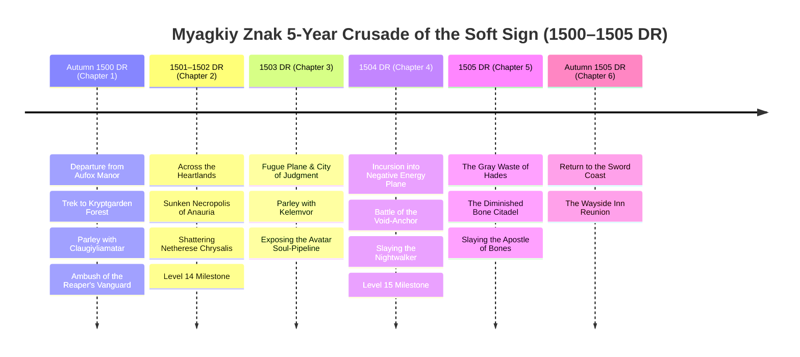

# 🕊️ The Shepherd of the Quiet Grave: The Saga of Myagkiy Znak

> **Chronicle Navigation:** ⬅️ **Previous:** [[07b - Bridge - Tvyordiy - The Breath of the Boundless Sky|07b: The Breath of the Boundless Sky]] | 🏠 [[The Order of Znak Complete Campaign Chronicle|Campaign Chronicle Hub]] | ⬆️ [[07 - Epilogue - Bridge Campaign|Epilogue Overview]] | ➡️ **Next Generation:** [[The Acolytes of Znak Campaign Plan|The Acolytes of Znak]]

---

*What [[Myagkiy Znak]] did across five years of solitary crusade (1500–1505 DR), hunting down the surviving cabals of Myrkul, terminating attempts to cultivate a new Chosen or Avatar of Death, and walking the planes until the gathering at the [[Wayside Inn]].*

When [[The Order of Znak]] scattered following five peaceful winters in [[Leilon]], they did not march under banners or sound trumpets. They dispersed like seeds caught in an autumn gale. [[Tvyordiy Znak]] had turned east toward the High Forest and the Star Mounts to seek his ancestral bloodline in the open skies. [[Krageer Stoneface Ogolakanu]] had turned north into the frozen crags with [[Cooragh]], carrying his seasoned iron skillet and a heart at peace. 

For [[Myagkiy Znak]], the road led southward down the High Road—clad in the polished, consecrated plate armor of fallen hero [[Dayne Preadhun]], his dark hair neatly tied back with strands of iron-grey touching his temples, and the flanged steel head of ***Bonecounter*** resting quiet at his belt. 

He was twelve years older than the solitary hermit who had once wandered the Dessarin Valley tending flocks of sheep. Yet beneath the tempered steel of his breastplate, the pulse of the Soft Sign—$\mathbf{Ь}$—beat with unyielding clarity: that which preserves life must also stand sentinel against the rot that would mock it.

---

## 🗺️ Campaign Pacing & Five-Year Chronicle Map (1500–1505 DR)

---

## Chapter 1: The Dragon's Debt & The Reaper of the Triad

*Table Session: November 15, 2026*  
*In-Game Setting: Autumn, 1500 DR (The Year of the Sea's Secrets Revealed)*  
*Location: Aufox Manor (Leilon) ➔ The High Road ➔ Deeping Cave (Kryptgarden Forest)*

---

### 🌅 Scene 1: The Dawn Departure from Aufox Manor

The autumn mist lay thick and silver over the mud flats of [[Leilon]]. Dawn was little more than a pale violet bruise along the ridge of the Sword Mountains when the heavy iron latch of the kitchen door clicked open.

Inside the great hall of [[Aufox Manor]], the peat fire burned low in the hearth. Upon the long pine table sat a neat stack of parchment: trade receipts from the quayside, salt-pork manifests from the [[Wayside Inn]], and a brass ring holding four iron keys.

Majordomo [[Leopold]] stood beside the hearth, a steaming ceramic mug of chicory tea cradled in his hands. He wore his woolen steward’s vest, his spectacles perched low on his nose, but his posture was that of a soldier who had spent half a lifetime watching commanders prepare for war.

"The carriage horses are fed, Master Myagkiy," Leopold said, his voice quiet so as not to wake the upper floor. "Though I know well enough you intend to walk."

Myagkiy tightened the leather cinch of his left gauntlet. Dayne's +2 plate armor was immaculate; dwarven smiths in Mirabar had etched Gond’s cog and Lathander’s rising sun across the polished pauldrons, while the silver medallion of the Life Domain hung heavy against his gorget. Over his shoulders rested the crimson velvet of the *Cape of the Mountebank*, shedding the chill damp of the coastal air.

"A horse makes a man look like a lord who has places to be," Myagkiy replied, his gravelly Slavic cadence calm and even. "A cleric on foot looks like a traveler who has time to listen. In the hamlets of the south, the folk speak to walkers. To horsemen, they only tip their caps and hide their meal-sacks."

He reached into his tunic and drew out an iron talisman carved with the rune **Ь**. He set it beside the keys on the table.

"The seal to the hearth," Myagkiy said, gesturing downward toward the floorstones. "Fifteen feet down in the granite bedrock, the vault is sealed. Thirty days of *Stone Shape* left no door, no seams, no hinges. If the town ever faces siege, or if the acolytes require the platinum reserves, remember: mundanely, a pickaxe will only break against it. Only a scroll of *Meld into Stone* will let you pass the threshold. Keep it secret, Leopold. Even from Sergeant Yorrum."

Leopold dipped his head with formal gravity. "The ledgers will balance to the copper, sir. As they always have."

Soft footfalls sounded on the timber stairs. 

[[Burnice Znak]], now twenty summers, stood on the bottom landing. She wore her fitted leather practice doublet, her dark hair pulled back in a warrior's braid, her grey eyes sharp with unshed emotion. Behind her padded broad-shouldered [[Smithwell Znak]], buttoning his heavy wool coat, followed by sixteen-year-old [[Yasmina]], her emerald lizardfolk crest flushed in the morning chill.

"You're slipping out like a thief," Burnice said, crossing her arms over her chest, trying to maintain her hardened guard. "Tvyordiy left two tendays ago under the full moon, and now you think you can slip out before porridge?"

Myagkiy looked upon the three of them. A faint, tender smile creased the corners of his dark eyes, where streaks of grey touched his dark temples—twelve years of sweat and blood since he had first pulled Burnice and Smithwell shivering from the kraken's mud in the coastal sloughs.

"A thief takes what is not his," Myagkiy said softly, taking three paces across the flagstones. "I leave behind everything that matters."

He placed a heavy, armored gauntlet on Burnice’s shoulder. She swallowed hard, broke her stern composure, and threw her arms around the cold silver steel of his breastplate, burying her face into his crimson cape. Myagkiy held her firmly, placing his other hand on Smithwell’s broad shoulder as the young man stepped forward, his jaw tight with restrained grief.

"Remember what I taught you both," Myagkiy murmured in their ears. "A sword is only an iron tooth. It bites whoever holds it with hatred. But the hand that binds the wound—that is the hand that builds the world. When Tvyordiy returns from the east, train with his disciples. Listen to his proverbs. And when you look upon the people of Leilon, see them as your own blood."

Yasmina approached silently, pressing her scaled snout against Myagkiy’s right gauntlet. From her courier satchel, she drew a rolled piece of heavy vellum tied with braided blue twine.

"For the road, Father Myagkiy," she whispered in her sibilant, musical voice. "So you remember us when the woods grow dark."

Myagkiy untied the cord and unfurled the parchment. It was a charcoal and ink wash sketch: the triangular roofline of Aufox Manor, the training pells in the courtyard, and the five of them standing together beneath the newly raised marble spire of the *Temple of the Gods*.

"A masterwork," Myagkiy breathed, carefully rolling it and tucking it into his waterproof leather scroll case. "Better than the portraits of Waterdeep archmages."

He embraced them each once more, turned on his heel, and stepped out into the courtyard.

The morning air smelled of crushed pine and sea brine. Crossing the gravel dojo, Myagkiy paused at the heavy timber palisade gate. He reached out his bare fingers, touching the smooth granite paver embedded beneath the archway. Beneath his calloused skin, the latent abjuration magic pulsed with faint celestial warmth—the dormant *Symbol of Stunning* he had inscribed with diamond ink.

To the north, rising above the wooden rooftops of Leilon, the white unmortared marble of the **[[The Temple of the Twin Signs|Temple of the Gods]]** gleamed like a newly fallen star. Two acolytes of Lathander were climbing the portico stairs, their brass censers sending thin ribbons of lavender frankincense into the twilight air. Beneath his heavy boots, the earth itself hummed with the permanent frequency of the *Forbiddance* grid—four sectors, four shield-walls, holding forty thousand square feet of town and hearth safe against the crawling dark.

"The house is guarded," Myagkiy whispered to the morning wind. 

He tightened his pack, swung ***Bonecounter*** comfortably against his hip, and stepped through the northern gate onto the High Road.

---

### 🌲 Scene 2: The 120-Mile March to Kryptgarden Forest

For six tendays, the High Road was Myagkiy's monastery.

He marched south through the sodden, moss-draped skirts of the Sword Mountains. Autumn was bleeding into early winter; the roadside birches stood stripped and skeletal against grey, leaden skies, while cold drizzle turned the wagon ruts into brown, sucking mud. 

Along the road, he avoided the grand caravans and merchant outriders, choosing instead to lodge with charcoal burners, roadside trappers, and tenant farmers. Where fever had taken a child, he cast *Lesser Restoration* and left loaves of flatbread. Where an old carter lay crippled by cold rot in his knees, he channeled the radiant warmth of Gond and Lathander, taking only a bowl of salted cabbage in return.

At night, beneath the shelter of a canvas lean-to propped against pine boughs, Myagkiy systematically enacted his ritual divinations.

#### 📜 The Legend Lore Encampment (Mid-Autumn 1500 DR)
*Casting: 5th-Level Divination (10 minutes)*  
*Components: 4 reusable ivory strips (200 gp focus), 1 block of rare frankincense & myrrh (250 gp consumed)*

Seated cross-legged upon a dry wool blanket, Myagkiy placed four polished strips of ivory upon the flat face of his +2 shield. Striking an iron flint, he touched flame to the resinous incense block. Thick, grey-violet smoke spiraled into the canvas roof, smelling of bitter cedar and ancient libraries.

Closing his eyes, Myagkiy held his holy symbol between his palms and intoned the prayer of boundless memory:

> *"O Lord of the Forge and Master of the Morning, let the stone remember what the flesh has forgotten. Reveal to thy servant the root of the rot that gnaws at Boareskyr and Leilon. Show me the thread of Myrkul."*

The smoke did not disperse in the night draft; it coalesced into swirling, shadowy glyphs before his mind's eye:

* **The Vision of Boareskyr Bridge:** He saw the cataclysm of the Time of Troubles—the mortal god of death, Myrkul, standing upon the blackened bridge over the Winding Water, blasted into ash by Midnight and Cyric. But death does not rot neatly. His broken essence had splintered into artifacts—the *Crown of Horns*, the scattered shrines of the Black Hand—before gathering in the bleak, twilight gloom of **Oinos**, the first layer of the **Gray Waste of Hades**. There, within a rotting citadel made of pulverized ribs and crushed skulls, the diminished Reaper hungered.
* **The Avatar Imperative:** Deprived of full divinity, Myrkul could not manifest at will. Like a parasite seeking blood, his power required mortal chrysalises—vessels steeped in atrocity and consecrated in ancient crypts. The vision whispered names from the deep past: the necrotic kings of fallen **Netheril**, the sunken sarcophagi of **Anauria**, and the warlords who sought to harvest the stolen souls of the Faithless.
* **The Living Shadow:** Finally, the smoke formed the image of a massive ancient green dragon perched atop a mountain of bones, surrounded by floating crystal scrying spheres, her yellow eyes gleaming with wicked, reptilian amusement.

Myagkiy exhaled. The incense burned down to ash. 

He opened his eyes. The night was dead silent, save for the hoot of a hunting owl in the canopy.

"Old Gnawbones," Myagkiy murmured, wiping the cold sweat from his brow. "She knows who paid Mortus. And she owes me her life."

On the forty-second morning of his pilgrimage, the High Road bent eastward toward the River Mirar, and the dark, towering wall of **Kryptgarden Forest** loomed against the horizon.

---

### 🐉 Scene 3: The Audience in Deeping Cave

Kryptgarden was not a forest of merry green leaves. It was an ancient, primeval swamp-wood choked with weeping willows, hanging curtains of grey Spanish moss, and ancient oak boles as thick as watchtowers. The air was thick with the reek of damp loam, stagnant water, and the pungent, vinegar tang of concentrated green dragon musk.

Myagkiy walked without stealth. His plate armor clinked with each deliberate stride, the tip of *Bonecounter* tapping rhythmically against the protruding roots. He did not bear a drawn weapon, but the holy aura of the Life Domain shimmered faintly around his shoulders—a golden corona holding the choking forest miasma ten paces from his lungs.

After half a day’s march into the deep interior, the marshy earth rose into broken limestone crags. A yawning, jagged chasm opened in the side of a moss-covered cliff—the entrance to **Deeping Cave**.

Inside, the light died. 

The cavern was vast, cathedral-like, and profoundly silent. Cascades of cold subterranean water dripped from stalactites into black pools. But the most striking feature was not the stone: floating throughout the cavern air at various heights were dozens of glowing, translucent **crystal spheres**—scrying orbs ranging in size from an apple to a carriage wheel, refracting eerie visions of castles, crossroads, city markets, and distant mountain passes.

From the high, shadowed vault above, a colossal bulk shifted.

The scraping of massive emerald scales against stone reverberated like grinding boulders. A draft of hot, sickeningly sweet gas washed over Myagkiy—chlorine and rotting meat.

Down from the cavern shadows slithered **[[Claugiyliamatar]]**—the ancient green wyrm known across the North as **Old Gnawbones**. Her body was eighty feet of sinuous, muscular horror, her ridge-scales encrusted with dried mud, calcified lichen, and bone fragments. Around her neck hung heavy chains of gold and electrum, each link studded with scrying crystals that chimed softly as she moved.

She descended until her massive, horned snout hovered three feet above Myagkiy’s head. Her vertical, slit-pupil eyes—ancient, wicked, and brimming with terrifying intellect—fixed upon the solitary cleric.

"A cleric of Leilon," Claugiyliamatar hissed, her voice like grinding millstones wrapped in silk. A wisp of pale green gas curled from her nostrils, sizzling harmlessly against Myagkiy’s *Aura of Protection*. "Walking alone into my deep belly without an army, without gold tributes, and without trembling. Have you forgotten whose forest this is, little bird?"

Myagkiy did not blink. He stood firm, resting his gauntlets on the pommel of his mace, his dark eyes meeting hers with the absolute calm of a priest who had looked into the face of gods.

"I have not forgotten the forest, Wyrm of the Crags," Myagkiy spoke, his resonant baritone filling the vault. "And I have not forgotten the sky above Leilon three summers ago, when the shadow of [[Ebondeath]] seized your flesh, broke your will, and turned your fangs against the innocent."

The dragon’s crest bristled with sudden, violent fury. A low, vibrating growl rumbled deep in her gullet, shaking loose stone from the cavern roof:

"You dare speak of the shadow-worm in *my* lair?!"

"I speak of the truth," Myagkiy replied calmly. "When Ebondeath wore you like a glove, it was not the Lords' Alliance who drove him out. It was not Lord Neverember’s gold. It was [[The Order of Znak]] that shattered the dragon-wraith's hold, broke his necrotic tether, and gave you back your mind, your hoard, and your throne."

He took one measured step forward, the steel of Dayne's plate ringing against the limestone flagstones.

"In the code of dragons, a life debt is not paid with coins. It is paid with honor. I have walked one hundred and twenty miles south not to beg, Claugiyliamatar. I have come to collect."

For five agonizing heartbeats, the cavern was dead still. Claugiyliamatar bared two rows of serrated, dagger-sharp teeth, her tail lashing the water in the cavern pool with a sound like a thunderclap. 

Then, slowly, her wicked jaws curved into a terrifying, sibilant grin. A dry, rattling chuckle echoed from her throat:

"The Soft Sign," she purred, her tongue darting out to taste the air. "Soft in name, but rock-hard in bone. Tvyordiy’s brother speaks with an unbending tongue. Very well, priest. Old Gnawbones honors her debts. What does the wandering cleric seek from the scrying web of Kryptgarden?"

"Ularan Mortus is dead," Myagkiy said, his voice tightening. "The Ruinstone is sealed. But Mortus did not forge those necrotic engines alone. His gold, his ships, and his death-knights were supplied from afar. Who backed him? And who seeks to rise in his place?"

Claugiyliamatar reared her head back, raising one massive front talon. With a flick of her claws, three floating crystal spheres drifted through the air, aligning themselves between them:

"Mortus was a pawn," the dragon whispered, gazing intently into the violet-swirling depths of the center orb. "A bloated carrion beetle sent west to fetch a jewel. His patrons sit far across the world, beneath the suffocating sands of the **Anauroch Desert**."

The surface of the crystal cleared, revealing a haunting vision: vast dunes of red sand burying the ruined step-pyramids of an ancient civilization.

"**Anauria**," Myagkiy murmured, recognizing the runes from his *Legend Lore*. "The successor kingdom of Netheril."

"The Netherese who refused to die," Claugiyliamatar chuckled coldly. "Ancient arch-liches who slumber beneath the dunes. When Mortus failed to deliver Leilon’s Ruinstone, their grand design did not stop. They turned their gaze to a living butcher."

The second crystal orb flared with jagged crimson fire. 

In the reflection stood an eight-foot armored warlord clad in blackened plate wrought from serrated bone, wielding a jagged, two-handed executioner's greatsword wrapped in necrotic frost. Behind him, dozens of cultists knelt before an altar of crushed skulls, while caged human prisoners were drained of life-blood to fuel a pulsing, purple chrysalis:

"**Vaelen the Grave-Sworn**," Claugiyliamatar hissed. "A renegade death-knight who calls himself the *Reaper of the Triad*. He has rallied Mortus’s scattered remnants across the Heartlands. He has made blood-pacts with the Anaurian liches. Even now, his vanguard marches to harvest souls along the Triboar Trail and the upper Delimbiyr, preparing a vessel to birth a new **Avatar of Myrkul**."

The third crystal drifted forward, showing a rocky forest ravine at the eastern boundary of Kryptgarden—barely ten miles from where they stood. Six heavily armored figures bearing the white skull emblem of Myrkul were establishing a barricaded camp over a desecrated shrine.

"His vanguard scouts your movements, priest," the dragon whispered, her eyes gleaming with malice. "They knew you departed Leilon. They lie in wait at the **Weeping Stone Crossing** to take your head and present it to Vaelen as a consecration gift."

Myagkiy reached down, unclasping ***Bonecounter*** and rolling the heavy mace in his gauntlet. The flanged steel head caught the green luminescence of the cavern with quiet, deadly weight.

"Then they have saved me the trouble of tracking them," Myagkiy said. He bowed slightly from the neck—not in submission, but in the formal respect of an equal who had concluded a covenant. "The debt is acknowledged, Claugiyliamatar. We are square."

"Go then, Shepherd of the Quiet Grave," the ancient wyrm hissed, melting back into the darkness of the cavern ceiling. "Kill the reaper’s curs. And when you march east to Anauria... bleed the liches dry. They never paid me for their crystal bowls."

---

### ⚔️ Scene 4: Ambush at the Weeping Stone Crossing

#### 🎲 Tactical Setup & The Ambush

The rain had turned into sleet as Myagkiy emerged from the crags of Kryptgarden onto the eastern river trail. The **Weeping Stone Crossing** was an ancient stone bridge spanning a swollen, blackwater torrent that fed into the Delimbiyr. 

At the center of the bridge stood an ancient elven shrine, now desecrated: the marble nymph statue was smashed, its torso replaced by a goat’s skull smeared in fresh crimson gore.

Hiding among the boulders and dripping gorse bushes were six operatives of the Reaper’s vanguard:
* **Malkor the Bone-Render** — Cult Fanatic Commander (Level 8 Death Priest, armed with a necrotic scythe).
* **2× Myrkulite Death-Wights** — Heavily armored wights wielding longswords and *Life Drain*.
* **3× Dread Cultists** — Fanatic shock troops armed with heavy crossbows and poisoned flails.

Myagkiy did not walk onto the bridge blindly. 

Sixty paces out, he cast ***Death Ward*** (4th-level, 8-hour duration) upon himself, his holy symbol glowing with gold-white brilliance as an invisible mantle of divine vitality enveloped his armor.

#### 🎲 Initiative Rolls

| Init | Combatant | HP | AC | Position & Status |
| :---: | :--- | :---: | :---: | :--- |
| **18** | **Myagkiy Znak (Ь)** | 107 / 107 | 24 | Dayne's +2 Plate, +2 Shield, Death Ward active |
| **14** | **Malkor the Bone-Render** | 65 / 65 | 16 | Bridge shrine, scythe primed |
| **11** | **Myrkulite Death-Wights (2)** | 45 / 45 ea | 17 | Flanking boulders at bridgehead |
| **8** | **Dread Cultists (3)** | 33 / 33 ea | 14 | Crossbow perches in the gorse |

---

#### 🌪️ Round 1: The Circle of Radiance

Winning initiative (`d20: 16 + 2 = 18`), Myagkiy advanced forty feet down the slick stone road, slamming his +2 shield against his breastplate.

"Servants of the Lord of Bones!" Myagkiy's baritone boomed across the roaring water. "Your master fell at Boareskyr! His crown is broken! Turn back to the earth, or answer to the Light that unbinds all graves!"

With his action, Myagkiy burned a **4th-level spell slot** to cast ***Spirit Guardians***!

A blinding hurricane of celestial radiant spirits—taking the spectral form of soaring silver herons and golden doves refracting the dawnlight of Lathander—erupted in a 15-foot radius sphere around him. 

* The three **Dread Cultists** and two **Death-Wights** were caught in the 15-foot radius!
* *WIS Save (DC 18):*
  * Cultist 1: `d20 (7) + 1 = 8` ➔ **FAILED!** Takes **`22 radiant damage`**! *(HP: 11 / 33)*
  * Cultist 2: `d20 (14) + 1 = 15` ➔ **FAILED!** Takes **`22 radiant damage`**! *(HP: 11 / 33)*
  * Cultist 3: `d20 (18) + 1 = 19` ➔ **PASSED!** Takes half: **`11 radiant damage`** *(HP: 22 / 33)*
  * Death-Wight 1: `d20 (6) + 2 = 8` ➔ **FAILED!** Vulnerable to radiant! Takes **`44 radiant damage`**! *(HP: 1 / 45)*
  * Death-Wight 2: `d20 (9) + 2 = 11` ➔ **FAILED!** Vulnerable to radiant! Takes **`44 radiant damage`**! *(HP: 1 / 45)*
* *Difficult Terrain:* The spectral tempest halved the movement speed of all hostiles within the radius!

Enraged, **Malkor the Bone-Render** pointed his gnarled scythe at Myagkiy:

"The Soft Sign dies here! Bleed him for Lord Vaelen!"

Malkor burned a 3rd-level slot to cast ***Bestow Curse***, lunging forward with necrotic tendrils:
* Melee Spell Attack: `d20 (14) + 6 = 20` vs AC 24 ➔ **MISS!** The cursed scythe struck Dayne's consecrated +2 shield and glanced off in a shower of holy sparks!

The two crippled **Death-Wights**, their rotting flesh smoking and sizzling under the radiant aura, lunged forward with two-handed longswords:
* Wight 1 Attack: `d20 (15) + 4 = 19` vs AC 24 ➔ **MISS!** Deflected by Myagkiy's gauntlet.
* Wight 2 Attack: `d20 (18) + 4 = 22` vs AC 24 ➔ **MISS!** Skittered off his steel pauldron.

From the rocks, the three **Dread Cultists** dropped their crossbows, drew barbed flails, and charged into melee:
* Flail Attack 1: `d20 (19) + 4 = 23` vs AC 24 ➔ **MISS!**
* Flail Attack 2: `d20 (6) + 4 = 10` vs AC 24 ➔ **MISS!**
* Flail Attack 3: `d20 (11) + 4 = 15` vs AC 24 ➔ **MISS!**

*Myagkiy's 24 AC remained completely impenetrable!*

---

#### 🔨 Round 2: The Harvest of Bonecounter

At the start of Round 2, the five enemies within the *Spirit Guardians* aura took another round of radiant damage:
* Cultist 1 & 2 took `18 radiant damage` ➔ **INCINERATED!** Their bodies collapsed into clean, fragrant white ash.
* Wight 1 & 2 took `36 radiant damage` ➔ **VAPORIZED!** The foul necromantic ties were burned away into pure light.
* Cultist 3 took `18 radiant damage` ➔ Collapsed dying into the mud *(HP: 4 / 33)*.

Only **Malkor the Bone-Render** stood on the bridge, his scythe trembling in his skeletal hands as the radiant herons swirled around him.

Myagkiy stepped forward, his boots ringing like iron bells against the bridge cobbles. 

He raised ***Bonecounter***. The heavy flanged steel head began to glow with golden, solar fury as he channeled **Divine Strike** (+1d8 radiant):

* **Bonecounter Melee Attack:** `d20 (17) + 9 = 26` vs AC 16 ➔ **CRITICAL HIT THRESHOLD — HIT!**
  * *Damage:* `1d6 + 4 (STR)` + `1d8 (Divine Strike)` = `6 + 4 + 7 = 17 bludgeoning and radiant damage`!
  * *Impact:* The heavy flanged mace shattered Malkor's shoulder, smashing him backward onto the flagstones. *(Malkor HP: 48 / 65)*

As a Bonus Action, Myagkiy cast a **2nd-level Spiritual Weapon**, manifesting a glowing silver warhammer bearing the Cyrillic mark **Ъ** above Malkor’s head:
* *Spiritual Weapon Attack:* `d20 (15) + 9 = 24` vs AC 16 ➔ **HIT!**
  * *Damage:* `1d8 + 4 = 8 force damage`! *(Malkor HP: 40 / 65)*

Terrified, Malkor scrambled backward through the mud, attempting to disengage and sprint toward the riverbank:

"Vaelen will rip your soul from your skin, cleric! Anauria has already forged the chrysalis!"

Myagkiy did not pursue with haste. He simply raised his left hand, pointing the Sunburst Medallion at the fleeing cultist’s back, and burned a **3rd-level spell slot** to cast ***Guiding Bolt***:
* Ranged Spell Attack: `d20 (18) + 9 = 27` vs AC 16 ➔ **DIRECT HIT!**
* Damage: `6d6 radiant` = `4 + 5 + 6 + 3 + 5 + 4 = 27 radiant damage`! *(Malkor HP: 13 / 65)*

The blast of divine sunlight lifted Malkor off his feet, flipping him through the air. He hit the stone balustrade and slumped to the ground, his scythe clattering into the raging torrent below.

---

### 🩸 Scene 5: The Interrogation & The Road to Anauroch

The rain slackened to a gentle mist. The smell of ozone and burnt sulfur hung over the bridge, cleansed by the sweet floral fragrance of the *Spirit Guardians* as Myagkiy dismissed the spell.

Myagkiy walked slowly to where Malkor lay wheezing against the parapet, his black robes scorched to rags. The cultist clutched his crushed ribs, his eyes wide with feverish terror as the towering cleric looked down upon him.

"Mercy..." Malkor choked out, blood bubbling at the corner of his lips. "You... you follow the Soft Sign... your god preaches mercy..."

Myagkiy knelt on one knee in the wet gravel. He reached out with his gauntleted hand, his fingers touching Malkor’s throat. A soft pulse of *Spare the Dying* closed the tearing artery, steadying the cultist’s rattling breath:

"The Soft Sign preserves life, cultist," Myagkiy said, his voice dropping to a low, sorrowful whisper that carried the gravity of a tomb. "It softens the blow. It binds the bone. But it does not tolerate the parasite that would feed upon the corpse of the innocent."

He reached inside Malkor’s leather vest and pulled out a heavy parchment map sealed with black wax stamped in the shape of a crowned human skull.

Breaking the seal, Myagkiy unrolled the map across his knee. 

Drawn in crimson ink were trade roads cutting east across the Heartlands: through the **Starmetal Hills**, past the ruins of **Hlondeth**, cutting north of the High Moor toward the western edge of the **Anauroch Desert**. Marked in the sunken dunes south of the Black Road was a cluster of three inverted pyramids labeled in archaic Netherese script:

> ***"The Chrysalis of the Bone-Sworn — The Siphon of Anauria."***

"Vaelen..." Malkor whispered, shivering violently as the fever took hold. "He has already taken three merchant caravans into the sand... eighty souls... their blood fills the basalt basins... when the eclipse comes next winter, the Anaurian lords will open the Negative Gate... Myrkul will walk the world in Vaelen's flesh..."

Myagkiy folded the map carefully and tucked it inside his leather haversack. He stood to his full height, looking eastward toward the jagged grey peaks of the horizon.

"A king who hides beneath the sand is not a god," Myagkiy said quietly. "He is only a corpse afraid of the sun."

He turned back to the groaning cultist:

"Walk west, Malkor. Take the road to the Wayside Inn. Tell Cooragh and Martisha you are a broken man seeking honest work with an axe in the wood-yard. If you ever speak the name of Myrkul again, the herons will find you."

Leaving the weeping cultist behind on the bridge, Myagkiy stepped over the blackened threshold stones and began his long march east toward the sands of Anauroch.

---

## 📊 End-of-Chapter Resource & Progress Ledger

### 🧙‍♂️ Character Status (Autumn 1500 DR)
* **Level:** 13 Life Domain Cleric (5.0 Ruleset)
* **Hit Points:** 107 / 107 HP
* **Armor Class:** 24 (Dayne's +2 Plate Armor, +2 Shield)
* **Spell Slots Expended:**
  * 1st Level: `0 / 4`
  * 2nd Level: `1 / 3` (*Spiritual Weapon*)
  * 3rd Level: `1 / 3` (*Guiding Bolt*)
  * 4th Level: `2 / 3` (*Death Ward*, *Spirit Guardians*)
  * 5th Level: `1 / 2` (*Legend Lore*)
  * 6th Level: `0 / 1`
  * 7th Level: `0 / 1`
* **Consumables Expended:**
  * 1× block of rare frankincense & myrrh (250 gp) consumed for *Legend Lore*.
  * Remaining: 2× 250 gp incense blocks, 2× 300 gp diamonds, 1× 500 gp diamond, 4 reusable ivory strips.
* **Liquid Funds:** 943 pp | 14,954 gp | 40 ep | 1,600 sp | 50 cp.
