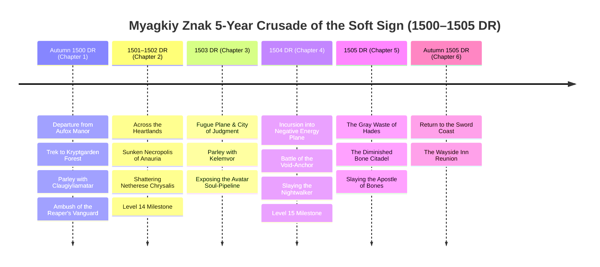

# 🕊️ The Shepherd of the Quiet Grave: The Saga of Myagkiy Znak

> **Chronicle Navigation:** ⬅️ **Previous:** [[07b - Bridge - Tvyordiy - The Breath of the Boundless Sky|07b: The Breath of the Boundless Sky]] | 🏠 [[The Order of Znak Complete Campaign Chronicle|Campaign Chronicle Hub]] | ⬆️ [[07 - Epilogue - Bridge Campaign|Epilogue Overview]] | ➡️ **Next Generation:** [[The Acolytes of Znak Campaign Plan|The Acolytes of Znak]]

---

*What [[Myagkiy Znak]] did across five years of solitary crusade (1500–1505 DR), hunting down the surviving cabals of Myrkul, terminating attempts to cultivate a new Chosen or Avatar of Death, and walking the planes until the gathering at the [[Wayside Inn]].*

When [[The Order of Znak]] scattered following five peaceful winters in [[Leilon]], they did not march under banners or sound trumpets. They dispersed like seeds caught in an autumn gale. [[Tvyordiy Znak]] had turned east toward the High Forest and the Star Mounts to seek his ancestral bloodline in the open skies. [[Krageer Stoneface Ogolakanu]] had turned north into the frozen crags with [[Cooragh]], carrying his seasoned iron skillet and a heart at peace. 

For [[Myagkiy Znak]], the road led southward down the High Road—clad in the polished, consecrated plate armor of fallen hero [[Dayne Preadhun]], his dark hair neatly tied back with strands of iron-grey touching his temples, his heavy mace ***Bonecounter*** stowed quiet at his pack, and his hands open to the road.

He was twelve years older than the solitary hermit who had once wandered the Dessarin Valley tending flocks of sheep. Yet beneath the tempered steel of his breastplate, the pulse of the Soft Sign—$\mathbf{Ь}$—beat with unyielding clarity: that which preserves life must also stand sentinel against the rot that would mock it.

---

## 🗺️ Campaign Pacing & Five-Year Chronicle Map (1500–1505 DR)

---

## Chapter 1: The Dragon's Debt & The Reaper of the Triad

*Table Session: November 16, 2026*  
*In-Game Setting: Autumn, 1500 DR (The Year of the Sea's Secrets Revealed)*  
*Location: Leilon Crossroads ➔ The High Road ➔ Deeping Cave (Kryptgarden Forest)*

---

### 🌅 Scene 1: The Parting of the Signs at the Crossroads

The morning air bit with the clean, sharp chill of early northern frost. A low white ground-mist drifted across the salt meadows, curling around the weathered timbers of the roadside ditches outside [[Leilon]].

Behind them, the palisade gates stood open. High upon the timber walkway, four familiar silhouettes watched in silence: [[Leopold]], his spectacles catching the first pale glint of dawn; broad-shouldered [[Smithwell Znak]] with his arms resting against the logs; [[Burnice Znak]], standing tall in her cuirass; and young [[Yasmina]], her dark hair and traveling cloak whipping in the coastal wind. Just beyond the rooftops, the unmortared white marble spire of the newly raised **[[The Temple of the Twin Signs|Temple of the Gods]]** caught the dawn light like a tranquil beacon above the town.

[[Myagkiy Znak]] and [[Tvyordiy Znak]] had walked down the cart-track together, their boots crunching side by side in the gravel. 

At the fork outside the ditch, where the High Road divided—the northern trail running toward the [[Wayside Inn]], and the southern branch winding down along the coast toward the gloom of Kryptgarden Forest—Tvyordiy came to a halt.

The veteran Aarakocra adjusted the coarse friar's cowl of his *Hat of Disguise*, settling the heavy hempen coils of rope and the traveling pack upon his shoulders. At sixteen summers, the silver frost touching his crest feathers marked him as an elder among his short-lived kin. 

He turned to face Myagkiy. His golden raptor eyes were deep, unblinking, and serene, carrying the quiet gravity of sixteen years of shared blood, bread, and brotherhood since that freezing alleyway in Waterdeep. 

He raised a scarred, feathered forearm in the traditional warrior's clasp, waiting for Myagkiy’s grip:

> *"The road forks here, brother,"* Tvyordiy rumbled softly in his deep, resonant baritone, his voice carrying clear above the keening autumn wind.  
> 
> *"I turn my face to the high country of the east; you turn yours to the quiet graves of the south. We do not know where these trails will take us, or when the wind will bring us back through these gates. But the Sign holds. When iron meets stone, it remembers. Watch your back in the wild places, Myagkiy. Walk with the light."*

Myagkiy clasped his brother's forearm, the steel of Dayne’s gauntlet locking firm against Tvyordiy's feathers:

> *"Brother, we both go to fight some unseen demons that have haunted us since our epic victory five years ago. That we should all four of us be beckoned away, each in our own turn, must be kismet."*

Tvyordiy nodded solemnly, his golden eyes unblinking in the wind. Myagkiy continued:

> *"We have put, each in our own way, a mark or sign on Leilon which will protect it. If not for that, mayhap we would not be able to even make this journey. Keep and watch for the Znak, Tvyordiy. It will protect and guide you."*

As he turned to walk away, a faint, wry smile touched Myagkiy's dark beard:

> *"I promise not to preach to every brigand on the path. And for you, do not get turned around whilst turning over every stone searching for the path. As you would say: 'If you are facing the right direction, all you need to do is keep on walking'."*

Tvyordiy’s beak curved in an amused, knowing smirk. With a final nod that spoke louder than oaths, the Aarakocra turned north, his long strides carrying him up the rise. 

Myagkiy watched until his brother’s grey friar's robe was swallowed by the northern mist. Then, turning his back to the town he had helped rebuild, he faced south down the High Road.

---

### 🚶 Scene 2: The Pastoral Road & The Scrying Veil

For eight days, Myagkiy walked south at an unhurried, pastoral pace. 

He covered fifteen or sixteen miles between sunrise and dusk, letting the steady crunch of gravel set the rhythm of his prayers. He traveled in Dayne’s polished +2 plate armor—its silvered steel catching the pale autumn sun—but his weapons remained stowed. The heavy flanged head of ***Bonecounter*** was strapped securely behind his pack, and his +2 shield hung dormant across his shoulders. He walked with his hands open, looking not like a conqueror seeking battle, but like a shepherd walking the boundaries of a vast, quiet pasture.

Where he met carters hauling salt-fish or tenant farmers gathering late cabbage, he stopped to share cold cheese and hear the news of the road. The countryside was peaceful. The dragon terrors of Icespire and the storm-raids of Talos had faded into tavern songs. Yet beneath that pastoral tranquility, Myagkiy’s spirit was troubled by what had transpired in the quiet months before his departure.

Within the sanctum of the **[[The Temple of the Twin Signs|Temple of the Gods]]**, in the weeks leading up to the autumn equinox, Myagkiy had sought to pierce the veil. He had burned rare incense over his ivory strips, casting ***Legend Lore*** to gather the ancient names and deeds of Myrkul—learning of the Lord of Bones’ fall at Boareskyr Bridge, the lingering curse of the *Crown of Horns*, and the desperate hunger of his diminished spirit in the wastes of the Outer Planes.

Yet when Myagkiy had knelt before the consecrated altar of the Twin Signs, focusing his divine focus to cast ***Scrying*** upon the surviving Myrkulite cells, his magic had struck an impenetrable wall.

A being of light and radiant vitality, guided by the benevolent mandates of Gond and Lathander, could not pierce the necrotic shroud. The very nature of Myagkiy’s divine power acted as a beacon of metaphysical opposition: the evil will and dense spiritual rot surrounding Myrkul’s surviving faithful repelled holy divination like oil rejecting holy water. The shroud of death would not open to a righteous man.

It was that theological failure that had led Myagkiy to his deduction. 

If a creature of radiant good could not pierce the necrotic veil, he needed an instrument already steeped in that darkness. And along the Sword Coast, only one creature possessed both the means and the metaphysical attunement: **[[Claugiyliamatar]]**, the ancient green wyrm known as **Old Gnawbones**.

Deep within her cavern in **Kryptgarden Forest**, she kept dozens of floating crystal scrying spheres and her massive, living topographic map of the Sword Coast. More critically, Claugiyliamatar possessed an involuntary, terrifying connection to the Lord of Bones: during the siege of Leilon, she had been possessed, hollowed out, and inhabited by **[[Ebondeath]]**, the ancient dragon-wraith of Myrkul. Though the ghost had been exorcised, that harrowing violation had left its stain in her marrow—a lingering resonance tuned precisely to Myrkul’s frequency. Her own predatory, wicked nature would offer no moral resistance against scrying the cult.

And above all, Old Gnawbones was bound by an absolute debt of blood. 

When Ebondeath was driven from her flesh in the climax of *Divine Contention*, the green wyrm had crashed into the shattered timber and masonry of **Aubrey’s Peculiarities**, broken, bleeding, and trembling at death’s door. It was Myagkiy who had stepped forward through the smoke. Channeling the boundless vitality of the Life Domain, Myagkiy had laid his gauntlets upon her torn emerald scales, pouring high-circle healing magic into her shattered breast until her lungs filled with air and her wings found the strength to launch into the sky and limp back to her forest redoubt.

She owed him her life.

On the eighth afternoon of his trek, the rolling scrubland fell away. To the east, the towering, moss-draped canopy of **Kryptgarden Forest** rose like an ancient green wall against the slate-grey sky.

---

### 🐉 Scene 3: The Audience in Deeping Cave

*(Live Tabletop Session — Peter as Myagkiy Znak, Antigravity as DM)*  
*Location: Deeping Cave, Deep Interior of Kryptgarden Forest*

The air within Kryptgarden is cold, heavy, and rank with the stench of stagnant blackwater and decaying oak leaves. Moss hangs from the weeping willows like tattered burial shrouds, muting the sound of your boots as you leave the High Road and follow the rocky tracks east into the limestone crags.

A jagged cleft in a moss-slick cliff yawns open before you: the mouth of **Deeping Cave**.

You step inside. The daylight dies behind you.

The cavern is colossal, stretching into shadows where massive stalactites hang like inverted spires. The air is warm, humid, and carries the suffocating vinegar sting of concentrated green dragon musk and chlorine gas. But what catches your eye immediately are the **crystal spheres**: dozens of glowing, translucent scrying orbs of varying sizes float suspended in the cavern air, drifting lazily through the gloom, refracting shifting, silent glimpses of crossroads, castle courtyards, Waterdeep docks, and misty mountain passes.

High above in the dripping vaulted darkness, something colossal shifts. 

The sound of emerald scales scraping across wet limestone echoes like grinding boulders. A draft of hot, sibilant air washes over your armor. Down from the ceiling shadows, sinuous and terrifying, slithers **[[Claugiyliamatar]]**.

She is eighty feet of massive, corded reptilian muscle. Her ridge scales are encrusted with dried muck and river mud, and around her neck hang heavy electrum chains linking dozens of crystal scrying baubles that chime softly with her movements. She settles her massive fore-talons onto a flat ledge twelve paces away, lowering her horned, crocodilian snout until her yellow, vertical-slit eyes are level with yours.

Her nostrils flare, sniffing the damp air. A thin wisp of pale green gas curls from her lips, dissolving against the air ten feet from you. Her voice rumbles through your sternum like grinding stone:

> *"Dayne's armor... Gond's cog... and the scent of Leilon's hearth,"* Old Gnawbones hisses softly, her tongue flicking across her serrated teeth.  
> 
> *"The soft-spoken cleric of the Soft Sign walks into my belly with his weapons stowed upon his back. No army. No archers. Only the same quiet eyes that watched me bleed in the rubble of Aubrey's shop."*
> 
> Her yellow eyes narrow, glowing with predatory cunning:
> 
> *"You gave me back my sky when the black ghost broke my bones, Myagkiy Znak. A life for a life. A dragon does not forget her debts... but a dragon does not welcome guests who bring the stench of the grave on their boots.*
> 
> *Speak, cleric. What draws you from your temple to the dark pools of Kryptgarden?"*

***

**What does Myagkiy say to Old Gnawbones?**
